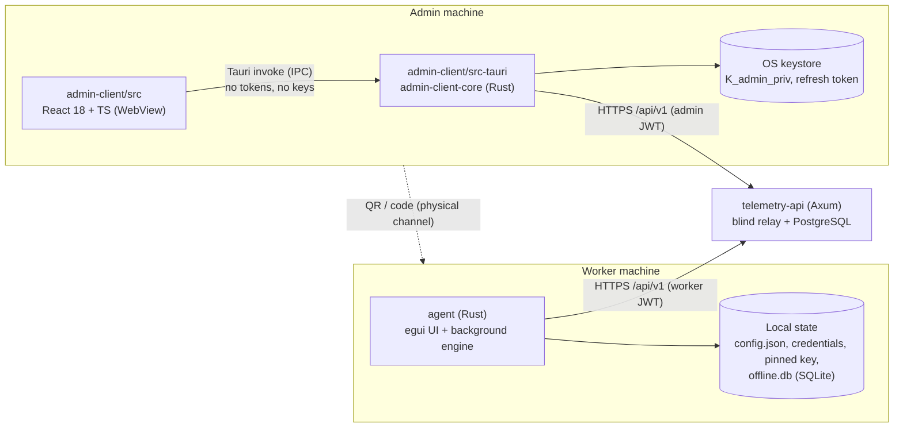

# Architecture

## 1. System context



Rules that shape everything:
1. **Only Rust talks to the API.** The WebView never calls `fetch` against the API and never sees a token or key. (The current `tauri-bridge.ts` browser fallback violates this — see `implementation-status.md`.)
2. **All crypto lives in `telemetry-crypto-core`.** Both apps depend on it; neither re-implements a primitive.
3. **The server is untrusted for integrity of keys and consent** — the agent verifies the enrollment commitment and pins the key.

## 2. Workspace

```
telemetry-apps/
├── Cargo.toml                 # workspace: telemetry-crypto-core, agent, admin-client/src-tauri
├── .cargo/config.toml         # release profile (LTO, strip, panic=abort), -D warnings
├── telemetry-crypto-core/     # library, no I/O, no async
├── agent/                     # worker app (bin)
├── admin-client/              # admin app (Tauri 2 + Vite/React)
│   ├── src/                   # UI
│   └── src-tauri/             # Rust backend (package admin-client-core)
├── docs/                      # functional specs + payload schemas
├── tasks/                     # implementation tasks
└── .ai-context/               # this folder
```

## 3. `telemetry-crypto-core`

| Module | Responsibility | Status |
|:-------|:---------------|:-------|
| `asymmetric.rs` | X25519 keypair gen, base64 encode/decode, ECDH (ephemeral & static). | Done |
| `kdf.rs` | HKDF-SHA256, `salt = "telemetry-v1"`, `info = "aes256gcm"`. | Done |
| `symmetric.rs` | AES-256-GCM, framing `nonce(12) ‖ tag(16) ‖ ct`. | Done |
| `lib.rs` | `encrypt_telemetry_batch<T: Serialize>`, `decrypt_telemetry_record<T>`, `EncryptedEnvelope`. | Done |
| `error.rs` | `CryptoError`. | Done |
| `enrollment.rs` | `EnrollmentManifest`, canonical serialization, `manifest_commitment`, `safety_code`, `public_key_fingerprint`. | **TASK-CRYPTO-02** |
| `backup.rs` | Passphrase-protected export/import of `K_admin_priv` (Argon2id + AES-256-GCM). | **TASK-ADMIN-01** (pending part) |

Constraints: pure functions, no filesystem/network, no `unwrap`, every secret in `Zeroizing<…>`.

## 4. `agent` (worker app)

### 4.1 Processes & threads

```
main thread ── eframe/egui event loop (UI only; never blocks on I/O)
   │  shared: Arc<AgentState>  (RwLock<Session>, RwLock<ServerView>, watch::Sender<RunMode>)
   │
   └── background thread ── tokio runtime
         ├── lifecycle task    GET /workers/me every 5 min + on 403 → updates ServerView/RunMode
         ├── scheduler task    starts/stops collectors when RunMode or effective flags change
         ├── collectors        one task/thread per enabled category (see table)
         ├── flush task        every WORKER_FLUSH_INTERVAL: drain buffer → group by category → encrypt → send/queue
         ├── queue drain task  backoff 2s→300s ±20% jitter; peeks SQLite FIFO
         └── notifier task     start-of-collection, hourly reminder, screenshot, work-hours edges
OS input hook thread ── only AtomicU64::fetch_add(Relaxed)
```

`RunMode` is derived, never set directly by the UI:

| RunMode | Condition |
|:--------|:----------|
| `Unenrolled` | No credentials / pinned key. |
| `AwaitingConsent` | Server status `PENDING_CONSENT`, or `consent_version > accepted_consent_version` with nothing accepted yet. |
| `Collecting(flags)` | Server status `ACTIVE` and effective flags non-empty. |
| `Paused` | Server status `PAUSED`. |
| `Halted(reason)` | Key fingerprint mismatch, refresh family revoked, or commitment failure. |

### 4.2 Target module layout

```
agent/src/
├── main.rs                  # bootstrap: tracing, state load, spawn runtime, run UI or --headless
├── state.rs                 # AgentState, RunMode, ServerView            (new)
├── config.rs                # non-secret settings (api_url, flush interval) (exists; to be split)
├── credentials.rs           # tokens + pinned key in OS keystore           (new, TASK-AGENT-08)
├── device.rs                # device_identifier + device_info              (exists)
├── enrollment.rs            # QR/code parsing, redeem, commitment check    (new; replaces ui/onboarding.rs)
├── errors.rs
├── notifications.rs
├── api/                     # typed client for every endpoint in api-contract.md (new; replaces io/transport.rs HTTP half)
├── core/
│   ├── buffer.rs            # MetricsBuffer, std::mem::take snapshot
│   ├── metrics.rs           # plaintext item structs (docs/telemetry-payloads.md)
│   └── collectors/          # system, keystroke, network, files, location, screenshot
├── pipeline/                # group-by-category, envelope building, OfflineQueue (SQLite)
├── background/              # runtime tasks listed above
└── ui/                      # egui screens: enrollment, consent, status, rights, diagnostics
```

### 4.3 Local storage

| Data | Where | Why |
|:-----|:------|:----|
| `api_url`, flush interval, UI prefs | `<config_dir>/telemetry-worker/config.json` | Non-secret. |
| access/refresh tokens | OS keystore (`keyring`, service `TelemetryWorker`) | Secret. |
| Pinned `K_admin_pub` + fingerprint + accepted manifest hash | OS keystore (same service) | Integrity-critical; not user-editable. |
| Offline queue | `<config_dir>/telemetry-worker/offline.db` | Contains **only ciphertext**. |

`<config_dir>` = `dirs::config_dir()`: `~/Library/Application Support` (macOS), `%APPDATA%` (Windows), `~/.config` (Linux).

## 5. `admin-client`

### 5.1 Layers

| Layer | Location | Owns |
|:------|:---------|:-----|
| UI | `admin-client/src/` | Screens, charts, forms. Holds **decrypted data only in component state**, dropped on lock. |
| IPC bridge | `admin-client/src/api/tauri-bridge.ts` | Typed wrappers over `invoke`. **No mocks in production builds, no direct `fetch` to the API.** |
| Commands | `admin-client/src-tauri/src/commands/` | One file per domain: `auth.rs`, `keys.rs`, `workers.rs`, `telemetry.rs`, `session.rs`. |
| API client | `src-tauri/src/client.rs` | Access token in RAM, refresh token in keystore, 401 → refresh → retry, unwraps `{ data }`. |
| Keystore | `src-tauri/src/keystore.rs` | `K_admin_priv`, refresh token. |
| Decryption | `src-tauri/src/commands/telemetry.rs` | Fetch pages → `rayon` parallel decrypt in `spawn_blocking` → verify inner `worker_id`/`category` → return typed items. |

### 5.2 Screens (details in `docs/admin-app-spec.md`)

Auth → Key vault (first run) → Workers (list, create, enrollment modal, detail with lifecycle actions & consent history) → Telemetry views (system, network, productivity, files, location) → Settings (API URL, auto-lock, backup) → Lock screen.

## 6. End-to-end data flow

1. Collector produces a plaintext item → `MetricsBuffer::push`.
2. Flush: `drain_for_flush()` → group by category → for each category build `PlaintextBatch { schema_version, category, worker_id, items }` → `encrypt_telemetry_batch(&batch, pinned_key)` → `EncryptedEnvelope`.
3. Send `POST /telemetry/{category}` with `{ records: [ { ephemeral_public_key, encrypted_payload(b64), client_timestamp } ] }` (productivity adds `subcategory`). On network/5xx/429 → SQLite queue. On 403 `WORKER_NOT_ACTIVE`/`CONSENT_NOT_GRANTED` → **drop** the envelope (never retry data the worker no longer consents to) and refresh `GET /workers/me`.
4. Admin: `GET /telemetry/{category}?worker_id=…&from&to&page` → decrypt in parallel → reject records whose inner `worker_id`/`category` don't match the row metadata → render.
