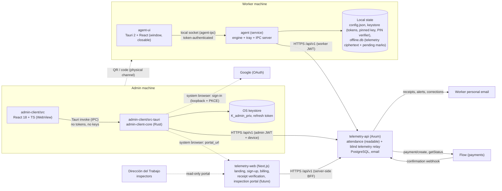

# Architecture

## 1. System context



Rules that shape everything:
1. **Only Rust talks to the API.** In the admin app, the WebView never calls `fetch` against the API. In the worker app, `agent-ui` never talks to the API at all: only the `agent` service does (PROC-03).
2. **All crypto lives in `telemetry-crypto-core`** (telemetry envelopes, key backup, enrollment commitment, attendance mark hash, legal document hash, PIN verifier).
3. **The server is untrusted for telemetry**: the agent verifies the enrollment commitment and pins the key. **For attendance the server is the legal record keeper** (it stamps and hashes); the agent keeps its own copy of what it sent and verifies receipt hashes (`security-model.md` §9).
4. **Attendance never depends on telemetry** (ATT-07) — separate modules in the service, separate screens, separate API paths.

## 2. Workspace

```
telemetry-apps/
├── Cargo.toml                 # workspace: telemetry-crypto-core, agent-ipc, agent, worker-client/src-tauri, admin-client/src-tauri
├── .cargo/config.toml         # release profile (LTO, strip, panic=abort), -D warnings
├── telemetry-crypto-core/     # library, no I/O, no async
├── worker-client/ipc/                 # protocol types + framing + client for the worker app IPC (new, AGENT-10)
├── agent/                     # worker background service (bin `telemetry-agent`): engine, tray, IPC server
├── worker-client/                  # worker window (Tauri 2 + Vite/React), package `agent-ui-core` (new, AGENT-11)
│   ├── src/                   # UI
│   └── src-tauri/             # thin Rust backend: IPC client only
├── admin-client/              # admin app (Tauri 2 + Vite/React)
│   ├── src/                   # UI
│   └── src-tauri/             # Rust backend (package admin-client-core)
├── docs/                      # functional specs, payload schemas, legal texts (docs/legal)
├── tasks/                     # implementation tasks
├── tools/orchestration/       # orchestrator scripts (Claude + agy), not part of the product
└── .ai-context/               # this folder
```

## 3. `telemetry-crypto-core`

| Module | Responsibility | Status |
|:-------|:---------------|:-------|
| `asymmetric.rs` | X25519 keypair gen, base64 encode/decode, ECDH (ephemeral & static). | Done |
| `kdf.rs` | HKDF-SHA256, `salt = "telemetry-v1"`, `info = "aes256gcm"`. | Done |
| `symmetric.rs` | AES-256-GCM, framing `nonce(12) ‖ tag(16) ‖ ct`. | Done |
| `lib.rs` | `encrypt_telemetry_batch<T: Serialize>`, `decrypt_telemetry_record<T>`, `EncryptedEnvelope`. | Done |
| `error.rs` | `CryptoError`. | Done |
| `enrollment.rs` | `EnrollmentManifest`, canonical serialization, `manifest_commitment`, `safety_code`, `public_key_fingerprint`, `EnrollmentQr` (`parse_payload` accepts base64 or JSON). | Done (CRYPTO-02, AGENT-09) |
| `payloads.rs` | Plaintext telemetry batch/item types shared by agent and admin. | Done (INT-01) |
| `backup.rs` | Legacy v1 `.vault` (PBKDF2-HMAC-SHA256 100k + AES-256-GCM). **Import only.** | Done (ADMIN-01) |
| `backup_v2.rs` | Key backup v2: Argon2id + AES-256-GCM (AAD `telemetry-key-backup-v2`), `.tkb` container, `import_any_backup`, file name. Same format as the server vault and `telemetry-web`. | **TASK-CRYPTO-03** |
| `attendance.rs` | Canonical attendance mark (`CanonicalMark`, field order fixed) and `mark_hash` (SHA-256 hex, chained via `prev_hash`). Shared test vector with `telemetry-api`. | **TASK-CRYPTO-04** |
| `legal.rs` | `document_hash(text) -> hex SHA-256`, `parse_version(text)` (line `**Versión:** AAAA-MM-DD`), `find_placeholders(text)`. | **TASK-CRYPTO-04** |
| `pin.rs` | PIN policy (SEC-20) and Argon2id verifier (`PinVerifier` PHC-free JSON: salt, params, hash; constant-time check). | **TASK-CRYPTO-04** |
| `rut.rs` | Chilean RUN/RUT parse, check digit (módulo 11), canonical `12.345.678-5` formatting. | **TASK-CRYPTO-04** |

Constraints: pure functions, no filesystem/network, no `unwrap`, every secret in `Zeroizing<…>`.

## 4. Worker app: `agent` (service) + `agent-ui` (window)

### 4.1 Processes & threads

```
agent (service, one per OS user, starts at login; bin `telemetry-agent`)
   main thread ── tray (Linux: GTK thread) + single-instance lock; spawns agent-ui on "Abrir"
   └── tokio runtime
         ├── ipc server        local socket (agent-ipc), token auth, request/response + event stream
         ├── lifecycle task    GET /workers/me every 5 min + on demand → ServerView, AttendanceMode, RunMode
         ├── attendance task   mark queue drain (immediate + backoff), /attendance/me/today refresh,
         │                     missing-mark and disconnection local notifications
         ├── scheduler task    starts/stops telemetry collectors on RunMode / flag changes
         ├── collectors        one task/thread per effective telemetry category
         ├── flush task        telemetry: drain buffer → group by category → encrypt → send/queue
         ├── queue drain task  telemetry backoff 2s→300s ±20% jitter
         └── notifier task     telemetry transparency notifications
   OS input hook thread ── only AtomicU64::fetch_add(Relaxed) (only while productivity_basic is collecting)

agent-ui (Tauri window, started on demand, closable at any time)
   React UI ── invoke ──> src-tauri (IPC client) ── socket ──> agent
```

Two derived modes, never set by the UI:

| `AttendanceMode` | Condition |
|:--|:--|
| `Unlinked` | No credentials. |
| `NeedsTerms` | Linked, current worker terms never accepted on this device (first acceptance). |
| `NeedsPin` | Terms accepted, no PIN verifier in the keystore. |
| `Ready { terms_update_pending: bool }` | Can mark. A newer terms version only sets the banner flag (ATT-02). |
| `Exempt` | Worker is art. 22 exempt (ATT-12). |

| Telemetry `RunMode` | Condition |
|:--------|:----------|
| `Unenrolled` | No credentials / pinned key. |
| `NotRequested` | `telemetry_status == NOT_REQUESTED`. |
| `AwaitingConsent { reason }` | `PENDING_DECISION`, or terms acceptance pending (LEG-05). |
| `Declined` | `DECLINED`. |
| `Collecting(flags)` | Worker `ACTIVE` ∧ `ACCEPTED` ∧ effective ∩ local non-empty ∧ tray available (PROC-02). |
| `Paused` | `telemetry_status == PAUSED`. |
| `EmployerSuspended { reason }` | Would collect, but the employer's subscription is blocked. |
| `Halted(reason)` | Key fingerprint mismatch (telemetry only; attendance unaffected). |

### 4.2 Module layout

```
worker-client/ipc/src/
├── lib.rs        # PROTOCOL_VERSION, Request/Response/Event enums (serde, tagged), IpcError
├── framing.rs    # length-prefixed JSON frames (u32 BE, max 1 MiB)
├── transport.rs  # local socket path/pipe name per user, connect/listen (crate `interprocess`)
└── client.rs     # IpcClient: handshake(token), call(Request) -> Response, subscribe() -> events

worker-client/service/src/
├── main.rs                  # service bootstrap: tracing, single instance, runtime, IPC server, tray
├── ipc_server.rs            # dispatch Request → engine/attendance/telemetry handlers (new)
├── state.rs                 # AgentState, AttendanceMode, RunMode, ServerView
├── config.rs · credentials.rs · device.rs · enrollment.rs · consent.rs · session.rs · errors.rs
├── attendance/              # (new, AGENT-12) marks, local queue, today view, corrections, PIN, alerts
├── legal.rs                 # embedded docs/legal texts + acceptance (new)
├── api/                     # typed client (contract v3)
├── core/ · pipeline/ · io/  # telemetry (unchanged)
├── background/              # runtime tasks
└── ui/tray.rs               # tray only (egui removed)

worker-client/
├── src/                     # React: screens of docs/worker-app-spec.md
└── src-tauri/src/           # commands = thin wrappers over agent_ipc::IpcClient; starts the service if absent
```

### 4.3 Local storage

| Data | Where | Why |
|:-----|:------|:----|
| flush interval, UI prefs, last legal versions seen | `<config_dir>/telemetry-worker/config.json` | Non-secret. |
| access/refresh tokens, pinned `K_admin_pub` + fingerprint + accepted manifest hash, **PIN verifier** | OS keystore (`keyring`, service `TelemetryWorker`) | Secret / integrity-critical. |
| Telemetry offline queue | `<config_dir>/telemetry-worker/offline.db` table `queue` | Only ciphertext. |
| **Pending marks + sent-mark journal** (id, type, device time, server time, hash, status) | same `offline.db`, table `marks` | Plain (not secret); lets the worker see marks offline and verify receipts. Kept 5 years or until unlink. |
| IPC token | `<runtime_dir>/telemetry-worker/ipc.token` (`0600`, regenerated at each service start) | SEC-18. |

`<runtime_dir>` = `$XDG_RUNTIME_DIR` (Linux), `$TMPDIR` per user (macOS), `%LOCALAPPDATA%\Temp` (Windows).

### 4.4 IPC (summary, full list in `docs/worker-app-spec.md` §8)

- Connect → `Hello { protocol_version, token }` → `Welcome { service_version }` or error.
- Request/response with `id`; one subscription channel pushes `Event::Snapshot(AppSnapshot)` on every
  state change (attendance today, modes, telemetry state, queue sizes, last error).
- Requests are commands the old egui app ran directly: enrollment, safety-code confirmation, terms
  acceptance, PIN set/change/reset, mark, correction response, consent decision, withdraw, data
  rights, unlink, diagnostics.

### 4.5 Attendance flow

1. UI: worker presses *Marcar entrada* → PIN dialog → `Request::Mark { type, pin }`.
2. Service: verify PIN (Argon2id, SEC-19) → create `PendingMark { client_mark_id: UUIDv7, type, device_ts }`
   in `marks` (status `PENDING`) → optional single location reading (ATT-08) → `POST /attendance/marks`.
3. `201`/`200 duplicate_of` → store `server_ts`, `hash`, `prev_hash`, status `CONFIRMED`; verify the
   hash locally with `telemetry_crypto_core::attendance::mark_hash`; mismatch ⇒ status `HASH_MISMATCH`
   shown in the UI and diagnostics (the server stays the legal record; the worker keeps evidence).
4. Network/5xx/429 → stays `PENDING`, retried with backoff and on every reconnect; `offline: true`
   when the first attempt failed (ATT-04).
5. Snapshot pushed to the UI.

## 5. `admin-client`

### 5.1 Layers

| Layer | Location | Owns |
|:------|:---------|:-----|
| UI | `admin-client/src/` | Screens, charts, forms. Holds **decrypted data only in component state**, dropped on lock. |
| IPC bridge | `admin-client/src/api/tauri-bridge.ts` | Typed wrappers over `invoke`. **No mocks in production builds, no direct `fetch` to the API.** |
| Commands | `admin-client/src-tauri/src/commands/` | One file per domain: `session.rs` (login, register, Google, profile), `keys.rs`, `vault.rs` (backups, recovery, rotation), `devices.rs`, `subscription.rs`, `workers.rs`, `telemetry.rs`. |
| API client | `src-tauri/src/client.rs` | Access token in RAM, refresh token in keystore, **single-flight** 401 → refresh → retry, typed `ApiError`, `session-expired` / `subscription-blocked` events, `X-Trial-Days-Left`. |
| Device & Google | `src-tauri/src/device.rs`, `src-tauri/src/google_oauth.rs` | Installation id + device descriptor; loopback + PKCE sign-in. |
| Keystore | `src-tauri/src/keystore.rs` | `K_admin_priv`, refresh token, installation id. |
| Decryption | `src-tauri/src/commands/telemetry.rs` | Fetch pages → `rayon` parallel decrypt in `spawn_blocking` → verify inner `worker_id`/`category` → return typed items. |

### 5.2 Screens (details in `docs/admin-app-spec.md`)

Auth (password or Google) → **Employer terms (T1)** → Subscription check (lock screen if suspended, with read-only attendance reports) → **Employer legal profile (P1)** → Key state (K1 create · K2 mismatch · K3 recover) → **Asistencia** (live board, marks, corrections, reports) → Workers (list, create with legal data + agreed schedule + optional telemetry, enrollment modal, detail) → Telemetry views → Bóveda & Cumplimiento (key, devices, subscription, legal documents) → Auto-lock screen.

New Rust command files: `commands/legal.rs`, `commands/employer.rs`, `commands/attendance.rs` (reports: JSON for display, server-generated XLSX/PDF/DOCX saved to Downloads).

## 6. End-to-end data flow (telemetry)

1. Collector produces a plaintext item → `MetricsBuffer::push`.
2. Flush: `drain_for_flush()` → group by category → for each category build `PlaintextBatch { schema_version, category, worker_id, items }` → `encrypt_telemetry_batch(&batch, pinned_key)` → `EncryptedEnvelope`.
3. Send `POST /telemetry/{category}` with `{ records: [ { ephemeral_public_key, encrypted_payload(b64), client_timestamp } ] }` (productivity adds `subcategory`). On network/5xx/429 → SQLite queue. On 403 `WORKER_NOT_ACTIVE`/`CONSENT_NOT_GRANTED` → **drop** the envelope (never retry data the worker no longer consents to) and refresh `GET /workers/me`. On 402/403 `SUBSCRIPTION_*` → keep it queued and switch to `EmployerSuspended`.
4. Admin: `GET /telemetry/{category}?worker_id=…&from&to&page` → decrypt in parallel → reject records whose inner `worker_id`/`category` don't match the row metadata → render.
