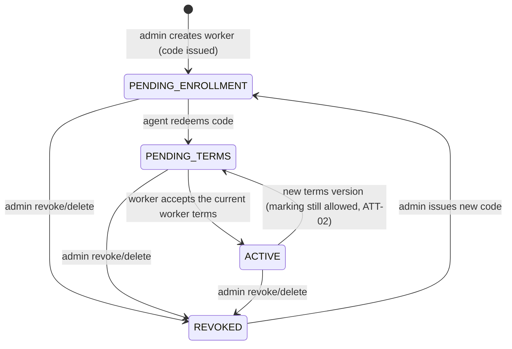

# Domain Model

> **Product pivot (2026-10-11, owner decision).** The product's main use is now the **legal
> attendance record** (registro de asistencia y jornada) required by the Chilean Labour Code art. 33
> and the Dirección del Trabajo's Resolución Exenta N°38/2024 (R38). Telemetry stays, unchanged in
> its guarantees, as an **optional** module. Legal research and article references:
> [`docs/legal/marco-legal-cl.md`](../docs/legal/marco-legal-cl.md).

## 1. What the product is

Two independent modules on the same apps and the same enrollment:

1. **Attendance (primary, mandatory for the employer by law).** The worker marks the start and end of
   the working day and of the meal break from the worker app, with a personal PIN. The server stamps
   the time, hashes every mark, emails a receipt, raises alerts for missing marks, lets the employer
   propose corrections the worker can oppose within 48 h, and produces the reports R38 requires
   (attendance, daily hours, Sundays/holidays, shift changes, technical incidents). The worker can see
   every mark and receipt for at least 5 years. **Attendance is not zero-knowledge**: the law requires
   the server (and labour inspectors) to read it (`security-model.md` §9).
2. **Telemetry (optional).** An employee-device telemetry system with a blind server, exactly as
   before: the admin may request categories with plain-language descriptions; the worker accepts any
   subset, none, or withdraws; data is encrypted on the device to the admin's pinned key; the server
   stores ciphertext; only the admin app decrypts. **Rejecting or withdrawing telemetry never affects
   attendance** (ATT-07).

Neither module is spyware: attendance only records deliberate acts of the worker (ATT-01); telemetry
is visible, consented, minimized, time-bounded and revocable. The product **does not** claim to be
authorized by the Dirección del Trabajo until it is (LEG-07).

## 2. Actors

| Actor | Software | Holds | Can | Cannot |
|:------|:---------|:------|:----|:-------|
| **Admin** (the employer or its representative) | `admin-client` (Tauri) and the web portal `telemetry-web` | `K_admin_priv` (OS keystore of each of their devices), admin JWT bound to a device, Master Password (in their head) | Accept the employer terms; set the **employer legal profile** (legal name, RUT, workplaces); create workers with their **legal data and agreed schedule**; see attendance live, propose corrections, get the R38 reports; register/back up/restore/rotate the key; request telemetry categories; issue enrollment codes; pause/resume telemetry; revoke workers; manage devices; pay (web only); decrypt telemetry. | Block a worker from marking (ATT-02). Edit or delete a mark (only propose corrections, ATT-05). Force telemetry consent. Read other employers' data. Recover telemetry without key backup. Use the console while the subscription is suspended (except read-only attendance reports, BILL-04). |
| **Worker** (employee) | `agent` (background service + tray) and `agent-ui` (Tauri window) | Local PIN verifier, pinned `K_admin_pub`, worker JWT pair | Accept the worker terms; set/change/reset the PIN; **mark attendance**; see all their marks, receipts and corrections and accept/oppose corrections; read the telemetry request and accept any subset, change it, reject or withdraw; request data export/deletion. | Accept a telemetry category the admin did not request. Read telemetry ciphertext. Delete attendance records the law requires to keep. |
| **Server** | `telemetry-api` (Axum) | Attendance marks (plaintext, hash-chained), worker legal data, ciphertext telemetry, `K_admin_pub`, hashed enrollment codes, encrypted key backup | Stamp and hash marks, send receipts/alerts, run the correction procedure, build reports, give inspectors read-only access, enforce telemetry consent/status/subscription at ingestion, compute subscription status. | Decrypt telemetry or the key backup. Alter a mark after the fact (corrections are new records). Change the key or the consent the worker saw. |
| **Labour inspector** (Dirección del Trabajo) | Inspection portal in `telemetry-web` (future) | `@dt.gob.cl` email + 5-day one-time password | Read-only access to every employer's attendance and reports (R38 arts. 22.4, 23–28). | Modify anything. See telemetry. |

## 3. Ubiquitous language

### 3.1 Attendance (new)

| Term | Meaning |
|:-----|:--------|
| **Mark** (marcación) | A deliberate act of the worker recorded by the system: `WORKDAY_START`, `WORKDAY_END`, `BREAK_START`, `BREAK_END` (wire names in `api-contract.md` §9). Immutable once stored. |
| **Server timestamp** (sello de tiempo) | Time assigned by the server when it receives the mark. The official time of the mark (R38 art. 11). Second precision. |
| **Device timestamp** | Clock of the worker's machine when the button was pressed. Stored for offline marks and audit; never replaces the server timestamp except for offline marks (ATT-04). |
| **Offline mark** | A mark taken without connectivity, queued on the device, sent automatically on reconnect and flagged `offline: true` (R38 art. 10). Its official time is the device timestamp, flagged in every report. |
| **Mark hash** | `SHA-256` over the canonical mark (including the previous mark's hash of the same worker = hash chain). Printed on the receipt; searchable on the verification page (R38 art. 8). Spec: `telemetry-crypto-core::attendance`, `api-contract.md` §9.3. |
| **Receipt** (comprobante) | Email the server sends to the worker's personal email for every mark, with the R38 art. 13 fields. The worker app also lists receipts (complement, not replacement). |
| **PIN** | Worker-chosen numeric secret (6–8 digits) that confirms each mark on the enrolled device: the **primary** identification method. Verified locally against an Argon2id verifier in the OS keystore; never sent to the server (`security-model.md` §9.2). The **secondary** method is the worker login of the web portal (future, `telemetry-web`). |
| **Agreed schedule** (jornada pactada) | Per worker, versioned with an effective date: days of the week with start/end, meal break window, whether the break counts as working time, journey type and work mode. Source of truth for alerts, "missing/extra time" and reports. |
| **Journey type** | `FIXED`, `SHIFTS`, `CYCLES`, `BIWEEKLY`, `EXCEPTIONAL` (+ resolution number and date), `PART_TIME` (R38 art. 25.1 e). |
| **Work mode** | `ON_SITE`, `REMOTE` (teletrabajo / trabajo a distancia), `HYBRID`. Remote workers have a **disconnection window** (CT art. 152 quáter J). |
| **Workplace** (lugar de prestación de servicios) | Establishment with full address (street, number, floor/office, commune, city, region) — or the worker's home for remote work. Printed on the receipt (R38 art. 13.2 c, 13.3). |
| **Correction** | Employer proposal to modify/replace, add or fix a mark (R38 art. 39). States: `PENDING` (48 h window) → `ACCEPTED` (worker agreed) / `CONSOLIDATED` (48 h passed without opposition) / `OPPOSED` (worker opposed: original stays). The original mark is never deleted. |
| **Day summary** | Server-computed view of a worker-day: agreed schedule, marks, missing time (`-hh:mm:ss`), extra time (`+hh:mm:ss`), anomalies. Computed to the second (ATT-10). |
| **Art. 22 exempt** | Workers excluded from working-hours limitation (CT art. 22 inc. 2°). The attendance module is disabled for them; the app says so. |

### 3.2 Telemetry and keys (unchanged)

| Term | Meaning |
|:-----|:--------|
| **Admin keypair** | X25519 pair. `K_admin_priv` never leaves the admin's devices in clear; `K_admin_pub` is registered on the server (write-once, rotation is destructive) and pinned by every agent at enrollment. **Used only for telemetry.** |
| **Master Password** | Password chosen by the admin that protects the key backups (`.tkb` file and server vault). Different from the account password; never sent to the server. |
| **`.tkb` file** | Key backup v2: JSON container with `K_admin_priv` encrypted with AES-256-GCM under a KEK derived with Argon2id from the Master Password (TASK-CRYPTO-03). `.vault` files (v1, PBKDF2) can still be imported. |
| **Server vault** | The same encrypted blob + Argon2id parameters stored by the API (`POST /admins/me/vault/setup`) to recover the key on a new device with the Master Password. |
| **Admin device** | One installation of the admin app (`inst-…` identifier in the keystore). Sessions are bound to it; revoking it kills its tokens immediately. |
| **Enrollment code** | Single-use code of 12 symbols from `23456789ABCDEFGHJKMNPQRSTVWXYZ` (`A68K-2PZS-PC4H`), valid 1–72 h (default 24), issued when the admin creates a worker or regenerates it. Stored hashed server-side. |
| **Enrollment QR** | `qr_payload` = base64 of `{ t, v, api_url, code, commitment }`. Carries the code *and* the commitment over a channel the server does not control. |
| **Consent manifest** | `{ admin_public_key, consent_version, consent_flags (requested), consent_descriptions }` — the exact telemetry request the worker is shown. With zero requested categories the manifest still exists (all false) and pins the key for a later request. |
| **Commitment** | `SHA-256("telemetry-enroll-v1\0" ‖ canonical(manifest))`, computed locally by the admin app, verified locally by the agent, sent as `manifest_hash` with every consent decision. |
| **Safety code** | 12 decimal digits derived from the commitment, shown in both apps for manual comparison when the QR is not used. |
| **Pinned key** | The `K_admin_pub` the agent stored at enrollment. The agent encrypts **only** to this key and never replaces it from server responses. |
| **Requested / effective flags** | What the admin asks to collect / what the worker accepted. Always `effective ⊆ requested`. Requested may be **empty** (attendance-only worker). |
| **Consent version** | Integer bumped by the server whenever the admin changes requested flags or descriptions. |
| **Effective subscription status** | `TRIAL`, `ACTIVE`, `SUSPENDED` or `CANCELLED`, computed by the server on every request. |
| **Envelope / Record / Flush** | As before: `{ ephemeral_public_key, encrypted_payload }`; one stored envelope; periodic drain → encrypt → send. |
| **Legal document** | Versioned text in `docs/legal/` (worker terms, employer terms, privacy policy). Identified by `{document, version, hash}` (`hash` = SHA-256 of the exact file). |

## 4. Worker lifecycle (contract v3)

Server-authoritative. The agent mirrors it via `GET /workers/me`. **Status is about the link and the
terms; telemetry has its own state (§5).**

| Status | Agent | Admin sees |
|:-------|:------|:-----------|
| `PENDING_ENROLLMENT` | Not bound (enrollment screen). | "Invitado — el código vence …" / "Código expirado" + *Regenerar*. |
| `PENDING_TERMS` | Bound. Shows the worker terms; after a **first** acceptance and PIN setup it becomes `ACTIVE`. If a **new version** arrives while active, marking keeps working and a banner asks to read the new version. No telemetry until terms are accepted. | "Esperando aceptación de términos". |
| `ACTIVE` | Attendance available; telemetry per §5. | Live board, marks, telemetry state. |
| `REVOKED` | Next refresh → 401 → wipe credentials, PIN verifier, pinned key, telemetry queue; **unsent offline marks are sent first if the session still works**, otherwise kept for the worker to see and reported as lost in diagnostics. | Revoked + *Re-vincular*. Attendance history stays (5 years). |

`PAUSED` and `PENDING_CONSENT` no longer exist as worker statuses: pausing is a telemetry action
(§5) and telemetry consent no longer gates the link.

## 5. Telemetry state and consent model

`telemetry_status` (server, per worker):

| Value | Meaning | Agent |
|:--|:--|:--|
| `NOT_REQUESTED` | Requested flags empty. | No telemetry UI except "Tu empleador no solicita telemetría". |
| `PENDING_DECISION` | Requested, current version not decided. | Shows the consent screen (C1) as a **non-blocking** prompt; previously accepted categories still requested keep applying until decided. |
| `ACCEPTED` | Effective flags non-empty. | Collects effective ∩ locally accepted (DP-07). |
| `DECLINED` | Worker rejected or withdrew. | Nothing collected. |
| `PAUSED` | Admin paused telemetry (attendance unaffected). | Collectors stopped, queue kept. |

- **Admin defines, worker chooses.** Unchanged (DP-08, DP-10, DP-11). All checkboxes start unchecked.
- **Withdrawal ≤ 2 clicks**, stops collection immediately, purges unsent data (DP-09), and is
  re-sent automatically if it failed offline.
- **Versioning:** narrowing applies immediately; widening or rewriting descriptions creates a new
  version that must be decided.
- **Evidence:** append-only `consent_records` with `manifest_hash`.
- **The agent is the last line of defence** (DP-07).
- **Independence:** no telemetry state, decision or failure changes anything in attendance, and no
  attendance state is inferred from telemetry (ATT-07).

## 6. Telemetry categories

| API flag | API path | Agent collector | Collected | Never collected | Restriction (R38, see `marco-legal-cl.md` §6) |
|:---------|:---------|:----------------|:----------|:----------------|:--|
| `system_activity` | `/telemetry/system` | `SystemCollector` | Foreground app & window title, idle seconds, CPU %, RAM, net bytes, USB events. | Screen content, process arguments. | — |
| `network_activity` | `/telemetry/network` | `NetworkCollector` | FQDN + hit count. | Full URL, path, query, headers, bodies. | — |
| `productivity_basic` | `/telemetry/productivity` (`BASIC`) | `KeystrokeCollector` | Keystrokes/min, clicks/min. | Which keys, any text. | — |
| `productivity_screenshots` | `/telemetry/productivity` (`SCREENSHOT`) | `ScreenshotCollector` | Periodic JPEG ≤1920×1080, each one notified. | Anything outside work hours or while paused. | **Not available for `REMOTE`/`HYBRID` workers** (R38 art. 55 a). Legal review pending. |
| `file_activity` | `/telemetry/files` | `FileCollector` | File metadata in admin-designated folders. | File contents; anything outside those folders. | — |
| `location` | `/telemetry/location` | `LocationCollector` | Lat, lon, accuracy — `FIELD` only, work hours only. | Anything for `OFFICE`; anything off-hours. | **Requires a declared safety or legal cause** shown verbatim to the worker (R38 art. 53 e). Never used for attendance. Legal review pending. |

Telemetry never runs during a remote worker's disconnection window (DP-12).

## 7. Worker roles (telemetry) and work modes (attendance)

| Role (`role_type`) | Telemetry location | Notes |
|:--|:--|:--|
| `OFFICE` | **Forbidden** everywhere. | Default. |
| `FIELD` | Allowed with consent + declared cause, only in work hours. | Changing to `OFFICE` narrows `location`. |

`work_mode` (`ON_SITE`/`REMOTE`/`HYBRID`) is independent of `role_type` and affects the receipt
address, the disconnection alert and the screenshot restriction.

## 8. Subscription (who pays, what stops)

| Effective status | Admin app | Agent: attendance | Agent: telemetry |
|:-----------------|:----------|:--|:--|
| `TRIAL` / `ACTIVE` | Works (trial banner ≤ 7 days) | Works | Works |
| `SUSPENDED` / `CANCELLED` | Lock screen + portal button; **read-only attendance reports stay reachable** (BILL-04) | **Works** (ATT-02: marking can never be blocked) | `EmployerSuspended`: no collection, no ingestion, queue kept |

## 9. Admin key custody

Unchanged (first run, new device, lost key, lost laptop). Losing the key affects **only telemetry**.

## 10. Attendance — rules of the domain

### 10.1 Marking

1. A mark is created only by the worker pressing a mark button and confirming with the PIN
   (ATT-01). Nothing is marked by logging in, booting, activity or schedule.
2. The app offers the **next logical mark** as the primary button (start → break start/end → end)
   and the others as secondary actions; any type can be marked at any time — the server records it
   and reports anomalies, it never rejects a mark for being out of order (ATT-02).
3. Consecutive repeated marks of the same type: the server keeps the **first** and answers with it
   (`duplicate_of`) (R38 art. 36 c).
4. Ending the break automatically resumes the working day (R38 art. 37); there is no separate
   "resume" mark.
5. Offline: the mark is stored locally (encrypted at rest is not required; it is not secret, but it
   is integrity-protected by the local queue), shown as "Pendiente de envío", and sent automatically
   with its device timestamp and `offline: true`.
6. Location at marking: only if the worker's schedule says `location_at_mark = true` (set by the
   admin declaring written consent, R38 art. 57.1). Single reading at the moment of the mark; if
   unavailable the mark is sent without it; never blocks (ATT-08).

### 10.2 Corrections (R38 arts. 39–41)

| Kind | Example | Server rules |
|:--|:--|:--|
| `MODIFY` | Remove a late arrival (move start earlier) | Only changes that do not harm the worker: a start can only move **earlier**, an end only **later**. Reason required. |
| `ADD` | Forgotten start/end, power cut, authorized early leave, afternoon off | Reason required. |
| `FIX` | Mass clock-change error | Reason required; applies to several workers. |

Common rules: allowed only from the **next business day** after the corrected day; the worker is
notified by email and in the app; **48 h** to oppose; no opposition ⇒ `CONSOLIDATED`; opposition ⇒
the original stays; every altered value carries a visible marker in apps and reports; start and end
of the workday are never auto-filled (R38 art. 41 d).

### 10.3 Alerts

| Alert | Who/when | Where |
|:--|:--|:--|
| Missing start/end mark | 30 min after the agreed time; worker + copy to employer; employer can disable | Server email (R38 art. 45.1) + local notification in the agent |
| Excessive agreed schedule | When the admin saves a schedule over 10 h/day or over the weekly legal maximum in force | Admin app, warning only (art. 45.2) |
| Disconnection | 30 min before a remote worker's disconnection window | Server email (art. 45.4) + local notification |

### 10.4 Reports (R38 art. 27)

Asistencia · Jornada diaria · Domingos y/o días festivos · Modificaciones y/o alteraciones de turnos ·
Reporte diario (email) · Incidentes técnicos. Computed **by the server** (one implementation for the
admin app, the portal and inspectors); exports to XLSX, PDF and DOCX generated by the server. Exact
columns: `docs/legal/marco-legal-cl.md` §3.3.

## 11. Personal data and retention

| Data | Retention |
|:--|:--|
| Marks, corrections, receipts metadata, location at mark | 5 years (R38 arts. 22.1, 53 f, 58 l) |
| Personal email, PIN verifier (device), extra personal data | Destroyed 90–120 days after the employment ends (R38 art. 57.4); PIN verifier wiped on unlink |
| Telemetry | As before (employer-defined; local queue ≤ 7 days) |
| Terms acceptances, consent records | Relationship + 5 years |
