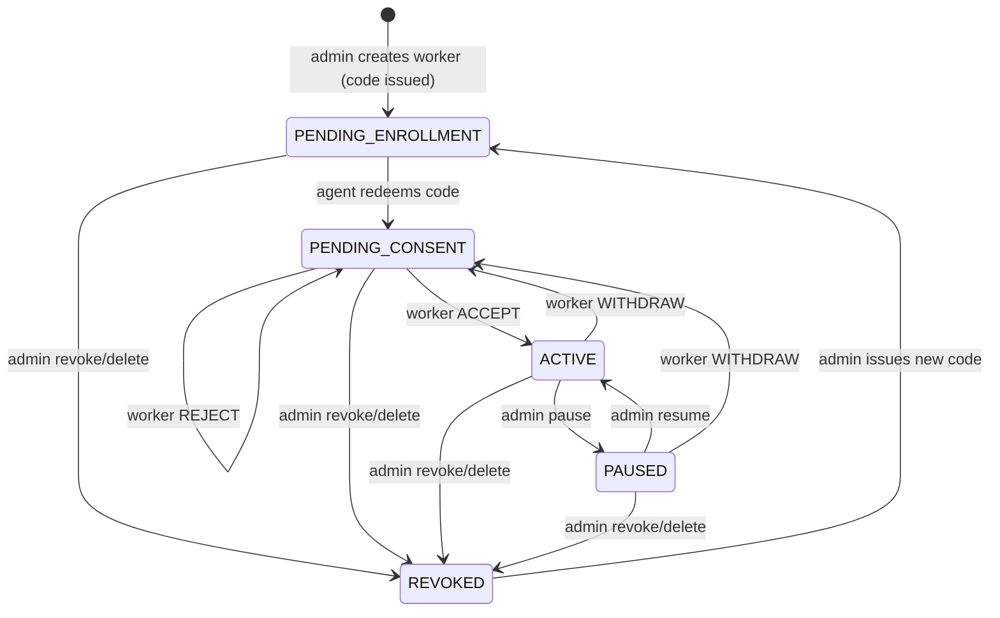

# Domain Model

## 1. What the product is

An **employee-device telemetry system with a blind server**. An organization's admin decides which categories of activity data *may* be collected from each employee's computer and explains each one in plain language; the employee sees exactly that and accepts the categories they agree to (or none); the employee's machine encrypts everything to the admin's public key before it leaves the device; the server stores ciphertext it cannot read; only the admin's desktop app can decrypt. The admin's private key can be backed up encrypted with a Master Password that the server never sees.

It is **not** spyware: collection is visible (status indicator, notifications), consented, minimized (no keystroke content, no URLs, no file contents), time-bounded (GPS only in work hours) and revocable.

## 2. Actors

| Actor | Software | Holds | Can | Cannot |
|:------|:---------|:------|:----|:-------|
| **Admin** | `admin-client` (Tauri) and the web portal `telemetry-web` | `K_admin_priv` (OS keystore of each of their devices), admin JWT bound to a device, Master Password (in their head) | Register (password or Google), register `K_admin_pub`, back up / restore / rotate the key, create workers, set requested consent + descriptions, issue enrollment codes, pause/resume/revoke workers, manage their devices, pay the subscription (web only), fetch & decrypt telemetry. | Force consent. See data of other admins' workers. Recover data if `K_admin_priv` is lost and there is neither a `.tkb` file nor a server backup (plus the Master Password). Use the console while the subscription is suspended. |
| **Worker** (employee) | `agent` (egui) | Pinned `K_admin_pub`, worker JWT pair | Enroll with a code/QR, read the consent manifest, **accept any subset of the requested categories**, change that selection, reject or withdraw, see status, request data export / deletion. | Accept a category the admin did not request. Read the encrypted data (no private key). |
| **Server** | `telemetry-api` (Axum) | Ciphertext, metadata, `K_admin_pub` (public), hashed enrollment codes, the **encrypted** key backup and its Argon2id parameters | Authenticate, authorize, enforce consent/status/subscription at ingestion, store blobs, keep audit + consent evidence, compute the subscription's effective status. | Decrypt anything — including the key backup (it never sees the Master Password nor runs Argon2). Silently change the key or consent the worker saw (see `security-model.md`). |

## 3. Ubiquitous language

| Term | Meaning |
|:-----|:--------|
| **Admin keypair** | X25519 pair. `K_admin_priv` never leaves the admin's devices in clear; `K_admin_pub` is registered on the server (write-once, rotation is destructive) and pinned by every agent at enrollment. |
| **Master Password** | Password chosen by the admin that protects the key backups (`.tkb` file and server vault). Different from the account password; never sent to the server. |
| **`.tkb` file** | Key backup v2: JSON container with `K_admin_priv` encrypted with AES-256-GCM under a KEK derived with Argon2id from the Master Password (TASK-CRYPTO-03). `.vault` files (v1, PBKDF2) can still be imported. |
| **Server vault** | The same encrypted blob + Argon2id parameters stored by the API (`POST /admins/me/vault/setup`) to recover the key on a new device with the Master Password. |
| **Admin device** | One installation of the admin app (`inst-…` identifier in the keystore). Sessions are bound to it; revoking it kills its tokens immediately. |
| **Enrollment code** | Single-use code of 12 symbols from `23456789ABCDEFGHJKMNPQRSTVWXYZ` (`A68K-2PZS-PC4H`), valid 1–72 h (default 24), issued when the admin creates a worker or regenerates it. Stored hashed server-side. |
| **Enrollment QR** | `qr_payload` = base64 of `{ t, v, api_url, code, commitment }`. Carries the code *and* the commitment over a channel the server does not control. The admin app shows it only after recomputing the commitment with its local key. |
| **Consent manifest** | `{ admin_public_key, consent_version, consent_flags (requested), consent_descriptions }` — the exact package the worker is shown. |
| **Commitment** | `SHA-256("telemetry-enroll-v1\0" ‖ canonical(manifest))`, computed locally by the admin app, verified locally by the agent, sent as `manifest_hash` with every consent decision. |
| **Safety code** | 12 decimal digits derived from the commitment, shown in both apps for manual comparison when the QR is not used. |
| **Pinned key** | The `K_admin_pub` the agent stored at enrollment. The agent encrypts **only** to this key and never replaces it from server responses. |
| **Requested flags** | What the admin asks to collect (`requested_consent_flags`), each with a plain-language description. |
| **Effective flags** | What may actually be collected (`consent_flags`): the subset the worker accepted. Always `effective ⊆ requested`, empty until the worker accepts. |
| **Consent version** | Integer bumped by the server whenever the admin changes requested flags or descriptions. |
| **Effective subscription status** | `TRIAL`, `ACTIVE`, `SUSPENDED` or `CANCELLED`, computed by the server on every request (expired trial or expired paid period + 3 grace days ⇒ `SUSPENDED`). |
| **Envelope** | `{ ephemeral_public_key, encrypted_payload }` produced by `telemetry-crypto-core`. `encrypted_payload = nonce(12) ‖ tag(16) ‖ ciphertext`. |
| **Record** | One envelope + `client_timestamp` as stored by the API (one row). One record = one category. |
| **Flush** | Periodic drain of the in-memory buffer → group by category → encrypt → send (or queue). |

## 4. Worker lifecycle

Server-authoritative. The agent mirrors it via `GET /workers/me`.

| Status | Agent behaviour | Admin sees |
|:-------|:----------------|:-----------|
| `PENDING_ENROLLMENT` | Not bound (shows enrollment screen). | "Invited — code expires at …" / "Code expired" + *Regenerate*. |
| `PENDING_CONSENT` | Bound but **inert**: consent screen, zero collectors, no sends. | "Waiting for employee consent" (+ rejected-at if any). |
| `ACTIVE` | Collectors for effective flags only (and none while the employer's subscription is blocked). | Live; device info; accepted categories, version & date. |
| `PAUSED` | Collectors stopped; queue kept; banner "Paused by your employer". | Paused + *Resume*. |
| `REVOKED` | Next refresh → 401 → wipe credentials, pinned key, queue → enrollment screen. | Revoked + *Re-enroll* (new code). |

## 5. Consent model

- **Admin defines, worker chooses.** The admin chooses the categories that *may* be collected and writes a plain-language description per enabled category. The worker accepts **any non-empty subset** of them, rejects all, changes the selection later or withdraws. Every checkbox starts unchecked (DP-08).
- **Withdrawal is always ≤ 2 clicks** (legal requirement) and stops all collection immediately; unsent data is purged (DP-09).
- **Versioning:**
  - Admin *narrows* (removes categories) → applied immediately, no re-acceptance, agent shows an info notice.
  - Admin *widens* or rewrites descriptions → new version; the agent shows the consent screen again; until the worker decides, the previously accepted categories that are still requested keep applying.
- **Evidence:** every decision is an append-only `consent_records` row server-side with the `manifest_hash` the agent computed over the full manifest shown and the `accepted_consent_flags` chosen.
- **The agent is the last line of defence:** it only starts a collector if the category is in the effective flags **and** it is part of the selection the worker accepted on this device.

## 6. Telemetry categories

| API flag | API path | Agent collector | Collected | Never collected |
|:---------|:---------|:----------------|:----------|:----------------|
| `system_activity` | `/telemetry/system` | `SystemCollector` | Foreground app name & window title, idle seconds, CPU %, RAM, net bytes, USB connect/disconnect (VID/PID/name). | Screen content, process arguments. |
| `network_activity` | `/telemetry/network` | `NetworkCollector` | FQDN + hit count (+ optional local category). | Full URL, path, query, headers, bodies. |
| `productivity_basic` | `/telemetry/productivity` (`subcategory: BASIC`) | `KeystrokeCollector` | Keystrokes/min, clicks/min. | Which keys, any text. |
| `productivity_screenshots` | `/telemetry/productivity` (`subcategory: SCREENSHOT`) | `ScreenshotCollector` | Periodic JPEG/WebP ≤1920×1080, each one notified. | Anything outside work hours; screenshots while paused. |
| `file_activity` | `/telemetry/files` | `FileCollector` | Created/Modified/Deleted/Renamed, relative path, extension — only inside admin-designated folders. | File contents; anything outside designated folders. |
| `location` | `/telemetry/location` | `LocationCollector` | Lat, lon, accuracy — only `FIELD` role, only inside work hours. | Anything for `OFFICE` workers; anything off-hours. |

Plaintext schemas: [`docs/telemetry-payloads.md`](../docs/telemetry-payloads.md).

## 7. Worker roles

| Role | Location | Notes |
|:-----|:---------|:------|
| `OFFICE` | **Forbidden** — rejected by admin UI, API and DB constraints; agent never starts the collector. | Default. |
| `FIELD` | Allowed with consent, only within `work_hours_start..work_hours_end` in the worker's IANA `timezone`. | Changing a worker to `OFFICE` removes `location` (a narrowing). |

## 8. Subscription (who pays, what stops)

The admin pays in the web portal (Flow, CLP). The server computes the effective status on every request.

| Effective status | Admin app | Agent (their workers) |
|:-----------------|:----------|:----------------------|
| `TRIAL` | Works; banner with days left when ≤ 7 | Works |
| `ACTIVE` | Works | Works |
| `SUSPENDED` | Lock screen "Suscripción suspendida" + button to the portal; no dashboard | `EmployerSuspended`: no collection, no ingestion, queue kept; rights intact |
| `CANCELLED` | Lock screen "Suscripción cancelada" | Same as suspended |

## 9. Admin key custody

| Situation | What the admin does |
|:----------|:--------------------|
| First run (account without key) | Generate the key, choose a Master Password, enable the server backup and/or download a `.tkb`. |
| New or reinstalled device | Restore with the `.tkb` + Master Password (A) or from the server backup with the Master Password (B). |
| Key lost and no backup | Generate a new key (C): destructive — historic data unreadable, every worker unlinked and must re-enroll. |
| Laptop lost | Revoke that device from another device; the key on it stays protected by the OS account/keystore. |
