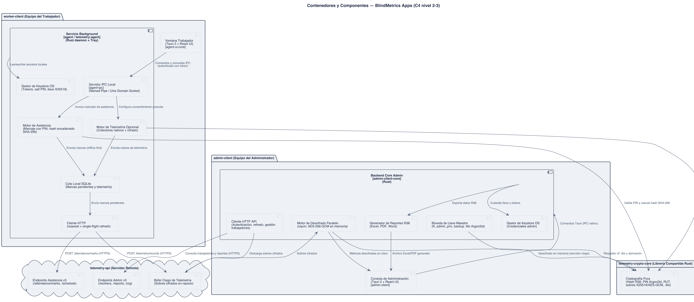

# BlindMetrics Apps

> **Aplicaciones de escritorio para registro legal de asistencia (Chile, Res. Ex. N°38/2024 DT) y telemetría opcional zero-knowledge.**

Clientes de escritorio multiplataforma de la plataforma Telemetry: la aplicación del **Administrador/Empleador** (`admin-client`, Tauri 2 + React) y la aplicación del **Trabajador** (`worker-client`, Tauri 2 + React con servicio daemon en segundo plano), compartiendo el crate criptográfico puro `telemetry-crypto-core`.

Desde el 2026-10-11, el propósito primario del sistema es el **registro legal de asistencia laboral en Chile**, dando cumplimiento riguroso al artículo 33 del Código del Trabajo y a la Resolución Exenta N°38/2024 de la Dirección del Trabajo (DT). La telemetría de productividad opera como un subsistema estrictamente opcional y desacoplado, bajo una arquitectura de **servidor ciego** (zero-knowledge) donde el servidor central nunca tiene acceso a texto plano de métricas ni a llaves privadas.

Ambas aplicaciones se comunican con [`telemetry-api`](https://github.com/Demiannnnnn/telemetry-api) (API REST v3) para estampar, encadenar y certificar las marcas con sellado de tiempo oficial del servidor, y se integran con el portal web `telemetry-web` abriéndolo directamente en el navegador del sistema para flujos de facturación, verificación pública de comprobantes y fiscalización laboral.

---

## Índice

- [Qué es y para quién](#qué-es-y-para-quién)
- [Características principales](#características-principales)
- [Estado actual del proyecto](#estado-actual-del-proyecto)
- [Arquitectura del sistema](#arquitectura-del-sistema)
- [Stack tecnológico y versiones exactas](#stack-tecnológico-y-versiones-exactas)
- [Requisitos del sistema](#requisitos-del-sistema)
- [Instalación y arranque local](#instalación-y-arranque-local)
- [Configuración y variables de entorno](#configuración-y-variables-de-entorno)
- [Uso y flujos operacionales](#uso-y-flujos-operacionales)
- [Consumo de API y contratos](#consumo-de-api-y-contratos)
- [Pruebas y calidad](#pruebas-y-calidad)
- [Despliegue y distribución](#despliegue-y-distribución)
- [Estructura del repositorio](#estructura-del-repositorio)
- [Documentación técnica y legal](#documentación-técnica-y-legal)
- [Cumplimiento normativo chileno](#cumplimiento-normativo-chileno)
- [Seguridad y divulgación responsable](#seguridad-y-divulgación-responsable)
- [Licencia](#licencia)
- [Relación con el ecosistema](#relación-con-el-ecosistema)

---

## Qué es y para quién

BlindMetrics Apps resuelve las necesidades operativas y legales del control horario y de productividad de empresas con trabajadores presenciales, remotos o en terreno en Chile:

1. **Para el Trabajador (Empleado):** Una aplicación ágil y respetuosa de la privacidad (`worker-client`). Le permite registrar sus inicios y términos de jornada y pausas de colación mediante un acto deliberado (botón + PIN personal de 4 dígitos), recibir comprobantes instantáneos con sellado de tiempo y firma criptográfica inmutable, revisar su jornada pactada y solicitar rectificaciones dentro de las 48 horas siguientes conforme a la ley. Si el empleador solicita telemetría, el trabajador visualiza qué categorías se solicitan en lenguaje claro y decide de forma granular si acepta o rechaza, pudiendo retirar su consentimiento en cualquier momento en menos de 2 clics.
2. **Para el Empleador / Administrador (RRHH y Operaciones):** Una consola integral de escritorio (`admin-client`) para gestionar el ciclo de vida de los trabajadores, configurar jornadas y lugares de trabajo, monitorear la asistencia en vivo en un tablero de control, tramitar oposiciones y correcciones, y emitir los seis reportes legales obligatorios exigidos por la Dirección del Trabajo (R38 art. 25 y 27). Custodia las llaves maestras institucionales de telemetría de forma descentralizada sin confiar en el servidor.
3. **Para la Dirección del Trabajo (DT) y Auditores:** Garantía de inmutabilidad y no repudio. Cada marca de asistencia forma parte de una cadena SHA-256 inalterable estampada por el servidor, verificable de forma independiente mediante comprobantes y reportes oficiales.

---

## Características principales

### Registro de asistencia legal (Chile R38)
- **Acto deliberado:** Marcado exclusivo por acción deliberada del trabajador (pulsación de botón e ingreso de PIN personal). Prohibido el marcaje automático o biométrico pasivo sin validación del sistema operativo.
- **Asistencia nunca bloqueada (ATT-01):** El marcaje de asistencia jamás se bloquea por falta de conexión a internet, suspensión de suscripción comercial, actualización de términos, cambio de políticas o estado de la telemetría.
- **Sellado de tiempo y cadena criptográfica:** Doble marca temporal (hora local del equipo y sellado oficial UTC del servidor). Encadenamiento canónico mediante función hash criptográfica SHA-256 (`hash = SHA-256(prev_hash || worker_id || timestamp || type || pin_hash)`).
- **Cola offline resiliente:** Si se interrumpe la conexión, la marca se guarda de inmediato en la base SQLite local en modo WAL y se despacha automáticamente al reanudar la conectividad, preservando la hora del evento.
- **Procedimiento de corrección legal de 48 horas (R38 art. 40):** El trabajador puede solicitar la rectificación de omisiones o errores de marcaje dentro de las 48 horas posteriores. El empleador evalúa y autoriza o rechaza la solicitud fundadamente, manteniéndose siempre la marca histórica original para trazabilidad de fiscalización.

### Telemetría zero-knowledge opcional
- **Servidor ciego (SEC-01, SEC-02):** Todo dato de telemetría es cifrado en el dispositivo del trabajador mediante X25519, derivación HKDF-SHA256 y cifrado autenticado AES-256-GCM antes de salir a la red. El servidor únicamente almacena blobs cifrados.
- **Consentimiento granular e informado (DP-08, DP-11):** El empleador debe describir el fin de cada categoría solicitada; las casillas de aceptación se presentan desmarcadas por defecto; el trabajador elige selectivamente.
- **Retiro inmediato (DP-10):** El retiro de consentimiento está disponible a ≤ 2 clics desde la bandeja del sistema o la ventana de usuario, purgando de inmediato los búferes locales.
- **Minimización estricta:** Conteo agregado de pulsaciones y clics por minuto (sin keyloggers ni contenido de texto), agregación de dominios FQDN (sin URLs completas ni consultas), metadatos de archivos solo en directorios designados, capturas de pantalla siempre notificadas con banner previo.

### Arquitectura de procesos y custodia de llaves
- **Separación de procesos (`PROC-01`):** La app del trabajador corre un servicio daemon nativo en segundo plano (`telemetry-agent`) que gestiona la cola, los colectores y el icono persistente en la bandeja del sistema (tray), mientras que la interfaz gráfica Tauri (`agent-ui`) puede abrirse o cerrarse a voluntad sin interrumpir las operaciones.
- **Bóveda de llaves `.tkb` v2 (SEC-12, SEC-13):** La llave privada maestra del administrador (`K_admin_priv`) se genera y reside exclusivamente en el llavero seguro del sistema operativo (OS Keystore). Se respalda mediante archivos de formato abierto `.tkb` v2 cifrados localmente con contraseña maestra y Argon2id.

---

## Estado actual del proyecto

El repositorio se encuentra en la **Etapa v3** (asistencia legal R38, app del trabajador migrada a Tauri 2 con procesos separados y contrato API v3 completo).

Métricas de aseguramiento de calidad verificadas:
- `cargo fmt --all --check` ✅
- `cargo clippy --workspace --all-targets -- -D warnings` ✅ (cero advertencias)
- `cargo test --workspace` ✅ (390 pruebas unitarias y de integración):
  - `telemetry-crypto-core`: 51 pruebas
  - `agent` (servicio en segundo plano): 155 pruebas
  - `agent-ipc`: 21 pruebas
  - `agent-ui-core`: 9 pruebas
  - `admin-client-core`: 154 pruebas
- `worker-client` UI: `npm test` ✅ (26 pruebas), `npm run build` ✅
- `admin-client` UI: `npm test` ✅ (91 pruebas), `npm run build` ✅
- `docs/build-docs.sh --check` ✅ (11 diagramas generados y consistentes)

El estado detallado de cada componente y los hitos completados se encuentran en [`.ai-context/implementation-status.md`](.ai-context/implementation-status.md) y en el [Plan Maestro de Tareas](tasks/README.md).

---

## Arquitectura del sistema

A continuación se presenta el diagrama de componentes y contenedores de la solución:



### Flujo de datos general

```mermaid
flowchart LR
    subgraph Admin["admin-client (Tauri 2)"]
        UI["React UI<br/>(sin llaves ni tokens)"] -- "Comandos Tauri" --> RS["admin-client-core (Rust)"]
        RS --> KS[("Llavero del SO<br/>K_admin_priv, tokens")]
    end

    subgraph Worker["worker-client"]
        WUI["Ventana React (Tauri 2)<br/>cerrable libremente"] -- "IPC local (agent-ipc)<br/>autenticado con token" --> SVC["Servicio daemon (Rust)<br/>Bandeja + Asistencia + Telemetría"]
        SVC --> AK[("Llavero del SO y SQLite<br/>Tokens, llave fijada, cola WAL")]
    end

    API[("telemetry-api (REST HTTPS)<br/>Sellado de tiempo y registros")]
    WEB["telemetry-web (Portal público)<br/>Facturación y verificación")]
    G["Google Identity (OAuth PKCE)"]

    RS -- "HTTPS: trabajadores, reportes R38" --> API
    SVC -- "HTTPS: marcas de asistencia, telemetría" --> API
    RS -. "Loopback local 127.0.0.1" .-> G
    RS -. "Apertura en navegador" .-> WEB
    Admin -. "QR de enrolamiento en persona" .-> Worker
```

Para consultar los diagramas de contexto (C4 nivel 1), casos de uso, clases de dominio, modelo de datos, despliegue, ciclos de vida y secuencias de flujos críticos, consulte la sección [Documentación técnica y legal](#documentación-técnica-y-legal).

---

## Stack tecnológico y versiones exactas

### Ecosistema Rust (Backend & Core)
| Dependencia / Herramienta | Versión | Rol en el sistema |
|:--------------------------|:--------|:------------------|
| **Rust Toolchain** | `1.75+` (edición 2021, probado con `1.99.1`) | Lenguaje de programación del núcleo y servicios |
| `tauri` | `2.x` | Framework de integración escritorio entre Rust y WebView |
| `telemetry-crypto-core` | `0.1.0` (interno) | Hashes R38, PIN Argon2id, RUT, sobres X25519/AES-GCM, `.tkb` |
| `agent-ipc` | `0.1.0` (interno) | Protocolo IPC por sockets de dominio Unix y Named Pipes |
| `x25519-dalek` | `2.0` | Intercambio de llaves Diffie-Hellman en curva Montgomery |
| `aes-gcm` | `0.10` | Cifrado autenticado AES-256-GCM para sobres y bóvedas |
| `sha2` | `0.10` | Función hash criptográfica SHA-256 para encadenamiento R38 |
| `argon2` | `0.5` | Derivación de claves con endurecimiento en memoria (KDF) |
| `hkdf` / `hmac` | `0.12` | Derivación canónica de claves de cifrado |
| `zeroize` | `1.8` | Limpieza segura de secretos de la memoria RAM |
| `tokio` | `1.37` | Runtime asíncrono para servicios e I/O de red |
| `reqwest` | `0.12` | Cliente HTTP asíncrono con backend `rustls-tls` |
| `rusqlite` | `0.31` | Motor de base de datos local embebida en modo WAL |
| `tray-icon` | `0.19` | Control nativo del icono en la bandeja del sistema |
| `serde` / `serde_json` | `1.0` | Serialización y deserialización de estructuras |

### Ecosistema Web / Frontend (UI)
| Dependencia / Herramienta | Versión | Rol en el sistema |
|:--------------------------|:--------|:------------------|
| **Node.js** | `≥ 22.0.0` (probado con `v26.12.1`) | Entorno de ejecución para tooling y pruebas de UI |
| **npm** | `≥ 10.0.0` (probado con `11.20.0`) | Gestor de paquetes |
| `react` / `react-dom` | `^18.2.0` | Biblioteca de construcción de interfaces declarativas |
| `typescript` | `^5.3.3` | Tipado estricto en el frontend |
| `tailwindcss` | `^4.3.3` | Motor de estilos de alta fidelidad |
| `echarts` / `echarts-for-react`| `^5.5.0` | Visualización analítica de métricas y jornadas |
| `leaflet` / `react-leaflet` | `^1.9.4` | Cartografía y geocercas para trabajadores de terreno |
| `qrcode.react` | `^3.1.0` | Renderizado del código QR de enrolamiento seguro |

---

## Requisitos del sistema

- **macOS:** macOS Monterey (12) o superior (Apple Silicon o Intel). Requiere Xcode Command Line Tools (`xcode-select --install`). Para funciones opcionales de telemetría de ventanas y capturas, se requieren permisos en *Ajustes del Sistema → Privacidad y Seguridad*.
- **Windows:** Windows 10 (versión 1809 o superior) o Windows 11 de 64 bits. Incluye soporte nativo para WebView2 Runtime.
- **Linux:** Distribuciones modernas de 64 bits con servidor gráfico X11 o Wayland, servicio de llavero compatible con Secret Service (`gnome-keyring` o `kwallet`) y soporte de AppIndicator en la barra de tareas.

### Paquetes de compilación en Linux (Ubuntu/Debian)
```bash
sudo apt update && sudo apt install -y build-essential pkg-config libssl-dev \
    libgtk-3-dev libwebkit2gtk-4.1-dev libayatana-appindicator3-dev librsvg2-dev \
    libxdo-dev libxtst-dev libx11-dev libxcb1-dev libxrandr-dev libxkbcommon-dev \
    libdbus-1-dev libpipewire-0.3-dev libclang-dev
```

---

## Instalación y arranque local

### 1. Clonar y configurar variables de entorno
```bash
git clone https://github.com/Demiannnnnn/blindmetrics-apps.git
cd blindmetrics-apps

cp .env.example .env
cp .env.example admin-client/.env
cp .env.example worker-client/service/.env
```

### 2. Aplicación del Trabajador (`worker-client`)

La aplicación del trabajador puede arrancarse en dos modalidades:

```bash
# Modalidad A: Solo el servicio background (Bandeja del sistema + IPC)
cargo run -p agent

# Modalidad B: Aplicación de escritorio completa con Tauri (arranca el servicio automáticamente)
cd worker-client
npm install
npm run app:dev       # Compila servicio Rust y levanta la ventana Tauri en modo desarrollo
```

### 3. Aplicación del Administrador (`admin-client`)

```bash
cd admin-client
npm install
npm run app:dev       # Levanta la consola de administración en modo desarrollo
```

---

## Configuración y variables de entorno

| Variable | Utilizada por | Por defecto | Descripción y reglas |
|:---------|:--------------|:------------|:---------------------|
| `TELEMETRY_API_URL` | `agent` (servicio) | `http://localhost:8080/api/v1` (debug) | URL base de la API central embebida en tiempo de compilación. En compilaciones `release` es obligatoria y debe iniciar con `https://`. |
| `TELEMETRY_API_URL` | `admin-client` | `http://localhost:8080/api/v1` (debug) | Misma función para la app del administrador. Aislada en Rust, nunca accesible al frontend. |
| `WORKER_FLUSH_INTERVAL` | `agent` | `30` | Intervalo en segundos de vaciado de la cola local de telemetría hacia el servidor (mínimo 5). |
| `VITE_DEMO_MODE` | `admin-client` UI | `unset` | Si es `true`, activa un almacén de datos ficticios en memoria para desarrollo de UI. Estrictamente prohibido en producción (`SEC-06`). |
| `ADMIN_GOOGLE_CLIENT_ID` | `admin-client-core` | `empty` | ID de cliente OAuth 2.0 de Google para aplicaciones de escritorio (Desktop App). |
| `ADMIN_GOOGLE_CLIENT_SECRET` | `admin-client-core` | `empty` | Secreto del cliente OAuth de escritorio para intercambio PKCE. |

### Rutas de almacenamiento local por sistema operativo
| Componente | Directorio / Almacén | Contenido |
|:-----------|:---------------------|:----------|
| `worker-client` | `<config_dir>/telemetry-worker/` | `config.json` (identificador de dispositivo, sin secretos), `offline.db` (cola SQLite WAL). |
| `worker-client` | Llavero seguro del SO (Keystore) | Tokens de sesión de dispositivo, salt y verificador Argon2id del PIN, llave privada X25519. |
| `worker-client` | `<runtime_dir>/telemetry-worker/` | `ipc.token` (token temporal por sesión con permisos `0600` para autenticación IPC local). |
| `admin-client` | Llavero seguro del SO (Keystore) | `K_admin_priv` (cifrada con Master Password), refresh token, ID de instalación. |

---

## Uso y flujos operacionales

1. **Alta del Administrador:** El empleador inicia sesión en `admin-client` mediante correo/contraseña o Google OAuth (PKCE en loopback 127.0.0.1). Genera su par de llaves maestras institucionales y exporta su primer respaldo cifrado `.tkb`.
2. **Creación de Trabajador:** En la sección *Trabajadores*, el administrador registra los datos del trabajador (RUT con validación de dígito verificador, jornada semanal pactada y lugar de trabajo). Opcionalmente define qué categorías de telemetría solicitará y describe su finalidad en texto plano.
3. **Generación del Enrolamiento Seguro:** El administrador genera el paquete de enrolamiento; `admin-client` verifica localmente el compromiso criptográfico SHA-256 y despliega un código de 6 caracteres y un código QR.
4. **Vinculación por el Trabajador:** El empleado abre `worker-client`, ingresa el código o importa el QR (desde archivo o portapapeles). El servicio verifica la integridad del compromiso contra la llave pública del administrador y fija la llave.
5. **Aceptación de Términos y Creación de PIN:** El trabajador lee los Términos y Condiciones y la Política de Privacidad completos (LEG-04), los acepta electrónicamente y define un PIN de 4 dígitos (hasheado con Argon2id).
6. **Marcaje de Asistencia:** En cualquier momento laboral, el trabajador pulsa "Marcar entrada/salida/colación" e ingresa su PIN. La marca se calcula de forma instantánea y se almacena en SQLite local; si hay conexión se sincroniza de inmediato con el servidor recibiendo el comprobante oficial firmado.
7. **Emisión de Reportes R38:** Desde la consola admin, Recursos Humanos puede consultar y exportar en cualquier momento los reportes de Asistencia, Horas Extraordinarias, Domingos y Festivos, Descansos y Modificaciones en formatos PDF, Excel y Word con los filtros exigidos por el artículo 25 de la Res. Ex. N°38/2024.

---

## Consumo de API y contratos

Las aplicaciones implementan el **Contrato API v3** documentado en [`.ai-context/api-contract.md`](.ai-context/api-contract.md):
- **Estructura de errores tipados:** Respuestas de error con `{ "error": { "code": "...", "message": "...", "details": { "reason": "..." } } }`. El código de la aplicación bifurca por `reason`, nunca inspeccionando mensajes en lenguaje natural.
- **Manejo de tokens y rotación `single-flight`:** La renovación de tokens de acceso (`POST /auth/refresh`) se realiza en un único vuelo concurrente protegido por mutex en memoria. Si un token es revocado (`DEVICE_REVOKED`), se fuerza el cierre de sesión inmediato sin intentar refrescos infinitos.
- **Control de Suscripción (APP-01):** Códigos `402 SUBSCRIPTION_SUSPENDED` o `403 SUBSCRIPTION_CANCELLED` bloquean la consola admin mostrando la pantalla de regularización con redirección al portal de pago de `telemetry-web`. En el trabajador, la telemetría se pausa (`EmployerSuspended`), pero el registro legal de asistencia continúa operando normalmente.

---

## Pruebas y calidad

El repositorio aplica las directrices de aseguramiento de calidad más rigurosas del estándar:
- **Cero tolerancias:** Prohibido el uso de `unsafe`, `unwrap`, `expect` o `panic!` en código de producción; las compilaciones en modo `release` abortan ante cualquier pánico.
- **Sin silenciamiento de lints:** Prohibido el uso de `#[allow(...)]`, `@ts-ignore` o `any` en rutas de producción.
- **Aislamiento en pruebas:** Los tests utilizan servidores falsos `wiremock`, bases de datos SQLite en carpetas temporales (`tempfile`) y llaveros en memoria; nunca tocan los llaveros reales del usuario ni la red externa.

```bash
# Verificación de formato de código
cargo fmt --all --check

# Análisis estático y linter en todo el workspace de Rust
cargo clippy --workspace --all-targets -- -D warnings

# Ejecución de la suite completa de pruebas unitarias y de integración en Rust
cargo test --workspace

# Pruebas unitarias y de integración de las interfaces de usuario
cd admin-client && npm test && npm run build
cd ../worker-client && npm test && npm run build

# Verificación de integridad de diagramas y documentación para humanos
./docs/build-docs.sh --check
```

---

## Despliegue y distribución

### Compilación local de instaladores
```bash
# Empaquetado de la aplicación del trabajador (genera binario sidecar + Tauri bundle)
cd worker-client
npm run app:build

# Empaquetado de la aplicación del administrador
cd admin-client
npm run app:build
```
Los artefactos finales se generan en `target/release/bundle/` (`.dmg` para macOS, `.deb`/`.AppImage` para Linux, `.msi` para Windows).

### Integración y entrega continua (CI/CD)
El flujo automatizado en GitHub Actions se organiza en:
- [`.github/workflows/ci.yml`](.github/workflows/ci.yml): Ejecuta en cada Pull Request la verificación estricta de formato, lints de Clippy, compilación y pruebas de Rust y Node.js.
- [`.github/workflows/release.yml`](.github/workflows/release.yml): Se activa al publicar una etiqueta `v*`. Compila matrices multiplataforma para macOS Apple Silicon (`aarch64-apple-darwin`), macOS Intel (`x86_64-apple-darwin`), Windows (`x86_64-pc-windows-msvc`) y Linux (`x86_64-unknown-linux-gnu`), generando instaladores firmados, sumas de verificación `SHA256SUMS.txt` y publicando una versión en GitHub Releases.

---

## Estructura del repositorio

```
blindmetrics-apps/
├── telemetry-crypto-core/       # Crate Rust puro: primitivas criptográficas, R38, PIN, RUT y .tkb
├── worker-client/               # Aplicación completa del Trabajador
│   ├── ipc/                     # Crate Rust agent-ipc: protocolo de comunicación local service ⇄ window
│   ├── service/                 # Crate Rust agent (telemetry-agent): daemon en segundo plano y tray
│   ├── src-tauri/               # Crate Rust agent-ui-core: backend Tauri de la ventana de marcaje
│   └── src/                     # Frontend React 18 + TypeScript + Tailwind de la ventana de marcaje
├── admin-client/                # Aplicación completa del Administrador
│   ├── src-tauri/               # Crate Rust admin-client-core: cliente API, descifrado rayon, bóveda
│   └── src/                     # Frontend React 18 + TypeScript: consola de asistencia y reportes
├── docs/                        # Documentación técnica, diagramas e informes para humanos
│   ├── md/                      # Especificaciones técnicas, operativas y textos legales base
│   │   ├── legal/               # Textos de Términos del Trabajador, Empleador y Política de Privacidad
│   │   ├── admin-app-spec.md    # Especificación de pantallas y flujos de admin-client
│   │   ├── worker-app-spec.md   # Especificación de pantallas y flujos de worker-client
│   │   └── telemetry-payloads.md# Esquemas en texto plano de sobres de telemetría
│   ├── diagramas/               # Diagramas de arquitectura del sistema
│   │   ├── fuentes/*.puml       # Fuentes PlantUML (única fuente de verdad)
│   │   ├── svg/*.svg            # Gráficos vectoriales generados
│   │   └── png/*.png            # Imágenes de alta resolución generadas
│   ├── informes/                # Informes técnicos, legales y operativos compilados (LaTeX/PDF/DOCX)
│   ├── plantilla/               # Kit común raysac (clase LaTeX, estilo PlantUML, plantilla DOCX)
│   └── build-docs.sh            # Script de regeneración y verificación de documentación
├── .ai-context/                 # Contexto de arquitectura, dominio, seguridad y contratos para asistentes IA
├── tasks/                       # Plan maestro de implementación desglosado en tareas atómicas
└── AGENTS.md                    # Reglas obligatorias de desarrollo y no negociables de seguridad
```

---

## Documentación técnica y legal

Conforme al estándar del ecosistema (`.ai-context/docs-standard.md`), la documentación para personas se organiza en informes formales disponibles en formatos **PDF** y **DOCX** ya compilados y versionados:

| Informe | Descripción del contenido | Formatos disponibles | Estado de generación |
|:--------|:--------------------------|:---------------------|:---------------------|
| **Informe Técnico** | Arquitectura profunda, stack con versiones exactas, algoritmos criptográficos, colas locales, IPC y rendimiento. | [PDF](docs/informes/informe-tecnico/informe-tecnico.pdf) · [DOCX](docs/informes/informe-tecnico/informe-tecnico.docx) | Tarea HDOC-02 |
| **Informe de Diagramas** | Catálogo exhaustivo de diagramas a página completa (C4, casos de uso, secuencias críticas, estados y despliegue). | [PDF](docs/informes/informe-diagramas/informe-diagramas.pdf) · [DOCX](docs/informes/informe-diagramas/informe-diagramas.docx) | Tarea HDOC-02 |
| **Informe Legal** | Matriz de cumplimiento normativo chileno (Código del Trabajo art. 33, Res. Ex. N°38/2024 DT, Ley 19.628 y Ley 21.719). | [PDF](docs/informes/informe-legal/informe-legal.pdf) · [DOCX](docs/informes/informe-legal/informe-legal.docx) | Tarea HDOC-03 |
| **Informe de Seguridad** | Modelo de amenazas STRIDE, análisis de activos y superficies, criptografía de servidor ciego y ciclo de vida de claves. | [PDF](docs/informes/informe-seguridad/informe-seguridad.pdf) · [DOCX](docs/informes/informe-seguridad/informe-seguridad.docx) | Tarea HDOC-03 |
| **Documento de Despliegue** | Guía de infraestructura, empaquetado multi-SO, firma de instaladores, gestión de variables y runbooks operativos. | [PDF](docs/informes/documento-despliegue/documento-despliegue.pdf) · [DOCX](docs/informes/documento-despliegue/documento-despliegue.docx) | Tarea HDOC-04 |
| **Informe de Pruebas** | Estrategia de pruebas, pirámide de testing, matrices de cobertura y resultados de auditoría en Rust y TypeScript. | [PDF](docs/informes/informe-pruebas/informe-pruebas.pdf) · [DOCX](docs/informes/informe-pruebas/informe-pruebas.docx) | Tarea HDOC-04 |
| **Manual de Usuario** | Guía práctica paso a paso por roles (Trabajador y Empleador) con recorridos visuales de uso y resolución de incidencias. | [PDF](docs/informes/manual-usuario/manual-usuario.pdf) · [DOCX](docs/informes/manual-usuario/manual-usuario.docx) | Tarea HDOC-04 |

---

## Cumplimiento normativo chileno

BlindMetrics Apps ha sido concebido desde sus cimientos para satisfacer el marco legal chileno aplicable al registro electrónico de asistencia y la protección de datos:

1. **Resolución Exenta N°38/2024 de la Dirección del Trabajo (DT):**
   - **Marcaje como acto deliberado (art. 12 y 16):** La asistencia solo se registra por voluntad expresa del empleado mediante ingreso de PIN.
   - **Inmutabilidad y encadenamiento (art. 17 y 18):** Encadenamiento criptográfico estricto sin posibilidad de sobreescritura unilateral.
   - **Comprobante inmediato (art. 20):** Generación y entrega instantánea de comprobantes de marcaje con hash y fecha de servidor.
   - **Reportes obligatorios (art. 25 y 27):** Consola nativa para generar y exportar los 6 reportes de fiscalización con los campos exactos requeridos.
   - **Procedimiento de corrección (art. 40):** Ventana legal estricta de 48 horas para subsanar omisiones preservando el registro original.
2. **Ley 19.628 y Ley 21.719 (Protección de Datos Personales):**
   - Consentimiento expreso, libre e informado previo a la captura de métricas.
   - Mecanismos nativos para el ejercicio de derechos ARCO (Acceso, Rectificación, Cancelación y Oposición) y portabilidad de datos.
3. **Ley 21.663 (Marco de Ciberseguridad):**
   - Cifrado robusto en tránsito (TLS 1.3) y en reposo (AES-256-GCM / Argon2id).
   - Gestión segura de secretos en el hardware del cliente mediante los llaveros oficiales del sistema operativo.

> **Aviso:** La documentación y funcionalidades del sistema constituyen una implementación técnica de altos estándares, pero no reemplazan la asesoría legal corporativa ni una certificación directa de la Dirección del Trabajo.

---

## Seguridad y divulgación responsable

Si descubres una vulnerabilidad de seguridad en estas aplicaciones, por favor **no abras un issue público en GitHub**. Reporta el hallazgo directamente al equipo de seguridad responsable:
- **Correo de contacto:** `security@telemetry.local`
- **Compromiso de respuesta:** Confirmación de recepción en menos de 48 horas y reporte de progreso periódico hasta la mitigación definitiva del vector de ataque.

---

## Licencia

Distribuido bajo los términos de la doble licencia **MIT** y **Apache 2.0**. Puedes consultar los detalles en los archivos de licencia del repositorio o en:
- [Apache License, Version 2.0](http://www.apache.org/licenses/LICENSE-2.0)
- [MIT License](http://opensource.org/licenses/MIT)

---

## Relación con el ecosistema

BlindMetrics Apps se integra de manera sinérgica con los componentes del ecosistema Telemetry y raysac:
- **`telemetry-api`:** Servidor central en Rust (Axum + SQLx + PostgreSQL) que aloja la lógica de negocio institucional, persistencia inmutable de marcas y búferes ciegos de telemetría.
- **`telemetry-web`:** Portal web para onboarding, pasarela de suscripciones comerciales (Flow), verificación pública de comprobantes mediante códigos QR y portal de fiscalización directa para inspectores del trabajo.
- **Criptografía compartida:** Estandarización de algoritmos mediante `telemetry-crypto-core` garantizando que los vectores de prueba de hashes y respaldos `.tkb` se comporten de forma idéntica en clientes de escritorio, navegador y servidor.
