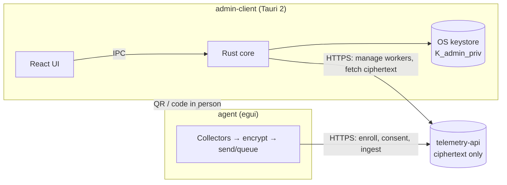

# Telemetry Apps

Desktop clients for the Telemetry system: an **Admin** console and a **Worker** agent, sharing one crypto crate. They talk to [`telemetry-api`](../telemetry-api), a **zero-knowledge** server that stores only ciphertext.

> **Project status (2026-09-28):** the crypto core is complete and tested. Both apps build and run, but they do **not** yet work end-to-end against the real API, and several screens run on mock data. See [`.ai-context/implementation-status.md`](.ai-context/implementation-status.md) and the roadmap in [`tasks/README.md`](tasks/README.md).

## What the system does

1. The **admin** installs the admin app, creates an account and generates an X25519 keypair. The private key stays in the OS keystore; the public key is registered on the server.
2. The admin creates a worker, chooses which data categories to collect and **writes in plain language what each one means**. The server returns a single-use enrollment code.
3. The admin app shows a **QR** (code + cryptographic commitment) and a short code, which the admin gives to the employee in person.
4. The **employee** installs the agent and scans the QR or types the code. The agent receives its credentials, the admin's public key and the consent request. It **verifies them against the QR commitment**, so a compromised server cannot swap the key, then pins the key.
5. The employee sees exactly what will be collected and **accepts or rejects the whole package**. They can withdraw at any time.
6. While `ACTIVE`, the agent collects only the accepted categories, encrypts each batch to the pinned key (ephemeral X25519 + HKDF-SHA256 + AES-256-GCM) and sends it. The server stores blobs it cannot read.
7. The admin app downloads the ciphertext, **decrypts it locally in parallel**, visualizes it and wipes it on auto-lock.

Full design: [`.ai-context/domain.md`](.ai-context/domain.md) · enrollment protocol: `telemetry-api/ENROLLMENT.md`.



## Repository layout

| Path | Package | What it is |
|:-----|:--------|:-----------|
| `telemetry-crypto-core/` | `telemetry-crypto-core` | Envelope encryption (X25519, HKDF-SHA256, AES-256-GCM, zeroize). Enrollment commitment (planned, CRYPTO-02). |
| `agent/` | `agent` | Worker app: egui window, background collectors, SQLite offline queue, notifications. |
| `admin-client/src-tauri/` | `admin-client-core` | Admin app Rust backend: keystore, API client, parallel decryption. |
| `admin-client/src/` | `telemetry-admin-ui` (npm) | Admin UI: React 18, TypeScript, Tailwind, ECharts, Leaflet. |
| `docs/` | — | Functional specs ([admin](docs/admin-app-spec.md), [worker](docs/worker-app-spec.md)) and [plaintext payload schemas](docs/telemetry-payloads.md). |
| `.ai-context/` | — | Architecture, domain, constraints, security model, API contract, implementation status. **Start here.** |
| `tasks/` | — | Implementation tasks with requirements, DoD and tests. |
| `AGENTS.md` | — | Rules for AI assistants and contributors. |

## Prerequisites

- Rust ≥ 1.75 (`rustup`), Node.js 18/20 LTS + npm.
- **macOS:** `xcode-select --install`.
- **Linux (Debian/Ubuntu):**
  ```bash
  sudo apt install -y build-essential libwebkit2gtk-4.1-dev libssl-dev \
      libayatana-appindicator3-dev librsvg2-dev libxdo-dev pkg-config
  ```
- **Windows:** Visual Studio C++ Build Tools. WebView2 ships with Windows 10/11.
- A running `telemetry-api` with PostgreSQL (see its README) for anything beyond UI work.

## Configuration

```bash
cp .env.example .env
cp .env.example admin-client/.env
```

| Variable | Used by | Default | Notes |
|:---------|:--------|:--------|:------|
| `TELEMETRY_API_URL` | agent | `http://localhost:8080/api/v1` | Dev only; in production the URL comes from the enrollment QR. |
| `WORKER_FLUSH_INTERVAL` | agent | `30` | Seconds between flushes (minimum 5 today, 15 planned). |
| `ADMIN_API_URL` | admin (Rust) | `http://localhost:8080/api/v1` | |
| `VITE_API_URL` | admin (UI) | `http://localhost:8080/api/v1` | Display/default only; the UI never calls the API directly (target). |
| `ADMIN_AUTO_LOCK_MINUTES` | admin | `5` | Not yet read by the code (ADMIN-07). |
| `WORKER_ROLE`, `WORKER_ORGANIZATION` | agent | — | **Deprecated.** Role and organization come from the server after enrollment (AGENT-08). |

Agent local state: `<config_dir>/telemetry-worker/` (`config.json`, `offline.db`), where `<config_dir>` is `~/Library/Application Support` on macOS, `%APPDATA%` on Windows and `~/.config` on Linux. Today `config.json` still contains tokens in plaintext; moving them to the OS keystore is AGENT-08.

## Running

```bash
# Worker agent
cargo run -p agent                 # window + background engine
cargo run -p agent -- --headless   # background engine only

# Admin app
cd admin-client
npm install
npm run tauri dev                  # desktop app (Vite + Tauri)
npm run dev                        # UI only in a browser (mock data)
```

## Testing & quality gates

```bash
cargo fmt --all --check
cargo clippy --workspace --all-targets -- -D warnings
cargo test --workspace             # crypto-core, agent, admin-client-core
cd admin-client && npm run build   # tsc + vite
```

Current coverage: crypto roundtrip and tamper detection; agent counters, buffer, device id, offline queue, config serialization and role rule; admin parallel decryption. No test yet exercises the real API contract (INT-01).

> `ui::tests::test_traffic_light_states` writes to your real agent `config.json`. Back it up before running the tests until INT-01 fixes this.

## Building releases

```bash
cargo build --release -p agent                 # target/release/agent(.exe)
cd admin-client && npm run tauri build         # .dmg/.app, .msi/.exe, .deb/.AppImage under src-tauri/target/release/bundle/
```

The release profile uses LTO, `strip`, `panic = "abort"` and `opt-level = 3`. Code signing and notarization are not configured yet.

## Privacy guarantees (by design)

| Category | Collected | Never collected |
|:---------|:----------|:----------------|
| System | Foreground app & title, idle time, CPU/RAM, USB events | Screen content |
| Network | Domain names (FQDN) + counts | URLs, paths, queries, page content |
| Productivity | Keystrokes and clicks **per minute**; screenshots only if explicitly requested and accepted, each one notified | Which keys were pressed, any text |
| Files | Create/modify/delete/rename events in designated folders | File contents, other folders |
| Location | GPS, `FIELD` role only, work hours only | Anything for `OFFICE` workers or off-hours |

Nothing is collected before the employee accepts, while the admin has the worker paused, or after withdrawal or revocation. Full rules with IDs: [`.ai-context/constraints.md`](.ai-context/constraints.md). Legal context: GDPR, Chilean Law 19.628 / 21.719. Whether consent is a valid legal basis in an employment relationship must be validated by counsel.

## Contributing

Branches: `dev` (protected) · `dev-architecture` · `dev-features` · `dev-admin/<topic>` · `dev-agent/<topic>`. Conventional commits. Read [`AGENTS.md`](AGENTS.md) and pick a task from [`tasks/README.md`](tasks/README.md); every PR updates the task checkboxes and `implementation-status.md`.
