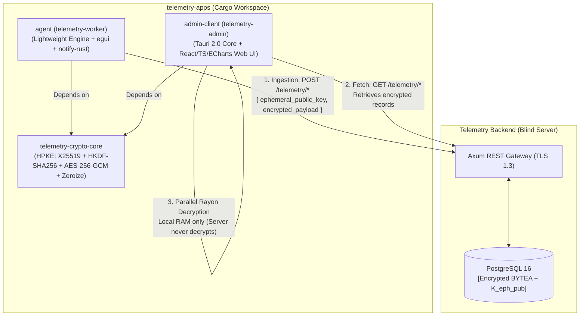

# Telemetry Apps — Zero-Knowledge Desktop Ecosystem


The **Telemetry Apps** monorepo hosts the production desktop applications and shared cryptographic core for the Telemetry enterprise ecosystem. Engineered with **Rust**, **Tauri 2.0**, and **egui**, the system enforces an uncompromising **Zero-Knowledge** and **Privacy by Design** architecture under international compliance standards (**GDPR** and **Chilean Law 19.628 / 21.719**).

---

## 📑 Table of Contents
1. [Architectural Overview & Security Model](#-architectural-overview--security-model)
2. [Monorepo Composition & Directory Structure](#-monorepo-composition--directory-structure)
3. [Prerequisites & System Requirements](#-prerequisites--system-requirements)
4. [Development & Execution Guide](#-development--execution-guide)
5. [Testing Suite](#-testing-suite)
6. [Generating Production Executables & Installers](#-generating-production-executables--installers)
7. [Enrollment & Configuration Protocol](#-enrollment--configuration-protocol)
8. [Data Minimization & Compliance Standards](#-data-minimization--compliance-standards)
9. [Branching & Contribution Strategy](#-branching--contribution-strategy)

---

## 🛡️ Architectural Overview & Security Model

The backend Axum / PostgreSQL server operates as a **blind encrypted relay**. It stores binary blobs (`BYTEA`) and ephemeral public keys, but **never** has access to plaintext telemetry data, symmetric keys, or master private keys.



### Hybrid Public Key Encryption (HPKE - RFC 9180) Flow

1. **Admin Master Setup:** The Admin application generates an asymmetric X25519 keypair ($K_{admin\_priv}$, $K_{admin\_pub}$). The private key is securely committed to the **OS Keystore** (Apple Keychain, Windows Credential Manager, or Linux Secret Service via DBus) and never leaves the machine.
2. **Worker Ephemeral Encryption:**
   - Every batch generates a fresh ephemeral X25519 keypair ($k_{eph\_priv}$, $K_{eph\_pub}$).
   - Computes Shared Secret: $SS = \text{ECDH}(k_{eph\_priv}, K_{admin\_pub})$.
   - Derives Data Encryption Key: $\text{DEK} = \text{HKDF-SHA256}(SS, \text{salt}=\text{"telemetry-v1"}, \text{info}=\text{"aes256gcm"})$.
   - Encrypts payload with **AES-256-GCM** using a cryptographically secure 12-byte Nonce.
   - Wraps ciphertext into the binary envelope:
     ```
     +-------------------+--------------------+--------------------------------+
     | Nonce (12 bytes)  | Auth Tag (16 bytes)| Ciphertext (N bytes)           |
     +-------------------+--------------------+--------------------------------+
     |<---------------------- encrypted_payload ----------------------------->|
     ```
   - **Zeroize:** Immediately overwrites $k_{eph\_priv}$, $SS$, and $\text{DEK}$ from RAM using the `zeroize` crate.
3. **Admin Multithreaded Decryption:**
   - Retrieves encrypted envelopes and $K_{eph\_pub}$.
   - Loads $K_{admin\_priv}$ from the OS Keystore.
   - Distributes batch decryption across all CPU cores using **`rayon::into_par_iter()`**.
   - Authenticates Poly1305/GCM tag and deserializes JSON into volatile memory.
   - Zeroizes derived keys and flushes plaintext upon inactivity auto-lock.

---

## 📦 Monorepo Composition & Directory Structure

```
telemetry-apps/
├── Cargo.toml                  # Workspace root (declares members and shared dependencies)
├── .cargo/
│   └── config.toml             # Optimization flags, LTO, and cross-compilation profiles
├── .gitignore                  # Git ignore rules for build artifacts and databases
├── README.md                   # Master engineering documentation
├── AGENTS.md                   # Strict architectural directives for AI agents
├── telemetry-crypto-core/      # Shared Zero-Knowledge Cryptographic Crate
│   ├── Cargo.toml
│   └── src/
│       ├── lib.rs              # High-level encrypt_telemetry_batch & decrypt_telemetry_record
│       ├── asymmetric.rs       # X25519 keypair generation, Base64 encoding, and ECDH
│       ├── kdf.rs              # HKDF-SHA256 key derivation with domain separation
│       ├── symmetric.rs        # AES-256-GCM AEAD encryption/decryption with Nonce+Tag framing
│       └── error.rs            # Strongly typed CryptoError hierarchy
├── agent/                      # Worker Desktop Daemon & Consent Client
│   ├── Cargo.toml
│   └── src/
│       ├── main.rs             # Application entrypoint & runtime bootstrap
│       ├── config.rs           # Persistent settings & consent flags
│       ├── device.rs           # Deterministic SHA-256 hardware identifier
│       ├── errors.rs           # AgentError hierarchy
│       ├── notifications.rs    # notify-rust dispatcher (hourly alerts, screenshot warnings)
│       ├── core/
│       │   ├── buffer.rs       # Double buffering engine via std::mem::take (<50ns hold)
│       │   ├── metrics.rs      # System, Network, Productivity, File, and Location models
│       │   └── collectors/     # Background telemetry collectors
│       │       ├── keystroke_counter.rs # O(1) AtomicU64 key & click counters (zero lag)
│       │       ├── idle_time.rs         # Non-intrusive polling loop
│       │       └── active_window.rs     # Foreground process and window title inspection
│       ├── io/
│       │   ├── encryption.rs   # Integration with telemetry-crypto-core
│       │   ├── system_hooks.rs # OS hook abstractions
│       │   └── transport.rs    # SQLite offline queue (WAL mode) & async HTTP client
│       ├── background/
│       │   └── worker.rs       # Background collection loop & hourly notification scheduler
│       └── ui/
│           ├── mod.rs          # WorkerUIState & traffic light indicator
│           ├── settings.rs     # Consent toggle rules & role restriction validation
│           ├── onboarding.rs   # Enrollment package parser
│           └── tray.rs         # System tray menu and pause controller
└── admin-client/               # Executive Admin Console (Tauri 2.0 + React)
    ├── package.json            # Web dependencies (React 18, Vite, ECharts, Lucide, Tailwind)
    ├── vite.config.ts          # Frontend bundler configuration
    ├── tsconfig.json           # TypeScript configuration with vite/client types
    ├── src/                    # Web Frontend Interface
    │   ├── App.tsx             # Executive sidebar layout & 5-minute auto-lock trigger
    │   ├── main.tsx            # React DOM mounting
    │   ├── index.css           # Tailwind CSS directives
    │   ├── api/
    │   │   └── tauri-bridge.ts # IPC bridge, data models & mock/live fallback
    │   └── components/
    │       ├── Dashboard.tsx         # KPI summary cards, deep filtering & worker CRUD
    │       ├── EmployeeCard.tsx      # Worker card with consent badges & enrollment action
    │       ├── ActivityChart.tsx     # ECharts dual-axis CPU/RAM/KPM timeline
    │       ├── NetworkExplorer.tsx   # Top FQDNs pie chart & GDPR compliance auditor
    │       ├── ScreenshotGallery.tsx # Productivity gallery with Privacy Blur mode
    │       ├── FieldMap.tsx          # Leaflet GPS breadcrumb tracker & geofencing
    │       ├── ConsentSettings.tsx   # Organization privacy compliance overview
    │       └── AutoLockModal.tsx     # Inactivity lock screen with RAM memory purge
    └── src-tauri/              # Native Rust Backend for Tauri
        ├── Cargo.toml
        ├── build.rs            # Tauri build script (tauri_build::build())
        ├── tauri.conf.json     # Tauri 2.0 window geometry, permissions & bundle metadata
        ├── icons/              # Multi-platform app icons (icns, ico, png)
        └── src/
            ├── main.rs         # Tauri core initialization, commands & tracing
            ├── keystore.rs     # Apple Keychain / DPAPI / SecretService vault
            ├── client.rs       # Authenticated HTTP client with token refresh
            └── commands.rs     # Rayon parallel batch decryption pipeline
```

---

## 💻 Prerequisites & System Requirements

### Cross-Platform Toolchains
- **Rust Toolchain:** Version `1.75.0` or newer (`rustc`, `cargo`).
- **Node.js:** Version `18.x` or `20.x` LTS + `npm` (v10+).

### Platform-Specific Native Dependencies

#### macOS (macOS 12 Monterey+)
- Xcode Command Line Tools:
  ```bash
  xcode-select --install
  ```

#### Linux (Ubuntu 22.04+ / Debian 12+ / Fedora / Arch)
- WebKitGTK and build tools for Tauri:
  ```bash
  # Debian / Ubuntu:
  sudo apt update
  sudo apt install -y build-essential libwebkit2gtk-4.1-dev curl wget file \
      libssl-dev libayatana-appindicator3-dev librsvg2-dev libxdo-dev pkg-config
  ```

#### Windows (Windows 10/11)
- Microsoft Visual Studio C++ Build Tools (with C++ Desktop Development workload).
- Microsoft Edge WebView2 (pre-installed on Windows 10/11).

---

## 🚀 Development & Execution Guide

### 1. Running the Worker Agent (`agent`)

The worker runs as an ultra-lightweight daemon on employee workstations.

```bash
# Run the worker in debug mode with structured logging
RUST_LOG=info cargo run -p agent

# Run with verbose trace logging (inspect buffer and collector ticks)
RUST_LOG=debug cargo run -p agent
```

#### What happens on startup:
1. Generates or loads the canonical **64-character SHA-256 device identifier** from hardware UUID.
2. Initializes the double buffer (`MetricsBuffer`) in volatile memory.
3. Dispatches an immediate desktop notification alerting the user that monitoring is active.
4. Starts a background timer that repeats the **transparency notification every 1 hour**.
5. Connects collectors ($O(1)$ block-free keystroke counters, 30s system samples).
6. Initializes the local offline queue in SQLite (`offline.db`).

---

### 2. Running the Admin Desktop Console (`admin-client`)

The admin app consists of a Vite/React frontend orchestrated by the Tauri 2.0 Rust runtime.

#### Option A: Full Tauri Desktop Mode (Recommended)
```bash
# Navigate to the admin-client folder
cd admin-client

# Install frontend dependencies
npm install

# Launch Tauri development mode (starts Vite server and native desktop window)
npm run tauri dev
```

#### Option B: Standalone Web Frontend Development
```bash
cd admin-client
npm install
npm run dev
# Open http://localhost:5173 in any browser to inspect the UI and charts
```

#### Option C: Native Backend Headless Testing
```bash
cargo run -p admin-client-core
```

---

## 🧪 Testing Suite

The repository contains an exhaustive test suite covering cryptographic integrity, concurrency stress tests, memory isolation, and UI state validation.

### Run All Workspace Tests
```bash
cargo test --workspace
```

### Testing Specific Components

#### 1. Cryptographic Core (`telemetry-crypto-core`)
```bash
cargo test -p telemetry-crypto-core
```
- `test_admin_keypair_generation`: Validates X25519 derivation and Base64 format.
- `test_roundtrip_encryption_decryption`: Verifies full HPKE cycle with arbitrary JSON.
- `test_tampered_ciphertext_fails`: Validates that altering 1 bit in ciphertext triggers `AeadError`.
- `test_tampered_tag_fails`: Validates that altering 1 bit in Poly1305/GCM tag rejects decryption.
- `test_payload_too_short`: Asserts that payloads $< 28$ bytes are immediately rejected.

#### 2. Worker Agent (`agent`)
```bash
cargo test -p agent
```
- `test_atomic_counters_record_and_reset`: Asserts $O(1)$ lock-free keystroke/click counters.
- `test_buffer_push_drain_and_fifo_eviction`: Validates `std::mem::take` and 1,000-item FIFO cap.
- `test_device_identifier_format_and_determinism`: Tests deterministic 64-char hex hardware hash.
- `test_offline_queue_fifo_order_and_deletion`: Verifies SQLite transaction isolation and FIFO delivery.
- `test_encryption_pipeline_integration`: Validates crypto-core batch wrapping.
- `test_office_worker_cannot_enable_location`: Enforces compliance: `OFFICE` workers cannot turn on GPS.
- `test_field_worker_can_enable_location`: Allows GPS for verified `FIELD` workers.
- `test_notifications_do_not_panic`: Ensures headless resilience for `notify-rust`.
- `test_traffic_light_states`: Validates 🟢/🟡/🔴 state transitions.

#### 3. Admin Core Backend (`admin-client-core`)
```bash
cargo test -p admin-client-core
```
- `test_parallel_decryption_pipeline`: Verifies that `rayon::into_par_iter()` decrypts 50 records concurrently across CPU cores.
- `test_corrupted_record_fails_in_parallel_pool`: Validates that tampered records are rejected safely.

#### 4. Frontend Typechecking & Bundle Verification
```bash
cd admin-client
npm run build
```
- Executes `tsc` followed by `vite build` to guarantee zero TypeScript or asset resolution errors.

---

## 📦 Generating Production Executables & Installers

### 1. Worker Agent Optimized Binary (`agent`)

The release profile enables Link-Time Optimization (**LTO**), abort-on-panic, maximum optimization (`opt-level = 3`), and binary symbol stripping.

```bash
cargo build --release -p agent
```
The resulting standalone executable is generated at:
```
target/release/agent
```
- **Windows:** `target/release/agent.exe`
- **macOS / Linux:** `target/release/agent`
- Typical footprint: $< 15\text{ MB}$, memory usage: $< 25\text{ MB}$ RAM.

---

### 2. Admin Desktop App Installers (`admin-client`)

Tauri bundles the React frontend and Rust backend into native, signed operating system installers:

```bash
cd admin-client
npm run tauri build
```

The resulting packages are located at `admin-client/src-tauri/target/release/bundle/`:

| Operating System | Generated Installer Format | Location |
|:---|:---|:---|
| **macOS (Apple Silicon & Intel)** | `.dmg` installer & `.app` bundle | `target/release/bundle/dmg/*.dmg` |
| **Windows 10/11** | `.msi` (WiX) & `.exe` (NSIS installer) | `target/release/bundle/msi/*.msi` |
| **Linux (Ubuntu/Debian)** | `.deb` package | `target/release/bundle/deb/*.deb` |
| **Linux (Cross-distro)** | `.AppImage` standalone binary | `target/release/bundle/appimage/*.AppImage` |

---

## 🔑 Enrollment & Configuration Protocol

1. **Admin Keypair Generation:**
   On first launch of `admin-client`, navigate to **Bóveda & Cumplimiento**. The app calls `generate_and_save_master_keys()`, storing $K_{admin\_priv}$ in Keychain/DPAPI and exposing $K_{admin\_pub}$.
2. **Worker Registration:**
   The admin opens **Nuevo Trabajador**, enters the worker's name, email, role (`OFFICE` vs `FIELD`), work hours (e.g. `09:00 - 18:00`), and timezone (`America/Santiago`).
3. **Enrollment Package:**
   The admin console generates an enrollment JSON package:
   ```json
   {
     "api_url": "https://telemetry.acme.corp/api/v1",
     "worker_id": "01912345-6789-7abc-def0-123456789def",
     "admin_public_key": "K_admin_pub_x25519_base64_encoded_here==",
     "organization": "Acme Corp"
   }
   ```
4. **Worker Provisioning:**
   The employee provides the JSON package to `agent`. The agent validates $K_{admin\_pub}$ via `decode_public_key()` and saves its configuration locally in:
   - **macOS:** `~/Library/Application Support/telemetry-worker/config.json`
   - **Windows:** `%APPDATA%\telemetry-worker\config.json`
   - **Linux:** `~/.config/telemetry-worker/config.json`

---

## ⚖️ Data Minimization & Compliance Standards

| Privacy Requirement | Technical Implementation | Regulatory Baseline |
|:---|:---|:---|
| **No Keystroke Logging** | Callback increments an `AtomicU64` with `Ordering::Relaxed`. Key codes are never captured. | GDPR Art. 5.1.c, Chilean Law 19.628 |
| **Network Privacy** | Captures passive DNS / SNI **FQDNs only** (e.g., `github.com`). Full URLs, query strings, and HTTP bodies are discarded. | GDPR Art. 5.1.c |
| **File Privacy** | Watches corporate directories via `notify`. Logs only `Created`, `Modified`, `Deleted`, `Renamed` and extensions. File contents are never opened or read. | Confidentiality of Communications |
| **Location Protection** | GPS is **hardware & software locked** for `OFFICE` workers. For `FIELD` workers, GPS is **automatically suspended** outside `work_hours_start` and `work_hours_end`. | Chilean Law 21.719 (Right to Disconnect) |
| **Active Transparency** | Dispatches desktop notification at startup and **recurrently every 1 hour** confirming telemetry collection. Alerts on screenshots. | Anti-Spyware Transparency |
| **Inactivity Auto-Lock** | Admin app auto-locks after 5 minutes of inactivity, immediately executing `zeroize` to flush plaintext records and tokens from RAM. | GDPR Art. 32 (Security of Processing) |

---

## 🌿 Branching & Contribution Strategy

To protect codebase stability and adhere to repository governance rules:

- **`dev`**: Integration branch (**Strictly Protected** — do not commit directly).
- **`dev-architecture`**: Core workspace configuration, Cargo setup, shared crates, and baseline documentation.
- **`dev-features`**: Cross-cutting feature developments across applications.
- **`dev-admin/*`**: Specific developments for the Tauri Admin desktop console.
- **`dev-agent/*`**: Specific developments for the Rust Worker daemon.
