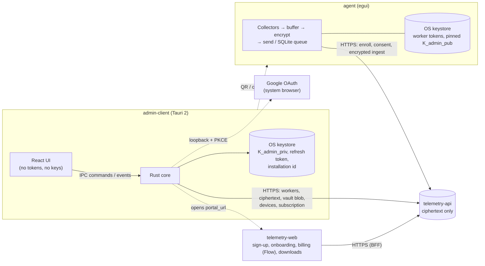

# Telemetry Apps

Desktop clients of the Telemetry platform: an **Admin** console (Tauri 2 + React) and a **Worker** agent (Rust + egui), sharing one crypto crate. They talk to [`telemetry-api`](https://github.com/Demiannnnnn/telemetry-api), a **zero-knowledge** server that stores only ciphertext, and to the web portal `telemetry-web` only by opening it in the browser (sign-up, billing, downloads).

> **Project status (2026-09-30).** Both apps speak the **API contract v2** (`telemetry-api` TASK-12..17): verified enrollment package v2, granular consent, typed errors, single-flight token refresh, Google sign-in and authorised devices for the admin, the key vault (`.tkb` backups, server backup, recovery, destructive rotation) and the subscription lock screen (TASK-APP-01/02). Verified in the audit: `cargo test --workspace` (crypto-core 33 · agent 86 · admin-client-core 91 tests), `cargo clippy -D warnings`, no `unwrap`/`expect` outside tests, `cargo fmt`, admin UI `tsc`, `npm test` (28) and `npm run build`. The desktop windows were **not** driven end-to-end against a live API in the audit environment.
>
> **Known production blockers** (details in [`implementation-status.md`](.ai-context/implementation-status.md) §5): the auto-lock "Biometría" button unlocks without any OS verification; a withdrawal that fails offline is not re-sent automatically; `agent --headless` runs without a tray icon.

---

## Contents

- [What the system does](#what-the-system-does)
- [Architecture](#architecture)
- [Repository layout](#repository-layout)
- [Features](#features)
- [Security and privacy guarantees](#security-and-privacy-guarantees)
- [Prerequisites](#prerequisites)
- [Configuration](#configuration)
- [Running in development](#running-in-development)
- [Google sign-in setup (admin app)](#google-sign-in-setup-admin-app)
- [Key backup format (`.tkb`)](#key-backup-format-tkb)
- [How the apps use the API](#how-the-apps-use-the-api)
- [Testing and quality gates](#testing-and-quality-gates)
- [Building releases](#building-releases)
- [Troubleshooting](#troubleshooting)
- [Privacy guarantees by category](#privacy-guarantees-by-category)
- [Documentation map](#documentation-map)
- [Contributing](#contributing)

---

## What the system does

1. The **admin** creates an account (email + password or Google, in the web portal or the admin app) and an X25519 keypair. The private key stays in the OS keystore; the public key is registered on the server. The admin keeps an encrypted copy of the private key — a `.tkb` file and/or a server backup — both encrypted **on the client** with a Master Password (Argon2id + AES-256-GCM). The server never sees the Master Password or the private key in clear.
2. The admin creates a worker, chooses which data categories may be collected and **writes in plain language what each one means**. The server returns a single-use enrollment package.
3. The admin app **verifies the enrollment package** against its own key (manifest commitment, 12-digit safety code, QR payload) and only then shows the **QR** and the short code, which the admin gives to the employee in person.
4. The **employee** installs the agent and pastes the QR payload or types the code. The agent receives its credentials, the admin's public key and the consent request, **verifies them against the QR commitment** (or the safety code read aloud) so a compromised server cannot swap the key, and pins the key.
5. The employee sees exactly what the employer asks for and **chooses category by category** (all boxes start unchecked). They can change the selection or withdraw at any time; every decision is stored by the server as immutable evidence.
6. While `ACTIVE`, the agent collects only the accepted categories, encrypts each batch to the pinned key (ephemeral X25519 + HKDF-SHA256 + AES-256-GCM) and sends it; the server stores blobs it cannot read.
7. The admin app downloads the ciphertext, **decrypts it locally in parallel**, visualizes it and wipes it on auto-lock.
8. Billing happens only in the web portal (Flow). If the subscription is suspended or cancelled, the admin app shows a lock screen that opens the portal, and agents stop collecting (already-encrypted data stays queued; the employee's rights keep working).

Full design: [`.ai-context/domain.md`](.ai-context/domain.md) · enrollment protocol: `telemetry-api/ENROLLMENT.md` · contract v2 design: `telemetry-api/ARCHITECTURE-CHANGES.md`.

## Architecture



- **Admin app:** the React UI only calls typed Tauri commands (`src/api/tauri-bridge.ts`); every HTTP request, token, key and Master Password lives in Rust (`admin-client/src-tauri`). Rust emits `session-expired` and `subscription-blocked` events to the UI.
- **Agent:** the egui window never blocks — async work runs on an engine runtime (`EngineHandle`), commands go over `mpsc`, state comes back over `watch`. The tray runs on its own GTK thread on Linux.
- **Crypto core:** one crate for both apps, so the envelope format, the enrollment commitment and the key backup format are identical everywhere.

Details: [`.ai-context/architecture.md`](.ai-context/architecture.md).

## Repository layout

| Path | Package | What it is |
|:-----|:--------|:-----------|
| `telemetry-crypto-core/` | `telemetry-crypto-core` | Envelope encryption (X25519, HKDF-SHA256, AES-256-GCM, zeroize), enrollment manifest/commitment/safety code/QR payload (CRYPTO-02), key backups: `.tkb` v2 with Argon2id (`backup_v2.rs`, CRYPTO-03) and legacy `.vault` v1 **import only** (`backup.rs`). |
| `agent/` | `agent` | Worker app: egui window, enrollment, granular consent, background collectors, SQLite offline queue, notifications, tray. |
| `admin-client/src-tauri/` | `admin-client-core` | Admin app Rust backend: `client.rs` (API client: typed errors, single-flight refresh, events), `google_oauth.rs`, `device.rs`, `keystore.rs`, `commands/{session,keys,vault,devices,subscription,workers,telemetry}.rs`. |
| `admin-client/src/` | `telemetry-admin` (npm) | Admin UI: React 18, TypeScript, Tailwind, ECharts, Leaflet, `qrcode.react`. Pure helpers in `src/lib/` (`errors.ts`, `subscription.ts`, `vault.ts`) and `components/consentCategories.ts` are unit-tested with `node --test`. |
| `docs/` | — | Functional specs ([admin](docs/admin-app-spec.md), [worker](docs/worker-app-spec.md)) and [plaintext payload schemas](docs/telemetry-payloads.md). |
| `.ai-context/` | — | Domain, architecture, constraints, security model, **API contract**, implementation status. **Start here.** |
| `tasks/` | — | Implementation tasks with requirements, validations, DoD and tests ([roadmap](tasks/README.md)). |
| `AGENTS.md` | — | Rules for AI assistants and contributors. |

## Features

### Admin app (`admin-client`)

| Area | What it does | Task |
|:---|:---|:---|
| Sign-in | Email + password or **Google** (system browser, loopback `127.0.0.1:<random>`, PKCE S256, `state` + `nonce`, 180 s timeout); every sign-in sends the device descriptor; no fake profiles. | ADMIN-02, ADMIN-10 |
| Session | Access token only in Rust memory (`Zeroizing`), refresh token in the keystore, **single-flight refresh**, `DEVICE_REVOKED` ⇒ immediate logout, auto-lock 5–30 min with RAM purge. | ADMIN-07, INT-02 |
| Start-up gates | Subscription → organization → key, before any data view; network failure ⇒ "Reintentar" (no state assumed). | ADMIN-12, ADMIN-09, ADMIN-11 |
| Subscription (TASK-APP-01) | Lock screen for `SUSPENDED`/`CANCELLED` with copy per reason, **Abrir en navegador** (server-provided portal URL only), support e-mail, "Ya pagué, verificar de nuevo", re-check every 60 s; trial banner ≤ 7 days. | ADMIN-12 |
| Key vault (TASK-APP-02) | First key (K0), recovery wizard (K1 key only on server, K2 mismatch): **A** `.tkb`/`.vault` file, **B** server backup + Master Password, **C** new key with double confirmation (`GENERAR NUEVA LLAVE`, checked in Rust); `.tkb` export; server backup setup/delete; no implicit key generation anywhere. | ADMIN-11 |
| Devices | List ("este equipo", last use, key fingerprint), rename, revoke (not the last active one; revoking this one logs out). | ADMIN-10 |
| Workers | Paginated list with filters, create with described consent (DP-08), **enrollment package v2 verified locally** before showing the QR, regenerate code (`REVOKE_FIRST` dialog), edit, pause/resume/revoke, delete, consent configuration, **granular evidence** (decision + accepted categories) with formula-safe CSV. | ADMIN-03, ADMIN-08, ADMIN-09 |
| Telemetry | Parallel decryption (`rayon`) tolerant to corrupted records; system, network, productivity/screenshots (blur mode), files and field map views (location locked for OFFICE). | ADMIN-04/05/06 |

### Worker agent (`agent`)

| Area | What it does | Task |
|:---|:---|:---|
| Enrollment | Paste the QR payload (v2 base64 or JSON) or type the code + server URL (https required in release); commitment verification or safety code; pinned key; tamper alert; errors by reason including `ENROLLMENT_LOCKED` countdown. | AGENT-08, AGENT-09 |
| Consent | One **unchecked** checkbox per category the admin requested, "Mantener mi selección anterior", "Cambiar mi selección", reject all, withdraw (purges buffer and queue first). | AGENT-09 |
| Collection | Only in `ACTIVE`, only accepted categories, time-bound categories only in work hours; keystroke/click **counts**, active window, idle, CPU/RAM, FQDN-only network, file metadata in designated folders, notified screenshots, FIELD-only location. | AGENT-02/03 |
| Delivery | One encrypted envelope per category, SQLite WAL queue (7 days, 100 MB, 5 MB/payload), backoff with jitter, single-flight refresh. | AGENT-04/05 |
| Billing pause | Employer suspended/cancelled ⇒ `EmployerSuspended`: collectors stop, queue kept, yellow light, notifications on enter/leave; rights keep working. | AGENT-09 |
| Transparency | Traffic light, schedule tab, rights tab (portability / erasure requests), diagnostics, notifications, tray. | AGENT-06/07 |

## Security and privacy guarantees

| Guarantee | How | Rule |
|:---|:---|:---|
| The server cannot read telemetry | Ephemeral X25519 + HKDF-SHA256 + AES-256-GCM per envelope, to the admin key pinned at enrollment | SEC-01, SEC-02 |
| The server never sees the admin private key or the Master Password | Argon2id and AES-GCM run only in the client; only the 60-byte blob + Argon2 parameters are uploaded | SEC-12 |
| A restored key is the right key | Public key derived after decrypting must match the registered fingerprint; keystore rolled back otherwise | SEC-13 |
| Refresh never self-revokes the session | Single-flight refresh in both apps | SEC-14 |
| Destroying the key requires intent | Checkbox + typed phrase, verified in Rust, then server rotation that revokes workers | SEC-15 |
| Google sign-in cannot be intercepted by another app | Loopback redirect on a random port, PKCE S256, `state`, `nonce` | SEC-16 |
| The UI cannot open arbitrary URLs | Only the portal URL received from the server, validated (https, no credentials, ≤ 2048) | SEC-17 |
| A compromised server cannot swap the admin key for a worker | QR commitment / safety code + key pinning; admin app re-verifies the package | SEC-07, SEC-08 |
| Secrets are wiped from memory | `zeroize` / `Zeroizing` for keys, KEKs, Master Passwords, tokens | SEC-02, SEC-11 |
| Nothing is collected without an explicit choice | Unchecked defaults, only requested categories, server-confirmed decisions | DP-06..DP-08, DP-11 |
| Billing never removes the worker's rights | Only ingestion stops; consent, withdrawal and data requests keep working | BILL-02, BILL-03 |

All rules with IDs: [`.ai-context/constraints.md`](.ai-context/constraints.md) · threat model: [`.ai-context/security-model.md`](.ai-context/security-model.md).

## Prerequisites

- **Rust** ≥ 1.75 (`rustup`).
- **Node.js 22** + npm for the admin UI (the unit tests import `.ts` modules directly with Node's type stripping; `npm run build` also works on Node 18/20).
- A running **`telemetry-api`** with PostgreSQL for anything beyond UI work (see its README).
- **macOS:** `xcode-select --install`. The agent needs the Accessibility (input counts, active window) and Screen Recording (screenshots) permissions, granted in System Settings → Privacy & Security.
- **Windows:** Visual Studio C++ Build Tools; WebView2 ships with Windows 10/11.
- **Linux (Debian/Ubuntu)** — packages verified to build the whole workspace:
  ```bash
  sudo apt install -y build-essential pkg-config libssl-dev \
      libgtk-3-dev libwebkit2gtk-4.1-dev libayatana-appindicator3-dev librsvg2-dev \
      libxdo-dev libxtst-dev libx11-dev libxcb1-dev libxrandr-dev libxkbcommon-dev \
      libdbus-1-dev libegl1-mesa-dev libwayland-dev libgbm-dev libpipewire-0.3-dev libclang-dev
  ```
  At runtime the OS keystore needs a Secret Service provider (GNOME Keyring or KWallet) and the tray needs an AppIndicator-capable desktop.

## Configuration

```bash
cp .env.example .env
cp .env.example admin-client/.env
```

| Variable | Used by | Default | Notes |
|:---------|:--------|:--------|:------|
| `TELEMETRY_API_URL` | agent | `http://localhost:8080/api/v1` | Dev only; in production the URL comes from the enrollment QR (must be `https`, SEC-10). |
| `WORKER_FLUSH_INTERVAL` | agent | `30` | Seconds between flushes; values below 5 are ignored. |
| `ADMIN_API_URL` | admin (Rust) | `http://localhost:8080/api/v1` | Release builds accept only `https://` URLs. |
| `VITE_API_URL` | admin (UI) | `http://localhost:8080/api/v1` | Default shown in the login form; the UI never calls the API directly. |
| `VITE_DEMO_MODE` | admin (UI) | unset | `true` enables the demo data store for UI work only; never set it in a release build (SEC-06). |
| `ADMIN_GOOGLE_CLIENT_ID` | admin (Rust) | empty | Google OAuth client of type **Desktop app**. Empty ⇒ the "Continuar con Google" button is hidden. Must also be listed in the API's `GOOGLE_CLIENT_ID`. |
| `ADMIN_GOOGLE_CLIENT_SECRET` | admin (Rust) | empty | Secret of that desktop client (Google does not treat it as confidential, but its token endpoint requires it). |
| `ADMIN_AUTO_LOCK_MINUTES` | — | `5` | Not read by the code: the auto-lock timeout (5–30 min) is chosen in the app (ADMIN-07). |

**Local state**

| App | Where | Contents |
|:---|:---|:---|
| Agent | `<config_dir>/telemetry-worker/` (`~/Library/Application Support` · `%APPDATA%` · `~/.config`) | `config.json` (no secrets), `offline.db` (encrypted envelopes) |
| Agent | OS keystore | Worker access/refresh tokens, pinned admin public key and fingerprint, accepted manifest hash and selection |
| Admin | OS keystore, service `TelemetryAdminVault` | `K_admin_priv`, refresh token, installation id (`inst-<32 hex>`) |
| Admin | Downloads folder | `.tkb` exports (permissions `0600` on Unix; never overwritten — an existing name gets `-2`, `-3`, … before `.tkb`; Downloads falls back to Documents, then home) |

## Running in development

```bash
# Worker agent
cargo run -p agent                 # window + background engine
# (--headless exists but currently runs without a tray icon: do not use it outside development)

# Admin app
cd admin-client
npm install
npm run tauri dev                  # desktop app (Vite + Tauri)
npm run dev                        # UI only in a browser; with VITE_DEMO_MODE=true it uses demo data
```

Typical local flow: start `telemetry-api` → register in the admin app (trial starts) → create the first key and a backup → create a worker → copy the QR payload → `cargo run -p agent` → paste it → choose categories.

## Google sign-in setup (admin app)

1. In Google Cloud Console create an OAuth client of type **Desktop app** (loopback redirects to `127.0.0.1` are allowed automatically).
2. Put its id and secret in `ADMIN_GOOGLE_CLIENT_ID` / `ADMIN_GOOGLE_CLIENT_SECRET`.
3. Add the same client id to the API's `GOOGLE_CLIENT_ID` (comma-separated with the web portal's client id) and set `GOOGLE_AUTH_ENABLED=true`.
4. The app opens the system browser, receives the code on `http://127.0.0.1:<random port>/`, exchanges it with PKCE at `https://oauth2.googleapis.com/token`, checks `state` and the ID token `nonce`, and sends the ID token to `POST /auth/google`. Codes: `GOOGLE_NOT_CONFIGURED`, `GOOGLE_SIGN_IN_CANCELLED`, `GOOGLE_SIGN_IN_TIMEOUT`, `GOOGLE_STATE_MISMATCH`, `GOOGLE_NONCE_MISMATCH`, `GOOGLE_TOKEN_EXCHANGE_FAILED`, `BROWSER_UNAVAILABLE`.

## Key backup format (`.tkb`)

Shared with `telemetry-web` (onboarding) and the API vault; specified in [`tasks/crypto-core/task-03-key-backup-v2-argon2id.md`](tasks/crypto-core/task-03-key-backup-v2-argon2id.md), which also contains the **reference vector** both implementations must reproduce.

```jsonc
{
  "format": "telemetry-key-backup", "version": 2,
  "kdf": { "algorithm": "argon2id", "version": 19, "memory_cost": 65536, "time_cost": 3, "parallelism": 4, "salt": "<b64 16 B>" },
  "encrypted_private_key": "<b64(nonce 12 ‖ tag 16 ‖ ciphertext 32)>",   // AES-256-GCM, AAD "telemetry-key-backup-v2"
  "public_key": "<b64 X25519>", "public_key_fingerprint": "<64 hex>",
  "organization": "Acme SpA", "created_at": "2026-09-30T12:00:00Z"
}
```

- Master Password: Unicode NFC, **not trimmed**, ≥ 12 characters, ≤ 1024 bytes. Accepted KDF ranges: `memory_cost` 32768–1048576 KiB, `time_cost` 2–20, `parallelism` 1–16, salt 16–64 bytes. Unknown fields are rejected; files are limited to 64 KiB.
- File name: `telemetry_key_{organization-slug}_{YYYY-MM-DD}.tkb`.
- Legacy `.vault` (v1, PBKDF2) can still be **imported**, never exported.

## How the apps use the API

Exact shapes, error mapping and events: [`.ai-context/api-contract.md`](.ai-context/api-contract.md) (contract v2). Summary:

| App | Endpoints |
|:---|:---|
| Admin | `POST /auth/{register,login,google,refresh,logout}` · `GET/PUT /admins/me` · `PUT /admins/me/public-key` · `POST /admins/me/public-key/rotate` · `GET/DELETE /admins/me/vault` · `POST /admins/me/vault/setup` · `GET /admins/me/vault/backup` · `GET /admins/me/devices` · `PATCH/DELETE /admins/me/devices/:id` · `GET /subscriptions/me` · `/workers` CRUD · `POST /workers/:id/enrollment-token` · `PUT /workers/:id/consent-config` · `PATCH /workers/:id/status` · `GET /workers/:id/consent-records` · `GET /telemetry/{category}` |
| Agent | `GET /health` · `POST /workers/enroll` · `POST /auth/refresh` · `GET /workers/me` · `PATCH /workers/me/consent` · `POST /telemetry/{category}` · `POST /workers/me/data-request` · `POST /workers/me/data-deletion` |

Rules both apps follow: branch on `error.code` + `error.details.reason` (never on `message`); one refresh in flight; `401 DEVICE_REVOKED` (admin) or a failed refresh (agent) ends the session; `402 SUBSCRIPTION_SUSPENDED` / `403 SUBSCRIPTION_CANCELLED` switch to the lock screen (admin) or to `EmployerSuspended` (agent); `Retry-After` is honoured for `429`. The deprecated `PATCH /workers/:id/consent` is not used.

## Testing and quality gates

```bash
cargo fmt --all --check
cargo clippy --workspace --all-targets -- -D warnings
cargo clippy --workspace -- -D clippy::unwrap_used -D clippy::expect_used   # no unwrap/expect outside tests
cargo test --workspace                                                    # crypto-core, agent, admin-client-core
cd admin-client && npx tsc --noEmit && npm test && npm run build          # UI types, unit tests, production build
```

| Suite | Highlights |
|:---|:---|
| `telemetry-crypto-core` | Envelope roundtrip/tamper, enrollment commitment vector, QR payload parsing, `.tkb` reference vector (verified independently with Python `argon2-cffi` + `cryptography`), legacy `.vault` fixture, KDF parameter limits |
| `agent` | Granular consent offer/decision/withdraw, enrollment errors and lockout, single-flight refresh, billing pause and queue retention, collectors gating, offline queue |
| `admin-client-core` | Typed errors and safe details, single-flight refresh, subscription block event, Google loopback flow with a simulated provider, PKCE (RFC 7636 vector), enrollment package verification, vault export/import/recovery/rotation with rollback, devices |
| UI (`npm test`) | Lock-screen copy, portal URL checks, Master Password rules, key-state screens, error messages, consent summaries and CSV evidence |

HTTP code is tested against `wiremock` servers that reproduce the API contract; tests never touch the real config directory or OS keystore (`tempfile`, `keystore::init_test_vault()`).

## Building releases

```bash
cargo build --release -p agent                 # target/release/agent(.exe)
cd admin-client && npm run tauri build         # .dmg/.app, .msi/.exe, .deb/.AppImage under src-tauri/target/release/bundle/
```

The release profile uses LTO, `strip`, `panic = "abort"` and `opt-level = 3`; the dev profile compiles `argon2`/`blake2` with `opt-level = 3` so key derivation stays fast in debug builds. Code signing and notarization are not configured yet. `telemetry-web` serves the installers from GitHub Releases. Before a production release, fix the blockers listed at the top of this file.

## Troubleshooting

| Symptom | Cause / fix |
|:---|:---|
| Admin shows "Suscripción suspendida" / "Período de prueba terminado" | `402`/`403` from the API: pay in the portal ("Abrir en navegador"), then "Ya pagué, verificar de nuevo". |
| Admin logs out with "Este equipo fue revocado" | The device was revoked from another session (`DEVICE_REVOKED`); sign in again (a new device entry is created). |
| "Continuar con Google" is missing | `ADMIN_GOOGLE_CLIENT_ID` is empty in the build environment. |
| Google sign-in fails with `GOOGLE_AUTH_DISABLED` / `INVALID_GOOGLE_TOKEN` | Enable Google on the API and add the desktop client id to `GOOGLE_CLIENT_ID`. |
| Recovery wizard says the key does not match | The file/backup belongs to another key (`BACKUP_KEY_MISMATCH`); use the backup made for the registered key, or generate a new key (destroys access to old data). |
| Creating a worker asks for the organization | `ORGANIZATION_NAME_MISSING`: the organization is shown to employees and is required. |
| Agent: "Demasiados intentos fallidos" | `ENROLLMENT_LOCKED`: wait for the countdown (`Retry-After`), then enter a valid code. |
| Agent: "Este código ya fue utilizado" | `ENROLLMENT_ALREADY_COMPLETED`: ask the admin for a new code (to move a device the admin revokes the old one first). |
| Agent light is yellow with "la cuenta de tu empleador no está activa" | Employer subscription blocked; collection resumes automatically after payment. |
| Linux: keystore errors | No Secret Service running (start GNOME Keyring / KWallet); in headless CI use the in-memory test vault. |
| Linux build fails on WebKit/GTK/dbus | Install the packages listed in [Prerequisites](#prerequisites). |

## Privacy guarantees by category

| Category | Collected | Never collected |
|:---------|:----------|:----------------|
| System | Foreground app & title, idle time, CPU/RAM, USB events | Screen content |
| Network | Domain names (FQDN) + counts | URLs, paths, queries, page content |
| Productivity | Keystrokes and clicks **per minute**; screenshots only if requested, accepted and each one notified | Which keys were pressed, any text |
| Files | Create/modify/delete/rename events in designated folders (relative paths, extensions) | File contents, other folders, absolute paths |
| Location | GPS, `FIELD` role only, work hours only | Anything for `OFFICE` workers or off-hours |

Nothing is collected before the employee accepts, outside the categories the employee accepted, while the admin has the worker paused or the employer's subscription is suspended, or after withdrawal or revocation. Legal context: GDPR, Chilean Law 19.628 / 21.719. Whether consent is a valid legal basis in an employment relationship must be validated by counsel.

## Documentation map

| Document | What it covers |
|:---|:---|
| [`.ai-context/README.md`](.ai-context/README.md) | Reading order and naming |
| [`.ai-context/domain.md`](.ai-context/domain.md) | Actors, lifecycle, consent model, categories, glossary |
| [`.ai-context/architecture.md`](.ai-context/architecture.md) | Crates, processes, threads, data flow |
| [`.ai-context/constraints.md`](.ai-context/constraints.md) | Hard rules with IDs (DP, SEC, PERF, BILL, …) |
| [`.ai-context/security-model.md`](.ai-context/security-model.md) | Keys, tokens, enrollment, vault, threat model |
| [`.ai-context/api-contract.md`](.ai-context/api-contract.md) | HTTP contract v2 as the apps use it |
| [`.ai-context/implementation-status.md`](.ai-context/implementation-status.md) | What is real, partial or missing, with known gaps |
| [`docs/admin-app-spec.md`](docs/admin-app-spec.md) · [`docs/worker-app-spec.md`](docs/worker-app-spec.md) | Screens, flows, commands, acceptance scenarios |
| [`docs/telemetry-payloads.md`](docs/telemetry-payloads.md) | Plaintext payload schemas (agent ⇄ admin) |
| [`tasks/README.md`](tasks/README.md) | Roadmap, dependency graph, Definition of Done |
| `telemetry-api/docs/api-specification.md`, Swagger `/swagger-ui` | Server contract (source of truth) |
| `telemetry-api/telemetry-apps.md` | Server-side mirror of these apps' spec and endpoint mapping |

## Contributing

Branches: never commit to `main`, `dev`, `develop` or `developer`; work on `dev-architecture`, `dev-features`, `dev-admin/<topic>`, `dev-agent/<topic>` or similar and open a pull request. Conventional commits. Read [`AGENTS.md`](AGENTS.md), pick a task from [`tasks/README.md`](tasks/README.md), keep the task checkboxes, `implementation-status.md` and — when the HTTP contract changes — `api-contract.md` updated in the same pull request.
