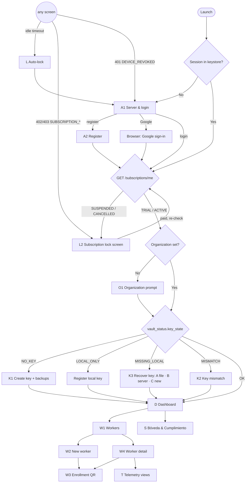

# Admin App (`admin-client`) — Functional Specification

> **v3 (2026-10-11):** attendance pivot. New screens T1, P1, AS1–AS4 and changes to L2, W1–W4, S, L
> are in §5. Domain: `.ai-context/domain.md` §10; rules `ATT-*`, `LEG-*`, `BILL-04`. **Keep the current
> palette, typography and layout** (owner decision): new screens reuse the existing sidebar, header,
> cards, tables and modals.

The desktop console for the organization's administrator. Its job:
1. Custody of `K_admin_pub`/`K_admin_priv` (the only place data can be decrypted) and of its encrypted backups.
2. Define what may be collected per worker, in plain language, and bind devices via verified enrollment codes.
3. Show the worker lifecycle and granular consent evidence; pause/resume/revoke.
4. Fetch ciphertext, decrypt locally, visualize — and forget it on lock.
5. Respect the subscription: when it is suspended, lock the console and send the admin to the web portal.

Stack: Tauri 2, Rust backend (`admin-client-core`), React 18 + TypeScript + Tailwind, ECharts, Leaflet, `keyring`, `rayon`. Window 1280×840 (min 1024×700).

## 1. Screen map



## 2. Screens

### A1 — Server & login
Email, password (no server field: the server is fixed at build time by `TELEMETRY_API_URL` in `admin-client/.env`) → `POST /auth/login { role: "ADMIN", device }`. **Continuar con Google** (ADMIN-10) opens the system browser; disabled with an explanation when the build has no Google client id. On failure show the API error — **never** a fake/offline profile. Session-expired reasons are shown here (`DEVICE_REVOKED`: "Este equipo fue revocado desde otra sesión").

### A2 — Register
Name, organization, email, password (hint matches the API rule: 8–128 with upper, lower, digit and symbol). `POST /auth/register` → logged in, 14-day trial.

### O1 — Organization prompt (ADMIN-09)
Shown when `organization` is empty (Google sign-up) or when `POST /workers` answers `409 ORGANIZATION_NAME_MISSING`. 2–255 chars; "Se muestra a tus trabajadores en la pantalla de consentimiento". `PUT /admins/me`.

### L2 — Subscription lock screen (ADMIN-12, `TASK-APP-01`)
Replaces the whole console (no sidebar). Title and text depend on `effective_status`/`reason` (trial ended, suspended for non-payment, cancelled). Shows the portal URL without scheme, **Abrir en navegador** (opens the server-provided `portal_url`), support e-mail with **Copiar**, **Ya pagué, verificar de nuevo**, **Cerrar sesión**; re-checks every 60 s. Decrypted data is purged when it appears.

### K1 — Create key (first run of the account, ADMIN-11)
1. Explain: "Esta llave es la única forma de leer los datos de tus trabajadores. El servidor nunca la tiene."
2. Generate → keystore → `PUT /admins/me/public-key` (rollback if it fails) → device key fingerprint.
3. **Backups** — Master Password (≥ 12 chars, typed twice; "No es la contraseña de tu cuenta y no la podemos recuperar"):
   - "Guardar respaldo cifrado en el servidor (recomendado)" → `POST /admins/me/vault/setup`.
   - "Descargar archivo de respaldo (.tkb)" → Downloads folder, path shown with the safe-keeping warning.
   Skippable, but a red alert stays in D and S until at least one backup exists.

### K2 — Key mismatch
The local key differs from the registered one. Shows both fingerprints (16 hex). Options: **Exportar la llave actual** (in case it decrypts old data) → then **Restaurar la llave registrada** (A file / B server, replacing the local one) or **Generar nueva llave** (C). Workers cannot be created until resolved.

### K3 — Recover key (new device, `TASK-APP-02`)
No key in this OS keystore but the server has one:
- **A. "Tengo archivo de respaldo (.tkb)"** — file picker (`.tkb`, also legacy `.vault`) + Master Password.
- **B. "Recuperar con Master Password"** — only if `key_backup_enabled`; downloads the encrypted backup (audited) and decrypts it locally.
- **C. "Generar nueva llave"** — destructive: warning ("los datos históricos serán ilegibles y todos tus trabajadores quedarán desvinculados"), checkbox + typing `GENERAR NUEVA LLAVE`; rotates the server key; then goes to K1 step 3.

### D — Dashboard
KPI cards: workers by status (Active / Awaiting consent / Invited / Paused / Revoked), key status (🟢 loaded & backed up / 🟡 not backed up / 🔴 missing), onboarding banner while `onboarding_completed = false`, trial banner (≤ 7 days left, button to the portal), pending alerts (codes expiring < 2 h, codes expired). Global worker selector and date range.

### W1 — Workers
Table: name, email, role, **status badge** ("Código expirado" when `enrollment_expired`), accepted/current consent version (`v2 / v3 ⚠`), accepted categories (`2/3`), device (hostname + OS), actions. Filters: status, role, search. Server pagination.

### W2 — New worker
Identity (name, email, role, work hours HH:MM start < end, IANA timezone), **data that may be collected**: six toggles (default off, DP-08), each enabled one requires a description (10–500 chars) prefilled with an editable template; `location` disabled for `OFFICE`; live **preview** of the worker's consent screen (checkboxes, as the agent shows them); code validity 1–72 h (default 24). Submit → `POST /workers` → W3. `409 ORGANIZATION_NAME_MISSING` → O1 then automatic retry; `409 ADMIN_PUBLIC_KEY_MISSING` → key screens.

### W3 — Enrollment QR (ADMIN-09)
- Rendered only after the local verification of the server package (commitment and safety code recomputed with the **local** key, `qr_payload` decoded and checked). Mismatch → integrity error, no QR.
- QR (`qr_payload`, base64), the code in large monospace, expiry countdown, **safety code**, server host.
- Instructions: "Instala Telemetry Worker, elige *Pegar QR* o *Ingresar código*. Si escribe el código, léele el código de seguridad y confirma que coincide."
- Copy code / Save QR as PNG. The code is **not stored**; closing the modal loses it (regenerate from W4).

### W4 — Worker detail
- Header: name, role, status badge, device info, enrolled at.
- **Lifecycle actions** (per status): *Generar código* (`PENDING_ENROLLMENT`, `REVOKED`, and `PENDING_CONSENT` never accepted); when the API answers `REVOKE_FIRST`, the dialog explains it and offers **Revocar equipo actual** (typed-name confirmation) before a new code; *Pause/Resume* with reason; *Revoke*; *Delete*.
- **Consent:** requested vs effective flags ("Aceptó 2 de 3 categorías"), current vs accepted version, descriptions; *Editar datos a recolectar* → `PUT /workers/:id/consent-config` (states whether re-acceptance is needed).
- **Consent history:** decision (Aceptó / Rechazó / Retiró / Reducción del admin), accepted categories, version, date, IP, app version, hash (short). CSV export (formula-safe).

### T — Telemetry views
Unchanged from ADMIN-04/05/06: two-phase progress, integrity panel, "No recolectado para este trabajador" for categories outside the effective flags.

### S — Bóveda & Cumplimiento
- **Llave:** local and registered fingerprints, state, **Exportar respaldo (.tkb)**, **Respaldo en el servidor** (enable/replace/delete), **Importar respaldo**, **Generar nueva llave (rotación)** (C).
- **Dispositivos autorizados** (ADMIN-10): list, rename, revoke (not the last active one; revoking this one logs out).
- **Suscripción** (ADMIN-12): effective status, expiry, trial days, **Gestionar suscripción** (portal).
- Auto-lock minutes, logout, version. Privacy principles cards.

### L — Auto-lock
After inactivity: clear decrypted data from React state and Rust caches, drop the access token (keep the refresh token), show unlock (password or, for Google-only accounts, sign in again with Google). Five wrong passwords revoke the session. The "Biometría" button must only unlock after a real OS prompt (Touch ID / Windows Hello); today it does not verify anything (known gap).

## 3. Tauri commands

| Domain | Commands |
|:-------|:---------|
| session | `admin_login(email, password, api_url)`, `admin_register(form)`, `admin_login_google(api_url)`, `google_sign_in_available()`, `admin_logout()`, `admin_get_session()`, `admin_update_profile({ name?, organization? })`, `admin_lock_and_flush_memory()`, `admin_unlock(password)`, `admin_unlock_with_biometric()` (⚠️ today re-opens the session with the stored refresh token **without** an OS biometric prompt — known gap, see `implementation-status.md`), `admin_is_locked()` |
| keys / vault | `admin_get_public_key()` (`KEY_SETUP_REQUIRED` when there is no local key — never generates one), `keys_status()`, `vault_status()`, `vault_create_initial_key()`, `keys_register_on_server()`, `vault_export_tkb(master_password, confirm_password?)`, `vault_setup_server_backup(master_password, confirm_password)`, `vault_delete_server_backup()`, `vault_import_backup(file_bytes, master_password, replace_local)`, `vault_recover_from_server(master_password, replace_local)`, `vault_generate_new_key(acknowledge_data_loss, confirmation_phrase)` |
| devices | `devices_list()`, `devices_rename(id, name)`, `devices_revoke(id)` |
| subscription | `subscription_status()`, `open_billing_portal()` |
| workers | `workers_list(query)`, `workers_get(id)`, `workers_create(form)`, `workers_update(id, form)`, `workers_delete(id)`, `workers_regenerate_token(id, ttl_hours?)`, `workers_update_consent_config(id, flags, descriptions)`, `workers_set_status(id, status, reason)`, `workers_get_consent_records(id)` |
| telemetry | `fetch_and_decrypt_telemetry(worker_id, category, from?, to?, subcategory?, page?, per_page?)` (category ∈ `system`, `network`, `productivity`, `files`, `location`; UUID and dates validated and percent-encoded), `admin_decrypt_records(records)`, `admin_simulate_and_decrypt()` (local self-test: encrypts a neutral sample to the local public key and decrypts it; no API call, no key creation) |

All return `Result<T, CommandError { code, message, reason?, details? }>`. None returns a token, a private key, a Master Password or a raw ciphertext to the UI. Events: `session-expired { reason }`, `subscription-blocked { status, reason, portal_url, support_email }`.

## 4. Acceptance scenarios

1. New admin on a fresh machine: register → key K1 → Master Password → server backup + `.tkb` → can create a worker.
2. Google sign-up on the web, first desktop login with Google → O1 (if needed) → K3 (key created on the web) → B with the Master Password → dashboard.
3. Create worker with 3 categories → QR shown only after local verification; a server answering with another commitment → integrity error, no QR.
4. After the employee accepts 2 of 3 categories, W1 shows ACTIVE `2/3` with their hostname.
5. Pause → agent stops; resume → agent restarts; revoke → agent unlinks. Regenerate on an accepted worker → REVOKE_FIRST dialog.
6. Widen consent → W1 shows `v1 / v2 ⚠` until the employee decides.
7. Export `.tkb` → delete the local key → import it → telemetry decrypts again.
8. Lost laptop: from another device, revoke it → its next request fails with `DEVICE_REVOKED`.
9. Trial expired → L2 at start; pay in the portal → "Ya pagué" → dashboard.
10. API down at login → error message, no fake session. 5 min idle → lock; decrypted data gone.


## 5. v3 — Attendance, legal and employer data

### 5.1 Navigation

The ink sidebar keeps its look. Items are grouped under two small uppercase labels (the existing
kicker style, `text-ink-muted`):

```
Tablero principal & enrolamiento
ASISTENCIA
  Asistencia en vivo            (AS1)
  Marcas y correcciones         (AS2)
  Reportes legales              (AS3)
TELEMETRÍA
  Actividad del sistema · Navegación de red (FQDN) · Productividad & capturas ·
  Actividad de archivos · Ubicación en terreno (FIELD)
Empresa                          (P1, AS4)
Bóveda & cumplimiento
```

The global header (worker + range selectors) is shown only on telemetry views; attendance views have
their own filters. After login the default view is **Asistencia en vivo** once the employer profile
exists; otherwise the Tablero with the onboarding banner.

### 5.2 Gates (order after sign-in)

`T1 terms` → subscription (`L2`) → organization (`O1`) → `P1 employer profile` (only blocks worker
creation, not navigation) → key state (K*) → console.

### T1 — Employer terms (LEG-04, LEG-05)
Full-screen card (auth layout: ink top bar + centered column `max-w-2xl`) with `terminos-empleador.md`
and `politica-privacidad.md` rendered from embedded Markdown, version + short hash, the fixed notice of
`marco-legal-cl.md` §7 in a warning box, **He leído y acepto** (enabled after scrolling both) and
**Cerrar sesión**. → `legal_accept_terms` → `POST /admins/me/terms-acceptance`. Shown again when
`terms_required_version` > accepted. Also readable any time from S → "Documentos legales".

### P1 — Employer legal profile (screen "Empresa")
- Card **Datos del empleador**: tipo (persona jurídica / natural), razón social o nombre completo, RUT
  (validated mod 11, formatted `76.123.456-7` on blur), dirección de casa matriz (calle, número, piso,
  oficina, comuna, ciudad, región — select of the 16 regions).
- Card **Lugares de trabajo**: table (nombre, dirección, trabajadores asignados), *Agregar lugar*,
  edit, delete (disabled with tooltip when in use).
- Card **Alertas de marcación**: toggle "Enviar alertas por marcas faltantes (30 minutos)" — on by
  default (R38 art. 45.1).
- Card **Incidentes técnicos**: list + *Registrar incidente* (inicio, término, descripción).
- Until the profile exists: a banner on Tablero and W2 "Completa los datos de tu empresa para crear
  trabajadores" + button to P1. `409 EMPLOYER_PROFILE_MISSING` from the API opens P1.

### AS1 — Asistencia en vivo
Table from `GET /attendance/board` (auto-refresh 60 s): trabajador, lugar, estado (En jornada · En
colación · Fuera de jornada · Sin marcar — badge with text), última marca (hora), marcas de hoy,
alertas ("Entrada no registrada"). Filters: lugar, estado, search. Row click → AS2 filtered on that
worker. Empty state: "Aún no hay trabajadores con asistencia. Crea uno desde el Tablero."

### AS2 — Marcas y correcciones
- Worker selector + date range (≤ 62 days). Day table from `GET /attendance/days`: fecha, jornada
  pactada, marcas (with `offline` and "Corregida" markers), faltante, extra, observaciones.
- Mark detail drawer: all fields incl. hash (mono groups of 4), source, workplace, location.
- **Proponer corrección** (secondary button; never deletes): kind (Modificar / Agregar), mark type,
  original mark (for Modificar), new date-time (to the second), motivo (5–500, required, e.g.
  "Elimina atraso"), checkbox "Confirmo que esta corrección no perjudica al trabajador". Inline
  errors by `details.reason`: `CORRECTION_TOO_EARLY` ("Solo puedes corregir desde el día hábil
  siguiente"), `CORRECTION_HARMS_WORKER`, etc. Copy: "El trabajador recibirá un correo y tendrá 48
  horas para oponerse. Si se opone, la marca original se mantiene."
- Corrections tab: status badges (Pendiente · Aceptada · Opuesta · Consolidada · Retirada), respond
  deadline, *Retirar* while pending.

### AS3 — Reportes legales (R38 arts. 25, 27, 28)
- Menu with the six reports in the R38 order and names: Reporte de asistencia · Reporte de jornada
  diaria · Reporte de domingos y/o días festivos · Reporte de modificaciones y/o alteraciones de
  turnos · Reporte diario (info: se envía por correo cada día) · Reporte de incidentes técnicos.
- Filters visible at once, usable in any order: trabajador(es) (search by name or RUN), período
  (última semana, quincena, mes anterior) or rango (≤ 5 años; 24 meses for domingos/festivos), tipo
  de jornada, lugar, cargo, hash.
- Preview = the server JSON rendered as tables per worker, R38 column names, altered cells marked,
  abbreviations legend; font ≤ 8 pt equivalent in print CSS; no horizontal scroll (columns wrap).
- **Exportar**: Excel / PDF / Word → `attendance_export_report` downloads the server file to
  Downloads (never overwrites; path shown with *Abrir carpeta*). **Imprimir** uses the PDF.
- Reachable **read-only from L2** when the subscription is blocked (BILL-04).

### AS4 — Settings in "Empresa"
See P1 (alerts toggle, incidents).

### 5.3 Changes to existing screens

- **L2 (subscription lock):** adds the secondary button **Ver reportes de asistencia** → AS3 in
  read-only mode inside the lock layout (no sidebar). Copy: "Tus trabajadores siguen pudiendo marcar
  asistencia. La telemetría está detenida."
- **W1 (workers):** columns become name, RUN, lugar, modalidad, **asistencia** (estado de hoy), status
  badge (`PENDING_TERMS` = "Esperando términos"), **telemetría** (`No solicitada` · `Pendiente` ·
  `2/3 aceptadas` · `Rechazada` · `Pausada`), device. Filters add lugar and modalidad.
- **W2 (new worker):** sections in order:
  1. *Identificación*: nombre completo, RUN, correo personal (unique; help: "Aquí llegan los
     comprobantes de cada marca. Debe ser un correo que controle el trabajador."), cargo.
  2. *Lugar y modalidad*: lugar de trabajo (select from P1; for Teletrabajo also "Domicilio del
     trabajador" address fields), modalidad (Presencial / Teletrabajo / Mixta), "Excluido de
     limitación de jornada (art. 22)" checkbox with help.
  3. *Jornada pactada*: tipo de jornada (+ resolución for Excepcional), week grid (Mon–Sun: works?,
     entrada, salida, colación inicio/fin), "La colación se imputa a la jornada", desconexión for
     Teletrabajo/Mixta (≥ 12 h), vigente desde. Live totals per day and week; warnings (not errors)
     when > 10 h/day or > weekly maximum in force ("Supera el máximo legal de 42 horas semanales").
     Checkbox "Registrar ubicación al marcar (requiere consentimiento escrito del trabajador en su
     contrato o anexo)" default off.
  4. *Telemetría (opcional)*: the existing six toggles, all off by default, with the note "Puedes no
     solicitar telemetría: el trabajador igual podrá marcar asistencia." Screenshots disabled for
     Teletrabajo/Mixta; Ubicación requires *Causa de seguridad o legal* (20–500 chars, shown to the
     worker verbatim) besides `FIELD`.
  5. Código de vinculación (TTL).
  The live consent preview stays (only when ≥ 1 category is requested).
- **W4 (worker detail):** header adds RUN, cargo, lugar, modalidad; tabs **Asistencia** (last 7 days
  summary + link to AS2), **Jornada** (current schedule, history of versions = shift changes,
  *Cambiar jornada* creates a new version with "vigente desde" and "solicitado por" Trabajador/Empleador),
  **Telemetría** (old consent section; *Pausar telemetría* / *Reanudar* replace Pause/Resume of the
  worker), **Evidencia** (consent records + terms acceptances). Lifecycle: Generar código, Revocar,
  Eliminar (unchanged rules).
- **S (Bóveda & cumplimiento):** adds **Documentos legales** (accepted versions, read again) and the
  authorization notice (LEG-07).
- **L (auto-lock):** the **Biometría** button is **removed** until a real OS prompt exists (closes the
  known security gap of ADMIN-07).
- **D (Tablero):** KPIs add "En jornada ahora", "Sin marcar hoy", "Correcciones pendientes".

### 5.4 New Tauri commands

| Domain | Commands |
|:--|:--|
| legal | `legal_documents()` (embedded texts, versions, hashes), `legal_status()`, `legal_accept_terms()` |
| employer | `employer_get()`, `employer_update(form)`, `workplaces_list()`, `workplaces_create(form)`, `workplaces_update(id, form)`, `workplaces_delete(id)`, `attendance_settings_update(form)`, `incidents_list(query)`, `incidents_create(form)` |
| attendance | `attendance_board()`, `attendance_days(worker_id, from, to)`, `attendance_marks(query)`, `attendance_propose_correction(form)`, `attendance_corrections(query)`, `attendance_withdraw_correction(id)`, `attendance_report(report, filters)`, `attendance_export_report(report, filters, format) -> saved path` |
| workers (v3) | `workers_create`/`workers_update` with legal data and schedule, `workers_update_schedule(id, schedule)`, `workers_set_telemetry_status(id, status, reason)`; `workers_set_status` keeps only `REVOKED` |

### 5.5 Acceptance scenarios (v3)

1. New admin: register → T1 → K1 → P1 (company + 1 workplace) → W2 attendance-only worker (no
   telemetry) → QR → the worker links, accepts terms, marks → AS1 shows "En jornada".
2. W2 with Teletrabajo: screenshots disabled; disconnection required ≥ 12 h; 11 h/day schedule shows
   the warning but saves.
3. AS2: correction on the same day → `CORRECTION_TOO_EARLY` message; next day "Elimina atraso" →
   pending; worker opposes → "Opuesta", original intact.
4. AS3: Reporte de jornada diaria for last week → R38 columns and weekly totals with sign; export
   Excel/PDF/Word saved to Downloads.
5. Subscription suspended → L2 → *Ver reportes de asistencia* works read-only; workers keep marking.
6. Auto-lock screen has no biometric button.
