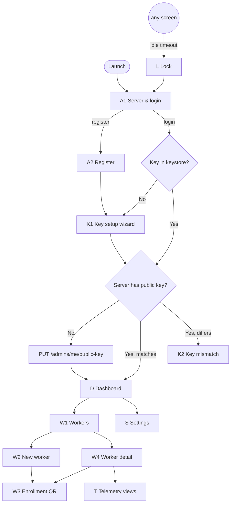

# Admin App (`admin-client`) — Functional Specification

The desktop console for the organization's administrator. Its job:
1. Custody of `K_admin_pub`/`K_admin_priv` (the only place data can be decrypted).
2. Define what is collected per worker, in plain language, and bind devices via enrollment codes.
3. Show the worker lifecycle and consent evidence; pause/resume/revoke.
4. Fetch ciphertext, decrypt locally, visualize — and forget it on lock.

Stack: Tauri 2, Rust backend (`admin-client-core`), React 18 + TypeScript + Tailwind, ECharts, Leaflet, `keyring`, `rayon`. Window 1280×840 (min 1024×700).

## 1. Screen map

## 2. Screens

### A1 — Server & login
Server URL (persisted in app config, not `localStorage`; default from `ADMIN_API_URL`), email, password. `POST /auth/login { role: "ADMIN" }`. On failure show the API error — **never** fall back to a fake/offline profile. A separate, clearly labelled *Demo mode* exists only in builds with `VITE_DEMO_MODE=true`.

### A2 — Register
Name, organization, email, password (complexity hint matches the API rule). `POST /auth/register` → logged in with returned tokens.

### K1 — Key setup wizard (first run on this machine)
1. Explain: "This key is the only way to read your workers' data. The server never has it."
2. Generate (`admin_generate_keypair`) → private key into keystore.
3. **Backup (strongly encouraged):** passphrase (≥ 12 chars, confirm) → save `.vault` file. Skippable, but the dashboard shows a persistent warning until done.
4. Show fingerprint. Register on server (`PUT /admins/me/public-key`).
Alternative: **Restore from backup** (`.vault` + passphrase) for a new machine.

### K2 — Key mismatch
Server already has a different public key (another machine, or reinstall without backup). Options: restore from backup; contact support. No way to overwrite (server is write-once by design). Workers cannot be created until resolved.

### D — Dashboard
KPI cards: workers by status (Active / Awaiting consent / Invited / Paused / Revoked), records received in 24 h, key status (🟢 loaded & backed up / 🟡 not backed up), pending alerts (codes expiring < 2 h, workers rejected consent, workers offline > 24 h). Global worker selector and date range (Today, Yesterday, 7 days, Custom).

### W1 — Workers
Table: name, email, role, **status badge**, accepted/current consent version (e.g. `v2 / v3 ⚠`), device (hostname + OS), last seen, actions. Filters: status, role, search (≥ 2 chars). Pagination from API.

### W2 — New worker
Form:
- Identity: name, email, role (`OFFICE`/`FIELD`), work hours (HH:MM start < end), IANA timezone (searchable list).
- **Data to collect:** the six categories as toggles. Each enabled toggle opens a **description** textarea (10–500 chars) prefilled with an editable template, e.g.:
  - system_activity: "We record which applications you use and your computer's CPU/memory usage during work hours."
  - network_activity: "We record the internet domains you visit (e.g. github.com), never full addresses or page content."
  - productivity_basic: "We count how many keys and clicks you make per minute, never what you type."
  - productivity_screenshots: "We take a screenshot every ~15 minutes during work hours. You are notified each time."
  - file_activity: "We record when files are created, changed or deleted in <folder>, never their content."
  - location: "We record your location during work hours only, for field routes."
- `location` disabled with tooltip for `OFFICE`.
- Live **preview** of the worker's consent screen (same layout as the agent C1).
- Code validity: 1–72 h (default 24).
Submit → `POST /workers` → W3.

### W3 — Enrollment QR
- QR (`{t,v,api_url,code,commitment}`), the code in large monospace (`K7QM-4XRT-9PWD`), expiry countdown, **safety code** `4821 9930 1157`.
- Instructions: "Install the Telemetry Worker app, choose *Scan QR* or *Enter code*. If they type the code, read them the safety code and confirm it matches theirs."
- Copy code / Save QR as PNG. The code is **not stored**: closing the modal loses it (regenerate from W4).
- Before rendering, verify the server response matches what was sent (security-model §3.2); mismatch → error, no QR.

### W4 — Worker detail
- Header: name, role, status badge, device info, enrolled at, last seen.
- **Lifecycle actions** (enabled per status):
  - *Regenerate code* (PENDING_ENROLLMENT, REVOKED; also "Move to new device" for bound workers — warns it unlinks the current device).
  - *Pause* (ACTIVE) / *Resume* (PAUSED; disabled if no consent) — optional reason.
  - *Revoke* (any but REVOKED) — confirmation with typed name.
  - *Delete* (soft delete).
- **Consent:** requested vs effective flags, current version vs accepted, descriptions; *Edit data to collect* → same editor as W2 → `PUT /workers/:id/consent-config`; the result states whether the worker must re-accept.
- **Consent history:** table from `/consent-records` (version, decision, date, IP, manifest hash short). Export CSV for legal requests.
- Shortcuts to telemetry views for this worker.

### T — Telemetry views (per worker, date range)
Two-phase progress: "Downloading encrypted records… (n/N pages)" → "Decrypting locally… (n/N)". Integrity failures (SEC-09 or GCM tag) listed in a collapsible "n records could not be verified" panel, never mixed into charts.

1. **System** — app usage timeline (foreground app blocks), top apps by time, idle vs active, CPU/RAM chart, USB events list.
2. **Network** — top domains bar/pie, by category, per-hour heatmap. Banner: "Only domains are collected."
3. **Productivity** — keystrokes & clicks per minute chart; screenshot gallery (only if consented) with blur-by-default toggle, zoom, and watermark on export.
4. **Files** — chronological table with filters (action, extension, watched root).
5. **Location** (FIELD only) — Leaflet map with route per day; points outside work hours flagged as anomalies (should never exist).
Categories not in the worker's effective flags show "Not collected for this worker" instead of an empty chart.

### S — Settings
Server URL, auto-lock minutes (1–60, default 5), key fingerprint, backup export / restore, logout, about/version.

### L — Lock
After inactivity: clear decrypted data from React state and Rust caches, drop the access token (keep refresh token in keystore), show login. Optional OS biometric unlock is a later enhancement.

## 3. Tauri commands (target)

| Domain | Command | Returns |
|:-------|:--------|:--------|
| session | `admin_login(email, password, api_url)`, `admin_register(form)`, `admin_logout()`, `admin_get_session()`, `admin_lock()` | `AdminProfile` / `()` |
| keys | `keys_status()`, `keys_generate()`, `keys_register_on_server()`, `keys_export_backup(passphrase, path)`, `keys_import_backup(path, passphrase)`, `keys_fingerprint()` | status / fingerprint |
| workers | `workers_list(query)`, `workers_get(id)`, `workers_create(form)`, `workers_update(id, form)`, `workers_delete(id)`, `workers_regenerate_code(id, ttl)`, `workers_update_consent_config(id, flags, descriptions)`, `workers_set_status(id, status, reason)`, `workers_consent_records(id, page)`, `workers_build_enrollment_qr(worker, code)` | DTOs; `EnrollmentQr { qr_payload, code, safety_code, expires_at }` |
| telemetry | `telemetry_fetch_decrypted(worker_id, category, from, to)` with progress events `telemetry://progress` | typed items + integrity failures |

All return `Result<T, CommandError { code, message }>`. None returns a token, a private key or a raw ciphertext to the UI.

## 4. Acceptance scenarios

1. New admin on a fresh machine: register → key wizard → backup → key registered → can create a worker.
2. Create worker with 3 categories → QR shown with safety code; closing modal and reopening requires regenerate.
3. After the employee accepts, W1 shows ACTIVE with their hostname within one refresh.
4. Pause → agent stops; resume → agent restarts; revoke → agent unlinks.
5. Widen consent → W1 shows `v1 / v2 ⚠` until the employee accepts.
6. Telemetry view decrypts 1000 records with progress; a tampered record appears only in the integrity panel.
7. API down at login → error message, no fake session.
8. 5 min idle → lock; decrypted data no longer in memory (verified by devtools state and Rust cache empty).
