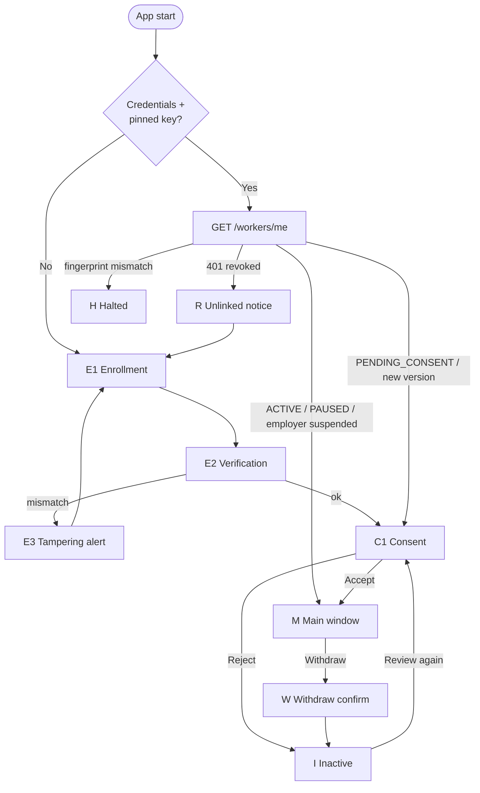

# Worker App (`agent`) — Functional Specification

The app installed on the employee's computer. Its job, in order of importance:
1. Make it **impossible to be monitored without knowing it**.
2. Collect **exactly** the categories the employee accepted (a subset of what the employer requested), nothing else, only while `ACTIVE` and while the employer's subscription is active.
3. Encrypt to the admin's pinned key and deliver reliably without slowing the machine.

Stack: Rust, `eframe`/`egui` (window ≈ 480×680, min 420×520), `tray-icon` (tray), `notify-rust` (notifications), `keyring` (secrets), `rusqlite` (queue), `tokio` (background).

## 1. Screen map



## 2. Screens

### E1 — Enrollment
- Title: "Link this computer to your employer".
- Two options: **Paste QR** (the QR content: the base64 `qr_payload` shown by the admin app, or the raw JSON of older admin versions; camera/image decoding is a later enhancement) and **Enter code** (`XXXX-XXXX-XXXX`; lowercase, spaces and dashes accepted; `I`/`L` → `1` and `O` → `0` for compatibility with v1 codes — v2 codes never contain `0 O 1 I L`).
- The worker never types a **server address**: the agent is built for one server (`TELEMETRY_API_URL`, read at compile time from `agent/.env`; `https://` required in release). The QR still carries `api_url`; a QR whose `api_url` is not the built-in server is rejected.
- Button **Link** → `POST /workers/enroll` with `device_identifier` and `device_info`.
- Errors by `details.reason` (AGENT-09):

  | Answer | Message |
  |:---|:---|
  | `400 INVALID_ENROLLMENT_TOKEN` | "Este código es inválido o expiró. Pide uno nuevo a tu administrador." |
  | `409 ENROLLMENT_ALREADY_COMPLETED` | "Este código ya fue utilizado. Si no fuiste tú, avisa a tu administrador de inmediato." |
  | `409 DEVICE_ALREADY_ENROLLED` | "Este equipo ya está vinculado a otro trabajador de la organización. Pide a tu administrador que lo desvincule." |
  | `429 ENROLLMENT_LOCKED` | "Demasiados intentos fallidos. Podrás intentarlo de nuevo en N minutos." — the **Link** button stays disabled until `Retry-After` passes. |
  | Network | "No se pudo contactar al servidor. Verifica la dirección y tu conexión." |

### E2 — Verification
- QR path: automatic. Recompute commitment; match → go to C1 (show "Verified ✓" for 1 s).
- Manual path: show **safety code** `4821 9930 1157` large, with: "Ask your administrator to read the code on their screen. Do they match?" → **They match** / **They don't match**.

### E3 — Tampering alert
"The information received does not match what your administrator generated. For your protection this computer was **not** linked." Credentials from the redeem are wiped. Button: back to E1.

### C1 — Consent (granular, AGENT-09)
Shown on first enrollment, whenever `consent_version > accepted_consent_version`, and from **Cambiar mi selección**.

```
┌──────────────────────────────────────────────┐
│  Acme SpA — Telemetría del equipo            │
├──────────────────────────────────────────────┤
│  Tu empleador solicita poder recolectar      │
│  estos datos. Elige cuáles aceptas:          │
│                                              │
│  ☐ Aplicaciones en uso                       │
│     "<descripción del admin, textual>"       │
│  ☐ Navegación web (solo dominios)            │
│     "<descripción del admin, textual>"       │
│  ☐ Actividad de teclado y mouse (conteo)     │
│     "<descripción del admin, textual>"       │
│                                              │
│  — Capturas de pantalla: no solicitado       │
│  — Archivos: no solicitado                   │
│  — Ubicación: no solicitado                  │
│                                              │
│  Horario: 09:00–18:00 America/Santiago       │
│  Los datos se cifran en este equipo; el      │
│  servidor no puede leerlos.                  │
│  Puedes aceptar solo algunas categorías y    │
│  cambiar o retirar tu elección cuando        │
│  quieras. También puedes pedir una copia o   │
│  la eliminación de tus datos.                │
│                                              │
│  [Mantener mi selección anterior]  (si aplica)│
│  [ RECHAZAR TODO ]   [ ACEPTAR SELECCIÓN (2) ]│
└──────────────────────────────────────────────┘
```

Rules:
- Category labels are fixed by the app (the six categories in `domain.md`); the quoted text is the admin's description, **verbatim** (LEG-01). Only requested categories have a checkbox; all start **unchecked** (DP-08).
- For a version update, a banner lists what changed ("Nuevo: Capturas de pantalla"). Categories already accepted remain active until the worker decides (domain §5). **Mantener mi selección anterior** checks exactly the previously accepted categories that are still requested (explicit action).
- **Aceptar selección (n)** (disabled with n = 0) → `PATCH /workers/me/consent { accepted: true, consent_version, manifest_hash, consent_flags: selection }` → persist hash + selection → M.
- **Rechazar todo** → `PATCH … { accepted: false }` → I.
- `409 CONSENT_VERSION_MISMATCH` / `403 CONSENT_FLAG_NOT_REQUESTED` → refetch `/workers/me`, rebuild the offer with the pinned key, re-render with "La solicitud de tu empleador cambió; revísala nuevamente".

### I — Inactive
"Monitoring is **off**. Nothing is being collected." Buttons: **Review request again** (C1), **Unlink this computer** (wipe local state). Status indicator ⚪.

### M — Main window (tabs)

**Header (always visible):** status light + text, organization name, worker name.

| Light | Meaning |
|:------|:--------|
| 🟢 | Collecting (ACTIVE, in work hours). |
| 🟡 | ACTIVE but out of work hours (time-bound collectors sleeping) — or PAUSED by employer — or employer subscription suspended ("Recolección detenida: la cuenta de tu empleador no está activa") (text says which). |
| ⚪ | Not collecting (awaiting consent / rejected / withdrawn). |
| 🔴 | Problem: offline > 15 min, halted, session ended. |

1. **What's collected** — list of the six categories with state: *Active* / *Not accepted by you* (requested, not chosen) / *Not requested* / *Sleeping (off-hours)* / *Unavailable on this computer* (e.g. Wayland without portal) with the admin's descriptions. Buttons **Cambiar mi selección** (→ C1 for the current version) and **Withdraw consent** (red, secondary) → W.
2. **My schedule** — work hours, timezone, current local time, "location/screenshots are only collected inside this window".
3. **My rights** — **Request a copy** (`POST /workers/me/data-request`) and **Request deletion** (`POST /workers/me/data-deletion`) with confirmation; show the returned `request_id` and status. Copy: "Your data is encrypted with your employer's key; exported data is delivered encrypted and can only be read with that key." Consent history (`GET /workers/:id/consent-records`).
4. **Diagnostics** — API reachability (`/health`), last successful send, queue size (items/MB), app version, device id (first 8 chars), key fingerprint (first 16 hex), OS permission status (Accessibility, Screen Recording, Location, portal).

### W — Withdraw confirmation
"If you withdraw, all collection stops immediately and unsent data on this computer is deleted." **Withdraw** → purge queue & buffer (DP-09) → `PATCH /workers/me/consent { accepted: false, consent_version: <current> }` (one retry with the server's current version on `409`) → I. Offline: collectors stop and local data is purged first (always), then the PATCH is sent.

> ⚠️ **Implementation gap (2026-09-30):** if the PATCH fails (offline), the agent shows *"Se detuvo la recolección y se borraron los datos locales, pero el servidor no confirmó el retiro"* but does **not** retry automatically, and because the accepted hash was already cleared a second press only purges locally. Target: persist a *pending withdrawal* and resend it on the next successful `/workers/me` poll. Collection stays stopped meanwhile (nothing is collected or sent).

### R — Unlinked notice
"This computer was unlinked by your employer." Credentials, pinned key and queue wiped. → E1.

### H — Halted
"Security check failed: the employer key reported by the server does not match the one verified when linking. Sending has been stopped." Shows both fingerprints. Only actions: **Unlink** or **Retry check**.

## 3. Tray

Icon reflects the light colour. Menu: *Open* · *What's collected* · *Withdraw consent…* · *Quit*. Closing the window hides it to the tray; quitting asks for confirmation ("Collection will stop until you reopen the app") and the app **does** stop collecting — it never keeps running invisibly.

There is **no** worker-side "pause 15 min" (old docs): pausing is an admin action; the worker's control is withdrawal.

## 4. Notifications

| When | Text |
|:-----|:-----|
| Collection starts (after accept, app start while ACTIVE, resume from pause) | "Telemetry active: <n> categories are being collected. Open to see which." |
| Every hour while collecting | "Reminder: telemetry is active." |
| Before each screenshot upload | "A work screenshot was taken." |
| Work hours start/end (if time-bound categories active) | "Work hours ended: location and screenshots paused." |
| Status change by admin (pause/resume/narrowing) | "Your employer paused monitoring." / "Your employer reduced the data collected." |
| New consent request | "Your employer requested a change. Review it to continue." |
| Unlinked / halted | As in R / H. |

## 5. Background behaviour

- Lifecycle poll `GET /workers/me` every 5 min, on startup, on resume from sleep, and after any 403/402.
- Employer subscription blocked (`ingestion_blocked_reason` or ingest `402`/`403 SUBSCRIPTION_*`) → `EmployerSuspended`: no collectors, no ingestion, queue **kept**; resumes on the next poll after reactivation. Notifications on both edges.
- Token refresh is single-flight (one refresh at a time; a concurrent refresh would revoke the whole session family).
- Collectors start/stop within 1 s of a RunMode or effective-flag change.
- Flush every `WORKER_FLUSH_INTERVAL` (default 30 s; values below 5 s are ignored): group by category → encrypt → send; failures → queue.
- Queue: cap 100 MB or 7 days (oldest dropped first); drain with backoff 2 s ×2 → 300 s ±20 %; drop 403 consent/status envelopes, keep subscription-blocked ones; purge on withdraw/revoke.
- Token refresh on 401 (persist new refresh token first); refresh 401 → R.
- `--headless` runs the same engine without a window **only** when a tray icon is available; otherwise refuse to start headless (no invisible monitoring).
  > ⚠️ **Implementation gap (2026-09-30):** `agent/src/main.rs` currently starts the engine in `--headless` mode without creating a tray icon (only notifications remain visible). Until fixed, do not ship or document `--headless` for end users.

## 6. Configuration

| Key | Source | Default |
|:----|:-------|:--------|
| API URL | Compile time only: `TELEMETRY_API_URL` (`agent/.env` or environment), never persisted in the config file | — |
| Flush interval | `WORKER_FLUSH_INTERVAL` env / config | 30 s |
| Role, work hours, timezone, flags | **Server** (`/workers/me`) — never env or local edit | — |

`WORKER_ROLE` and `WORKER_ORGANIZATION` env vars are removed.

## 7. Acceptance scenarios

1. Fresh install + valid QR (base64 from the admin app) → linked, consent shown with all boxes unchecked, accept 2 of 3 → 🟢, only those 2 categories reach the admin within 2 flushes.
2. Server returns a different public key at redeem → E3, nothing stored.
3. Reject → ⚪, no collectors, no network traffic except `/workers/me` polls.
4. Admin pauses → 🟡 "Paused by your employer" within 5 min, no ingest calls.
5. Admin widens consent → notification + C1; old categories keep flowing; new one starts only after accept.
6. Withdraw offline → collectors stop immediately, queue empty, PATCH sent on reconnect.
7. Admin revokes → next refresh fails → R → E1, local secrets gone.
8. OFFICE worker: location never appears in "Active", GPS API never called.
9. Three wrong codes in a row → "Demasiados intentos…" and the button stays disabled for the `Retry-After` time.
10. Employer trial expires → 🟡 "la cuenta de tu empleador no está activa", no collection, queue intact; after payment the next poll resumes collection and drains the queue.
11. "Cambiar mi selección" adds a category without re-enrolling; the admin sees a new `ACCEPTED` evidence row with the new subset.
