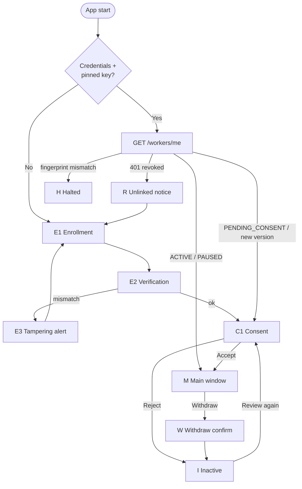

# Worker App (`agent`) — Functional Specification

The app installed on the employee's computer. Its job, in order of importance:
1. Make it **impossible to be monitored without knowing it**.
2. Collect **exactly** what the employee accepted, nothing else, only while `ACTIVE`.
3. Encrypt to the admin's pinned key and deliver reliably without slowing the machine.

Stack: Rust, `eframe`/`egui` (window ≈ 480×680, min 420×520), `tray-icon` (tray), `notify-rust` (notifications), `keyring` (secrets), `rusqlite` (queue), `tokio` (background).

## 1. Screen map



## 2. Screens

### E1 — Enrollment
- Title: "Link this computer to your employer".
- Two options: **Scan QR** (camera if available; otherwise "Open QR image…") and **Enter code** (`XXXX-XXXX-XXXX`, auto-uppercase, auto-hyphen, accepts I/L/O and maps them).
- Manual code also needs the **server address** (prefilled from `TELEMETRY_API_URL` in dev; required field in production). The QR carries it.
- Button **Link** → `POST /workers/enroll` with `device_identifier` and `device_info`.
- Errors: invalid/expired code → "This code is invalid or has expired. Ask your administrator for a new one."; 429 → "Too many attempts, try again in 15 minutes."; network → retry.

### E2 — Verification
- QR path: automatic. Recompute commitment; match → go to C1 (show "Verified ✓" for 1 s).
- Manual path: show **safety code** `4821 9930 1157` large, with: "Ask your administrator to read the code on their screen. Do they match?" → **They match** / **They don't match**.

### E3 — Tampering alert
"The information received does not match what your administrator generated. For your protection this computer was **not** linked." Credentials from the redeem are wiped. Button: back to E1.

### C1 — Consent
Shown on first enrollment and whenever `consent_version > accepted_consent_version`.

```
┌─────────────────────────────────────────┐
│  Acme Corp — Device Telemetry           │
├─────────────────────────────────────────┤
│  Your employer will collect the         │
│  following data from this computer:     │
│                                         │
│  ✅ Applications in use                 │
│     "<admin description, verbatim>"     │
│  ✅ Web browsing (domains only)         │
│     "<admin description, verbatim>"     │
│  ✅ Keyboard/mouse activity (counts)    │
│     "<admin description, verbatim>"     │
│                                         │
│  ❌ Screenshots — NOT active            │
│  ❌ Files — NOT active                  │
│  ❌ GPS location — NOT active           │
│                                         │
│  Work hours: 09:00–18:00 America/Santiago│
│  Data is encrypted on this computer;    │
│  the server cannot read it.             │
│                                         │
│  Your rights: you can request a copy or │
│  deletion of your data, and withdraw    │
│  this consent at any time from this app.│
│                                         │
│  [Read full policy]                     │
│                                         │
│  [  REJECT  ]            [  ACCEPT  ]   │
└─────────────────────────────────────────┘
```

Rules:
- Category labels are fixed by the app (the six categories in `domain.md`); the quoted text is the admin's description, **verbatim** (LEG-01).
- For a version update, a banner lists what changed ("New: Screenshots"). Categories already accepted remain active until the worker decides (domain §5).
- **Accept** → `PATCH /workers/:id/consent { ACCEPT, consent_version, manifest_hash }` → persist the accepted manifest hash → M.
- **Reject** → `PATCH … { REJECT }` → I.
- `409 CONSENT_VERSION_MISMATCH` → refetch `/workers/me`, re-render, tell the worker "The request changed; please review again".

### I — Inactive
"Monitoring is **off**. Nothing is being collected." Buttons: **Review request again** (C1), **Unlink this computer** (wipe local state). Status indicator ⚪.

### M — Main window (tabs)

**Header (always visible):** status light + text, organization name, worker name.

| Light | Meaning |
|:------|:--------|
| 🟢 | Collecting (ACTIVE, in work hours). |
| 🟡 | ACTIVE but out of work hours (time-bound collectors sleeping) — or PAUSED by employer (text says which). |
| ⚪ | Not collecting (awaiting consent / rejected / withdrawn). |
| 🔴 | Problem: offline > 15 min, halted, session ended. |

1. **What's collected** — list of the six categories with state: *Active* / *Not requested* / *Sleeping (off-hours)* / *Unavailable on this computer* (e.g. Wayland without portal) with the admin's descriptions. Last collection time per category. Button **Withdraw consent** (red, secondary) → W.
2. **My schedule** — work hours, timezone, current local time, "location/screenshots are only collected inside this window".
3. **My rights** — **Request a copy** (`POST /workers/me/data-request`) and **Request deletion** (`POST /workers/me/data-deletion`) with confirmation; show the returned `request_id` and status. Copy: "Your data is encrypted with your employer's key; exported data is delivered encrypted and can only be read with that key." Consent history (`GET /workers/:id/consent-records`).
4. **Diagnostics** — API reachability (`/health`), last successful send, queue size (items/MB), app version, device id (first 8 chars), key fingerprint (first 16 hex), OS permission status (Accessibility, Screen Recording, Location, portal).

### W — Withdraw confirmation
"If you withdraw, all collection stops immediately and unsent data on this computer is deleted." **Withdraw** → `PATCH … { WITHDRAW }` → purge queue & buffer (DP-09) → I. Works offline: stop collectors and purge locally first, send the PATCH when back online.

### R — Unlinked notice
"This computer was unlinked by your employer." Credentials, pinned key and queue wiped. → E1.

### H — Halted
"Security check failed: the employer key reported by the server does not match the one verified when linking. Sending has been stopped." Shows both fingerprints. Only actions: **Unlink** or **Retry check**.

## 3. Tray

Icon reflects the light colour. Menu: *Open* · *What's collected* · *Withdraw consent…* · *Quit*. Closing the window hides it to the tray; quitting asks for confirmation ("Collection will stop until you reopen the app") and the app **does** stop collecting — it never keeps running invisibly.

There is **no** worker-side "pause 15 min" (old docs): pausing is an admin action; the worker's control is withdrawal.

## 4. Notifications

| When | Text |
|:-----|:-----|
| Collection starts (after accept, app start while ACTIVE, resume from pause) | "Telemetry active: <n> categories are being collected. Open to see which." |
| Every hour while collecting | "Reminder: telemetry is active." |
| Before each screenshot upload | "A work screenshot was taken." |
| Work hours start/end (if time-bound categories active) | "Work hours ended: location and screenshots paused." |
| Status change by admin (pause/resume/narrowing) | "Your employer paused monitoring." / "Your employer reduced the data collected." |
| New consent request | "Your employer requested a change. Review it to continue." |
| Unlinked / halted | As in R / H. |

## 5. Background behaviour

- Lifecycle poll `GET /workers/me` every 5 min, on startup, on resume from sleep, and after any 403.
- Collectors start/stop within 1 s of a RunMode or effective-flag change.
- Flush every `WORKER_FLUSH_INTERVAL` (default 30 s; min 15 s): group by category → encrypt → send; failures → queue.
- Queue: cap 100 MB or 7 days (oldest dropped first); drain with backoff 2 s ×2 → 300 s ±20 %; drop 403 envelopes; purge on withdraw/revoke.
- Token refresh on 401 (persist new refresh token first); refresh 401 → R.
- `--headless` runs the same engine without a window **only** when a tray icon is available; otherwise refuse to start headless (no invisible monitoring).

## 6. Configuration

| Key | Source | Default |
|:----|:-------|:--------|
| API URL | QR / enrollment form; `TELEMETRY_API_URL` env in debug builds only | — |
| Flush interval | `WORKER_FLUSH_INTERVAL` env / config | 30 s |
| Role, work hours, timezone, flags | **Server** (`/workers/me`) — never env or local edit | — |

`WORKER_ROLE` and `WORKER_ORGANIZATION` env vars are removed.

## 7. Acceptance scenarios

1. Fresh install + valid QR → linked, consent shown, accept → 🟢, first system record visible in admin within 2 flushes.
2. Server returns a different public key at redeem → E3, nothing stored.
3. Reject → ⚪, no collectors, no network traffic except `/workers/me` polls.
4. Admin pauses → 🟡 "Paused by your employer" within 5 min, no ingest calls.
5. Admin widens consent → notification + C1; old categories keep flowing; new one starts only after accept.
6. Withdraw offline → collectors stop immediately, queue empty, PATCH sent on reconnect.
7. Admin revokes → next refresh fails → R → E1, local secrets gone.
8. OFFICE worker: location never appears in "Active", GPS API never called.
