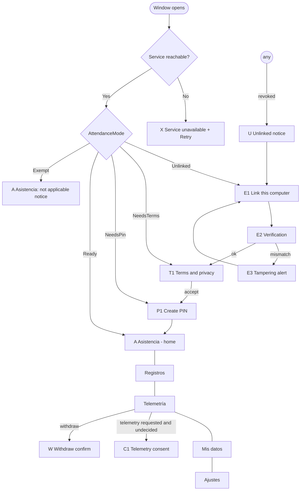

# Worker App (`agent` + `agent-ui`) — Functional Specification

> v3 (2026-10-11). Replaces the egui app. Domain: `.ai-context/domain.md` §1, §4, §5, §10.
> Legal basis: `docs/legal/marco-legal-cl.md`. Rules: `ATT-*`, `PROC-*`, `DP-*`, `LEG-*`.

The app installed on the employee's computer. In order of importance:
1. Let the worker **mark attendance** reliably, with their PIN, always (ATT-01, ATT-02), and see every
   mark, receipt and correction (ATT-06).
2. Make it **impossible to be monitored without knowing it** (telemetry is optional, visible, consented).
3. Collect **exactly** the telemetry categories the worker accepted, encrypt them to the pinned key,
   and deliver without slowing the machine.

## 0. Processes (PROC-01..05)

| Process | Binary | Lifetime | Owns |
|:--|:--|:--|:--|
| Service | `telemetry-agent` (crate `agent`) | Starts at OS login (autostart entry created by the installer and re-created on first run); one per user | Tray, notifications, API, keystore, local DB, telemetry engine, mark queue, IPC server |
| Window | `telemetry-worker` (crate `agent-ui`, Tauri 2 + React) | Opened by the worker (app menu, tray *Abrir*, or a notification) and closed at will | Nothing secret; renders `AppSnapshot` and sends requests |

- Closing the window never stops the service; the tray icon stays.
- Opening the window when the service is not running starts it (the service binary sits next to the
  UI binary; Tauri `externalBin` sidecar in bundles) and waits ≤ 5 s for the socket.
- *Salir* in the tray asks: "Si sales, la telemetría se detiene y no podrás marcar asistencia desde
  este equipo hasta volver a abrir la app." → **Salir** / **Cancelar**. Pending marks stay queued.
- Window: 480×720, min 420×600, title "Telemetry — Asistencia".
- Stack (UI): React 18 + TypeScript strict + Tailwind 4 with the **same tokens and fonts as
  `admin-client`** (design system `.claude/skills/enterprise-design-system`), `lucide-react` icons,
  es-CL copy, **tú**. No emojis. Colors only through tokens.

## 1. Screen map



Navigation after linking: left rail on ink (the admin app's sidebar pattern, compact: icon + label)
with **Asistencia** (default), **Registros**, **Telemetría**, **Mis datos**, **Ajustes**. A header
shows the organization and the worker name. Banners (one at a time, by priority): service problem >
pending marks offline > correction to review > new terms version > telemetry notice.

## 2. Linking and terms

### E1 — Link this computer
Unchanged logic from AGENT-08/09 (QR payload paste or code `XXXX-XXXX-XXXX`; server fixed at build
time; errors by `details.reason`; `Retry-After` countdown). Title: "Vincula este computador con tu
empleador". Help text: "Tu empleador te entregó un código o un QR. Si no lo tienes, pídeselo."

### E2 / E3 — Verification / tampering alert
Unchanged (safety code `dddd dddd dddd`, "Coinciden" / "No coinciden"; mismatch wipes everything).

### T1 — Terms and privacy (LEG-04, LEG-05)
- Shows `terminos-trabajador.md` then `politica-privacidad.md`, rendered from the embedded Markdown
  (headings, lists, tables), full text, scrollable, with version and hash (first 16 hex) at the top.
- **He leído y acepto** is enabled only after scrolling to the end of both documents. **No acepto**
  shows: "Sin aceptar los términos no puedes usar esta app. Habla con tu empleador." and keeps the
  device linked so the worker can come back.
- On accept → `Request::AcceptTerms { version, hash, privacy_version, privacy_hash }` → API.
  `409 TERMS_VERSION_MISMATCH` → "Hay una versión más nueva de esta app. Actualízala para continuar."
- New version later (worker already accepted once): non-blocking banner "Hay una nueva versión de los
  términos. Léela." → T1 in "update" mode; marking keeps working (ATT-02); telemetry decisions wait.

### P1 — Create PIN (SEC-19, SEC-20)
"Crea tu PIN de asistencia. Lo usarás para confirmar cada marca. Es personal: no lo compartas."
Two fields (6–8 digits, masked, numeric keypad-friendly), inline policy errors ("No uses números
repetidos ni seguidos como 123456"). → `Request::SetPin`. Success → A.

## 3. A — Asistencia (home)

```
┌────────────────────────────────────────────┐
│ Acme SpA · Juan Pérez                       │
├────────────────────────────────────────────┤
│  Sábado 11/10/26                            │
│  12:00:05         (hora del servidor)       │
│  Estado: En jornada desde 09:02:11          │
│  Jornada de hoy: 09:00 – 18:00              │
│  Colación: 13:00 – 14:00                    │
│                                             │
│  [  Iniciar colación  ]   (primary)         │
│  Otras marcas ▾                             │
│                                             │
│  Marcas de hoy                              │
│  09:02:11  Entrada   Enviada · 3f9a 21c0 …  │
│                                             │
│  Ubicación: no se registra al marcar        │
└────────────────────────────────────────────┘
```

- The clock shows server time (`server_time` of `/attendance/me/today` + monotonic offset), seconds,
  `tabular-nums`. If the device clock differs > 60 s: muted note "La hora de tu equipo difiere de la
  del servidor; se usa la del servidor." (ATT-10).
- **Primary button = `next_mark`** from the server (or local state when offline): *Marcar entrada*,
  *Iniciar colación*, *Terminar colación*, *Marcar salida*. "Otras marcas" lists the other three
  (always allowed, ATT-02).
- If today has no agreed schedule: "Hoy no tienes jornada pactada. Si trabajas, marca igual."
- Exempt (art. 22): only the notice "Tu contrato no está sujeto a control de jornada (art. 22 del
  Código del Trabajo). No necesitas marcar."
- Location line reflects `location_at_mark` ("Se registra tu ubicación solo en el momento de marcar"
  / "No se registra").

### M — Mark dialog
Title = action ("Marcar entrada"). Text: "Se registrará con la hora del servidor al recibirla." PIN
field + **Confirmar** (primary) + **Cancelar**. Wrong PIN: "PIN incorrecto. Espera N s para
reintentar." (delay from the service). Link "Olvidé mi PIN" → reset flow (§6).
On success the dialog turns into the **receipt**: type, `dd/mm/aa`, `hh:mm:ss`, hash in Plex Mono
groups of 4 with *Copiar*, "Te enviamos el comprobante a j•••@gmail.com". Offline: "Sin conexión: la
marca quedó guardada con la hora de tu equipo (12:00:04) y se enviará automáticamente."

### Today's marks list
Time, type, status (`Enviada` · `Pendiente de envío` · `Hash no coincide` (danger, with "Guarda este
comprobante y avisa a tu empleador")), short hash. Altered marks (from corrections) carry the
"Corregida" marker (ATT-05).

## 4. Registros

- Range picker (this week, last week, this month, last month, custom up to 5 years).
- Day list from `GET /attendance/me/days`: date, agreed, marks, `Tiempo faltante` / `Tiempo extra`
  (server values, ATT-09), anomalies in words ("Colación sin término").
- Mark detail: every field of the receipt incl. full hash, prev hash, offline flag, source,
  workplace, location (if any); *Copiar comprobante* (plain text, printable).
- **Correcciones**: pending first, each with original vs proposed, reason, "Puedes oponerte hasta el
  12/10/26 14:30" countdown, buttons **Aceptar** / **Oponerme** (confirmation: "Si te opones, se
  mantiene tu marca original."). History below with final state.
- Works offline from the local journal (sent and pending marks); server summaries when online.

## 5. Telemetría

Content of the old "What's collected" tab, now its own section and never in the way of attendance:
- `NOT_REQUESTED`: "Tu empleador no solicita telemetría de este equipo." Nothing else.
- `PENDING_DECISION`: card "Tu empleador solicita datos de este equipo" + **Revisar solicitud** → C1
  (unchanged rules: DP-08 unchecked, admin descriptions verbatim LEG-01, *Mantener mi selección
  anterior*, *Aceptar selección (n)*, *Rechazar todo*). If new terms are pending, C1 first shows
  "Lee los nuevos términos antes de decidir" (LEG-05).
- `ACCEPTED`: list of the six categories with state (Activa / No aceptada / No solicitada /
  Durmiendo / No disponible en este equipo), admin descriptions, **Cambiar mi selección**,
  **Retirar consentimiento** (danger-secondary, W).
- `DECLINED`: "Rechazaste la telemetría. No se recolecta nada." + **Revisar solicitud**.
- `PAUSED`, `EmployerSuspended`, `Halted`: explanatory banner inside this section only.
- Location shows the employer's declared cause verbatim; screenshots for remote/hybrid workers are
  shown as "No disponible para trabajo a distancia".
- Work-hours window and disconnection window shown here ("La telemetría nunca funciona durante tu
  desconexión").

### W — Withdraw confirmation
Unchanged copy and DP-09 behaviour. **Gap closed in v3:** a withdrawal that fails offline is stored
as `pending_withdrawal` and re-sent on every lifecycle poll until confirmed; collection stays stopped.

## 6. Mis datos and Ajustes

**Mis datos:** request a copy / deletion (unchanged), with the note "Los registros de asistencia se
conservan 5 años por obligación legal y no se eliminan antes." Consent history.

**Ajustes:**
- *Cambiar PIN* (current + new twice).
- *Olvidé mi PIN*: "Te enviaremos un código a j•••@gmail.com" → code → new PIN twice.
- *Términos y privacidad*: accepted versions and dates, read again.
- *Diagnóstico*: service version and uptime, API reachability, server time offset, pending marks,
  telemetry queue (items/MB), last successful send, device id (8 chars), key fingerprint (16 hex), tray
  available, OS permission status.
- *Desvincular este equipo* (danger zone): "Se borran tus credenciales, tu PIN y los datos de
  telemetría no enviados. Tus marcas siguen guardadas en el servidor." If pending marks exist:
  "Tienes N marcas sin enviar. Conéctate antes de desvincular o se perderán." (requires typing
  `DESVINCULAR`).

## 7. Tray (service)

- Icon colour = telemetry light (🟢 collecting, 🟡 paused/suspended/off-hours, ⚪ not collecting,
  🔴 problem). Tooltip line 1 = attendance ("En jornada desde 09:02", "Fuera de jornada", "2 marcas
  pendientes de envío"); line 2 = telemetry state.
- Menu: **Abrir** · **Marcar asistencia…** (opens the window on A) · **Qué se recolecta** (window on
  Telemetría) · **Retirar consentimiento…** (only while collecting; window on W) · separator ·
  **Salir**.

## 8. Notifications (service)

| When | Text |
|:--|:--|
| 30 min after an agreed start/end/break mark without the mark (once per mark) | "No registraste tu entrada de las 09:00. Ábrela para marcar." |
| Pending offline marks sent | "Se enviaron N marcas guardadas sin conexión." |
| Correction proposed | "Tu empleador propuso una corrección. Tienes 48 horas para revisarla." |
| 30 min before a remote worker's disconnection | "En 30 minutos comienza tu desconexión (20:00)." |
| Telemetry notifications | As before (start, hourly reminder, screenshot, work-hours edges, pause, narrowing, new request, unlinked, halted). |

Notifications never contain the RUN, email, hash or location.

## 9. IPC (`agent-ipc`, PROTOCOL_VERSION = 1)

Requests (`Request` enum, `#[serde(tag = "op")]`), all answered with `Response::Ok(payload)` or
`Response::Err(IpcError { code, message, retry_after_secs? })`:

| Op | Payload | Notes |
|:--|:--|:--|
| `Snapshot` | — | Full `AppSnapshot` |
| `Enroll` | `{ qr_payload? , code? }` | Returns `Verification::{Verified, NeedsSafetyCode{code}}` |
| `ConfirmSafetyCode` | `{ matches: bool }` | |
| `LegalDocuments` | — | Embedded texts + versions + hashes |
| `AcceptTerms` | `{ version, hash, privacy_version, privacy_hash }` | |
| `SetPin` / `ChangePin` | `{ pin }` / `{ current, new }` | `Zeroizing` on both sides |
| `RequestPinReset` / `VerifyPinReset` | — / `{ code }` | |
| `Mark` | `{ type, pin }` | Returns the local mark (with server data if sent) |
| `Days` / `Marks` | `{ from, to }` | Server when online, local journal otherwise |
| `Corrections` / `RespondCorrection` | — / `{ id, accept }` | |
| `ConsentDecision` | `{ accept: Option<ConsentFlags> }` | `None` = reject all |
| `Withdraw` | — | |
| `DataRequest` / `DataDeletion` | as before | |
| `Unlink` | `{ confirm: "DESVINCULAR" }` | |
| `Diagnostics` | — | |
| `Subscribe` | — | Then `Event::Snapshot` frames until the connection closes |

`AppSnapshot` = `{ service_version, attendance_mode, attendance_today?, pending_marks, run_mode,
telemetry_view (offer, accepted, categories with state), worker (name, organization, work_mode,
schedule summary, location_at_mark), banners, last_error? }`. No secrets ever (PROC-03).

## 10. Background behaviour (service)

- Lifecycle poll `GET /workers/me` every 5 min, at start, on resume, after 401/402/403.
- `/attendance/me/today` at start, every 5 min, after every mark, and at each agreed mark time + 30 min
  (for the local missing-mark notification).
- Mark queue: send immediately; on failure backoff 2 s ×2 → 300 s ±20 %; on reconnect drain all in
  order of `device_ts`. Never dropped except `400` validation (shown) (ATT-04).
- Telemetry: unchanged (flush 30 s, queue 100 MB / 7 days, backoff, DP-09 purge, BILL-03).
- Token refresh single-flight (SEC-14).

## 11. Acceptance scenarios

1. Fresh install + valid QR → T1 (accept only after scrolling) → P1 → A shows *Marcar entrada*; mark
   with PIN → receipt with hash; admin board shows "En jornada".
2. Close the window → tray stays; open from tray → same state; *Salir* asks confirmation.
3. Disconnect network, mark *Iniciar colación* → "Pendiente de envío"; reconnect → sent with
   `offline: true`, notification "Se enviaron 1 marcas…".
4. Employer subscription suspended → marking works; telemetry shows the suspended banner.
5. Worker rejects all telemetry → attendance unaffected; admin sees `DECLINED`.
6. Admin proposes "elimina atraso" → notification + Registros shows it; *Oponerme* → original stays;
   no answer for 48 h → consolidated, mark shows "Corregida".
7. Missing start 30 min after 09:00 → local notification (and the server email).
8. Wrong PIN 3 times → growing delay, never a lock; *Olvidé mi PIN* resets via email code.
9. New terms version → banner, marking still works, telemetry decisions wait until read.
10. Remote worker: disconnection notification 30 min before; no telemetry during disconnection;
    screenshots never offered.
11. All telemetry scenarios of the previous spec still pass (granular consent, pause, narrowing,
    revocation, key mismatch ⇒ telemetry `Halted` while attendance keeps working).
