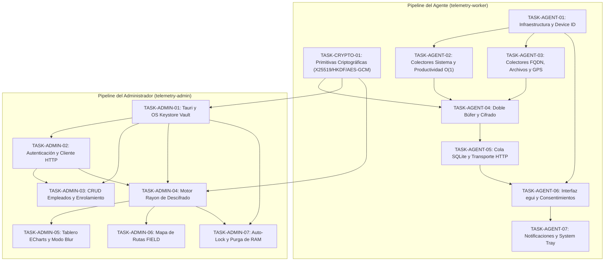

# Plan Maestro de Tareas — Telemetry Apps

Este directorio contiene la especificación detallada de implementación para el desarrollo de las aplicaciones desktop del ecosistema de Telemetría (`telemetry-apps`), estructuradas según el modelo **Zero-Knowledge**, la arquitectura de **Cargo Workspace** y las mejores prácticas de ingeniería en **Rust**, **Tauri** y **egui**.

---

## 🗂️ Estructura del Directorio

```
tasks/
├── README.md                                             # Índice maestro de tareas
├── crypto-core/                                          # Crate Criptográfico Compartido
│   └── task-01-crypto-core-foundations.md                # Primitivas Zero-Knowledge (HPKE, X25519, HKDF, AES-GCM)
├── agent/                                                # telemetry-worker (egui + notify-rust)
│   ├── task-01-agent-foundations-and-device-id.md        # Configuración y device_identifier determinista
│   ├── task-02-system-and-productivity-collectors.md     # Hooks O(1), sysinfo e inactividad
│   ├── task-03-network-files-and-location-collectors.md  # FQDNs, watcher de archivos y GPS FIELD
│   ├── task-04-metrics-buffer-and-encryption.md          # Doble búfer (std::mem::take) y pipeline de cifrado
│   ├── task-05-offline-queue-and-transport.md           # Cola SQLite, TLS 1.3 y auto-refresh de JWTs
│   ├── task-06-egui-transparency-ui-and-consent.md       # Panel egui, 6 consentimientos y derechos ARCO
│   └── task-07-system-notifications-and-tray.md          # notify-rust y bandeja del sistema (tray)
└── admin-client/                                         # telemetry-admin (Tauri 2.0 + React/TS)
    ├── task-01-tauri-foundations-and-keystore.md         # Runtime Tauri y OS Keystore Vault (keyring)
    ├── task-02-auth-session-and-api-client.md            # Autenticación, sesión en RAM e interceptor HTTP
    ├── task-03-worker-management-and-enrollment.md       # CRUD de empleados y paquete de enrolamiento
    ├── task-04-parallel-decryption-engine.md             # Motor Rayon de descifrado masivo multinúcleo
    ├── task-05-telemetry-analytics-dashboard.md          # Tablero analítico ECharts y privacidad (Blur)
    ├── task-06-field-worker-map-tracking.md              # Mapa interactivo Leaflet y geocercas
    └── task-07-security-hardening-and-autolock.md        # Auto-lock por inactividad y purga de RAM
```

---

## 🧭 Matriz de Dependencias y Grafo de Ejecución


