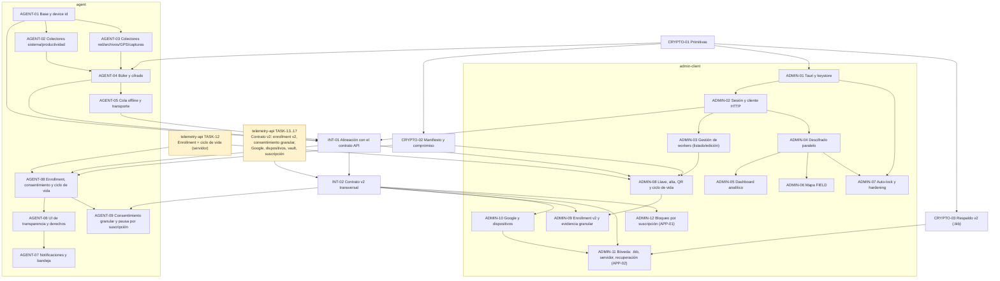
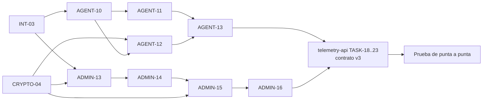

# Plan Maestro de Tareas — Telemetry Apps

> **Etapa v3 (desde 2026-10-11): registro de asistencia + app del trabajador en Tauri.** Ver §6. Las
> secciones 1–5 describen la etapa anterior (contrato v2), ya completada salvo las brechas indicadas.

Guía de implementación de las apps desktop del ecosistema Telemetry: **Admin** (`admin-client`, Tauri 2 + React), **Worker** (`agent`, Rust + egui) y el crate compartido **`telemetry-crypto-core`**. Mismo formato que las tareas de `telemetry-api`: cada tarea tiene contexto, requerimientos (`RF-*`), pseudocódigo, reglas, validaciones, logs, DoD y pruebas.

> **Antes de tomar una tarea** lee [`.ai-context/implementation-status.md`](../.ai-context/implementation-status.md). Varias tareas marcadas "implementadas" en commits anteriores son en realidad stubs o mocks. El estado de esta tabla refleja la auditoría del 2026-09-30 (contrato v2 cerrado en INT-02, CRYPTO-03, AGENT-09 y ADMIN-09..12), no los mensajes de commit.

---

## 1. Principios de Arquitectura y Gobernanza

1. **Servidor ciego:** las apps nunca envían texto plano, llaves privadas ni DEKs a la API. Toda la criptografía vive en `telemetry-crypto-core` (SEC-01, SEC-02).
2. **El admin define, el worker elige:** el admin configura las categorías que *pueden* recolectarse y su descripción; el empleado acepta el subconjunto que quiera (o ninguno), puede cambiarlo y retirarlo en cualquier momento. Casillas siempre desmarcadas por defecto (DP-08, DP-11).
3. **Enrollment con integridad:** código de un solo uso + QR con compromiso criptográfico + llave fijada en el agent (SEC-07, SEC-08). Diseño: `telemetry-api/ENROLLMENT.md`.
4. **Recolección solo en `ACTIVE`** y solo de categorías aceptadas en el dispositivo (DP-06, DP-07).
5. **Sin datos falsos en producción:** nada de mocks silenciosos ni valores hardcodeados que parezcan reales (PLAT-02).
6. **Sin panics:** cero `unwrap`/`expect` fuera de tests (release usa `panic = "abort"`).
7. **Contratos explícitos:** HTTP según [`.ai-context/api-contract.md`](../.ai-context/api-contract.md) (contrato v2 de `telemetry-api` TASK-13..17); payloads en claro según [`docs/telemetry-payloads.md`](../docs/telemetry-payloads.md).
8. **La llave del admin es custodiada, no confiada:** respaldos solo cifrados con Master Password + Argon2id en el cliente; el servidor nunca ve la contraseña ni la llave en claro (SEC-12, SEC-13).
9. **La facturación nunca es excusa para perder datos ni derechos:** la app admin se bloquea y manda al portal; el agent deja de recolectar pero conserva lo ya cifrado y los derechos del trabajador (BILL-01..03).

Las reglas completas con IDs están en [`.ai-context/constraints.md`](../.ai-context/constraints.md).

---

## 2. Estructura del Directorio

```
tasks/
├── README.md
├── integration/
│   ├── task-01-api-contract-alignment.md                 # INT-01: hablar el contrato real de la API, sin mocks silenciosos
│   └── task-02-api-v2-contract-alignment.md              # INT-02: errores tipados, refresh single-flight, dispositivo, suscripción
├── crypto-core/
│   ├── task-01-crypto-core-foundations.md                # X25519 / HKDF / AES-GCM
│   ├── task-02-enrollment-manifest-commitment.md         # Manifiesto, compromiso, código de verificación, payloads compartidos
│   └── task-03-key-backup-v2-argon2id.md                 # Respaldo v2 (.tkb): Argon2id + AES-256-GCM, import v1
├── agent/
│   ├── task-01-agent-foundations-and-device-id.md
│   ├── task-02-system-and-productivity-collectors.md
│   ├── task-03-network-files-and-location-collectors.md
│   ├── task-04-metrics-buffer-and-encryption.md
│   ├── task-05-offline-queue-and-transport.md
│   ├── task-06-egui-transparency-ui-and-consent.md
│   ├── task-07-system-notifications-and-tray.md
│   ├── task-08-enrollment-consent-and-lifecycle.md       # Enrollment QR/código, consentimiento (paquete), RunMode
│   └── task-09-granular-consent-and-billing-pause.md     # Consentimiento granular, errores enrollment v2, pausa por suscripción
└── admin-client/
    ├── task-01-tauri-foundations-and-keystore.md
    ├── task-02-auth-session-and-api-client.md
    ├── task-03-worker-management-and-enrollment.md
    ├── task-04-parallel-decryption-engine.md
    ├── task-05-telemetry-analytics-dashboard.md
    ├── task-06-field-worker-map-tracking.md
    ├── task-07-security-hardening-and-autolock.md
    ├── task-08-enrollment-and-worker-lifecycle.md        # Registro de llave, alta con descripciones, QR, ciclo de vida
    ├── task-09-enrollment-v2-and-consent-evidence.md     # QR verificado v2, cambio de equipo, organización, evidencia granular
    ├── task-10-google-sign-in-and-admin-devices.md       # Google (loopback + PKCE) y dispositivos autorizados
    ├── task-11-key-vault-backup-and-recovery.md          # APP-02: .tkb, respaldo en servidor, recuperación, nueva llave
    └── task-12-subscription-lock-screen.md               # APP-01: verificación de suscripción y pantalla de bloqueo
```

---

## 3. Matriz de Dependencias y Secuencia de Ejecución



**Orden recomendado:** `INT-01` → (`telemetry-api TASK-12` ∥ `CRYPTO-02`) → `ADMIN-08` ∥ `AGENT-08` → colectores reales (`AGENT-02/03`) → vistas con datos reales (`ADMIN-04/05/06`) → hardening (`AGENT-05/07`, `ADMIN-07`) → **contrato v2** (`telemetry-api TASK-13..17`) → `INT-02` ∥ `CRYPTO-03` → `ADMIN-12` (APP-01) → `ADMIN-11` (APP-02) → `ADMIN-09` ∥ `AGENT-09` → `ADMIN-10`.

---

## 4. Resumen de Tareas y Estado Real

Leyenda: 🟢 Completada · 🟡 Parcial (existe con defectos o partes faltantes) · 🎭 Stub/mock (aparenta estar hecha) · 🔴 Pendiente · ⚠️ Parcialmente reemplazada por otra tarea

| ID | Archivo | Descripción | Estado |
|:---|:---|:---|:---:|
| **INT-01** | [`integration/task-01-api-contract-alignment.md`](integration/task-01-api-contract-alignment.md) | Formato de ingesta `records[]`, un sobre por categoría, envelope `{data}`, login admin con `role`, sin fallbacks falsos, sin panics. | 🟢 |
| **INT-02** | [`integration/task-02-api-v2-contract-alignment.md`](integration/task-02-api-v2-contract-alignment.md) | Contrato v2: errores tipados con `reason`, refresh single-flight (ambas apps), descriptor de dispositivo, códigos de suscripción, `Retry-After`, sin fallback de organización. | 🟢 |
| **CRYPTO-01** | [`crypto-core/task-01-crypto-core-foundations.md`](crypto-core/task-01-crypto-core-foundations.md) | X25519, HKDF-SHA256, AES-256-GCM, framing del sobre, zeroize. | 🟢 |
| **CRYPTO-02** | [`crypto-core/task-02-enrollment-manifest-commitment.md`](crypto-core/task-02-enrollment-manifest-commitment.md) | Manifiesto canónico, compromiso, código de verificación, fingerprint, QR, payloads compartidos. | 🟢 |
| **CRYPTO-03** | [`crypto-core/task-03-key-backup-v2-argon2id.md`](crypto-core/task-03-key-backup-v2-argon2id.md) | Respaldo v2 de `K_admin_priv`: Argon2id + AES-256-GCM (AAD), contenedor `.tkb`, importación v1/v2, vector fijo compartido con `telemetry-web`. | 🟢 |
| **AGENT-01** | [`agent/task-01-agent-foundations-and-device-id.md`](agent/task-01-agent-foundations-and-device-id.md) | Config local y `device_identifier` determinista con fallback. Credenciales en keystore (AGENT-08). | 🟢 |
| **AGENT-02** | [`agent/task-02-system-and-productivity-collectors.md`](agent/task-02-system-and-productivity-collectors.md) | Hook O(1) con `rdev`, KPM/CPM atómicos, ventana activa real e idle nativo sin fake data (PLAT-02), capturas `xcap` notificadas (DP-05). | 🟢 |
| **AGENT-03** | [`agent/task-03-network-files-and-location-collectors.md`](agent/task-03-network-files-and-location-collectors.md) | Agregación FQDN limpia (DP-02), watcher reactivo de metadatos de archivos (DP-03), geolocalización solo para FIELD en horario laboral (DP-04). | 🟢 |
| **AGENT-04** | [`agent/task-04-metrics-buffer-and-encryption.md`](agent/task-04-metrics-buffer-and-encryption.md) | Doble búfer en memoria con `std::mem::take`, descarte FIFO, partición canónica por categoría y cifrado `telemetry-crypto-core`. | 🟢 |
| **AGENT-05** | [`agent/task-05-offline-queue-and-transport.md`](agent/task-05-offline-queue-and-transport.md) | Cola SQLite WAL con retención 7 días, límite 5MB por payload, tope 100MB, cuarentena 10 reintentos, backoff exponencial con jitter y auto-renovación JWT en 401. ⚠️ Ampliada por AGENT-09: `402`/`403` de suscripción conservan los sobres; refresh single-flight. | 🟢 |
| **AGENT-06** | [`agent/task-06-egui-transparency-ui-and-consent.md`](agent/task-06-egui-transparency-ui-and-consent.md) | Semáforo visual, horario laboral y portal ARCO con endpoints reales de exportación y supresión ante la API. | 🟢 |
| **AGENT-07** | [`agent/task-07-system-notifications-and-tray.md`](agent/task-07-system-notifications-and-tray.md) | Catálogo completo de notificaciones de transparencia (`notify-rust`), bandeja del sistema con `tray-icon` y minimizado al cerrar ventana. | 🟢 |
| **AGENT-08** | [`agent/task-08-enrollment-consent-and-lifecycle.md`](agent/task-08-enrollment-consent-and-lifecycle.md) | Enrollment con verificación, llave fijada, `RunMode`, retiro, revocación. ⚠️ El consentimiento todo-o-nada fue reemplazado por AGENT-09. | 🟢 |
| **AGENT-09** | [`agent/task-09-granular-consent-and-billing-pause.md`](agent/task-09-granular-consent-and-billing-pause.md) | Consentimiento granular (`PATCH /workers/me/consent`), errores de enrollment v2 con `Retry-After`, QR base64, `EmployerSuspended` por suscripción. ⚠️ Falta reenviar el retiro que falló sin conexión. | 🟡 |
| **ADMIN-01** | [`admin-client/task-01-tauri-foundations-and-keystore.md`](admin-client/task-01-tauri-foundations-and-keystore.md) | Keystore y generación de llave, exportación e importación de backup cifrado (.vault) con PBKDF2 + AES-GCM. ⚠️ La exportación `.vault` fue reemplazada por `.tkb` (ADMIN-11); la importación v1 se mantiene. | 🟢 |
| **ADMIN-02** | [`admin-client/task-02-auth-session-and-api-client.md`](admin-client/task-02-auth-session-and-api-client.md) | Login y registro contra la API real, rotación transparente de refresh token en 401, tokens aislados en Rust. ⚠️ Ampliada por INT-02/ADMIN-10: refresh single-flight, errores tipados, descriptor de dispositivo, Google. | 🟢 |
| **ADMIN-03** | [`admin-client/task-03-worker-management-and-enrollment.md`](admin-client/task-03-worker-management-and-enrollment.md) | Listado paginado con filtros reales, edición (`PUT /workers/:id`), pausa/reanudación y baja con confirmación. ⚠️ Alta y paquete de enrollment reemplazados por ADMIN-08. | 🟢 |
| **ADMIN-04** | [`admin-client/task-04-parallel-decryption-engine.md`](admin-client/task-04-parallel-decryption-engine.md) | Pipeline `rayon` en memoria tolerante a registros corruptos con fetch real a la API. | 🟢 |
| **ADMIN-05** | [`admin-client/task-05-telemetry-analytics-dashboard.md`](admin-client/task-05-telemetry-analytics-dashboard.md) | Vistas especializadas (Sistema, Red, Productividad/Capturas, Archivos) con datos reales descifrados, LTTB, modo blur y selector global de contexto. | 🟢 |
| **ADMIN-06** | [`admin-client/task-06-field-worker-map-tracking.md`](admin-client/task-06-field-worker-map-tracking.md) | Mapa Leaflet con polilínea cronológica, geocercas, popups interactivos, bloqueo para OFFICE y auditoría de jornada. | 🟢 |
| **ADMIN-07** | [`admin-client/task-07-security-hardening-and-autolock.md`](admin-client/task-07-security-hardening-and-autolock.md) | Hook `useAutoLock` configurable (5-30 min), zeroize de `access_token` en RAM, re-autenticación y revocación tras 5 fallos. Biometría sin verificación quitada en ADMIN-13. | 🟢 |
| **ADMIN-08** | [`admin-client/task-08-enrollment-and-worker-lifecycle.md`](admin-client/task-08-enrollment-and-worker-lifecycle.md) | Registro de llave, alta con descripciones, QR con compromiso, detalle W4 con acciones de ciclo de vida, edición de consentimiento y evidencia CSV. Falta: alertas de rechazos / sin datos 24 h (la API no expone `last_seen`). | 🟡 |
| **ADMIN-09** | [`admin-client/task-09-enrollment-v2-and-consent-evidence.md`](admin-client/task-09-enrollment-v2-and-consent-evidence.md) | Verificación local del paquete de enrollment v2 (compromiso, código de seguridad, `qr_payload`), `REVOKE_FIRST`, organización faltante, evidencia con categorías aceptadas. | 🟢 |
| **ADMIN-10** | [`admin-client/task-10-google-sign-in-and-admin-devices.md`](admin-client/task-10-google-sign-in-and-admin-devices.md) | Inicio con Google (loopback + PKCE + nonce) y gestión de dispositivos autorizados. | 🟢 |
| **ADMIN-11** | [`admin-client/task-11-key-vault-backup-and-recovery.md`](admin-client/task-11-key-vault-backup-and-recovery.md) | **APP-02:** exportar `.tkb`, respaldo en servidor, recuperar (archivo/servidor), generar nueva llave con doble confirmación, zeroize. | 🟢 |
| **ADMIN-12** | [`admin-client/task-12-subscription-lock-screen.md`](admin-client/task-12-subscription-lock-screen.md) | **APP-01:** verificación de suscripción en cada inicio, pantalla de bloqueo con portal, aviso de prueba. | 🟢 |

---

## 5. Definición de Terminado (DoD) — aplica a todas las tareas

1. `cargo fmt --all --check`, `cargo clippy --workspace --all-targets -- -D warnings` y `cargo test --workspace` en verde.
2. `cd admin-client && npm run build && npm test` en verde si se tocó la UI.
3. Cero `unwrap`/`expect` nuevos fuera de tests; ningún mock alcanzable sin `VITE_DEMO_MODE=true`.
4. Cada restricción tocada (`DP-*`, `SEC-*`, `PERF-*`, `BILL-*`, …) está referenciada en el código y cubierta por un test.
5. Pruebas nombradas `test_<modulo>_<accion>_<resultado_esperado>`; sin acceso al directorio de configuración ni al keystore reales.
6. Checkboxes del DoD de la tarea marcados, estado en esta tabla y en [`implementation-status.md`](../.ai-context/implementation-status.md) actualizados en el mismo PR.
7. Si cambia un contrato: `api-contract.md` o `telemetry-payloads.md` actualizados.


---

## 6. Etapa v3 — Asistencia legal (Chile), términos y app del trabajador en Tauri

Decisión del dueño (2026-10-11): el uso principal pasa a ser el **registro de inicio y término de
jornada** según la ley chilena (Código del Trabajo art. 33, Res. Ex. N°38/2024 de la DT); la telemetría
queda como módulo opcional; términos y condiciones robustos en ambas apps; la app del trabajador se
porta de egui a **Tauri** con **procesos separados** (servicio en segundo plano + ventana). Base:
[`docs/legal/marco-legal-cl.md`](../docs/legal/marco-legal-cl.md), [`docs/worker-app-spec.md`](../docs/worker-app-spec.md),
[`docs/admin-app-spec.md`](../docs/admin-app-spec.md) §5, `.ai-context/*` (ATT-*, PROC-*, LEG-04..07,
contrato v3 en `api-contract.md` §9–§12).

### 6.1 Tareas

| ID | Archivo | Descripción | Estado |
|:---|:---|:---|:---:|
| **INT-03** | [`integration/task-03-green-baseline.md`](integration/task-03-green-baseline.md) | Clippy en verde (22 × `result_large_err` en `admin-client-core` con Rust 1.98) sin `allow`. | 🟢 |
| **CRYPTO-04** | [`crypto-core/task-04-attendance-legal-pin-rut.md`](crypto-core/task-04-attendance-legal-pin-rut.md) | Hash canónico encadenado de marcas + vector compartido con la API, hash/versión/marcadores de documentos legales, PIN (política + Argon2id), RUT. | 🟢 |
| **AGENT-10** | [`agent/task-10-service-and-ipc.md`](agent/task-10-service-and-ipc.md) | Crate `agent-ipc`; `agent` como servicio (bandeja, IPC con token, instancia única, sin egui ni `--headless`); retiro offline reenviado. | 🟢 |
| **AGENT-11** | [`agent/task-11-tauri-window-parity.md`](agent/task-11-tauri-window-parity.md) | Ventana `agent-ui` (Tauri 2 + React, design system del admin) con paridad de la app egui; arranca el servicio si falta. | 🟢 |
| **AGENT-12** | [`agent/task-12-attendance-terms-pin-service.md`](agent/task-12-attendance-terms-pin-service.md) | Servicio: contrato v3, términos, PIN, marcas con cola offline y verificación de hash, correcciones, avisos locales, bandeja. | 🟢 |
| **AGENT-13** | [`agent/task-13-attendance-ui.md`](agent/task-13-attendance-ui.md) | Ventana: T1 términos, P1 PIN, A Asistencia + comprobante, Registros, correcciones, banners. | 🟢 |
| **ADMIN-13** | [`admin-client/task-13-legal-and-employer.md`](admin-client/task-13-legal-and-employer.md) | T1 términos del empleador, Empresa (perfil legal, lugares, alertas, incidentes), documentos legales, se quita la biometría falsa. | 🟢 |
| **ADMIN-14** | [`admin-client/task-14-workers-v3-schedule.md`](admin-client/task-14-workers-v3-schedule.md) | Trabajadores v3: datos legales, jornada pactada con advertencias legales, modalidad, telemetría opcional y restringida, pausa de telemetría. | 🟢 |
| **ADMIN-15** | [`admin-client/task-15-attendance-console.md`](admin-client/task-15-attendance-console.md) | Riel agrupado, asistencia en vivo, días y marcas con verificación de hash, correcciones (R38 art. 40), KPIs. | 🟢 |
| **ADMIN-16** | [`admin-client/task-16-legal-reports.md`](admin-client/task-16-legal-reports.md) | Seis reportes R38 con filtros del art. 25, vista previa fiel, exportar Excel/PDF/Word, acceso de solo lectura con suscripción bloqueada. | 🟢 |
| **ADMIN-17** | [`admin-client/task-17-absences-effective-time.md`](admin-client/task-17-absences-effective-time.md) | Contrato v3.1: calificación de ausencias (R38 art. 27.1) y hora efectiva de las marcas (`effective_ts`). | 🟢 |
| **ADMIN-18** | [`admin-client/task-18-csp-and-correction-timezone.md`](admin-client/task-18-csp-and-correction-timezone.md) | CSP del WebView sin `unsafe-inline`/`unsafe-eval` (brecha 5) y `proposed_ts` de correcciones convertido desde la zona del trabajador (no UTC). | 🟢 |
| **INT-04** | [`integration/task-04-worker-client-layout.md`](integration/task-04-worker-client-layout.md) | App del trabajador en una sola carpeta `worker-client/` (servicio, IPC, ventana) como `admin-client/`; compilar con un comando; README de ambas apps. | 🟢 |
| **ADMIN-19** | [`admin-client/task-19-google-sign-in-cancel.md`](admin-client/task-19-google-sign-in-cancel.md) | Botón Cancelar mientras se espera el inicio de sesión con Google (brecha 3). | 🟢 |
| **INT-05** | [`integration/task-05-live-api-contract-tests.md`](integration/task-05-live-api-contract-tests.md) | Pruebas opt-in (`--features live-api`) de los clientes HTTP de ambas apps contra la API real (`tools/orchestration/live-api.sh`); tabla de diferencias con el contrato (brecha 9). | 🟢 |
| **CRYPTO-05** | [`crypto-core/task-05-portal-mark-vector.md`](crypto-core/task-05-portal-mark-vector.md) | Vector de marca `PORTAL` idéntico al de la API (TASK-24). | ⏳ |
| **INT-06** | [`integration/task-06-macos-green-baseline.md`](integration/task-06-macos-green-baseline.md) | DoD verde también en macOS: tests solo-Linux de `agent-ipc` bajo `cfg` y carrera del test de lanzamiento del servicio. | 🟢 |

### 6.2 Orden y paralelismo



Etapas (dos implementadores en paralelo, cada uno en su worktree): **0** INT-03 ∥ CRYPTO-04 ·
**1** AGENT-10 ∥ ADMIN-13 · **2** AGENT-11 ∥ ADMIN-14 · **3** AGENT-12 ∥ ADMIN-15 · **4** AGENT-13 ∥ ADMIN-16 · **5** ADMIN-17.
Después: tareas v3 en `telemetry-api` (y luego `telemetry-web`: verificación de comprobantes, login
secundario del trabajador, portal de fiscalización).

### 6.3 Brechas conocidas que cierra esta etapa

| Brecha (`implementation-status.md` §5) | Tarea |
|:--|:--|
| 4 — biometría sin verificación del SO | ADMIN-13 (se quita el botón) |
| 6 — retiro offline no reenviado | AGENT-10 |
| 7 — `--headless` sin bandeja | AGENT-10 (se elimina; sin bandeja no hay telemetría) |
