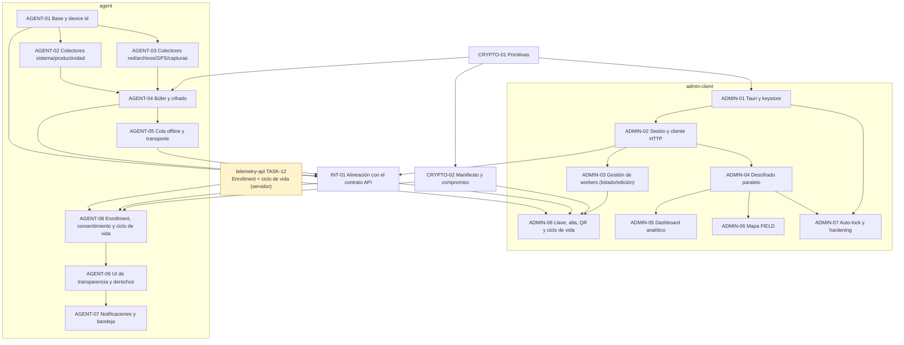

# Plan Maestro de Tareas — Telemetry Apps

Guía de implementación de las apps desktop del ecosistema Telemetry: **Admin** (`admin-client`, Tauri 2 + React), **Worker** (`agent`, Rust + egui) y el crate compartido **`telemetry-crypto-core`**. Mismo formato que las tareas de `telemetry-api`: cada tarea tiene contexto, requerimientos (`RF-*`), pseudocódigo, reglas, validaciones, logs, DoD y pruebas.

> **Antes de tomar una tarea** lee [`.ai-context/implementation-status.md`](../.ai-context/implementation-status.md). Varias tareas marcadas "implementadas" en commits anteriores son en realidad stubs o mocks. El estado de esta tabla refleja la auditoría del 2026-09-28, no los mensajes de commit.

---

## 1. Principios de Arquitectura y Gobernanza

1. **Servidor ciego:** las apps nunca envían texto plano, llaves privadas ni DEKs a la API. Toda la criptografía vive en `telemetry-crypto-core` (SEC-01, SEC-02).
2. **El admin define, el worker acepta:** el admin configura las categorías y sus descripciones; el empleado acepta o rechaza el paquete completo y puede retirarlo en cualquier momento. Sin toggles por categoría para el worker. Defaults siempre en `false` (DP-08).
3. **Enrollment con integridad:** código de un solo uso + QR con compromiso criptográfico + llave fijada en el agent (SEC-07, SEC-08). Diseño: `telemetry-api/ENROLLMENT.md`.
4. **Recolección solo en `ACTIVE`** y solo de categorías aceptadas en el dispositivo (DP-06, DP-07).
5. **Sin datos falsos en producción:** nada de mocks silenciosos ni valores hardcodeados que parezcan reales (PLAT-02).
6. **Sin panics:** cero `unwrap`/`expect` fuera de tests (release usa `panic = "abort"`).
7. **Contratos explícitos:** HTTP según [`.ai-context/api-contract.md`](../.ai-context/api-contract.md); payloads en claro según [`docs/telemetry-payloads.md`](../docs/telemetry-payloads.md).

Las reglas completas con IDs están en [`.ai-context/constraints.md`](../.ai-context/constraints.md).

---

## 2. Estructura del Directorio

```
tasks/
├── README.md
├── integration/
│   └── task-01-api-contract-alignment.md                 # INT-01: hablar el contrato real de la API, sin mocks silenciosos
├── crypto-core/
│   ├── task-01-crypto-core-foundations.md                # X25519 / HKDF / AES-GCM
│   └── task-02-enrollment-manifest-commitment.md         # Manifiesto, compromiso, código de verificación, payloads compartidos
├── agent/
│   ├── task-01-agent-foundations-and-device-id.md
│   ├── task-02-system-and-productivity-collectors.md
│   ├── task-03-network-files-and-location-collectors.md
│   ├── task-04-metrics-buffer-and-encryption.md
│   ├── task-05-offline-queue-and-transport.md
│   ├── task-06-egui-transparency-ui-and-consent.md
│   ├── task-07-system-notifications-and-tray.md
│   └── task-08-enrollment-consent-and-lifecycle.md       # Enrollment QR/código, consentimiento todo-o-nada, RunMode
└── admin-client/
    ├── task-01-tauri-foundations-and-keystore.md
    ├── task-02-auth-session-and-api-client.md
    ├── task-03-worker-management-and-enrollment.md
    ├── task-04-parallel-decryption-engine.md
    ├── task-05-telemetry-analytics-dashboard.md
    ├── task-06-field-worker-map-tracking.md
    ├── task-07-security-hardening-and-autolock.md
    └── task-08-enrollment-and-worker-lifecycle.md        # Registro de llave, alta con descripciones, QR, ciclo de vida
```

---

## 3. Matriz de Dependencias y Secuencia de Ejecución



**Orden recomendado:** `INT-01` → (`telemetry-api TASK-12` ∥ `CRYPTO-02`) → `ADMIN-08` ∥ `AGENT-08` → colectores reales (`AGENT-02/03`) → vistas con datos reales (`ADMIN-04/05/06`) → hardening (`AGENT-05/07`, `ADMIN-07`).

---

## 4. Resumen de Tareas y Estado Real

Leyenda: 🟢 Completada · 🟡 Parcial (existe con defectos o partes faltantes) · 🎭 Stub/mock (aparenta estar hecha) · 🔴 Pendiente · ⚠️ Parcialmente reemplazada por otra tarea

| ID | Archivo | Descripción | Estado |
|:---|:---|:---|:---:|
| **INT-01** | [`integration/task-01-api-contract-alignment.md`](integration/task-01-api-contract-alignment.md) | Formato de ingesta `records[]`, un sobre por categoría, envelope `{data}`, login admin con `role`, sin fallbacks falsos, sin panics. | 🟢 |
| **CRYPTO-01** | [`crypto-core/task-01-crypto-core-foundations.md`](crypto-core/task-01-crypto-core-foundations.md) | X25519, HKDF-SHA256, AES-256-GCM, framing del sobre, zeroize. | 🟢 |
| **CRYPTO-02** | [`crypto-core/task-02-enrollment-manifest-commitment.md`](crypto-core/task-02-enrollment-manifest-commitment.md) | Manifiesto canónico, compromiso, código de verificación, fingerprint, QR, payloads compartidos. | 🟢 |
| **AGENT-01** | [`agent/task-01-agent-foundations-and-device-id.md`](agent/task-01-agent-foundations-and-device-id.md) | Config local y `device_identifier`. ⚠️ El guardado de llave/credenciales pasa a AGENT-08. | 🟡 |
| **AGENT-02** | [`agent/task-02-system-and-productivity-collectors.md`](agent/task-02-system-and-productivity-collectors.md) | Hook O(1) con `rdev`, KPM/CPM atómicos, ventana activa real e idle nativo sin fake data (PLAT-02), capturas `xcap` notificadas (DP-05). | 🟢 |

| **AGENT-03** | [`agent/task-03-network-files-and-location-collectors.md`](agent/task-03-network-files-and-location-collectors.md) | Agregación FQDN limpia (DP-02), watcher reactivo de metadatos de archivos (DP-03), geolocalización solo para FIELD en horario laboral (DP-04). | 🟢 |

| **AGENT-04** | [`agent/task-04-metrics-buffer-and-encryption.md`](agent/task-04-metrics-buffer-and-encryption.md) | Doble búfer OK; el cifrado mezcla categorías (lo corrige INT-01). | 🟡 |
| **AGENT-05** | [`agent/task-05-offline-queue-and-transport.md`](agent/task-05-offline-queue-and-transport.md) | Cola SQLite WAL con retención 7 días, límite 5MB por payload, tope 100MB, cuarentena 10 reintentos, backoff exponencial con jitter y auto-renovación JWT en 401. | 🟢 |
| **AGENT-06** | [`agent/task-06-egui-transparency-ui-and-consent.md`](agent/task-06-egui-transparency-ui-and-consent.md) | Semáforo, horario, derechos ARCO. ⚠️ Los toggles por categoría fueron reemplazados por AGENT-08. Los botones ARCO no llaman a la API. | 🎭 |
| **AGENT-07** | [`agent/task-07-system-notifications-and-tray.md`](agent/task-07-system-notifications-and-tray.md) | Notificaciones de inicio y cada hora; la bandeja no existe. ⚠️ Se elimina la "pausa 15 min" del worker. | 🟡 |
| **AGENT-08** | [`agent/task-08-enrollment-consent-and-lifecycle.md`](agent/task-08-enrollment-consent-and-lifecycle.md) | Enrollment con verificación, llave fijada, consentimiento todo o nada, `RunMode`, retiro, revocación. | 🟢 |
| **ADMIN-01** | [`admin-client/task-01-tauri-foundations-and-keystore.md`](admin-client/task-01-tauri-foundations-and-keystore.md) | Keystore y generación de llave OK; falta backup/restore. | 🟡 |
| **ADMIN-02** | [`admin-client/task-02-auth-session-and-api-client.md`](admin-client/task-02-auth-session-and-api-client.md) | Login roto contra la API real; sin refresh token; comandos sin dividir. | 🟡 |
| **ADMIN-03** | [`admin-client/task-03-worker-management-and-enrollment.md`](admin-client/task-03-worker-management-and-enrollment.md) | Listado/edición/baja. ⚠️ Alta y paquete de enrollment reemplazados por ADMIN-08. Todo corre sobre mocks. | 🎭 |
| **ADMIN-04** | [`admin-client/task-04-parallel-decryption-engine.md`](admin-client/task-04-parallel-decryption-engine.md) | Pipeline `rayon` en memoria tolerante a registros corruptos con fetch real a la API. | 🟢 |
| **ADMIN-05** | [`admin-client/task-05-telemetry-analytics-dashboard.md`](admin-client/task-05-telemetry-analytics-dashboard.md) | Vistas especializadas (Sistema, Red, Productividad/Capturas, Archivos) con datos reales descifrados, LTTB, modo blur y selector global de contexto. | 🟢 |
| **ADMIN-06** | [`admin-client/task-06-field-worker-map-tracking.md`](admin-client/task-06-field-worker-map-tracking.md) | Mapa Leaflet con polilínea cronológica, geocercas, popups interactivos, bloqueo para OFFICE y auditoría de jornada. | 🟢 |
| **ADMIN-07** | [`admin-client/task-07-security-hardening-and-autolock.md`](admin-client/task-07-security-hardening-and-autolock.md) | Hook `useAutoLock` configurable (5-30 min), zeroize de `access_token` en RAM, re-autenticación y revocación tras 5 fallos. | 🟢 |
| **ADMIN-08** | [`admin-client/task-08-enrollment-and-worker-lifecycle.md`](admin-client/task-08-enrollment-and-worker-lifecycle.md) | Registro de llave, alta con descripciones, QR con compromiso, acciones de ciclo de vida, evidencia. | 🟢 |

---

## 5. Definición de Terminado (DoD) — aplica a todas las tareas

1. `cargo fmt --all --check`, `cargo clippy --workspace --all-targets -- -D warnings` y `cargo test --workspace` en verde.
2. `cd admin-client && npm run build` en verde si se tocó la UI.
3. Cero `unwrap`/`expect` nuevos fuera de tests; ningún mock alcanzable sin `VITE_DEMO_MODE=true`.
4. Cada restricción tocada (`DP-*`, `SEC-*`, `PERF-*`, …) está referenciada en el código y cubierta por un test.
5. Pruebas nombradas `test_<modulo>_<accion>_<resultado_esperado>`; sin acceso al directorio de configuración ni al keystore reales.
6. Checkboxes del DoD de la tarea marcados, estado en esta tabla y en [`implementation-status.md`](../.ai-context/implementation-status.md) actualizados en el mismo PR.
7. Si cambia un contrato: `api-contract.md` o `telemetry-payloads.md` actualizados.
