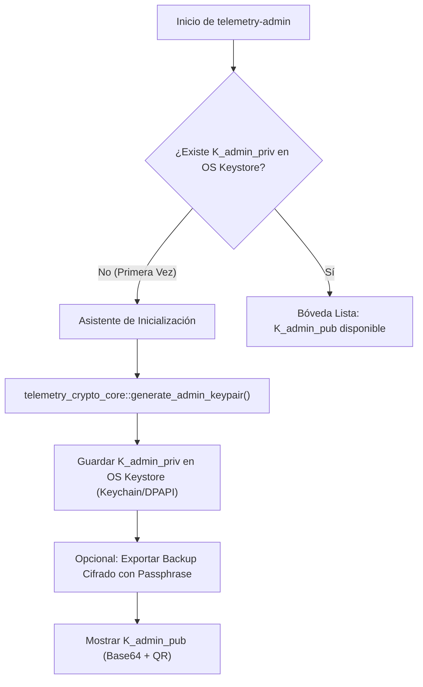

# Tarea 01 (Admin): Infraestructura Base de Tauri 2.0 y Bóveda Segura de Llaves en OS Keystore

| Atributo | Detalle |
|:---|:---|
| **ID de Tarea** | `TASK-ADMIN-01` |
| **Módulos Afectados** | [`admin-client/src-tauri/src/`](file:///Users/demian/Documents/GitHub/telemetry-apps/admin-client/src-tauri/src/) (`main.rs`, `keystore.rs`, `commands/keys.rs`) |
| **Dependencias** | [`TASK-CRYPTO-01`](file:///Users/demian/Documents/GitHub/telemetry-apps/tasks/crypto-core/task-01-crypto-core-foundations.md) |
| **Prioridad** | Crítica / P0 |

---

## 1. Contexto y Arquitectura

La aplicación `telemetry-admin` es la consola central de seguridad y auditoría. Dado el modelo **Zero-Knowledge**, el servidor central jamás almacena la clave privada del administrador (`K_admin_priv`). Por ende, la custodia de esta clave es responsabilidad exclusiva de la aplicación de escritorio del administrador.

Esta tarea establece el runtime de **Tauri 2.0** y el módulo de **Bóveda Segura de Llaves (OS Keystore Vault)** utilizando el crate `keyring`:
- **macOS:** Apple Keychain Services (`kSecClassGenericPassword`).
- **Windows:** Windows Credential Manager / DPAPI (`CryptProtectMemory`).
- **Linux:** Secret Service API vía D-Bus (`org.freedesktop.secrets`).

Asimismo, implementa el asistente de primera ejecución (First-Run Wizard) para generar el par X25519 con `telemetry-crypto-core`, almacenar `K_admin_priv` en el almacén seguro del sistema, y ofrecer mecanismos de exportación/importación de respaldo cifrado con frase de paso (PBKDF2/Argon2 + AES-GCM).



---

## 2. Requerimientos Funcionales y Reglas de Negocio

- **RF-ADMIN-01-1 (Integración con el Almacén Seguro del SO):**
  - Nombre del servicio: `TelemetryAdminVault`.
  - Nombre de cuenta: `admin_master_key_v1`.
  - Prohibido guardar la clave privada en archivos de configuración planos, `localStorage` o bases de datos no cifradas.
- **RF-ADMIN-01-2 (Asistente de Generación Inicial):**
  - Si la clave no existe al arrancar, Tauri debe emitir el comando para generar un par asimétrico X25519 nuevo mediante `telemetry-crypto-core::generate_admin_keypair()`.
- **RF-ADMIN-01-3 (Respaldo Cifrado con Frase de Paso):**
  - Permitir al administrador exportar su clave privada en un archivo `.vault` cifrado.
  - Derivar clave simétrica a partir de la frase de paso usando Argon2id o PBKDF2 (mínimo 100,000 iteraciones).
  - Cifrar `K_admin_priv` con AES-256-GCM.
- **RF-ADMIN-01-4 (Comandos de Tauri Expuestos al Frontend):**
  - `admin_get_public_key() -> Result<String, String>`
  - `admin_generate_keypair() -> Result<String, String>`
  - `admin_export_backup(passphrase: String) -> Result<Vec<u8>, String>`
  - `admin_import_backup(backup_data: Vec<u8>, passphrase: String) -> Result<(), String>`

---

## 3. Arquitectura de Código y Pseudocódigo

### A. Módulo de Abstracción de Keystore ([`admin-client/src-tauri/src/keystore.rs`](file:///Users/demian/Documents/GitHub/telemetry-apps/admin-client/src-tauri/src/keystore.rs))

```rust
use keyring::Entry;
use thiserror::Error;

const SERVICE_NAME: &str = "TelemetryAdminVault";
const KEY_ACCOUNT: &str = "admin_master_key_v1";

#[derive(Error, Debug)]
pub enum KeystoreError {
    #[error("Keyring failure: {0}")]
    Keyring(#[from] keyring::Error),
    #[error("Private key not found in OS Keystore")]
    KeyNotFound,
}

pub fn save_admin_private_key(priv_key_b64: &str) -> Result<(), KeystoreError> {
    let entry = Entry::new(SERVICE_NAME, KEY_ACCOUNT)?;
    entry.set_password(priv_key_b64)?;
    Ok(())
}

pub fn load_admin_private_key() -> Result<String, KeystoreError> {
    let entry = Entry::new(SERVICE_NAME, KEY_ACCOUNT)?;
    match entry.get_password() {
        Ok(k) => Ok(k),
        Err(keyring::Error::NoEntry) => Err(KeystoreError::KeyNotFound),
        Err(e) => Err(KeystoreError::Keyring(e)),
    }
}
```

### B. Comandos Tauri de Bóveda ([`admin-client/src-tauri/src/commands/keys.rs`](file:///Users/demian/Documents/GitHub/telemetry-apps/admin-client/src-tauri/src/commands/keys.rs))

```rust
use tauri::command;
use telemetry_crypto_core::generate_admin_keypair;
use crate::keystore::{load_admin_private_key, save_admin_private_key};

#[command]
pub fn admin_get_public_key() -> Result<String, String> {
    // Si ya existe la privada, podemos calcular la pública con x25519
    let priv_b64 = load_admin_private_key().map_err(|e| e.to_string())?;
    // Derivar pública y retornar
    Ok("public_key_base64_here".to_string())
}

#[command]
pub fn admin_generate_keypair() -> Result<String, String> {
    let (priv_b64, pub_b64) = generate_admin_keypair();
    save_admin_private_key(&priv_b64).map_err(|e| e.to_string())?;
    Ok(pub_b64)
}
```

---

## 4. Prácticas de Programación y Reglas de Seguridad

- **Aislamiento de la Clave Privada:** La clave privada jamás debe ser transferida al contexto JavaScript del WebView. Permanece estrictamente dentro del proceso en Rust en `src-tauri`.
- **Limpieza de Memoria:** Cualquier buffer temporal de `priv_b64` obtenido del Keystore debe ser limpiado con `zeroize` inmediatamente después de ejecutar una operación criptográfica.
- **Protección contra Exportación Desatendida:** Requerir confirmación de contraseña local del sistema operativo antes de exportar o reescribir la clave privada.

---

## 5. Validaciones y Restricciones

- La frase de paso para el archivo de respaldo `.vault` debe tener una longitud mínima de 12 caracteres.
- Solo se permite una clave maestra de administrador activa por instalación.

---

## 6. Logs y Observabilidad

- `tracing::info!("Admin master key successfully accessed from OS Keystore")`.
- `tracing::warn!("First-run wizard: no master key found, prompt required")`.

---

## 7. Criterios de Aceptación y Definición de Terminado (DoD)

1. [x] La aplicación compila con Tauri 2.0 y abre la ventana principal sin errores de WebView.
2. [x] El par de claves se genera y la clave privada persiste en el Keychain / DPAPI / Secret Service.
3. [x] Al reiniciar la aplicación, `load_admin_private_key()` recupera la clave sin solicitar regeneración.
4. [x] La exportación y reimportación del backup protegido por contraseña funciona adecuadamente.

---

## 8. Especificación de Pruebas

- `test_keystore_mock_save_and_load`: Simular guardado y lectura de la clave privada en el entorno de pruebas.
- `test_backup_encryption_invalid_passphrase`: Intentar descifrar un backup con una contraseña incorrecta y verificar rechazo con error criptográfico.
