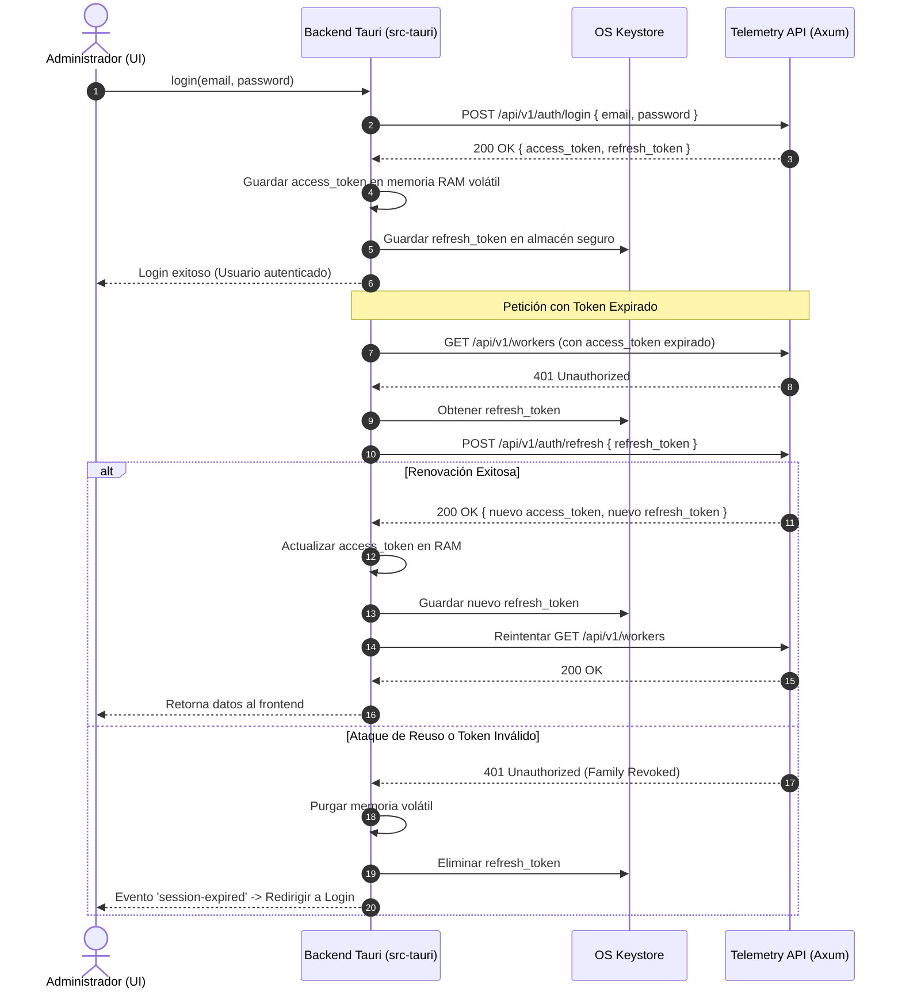

# Tarea 02 (Admin): Autenticación de Administrador, Sesión y Cliente HTTP Resiliente

| Atributo | Detalle |
|:---|:---|
| **ID de Tarea** | `TASK-ADMIN-02` |
| **Módulos Afectados** | [`admin-client/src-tauri/src/`](file:///Users/demian/Documents/GitHub/telemetry-apps/admin-client/src-tauri/src/) (`client.rs`, `commands/auth.rs`), [`admin-client/src/api/`](file:///Users/demian/Documents/GitHub/telemetry-apps/admin-client/src/api/) (`tauri-bridge.ts`) |
| **Dependencias** | [`TASK-ADMIN-01`](file:///Users/demian/Documents/GitHub/telemetry-apps/tasks/admin-client/task-01-tauri-foundations-and-keystore.md) |
| **Prioridad** | Crítica / P0 |

---

## 1. Contexto y Arquitectura

La seguridad del administrador requiere un esquema riguroso para la gestión de credenciales y tokens JWT:
1. **Aislamiento de Tokens Sensibles:** El `access_token` se conserva exclusivamente en la memoria volátil del proceso nativo de Rust (`src-tauri`). **Nunca** debe almacenarse en `localStorage`, `sessionStorage` o cookies del WebView para evitar ataques XSS.
2. **Custodia Segura de Refresh Token:** El `refresh_token` se almacena en el OS Keystore mediante `keyring`.
3. **Interceptor HTTP Transparente con Rotación de Tokens:** Al detectar un `401 Unauthorized` por expiración de token (15 minutos de vigencia), el cliente en Rust invoca automáticamente `POST /api/v1/auth/refresh`. Si el servidor detecta un ataque de reuso de token y revoca la familia, el cliente purga la sesión y notifica al frontend para forzar el bloqueo y relogin.



---

## 2. Requerimientos Funcionales y Reglas de Negocio

- **RF-ADMIN-02-1 (Registro e Inicio de Sesión):**
  - Registro de cuenta inicial: `POST /api/v1/auth/register` (nombre, email, password, organización).
  - Login: `POST /api/v1/auth/login`.
  - Logout: `POST /api/v1/auth/logout` que invalida el refresh token en el servidor y purga credenciales locales.
- **RF-ADMIN-02-2 (Cero Exposición de Tokens en Frontend):** Los comandos de Tauri solo retornan al frontend información de perfil no sensible (`AdminProfile`: id, email, name, organization). Los tokens nunca se envían al WebView.
- **RF-ADMIN-02-3 (Mapeo de Comandos de Tauri):**
  - `admin_login(email, password) -> Result<AdminProfile, String>`
  - `admin_register(form) -> Result<AdminProfile, String>`
  - `admin_logout() -> Result<(), String>`
  - `admin_get_current_session() -> Result<Option<AdminProfile>, String>`

---

## 3. Arquitectura de Código y Pseudocódigo

### A. Cliente HTTP Autenticado ([`admin-client/src-tauri/src/client.rs`](file:///Users/demian/Documents/GitHub/telemetry-apps/admin-client/src-tauri/src/client.rs))

```rust
use reqwest::{Client, StatusCode};
use serde::{Deserialize, Serialize};
use std::sync::RwLock;

pub struct AdminApiClient {
    client: Client,
    base_url: String,
    access_token: RwLock<Option<String>>,
}

#[derive(Serialize, Deserialize, Clone, Debug)]
pub struct AdminProfile {
    pub id: String,
    pub email: String,
    pub name: String,
    pub organization: String,
}

impl AdminApiClient {
    pub fn new(base_url: String) -> Self {
        Self {
            client: Client::builder().timeout(std::time::Duration::from_secs(15)).build().unwrap(),
            base_url,
            access_token: RwLock::new(None),
        }
    }

    pub async fn login(&self, email: &str, pass: &str) -> Result<AdminProfile, String> {
        let url = format!("{}/auth/login", self.base_url);
        let res = self.client.post(&url)
            .json(&serde_json::json!({
                "email": email,
                "password": pass,
                "role": "ADMIN"
            }))
            .send().await.map_err(|e| e.to_string())?;

        if !res.status().is_success() {
            return Err("Invalid credentials".to_string());
        }

        let body: serde_json::Value = res.json().await.map_err(|e| e.to_string())?;
        let at = body["access_token"].as_str().unwrap().to_string();
        let rt = body["refresh_token"].as_str().unwrap().to_string();

        *self.access_token.write().unwrap() = Some(at);
        crate::keystore::save_admin_private_key(&rt).ok(); // Almacenar en Keystore

        serde_json::from_value(body["user"].clone()).map_err(|e| e.to_string())
    }

    pub async fn get_with_auth(&self, endpoint: &str) -> Result<reqwest::Response, String> {
        let url = format!("{}{}", self.base_url, endpoint);
        let token = self.access_token.read().unwrap().clone().unwrap_or_default();

        let res = self.client.get(&url)
            .bearer_auth(&token)
            .send().await.map_err(|e| e.to_string())?;

        if res.status() == StatusCode::UNAUTHORIZED {
            self.refresh_token().await?;
            let new_token = self.access_token.read().unwrap().clone().unwrap_or_default();
            return self.client.get(&url)
                .bearer_auth(&new_token)
                .send().await.map_err(|e| e.to_string());
        }

        Ok(res)
    }

    async fn refresh_token(&self) -> Result<(), String> {
        // Implementación de refresh con rotación de familia
        Ok(())
    }
}
```

---

## 4. Prácticas de Programación y Reglas de Seguridad

- **No Almacenar Contraseñas en Memoria:** Las contraseñas ingresadas en el login deben transmitirse directamente y ser descartadas de la memoria volátil de inmediato.
- **Tiempos Límite Estrictos:** Aplicar un timeout de 15 segundos a todas las peticiones a la API para prevenir bloqueos de UI.

---

## 5. Validaciones y Restricciones

- Correo electrónico: Validación de formato RFC 5322 antes de enviar a la API.
- Longitud de contraseña: Mínimo 8 caracteres en registro.

---

## 6. Logs y Observabilidad

- `tracing::info!("Admin session started for user: {}", email)`.
- `tracing::warn!("Session expired: token refresh failed or token family revoked")`.

---

## 7. Criterios de Aceptación y Definición de Terminado (DoD)

1. [ ] El login y registro comunican correctamente con la API REST.
2. [ ] El `access_token` nunca se escribe en el almacenamiento local del navegador (`localStorage`).
3. [ ] Al expirar el access token, las peticiones HTTP se renuevan automáticamente en segundo plano.
4. [ ] Cerrar sesión limpia todos los tokens en memoria y en el OS Keystore.

---

## 8. Especificación de Pruebas

- `test_admin_login_success`: Validar que una respuesta exitosa puebla el `access_token` en memoria y retorna el perfil de usuario.
- `test_transparent_refresh_on_401`: Configurar un mock server que retorne 401 en la primera petición y 200 en la segunda tras invocar `/auth/refresh`.
