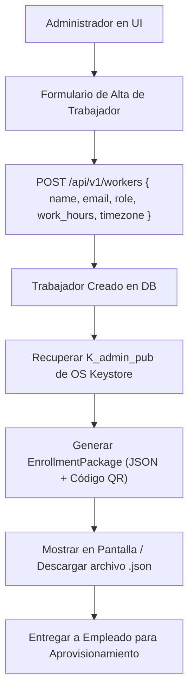

# Tarea 03 (Admin): Gestión del Ciclo de Vida de Trabajadores y Paquete de Enrolamiento

| Atributo | Detalle |
|:---|:---|
| **ID de Tarea** | `TASK-ADMIN-03` |
| **Módulos Afectados** | [`admin-client/src-tauri/src/commands/workers.rs`](../../admin-client/src-tauri/src/commands/workers.rs), [`admin-client/src/components/EmployeeCard.tsx`](../../admin-client/src/components/EmployeeCard.tsx) |
| **Dependencias** | [`TASK-ADMIN-01`](task-01-tauri-foundations-and-keystore.md), [`TASK-ADMIN-02`](task-02-auth-session-and-api-client.md) |
| **Prioridad** | Alta / P1 |


> ⚠️ **Parcialmente reemplazada (2026-09-28).** El alta de trabajadores (RF-ADMIN-03-2) y el *Paquete de Enrolamiento* JSON (RF-ADMIN-03-3: `{api_url, worker_id, admin_public_key, organization}`) quedan **obsoletos**: el alta ahora incluye consentimiento descrito y el enrollment usa código de un solo uso + QR con compromiso → ver [`TASK-ADMIN-08`](task-08-enrollment-and-worker-lifecycle.md). Esta tarea conserva el listado, los filtros, la edición y la baja. Estado 2026-09-29: implementada en `commands/workers.rs` y `Dashboard.tsx`; `mockWorkers` solo existe tras `VITE_DEMO_MODE=true`.

---

## 1. Contexto y Arquitectura

La administración de empleados es la puerta de entrada para la recolección de métricas. Los trabajadores deben ser dados de alta por un administrador y recibir un **Paquete de Enrolamiento Seguro** que vincula la estación de trabajo con la clave pública de la organización.

Esta tarea cubre:
1. **CRUD y Filtros de Trabajadores:** Integración con `GET /api/v1/workers`, `POST /api/v1/workers`, `PUT /api/v1/workers/:id`, y `DELETE /api/v1/workers/:id` (baja lógica).
2. **Visualización de Consentimientos en Badges:** Inspección del estado actual de los 6 consentimientos otorgados por el empleado.
3. **Generación de Paquete de Enrolamiento (JSON y Código QR):** Estructura que contiene la URL base de la API, el ID del trabajador, la clave pública del administrador ($K_{admin\_pub}$) y el nombre de la organización, permitiendo que el trabajador aprovisione su agente en 1 solo paso.



---

## 2. Requerimientos Funcionales y Reglas de Negocio

- **RF-ADMIN-03-1 (Paginación y Filtros de Empleados):**
  - Consumo de `GET /api/v1/workers` con soporte para `page`, `per_page`, búsqueda por texto libre `search`, filtro por rol (`OFFICE` / `FIELD`) y filtro por estado activo (`is_active`).
- **RF-ADMIN-03-2 (Formulario de Creación de Trabajador):**
  - Campos: Nombre completo, correo corporativo, rol (`OFFICE` o `FIELD`), horario laboral (`work_hours_start` y `work_hours_end`, ej. `09:00` y `18:00`), y zona horaria IANA (ej. `America/Santiago`).
- **RF-ADMIN-03-3 (Estructura del Paquete de Enrolamiento):**
  - Formato JSON estricto:
    ```json
    {
      "api_url": "https://telemetry.empresa.com/api/v1",
      "worker_id": "01912345-6789-7abc-def0-123456789def",
      "admin_public_key": "x25519_base64_encoded_public_key_here==",
      "organization": "Acme Corp"
    }
    ```
  - Generar código QR compatible para aprovisionamiento rápido mediante cámara o escáner.
- **RF-ADMIN-03-4 (Desactivación y Baja Lógica):**
  - Confirmación modal antes de emitir `DELETE /api/v1/workers/:id`.
  - La baja revoca inmediatamente las credenciales del trabajador en el backend.

---

## 3. Arquitectura de Código y Pseudocódigo

### A. Comandos de Trabajadores en Rust ([`admin-client/src-tauri/src/commands/workers.rs`](../../admin-client/src-tauri/src/commands/workers.rs))

```rust
use tauri::command;
use serde::{Deserialize, Serialize};

#[derive(Serialize, Deserialize, Clone, Debug)]
pub struct WorkerItem {
    pub id: String,
    pub name: String,
    pub email: String,
    pub role: String, // "OFFICE" o "FIELD"
    pub is_active: bool,
    pub work_hours_start: String,
    pub work_hours_end: String,
    pub timezone: String,
}

#[derive(Serialize, Deserialize, Debug)]
pub struct EnrollmentPackage {
    pub api_url: String,
    pub worker_id: String,
    pub admin_public_key: String,
    pub organization: String,
}

#[command]
pub async fn admin_create_worker(
    name: String,
    email: String,
    role: String,
    start: String,
    end: String,
    tz: String,
) -> Result<EnrollmentPackage, String> {
    // 1. Invocar POST /api/v1/workers en la API
    // 2. Obtener worker_id creado
    let worker_id = "01912345-6789-7abc-def0-123456789def".to_string();
    
    // 3. Obtener K_admin_pub
    let pub_key = crate::commands::keys::admin_get_public_key()?;

    Ok(EnrollmentPackage {
        api_url: "https://telemetry.empresa.com/api/v1".to_string(),
        worker_id,
        admin_public_key: pub_key,
        organization: "Acme Corp".to_string(),
    })
}
```

### B. Componente Frontend de Tarjeta de Empleado ([`admin-client/src/components/EmployeeCard.tsx`](../../admin-client/src/components/EmployeeCard.tsx))

```tsx
import React from 'react';

interface WorkerProps {
  worker: {
    id: string;
    name: string;
    email: string;
    role: 'OFFICE' | 'FIELD';
    isActive: boolean;
  };
  onSelect: (id: string) => void;
  onDeactivate: (id: string) => void;
}

export const EmployeeCard: React.FC<WorkerProps> = ({ worker, onSelect, onDeactivate }) => {
  return (
    <div className="p-4 border rounded-lg shadow-sm hover:shadow-md transition bg-white flex justify-between items-center">
      <div>
        <h4 className="font-semibold text-gray-800">{worker.name}</h4>
        <p className="text-sm text-gray-500">{worker.email}</p>
        <div className="mt-2 flex gap-2">
          <span className={`px-2 py-0.5 text-xs rounded font-medium ${
            worker.role === 'FIELD' ? 'bg-amber-100 text-amber-800' : 'bg-blue-100 text-blue-800'
          }`}>
            {worker.role}
          </span>
          <span className={`px-2 py-0.5 text-xs rounded font-medium ${
            worker.isActive ? 'bg-green-100 text-green-800' : 'bg-red-100 text-red-800'
          }`}>
            {worker.isActive ? 'Activo' : 'Inactivo'}
          </span>
        </div>
      </div>
      <div className="flex gap-2">
        <button
          onClick={() => onSelect(worker.id)}
          className="px-3 py-1 bg-indigo-600 text-white rounded hover:bg-indigo-700 text-sm"
        >
          Ver Telemetría
        </button>
        <button
          onClick={() => onDeactivate(worker.id)}
          className="px-3 py-1 bg-gray-100 text-red-600 rounded hover:bg-red-50 text-sm"
        >
          Desactivar
        </button>
      </div>
    </div>
  );
};
```

---

## 4. Prácticas de Programación y Reglas de Seguridad

- **Validación de Roles y Horarios:** Validar que el formato de horarios cumpla `HH:MM` y que la zona horaria sea válida según la base de datos IANA antes de llamar a la API.
- **Protección del Paquete de Enrolamiento:** Los paquetes de enrolamiento no contienen contraseñas ni claves privadas, únicamente la clave pública del administrador y el identificador del empleado.

---

## 5. Validaciones y Restricciones

- Búsqueda difusa: Limitar a consultas de al menos 2 caracteres para no sobrecargar el servidor.
- Roles soportados estrictamente: `"OFFICE"` o `"FIELD"`.

---

## 6. Logs y Observabilidad

- `tracing::info!("Created worker {} with role {}", email, role)`.
- `tracing::info!("Generated enrollment package for worker ID {}", worker_id)`.

---

## 7. Criterios de Aceptación y Definición de Terminado (DoD)

1. [x] El listado de trabajadores muestra correctamente los datos paginados y los filtros por rol/estado funcionan (`WorkerListQuery::to_endpoint`, paginación en `Dashboard.tsx`).
2. [x] ~~El modal de creación valida todos los campos y produce el JSON de enrolamiento.~~ Reemplazado por ADMIN-08: `CreateWorkerModal` valida identidad, horario, zona IANA, vigencia y descripciones, y muestra el `EnrollmentView` (QR con compromiso).
3. [x] ~~El código QR se genera y puede ser escaneado por el agente.~~ Cubierto por ADMIN-08 (`test_enrollment_qr_cross_app_compatibility`).
4. [x] La pausa/baja de un trabajador cambia su badge inmediatamente (`replaceWorker` con la respuesta de `PATCH /status`; baja con confirmación por nombre).
5. [x] Edición (`workers_update` → `PUT /workers/:id`) solo con los campos modificados.

## 8. Especificación de Pruebas

Implementadas en `admin-client/src-tauri/src/commands/workers.rs`:

- ~~`test_enrollment_package_structure`~~: obsoleto (el paquete JSON fue reemplazado por el QR con compromiso de ADMIN-08).
- `test_workers_work_hours_malformed_rejected`: `"25:99"`, `"24:00"`, vacíos y `start >= end` rechazados antes de la llamada HTTP.
- `test_workers_work_hour_normalized_to_seconds`, `test_workers_timezone_iana_format_validated`.
- `test_workers_list_query_builds_encoded_filters`, `test_workers_list_query_short_search_and_empty_omitted`, `test_workers_list_query_invalid_status_rejected`.
- `test_workers_update_body_contains_only_provided_fields`, `test_workers_update_invalid_forms_rejected`, `test_workers_update_sends_put_and_returns_worker`, `test_workers_update_surfaces_server_reason`.
- `test_workers_delete_sends_soft_delete`.
