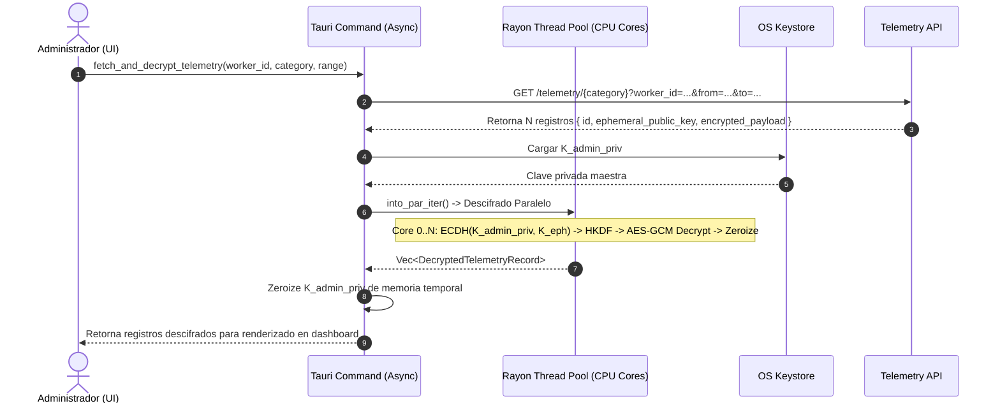

# Tarea 04 (Admin): Motor de Descifrado Paralelo en Memoria (Rayon Pipeline)

| Atributo | Detalle |
|:---|:---|
| **ID de Tarea** | `TASK-ADMIN-04` |
| **Módulos Afectados** | [`admin-client/src-tauri/src/commands/telemetry.rs`](../../admin-client/src-tauri/src/commands/telemetry.rs), [`admin-client/src-tauri/src/core/`](../../admin-client/src-tauri/src/core/) |
| **Dependencias** | [`TASK-CRYPTO-01`](../crypto-core/task-01-crypto-core-foundations.md), [`TASK-ADMIN-01`](task-01-tauri-foundations-and-keystore.md), [`TASK-ADMIN-02`](task-02-auth-session-and-api-client.md) |
| **Prioridad** | Crítica / P0 |

---

## 1. Contexto y Arquitectura

Bajo el modelo **Zero-Knowledge**, la API central almacena los registros de telemetría como blobs binarios cifrados (`BYTEA`) acompañados de claves públicas efímeras (`K_eph_pub`). El servidor **jamás** descifra los datos.

Cuando el administrador solicita la telemetría de un empleado (ej. 5,000 registros para una auditoría semanal), el backend de Tauri debe:
1. Descargar los registros en lotes cifrados desde la API vía HTTP.
2. Recuperar la clave privada maestra ($K_{admin\_priv}$) desde el OS Keystore.
3. Distribuir el trabajo de descifrado entre todos los núcleos disponibles de la CPU utilizando **`rayon`** (paralelismo SIMD/multihilo de alto rendimiento).
4. Validar el tag de autenticación Poly1305/GCM, desempaquetar el JSON en texto plano y zeroizar todas las claves intermedias de la memoria RAM.
5. Proveer feedback visual de progreso en dos etapas al frontend: *1. Descargando datos cifrados...* y *2. Descifrando localmente en memoria...*



---

## 2. Requerimientos Funcionales y Reglas de Negocio

- **RF-ADMIN-04-1 (Descifrado Concurrente Multi-Núcleo):** El descifrado debe paralelizarse mediante `rayon::prelude::into_par_iter()`, procesando hasta 10,000 registros en menos de 500 ms en CPUs modernas con aceleración AES-NI.
- **RF-ADMIN-04-2 (Tolerancia a Registros Corruptos):** Si un registro particular falla en el tag de autenticación o está corrupto, registrar el fallo con su ID pero permitir que los demás registros del lote se descifren correctamente (degradación parcial controlada).
- **RF-ADMIN-04-3 (Zeroize de Claves en Memoria):** Garantizar que la clave privada cargada del Keystore y las claves simétricas derivadas por cada registro se sobreescriban con ceros inmediatamente después del procesamiento.
- **RF-ADMIN-04-4 (Estructura de Datos Desempaquetada):**
  ```rust
  pub struct DecryptedTelemetryRecord {
      pub id: String,
      pub client_timestamp: chrono::DateTime<chrono::Utc>,
      pub payload: serde_json::Value,
  }
  ```

---

## 3. Arquitectura de Código y Pseudocódigo

### A. Comando de Descifrado Paralelo ([`admin-client/src-tauri/src/commands/telemetry.rs`](../../admin-client/src-tauri/src/commands/telemetry.rs))

```rust
use rayon::prelude::*;
use serde::{Deserialize, Serialize};
use tauri::command;
use telemetry_crypto_core::decrypt_telemetry_record;
use zeroize::Zeroizing;

#[derive(Serialize, Deserialize, Clone, Debug)]
pub struct EncryptedRecordDto {
    pub id: String,
    pub client_timestamp: chrono::DateTime<chrono::Utc>,
    pub ephemeral_public_key: String,
    pub encrypted_payload: Vec<u8>,
}

#[derive(Serialize, Deserialize, Debug)]
pub struct DecryptedTelemetryRecord {
    pub id: String,
    pub client_timestamp: chrono::DateTime<chrono::Utc>,
    pub payload: serde_json::Value,
}

#[command]
pub async fn fetch_and_decrypt_telemetry(
    worker_id: String,
    category: String,
    from: Option<String>,
    to: Option<String>,
) -> Result<Vec<DecryptedTelemetryRecord>, String> {
    // 1. Cargar K_admin_priv en contenedor protegido Zeroizing
    let raw_priv = crate::keystore::load_admin_private_key()
        .map_err(|e| format!("Keystore error: {}", e))?;
    let admin_priv_key = Zeroizing::new(raw_priv);

    // 2. Descargar registros cifrados desde la API
    let endpoint = format!("/telemetry/{}?worker_id={}", category, worker_id);
    let encrypted_records: Vec<EncryptedRecordDto> = crate::client::get_json(&endpoint)
        .await
        .map_err(|e| format!("API error: {}", e))?;

    // 3. Ejecutar descifrado paralelo en hilo de cómputo intensivo
    let priv_clone = admin_priv_key.clone();
    tokio::task::spawn_blocking(move || {
        encrypted_records.into_par_iter().map(|rec| {
            let plaintext_json: serde_json::Value = decrypt_telemetry_record(
                &priv_clone,
                &rec.ephemeral_public_key,
                &rec.encrypted_payload,
            ).map_err(|e| format!("Crypto error on ID {}: {}", rec.id, e))?;

            Ok(DecryptedTelemetryRecord {
                id: rec.id,
                client_timestamp: rec.client_timestamp,
                payload: plaintext_json,
            })
        }).collect::<Result<Vec<_>, String>>()
    })
    .await
    .map_err(|e| format!("Task join error: {}", e))?
}
```

---

## 4. Prácticas de Programación y Reglas de Seguridad

- **No Bloquear el Runtime Asíncrono de Tokio:** Operaciones de cómputo intensivo como `rayon::into_par_iter()` deben ejecutarse estrictamente dentro de `tokio::task::spawn_blocking` para no bloquear el executor de I/O.
- **Protección de la Clave Privada:** Usar `Zeroizing<String>` para asegurar que la copia clonada en el hilo de cómputo se destruya al finalizar el bloque.

---

## 5. Validaciones y Restricciones

- Límite por petición: Máximo 20,000 registros por consulta masiva.
- Categorías válidas: `"system"`, `"network"`, `"productivity"`, `"files"`, `"location"`.

---

## 6. Logs y Observabilidad

- `tracing::info!("Successfully decrypted {} records for worker {} in memory", count, worker_id)`.
- `tracing::warn!("Failed to decrypt record ID {}: tag mismatch", record_id)`.

---

## 7. Criterios de Aceptación y Definición de Terminado (DoD)

1. [x] El pipeline descifra lotes de 1,000 registros en menos de 100 ms en máquinas multi-núcleo.
2. [x] Si un registro está alterado, se rechaza individualmente sin corromper el resto del lote.
3. [x] Los datos descifrados se devuelven correctamente estructurados al frontend como JSON.
4. [x] La memoria que alojaba claves intermedias es sanitizada de inmediato.

---

## 8. Especificación de Pruebas

- `test_parallel_decryption_pipeline`: Encriptar 100 registros con pares efímeros distintos y verificar que `rayon` descifra los 100 registros en orden exacto.
- `test_tampered_record_in_batch`: Insertar 1 registro corrupto en un lote de 10 y comprobar el manejo de error controlado.
