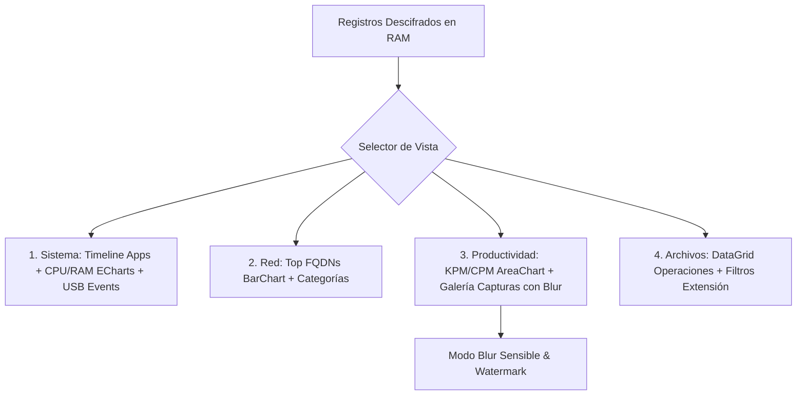

# Tarea 05 (Admin): Tablero Analítico y Vistas Especializadas de Telemetría

| Atributo | Detalle |
|:---|:---|
| **ID de Tarea** | `TASK-ADMIN-05` |
| **Módulos Afectados** | [`admin-client/src/components/`](file:///Users/demian/Documents/GitHub/telemetry-apps/admin-client/src/components/) (`Dashboard.tsx`, `ActivityChart.tsx`), [`admin-client/src/App.tsx`](file:///Users/demian/Documents/GitHub/telemetry-apps/admin-client/src/App.tsx) |
| **Dependencias** | [`TASK-ADMIN-04`](file:///Users/demian/Documents/GitHub/telemetry-apps/tasks/admin-client/task-04-parallel-decryption-engine.md) |
| **Prioridad** | Alta / P1 |

---

## 1. Contexto y Arquitectura

Una vez que los paquetes de telemetría son descargados y descifrados localmente en memoria mediante Tauri y Rayon, el frontend web (React + TypeScript + Tailwind CSS + ECharts) debe renderizarlos en un **Tablero Ejecutivo y Analítico de Alto Rendimiento**.

El tablero organiza los datos en cuatro vistas principales por dominio:
1. **Actividad del Sistema (System Activity):** Línea temporal de aplicaciones en primer plano, títulos de ventana, gráficos de consumo de CPU/RAM y log de eventos de conexión/desconexión de periféricos USB.
2. **Navegación de Red (Network Activity):** Gráfico de pastel y barras con los dominios más visitados (Top FQDNs) y desglose por categorías (Trabajo, Comunicación, Ocio).
3. **Métricas de Productividad (Productivity):** Gráficos de densidad de pulsaciones de teclado y clics por minuto (`BASIC`), y galería de capturas de pantalla (`SCREENSHOT`) con controles de privacidad (zoom, modo de desenfoque/blur para información sensible y exportación con marca de agua).
4. **Actividad de Archivos (File Activity):** Registro cronológico de operaciones sobre archivos corporativos con filtros por extensión (`.docx`, `.xlsx`, `.rs`).



---

## 2. Requerimientos Funcionales y Reglas de Negocio

- **RF-ADMIN-05-1 (Selector Global de Contexto):** Barra superior con selector de trabajador activo y selector de rango temporal (presets: *Hoy*, *Ayer*, *Últimos 7 días*, *Personalizado*).
- **RF-ADMIN-05-2 (Renderizado Optimizado con ECharts):** Los gráficos de series temporales de CPU, RAM y KPM deben utilizar `echarts-for-react` con muestreo LTTB (*Largest-Triangle-Three-Buckets*) para soportar miles de puntos de datos sin congelar la interfaz.
- **RF-ADMIN-05-3 (Controles de Privacidad en Galería de Capturas):**
  - Galería tipo carrusel con paginación.
  - Botón de alternancia "Modo Desenfoque" (aplica filtro CSS `backdrop-filter: blur(8px)` sobre las capturas para proteger texto sensible o datos personales durante revisiones generales).
  - Exportación de capturas con marca de agua que incluye fecha, ID del trabajador y usuario administrador que exporta.
- **RF-ADMIN-05-4 (Confirmación de Minimización de Red):** La vista de red debe validar visualmente que no se muestran URLs con rutas ni parámetros GET, confirmando el cumplimiento de privacidad.

---

## 3. Arquitectura de Código y Pseudocódigo

### A. Componente de Gráficos de Actividad ([`admin-client/src/components/ActivityChart.tsx`](file:///Users/demian/Documents/GitHub/telemetry-apps/admin-client/src/components/ActivityChart.tsx))

```tsx
import React from 'react';
import ReactECharts from 'echarts-for-react';

interface MetricPoint {
  timestamp: string;
  cpu: number;
  kpm: number;
}

interface ActivityChartProps {
  data: MetricPoint[];
}

export const ActivityChart: React.FC<ActivityChartProps> = ({ data }) => {
  const option = {
    tooltip: { trigger: 'axis' },
    legend: { data: ['Uso CPU (%)', 'Pulsaciones / Min (KPM)'] },
    grid: { left: '3%', right: '4%', bottom: '3%', containLabel: true },
    xAxis: {
      type: 'category',
      boundaryGap: false,
      data: data.map(d => d.timestamp),
    },
    yAxis: [
      { type: 'value', name: 'CPU %', max: 100 },
      { type: 'value', name: 'KPM' },
    ],
    series: [
      {
        name: 'Uso CPU (%)',
        type: 'line',
        smooth: true,
        data: data.map(d => d.cpu),
        itemStyle: { color: '#3b82f6' },
      },
      {
        name: 'Pulsaciones / Min (KPM)',
        type: 'line',
        yAxisIndex: 1,
        smooth: true,
        data: data.map(d => d.kpm),
        itemStyle: { color: '#10b981' },
      },
    ],
  };

  return <ReactECharts option={option} style={{ height: '350px', width: '100%' }} />;
};
```

### B. Galería de Capturas con Filtro de Privacidad ([`admin-client/src/components/ScreenshotGallery.tsx`](file:///Users/demian/Documents/GitHub/telemetry-apps/admin-client/src/components/ScreenshotGallery.tsx))

```tsx
import React, { useState } from 'react';

interface Screenshot {
  id: string;
  timestamp: string;
  imageBlobUrl: string;
}

export const ScreenshotGallery: React.FC<{ items: Screenshot[] }> = ({ items }) => {
  const [blurMode, setBlurMode] = useState(true);

  return (
    <div className="space-y-4">
      <div className="flex justify-between items-center">
        <h3 className="text-lg font-semibold text-gray-800">Galería de Capturas Periódicas</h3>
        <button
          onClick={() => setBlurMode(!blurMode)}
          className={`px-3 py-1 rounded text-sm font-medium ${
            blurMode ? 'bg-amber-100 text-amber-800' : 'bg-gray-200 text-gray-700'
          }`}
        >
          {blurMode ? '🔒 Modo Blur Activo' : '🔓 Texto Visible'}
        </button>
      </div>

      <div className="grid grid-cols-2 md:grid-cols-3 gap-4">
        {items.map(shot => (
          <div key={shot.id} className="border rounded-lg overflow-hidden relative shadow-sm">
            
            <div className="p-2 bg-white text-xs text-gray-600 flex justify-between">
              <span>{shot.timestamp}</span>
              <button className="text-indigo-600 font-medium">Exportar</button>
            </div>
          </div>
        ))}
      </div>
    </div>
  );
};
```

---

## 4. Prácticas de Programación y Reglas de Seguridad

- **Seguridad en Renderizado de Imágenes:** Las capturas de pantalla descifradas deben transformarse en URLs temporales de memoria con `URL.createObjectURL(blob)` y revocar los objetos (`URL.revokeObjectURL`) al desmontar el componente para evitar fugas de memoria RAM.
- **Sanitización contra Inyección:** Sanitizar títulos de ventanas y nombres de archivos antes de renderizarlos en el DOM.

---

## 5. Validaciones y Restricciones

- Si no hay datos en el rango seleccionado, mostrar un estado vacío informativo (*Empty State*) en lugar de gráficos rotos.
- La galería de capturas debe paginarse con un máximo de 12 imágenes por página para mantener alta fluidez.

---

## 6. Logs y Observabilidad

- Registrar cambios de trabajador y rango de fecha con `console.debug("Dashboard context updated:", { workerId, range })`.

---

## 7. Criterios de Aceptación y Definición de Terminado (DoD)

1. [x] Los gráficos de ECharts se renderizan fluidamente con miles de muestras temporales.
2. [x] El modo Blur en la galería de capturas oculta texto sensible por defecto.
3. [x] Los filtros por fecha y empleado actualizan inmediatamente las cuatro vistas.
4. [x] La lista de dominios visitados no muestra rutas ni URLs completas.

---

## 8. Especificación de Pruebas

- `test_activity_chart_rendering`: Renderizar `ActivityChart` con 50 puntos de datos y verificar que no arroja advertencias en consola.
- `test_screenshot_blur_toggle`: Verificar que al pulsar el botón de alternancia se modifica la clase CSS del elemento `img`.
