# Tarea 06 (Admin): Mapa Interactivo de Rutas y Geocercas para Trabajadores FIELD

| Atributo | Detalle |
|:---|:---|
| **ID de Tarea** | `TASK-ADMIN-06` |
| **Módulos Afectados** | [`admin-client/src/components/FieldMap.tsx`](file:///Users/demian/Documents/GitHub/telemetry-apps/admin-client/src/components/FieldMap.tsx), [`admin-client/src-tauri/src/commands/telemetry.rs`](file:///Users/demian/Documents/GitHub/telemetry-apps/admin-client/src-tauri/src/commands/telemetry.rs) |
| **Dependencias** | [`TASK-ADMIN-04`](file:///Users/demian/Documents/GitHub/telemetry-apps/tasks/admin-client/task-04-parallel-decryption-engine.md) |
| **Prioridad** | Media / P2 |

---

## 1. Contexto y Arquitectura

Para los trabajadores de campo asignados al rol `FIELD`, la aplicación `telemetry-admin` provee un módulo de **Geolocalización y Trazado de Rutas Interactivo** utilizando mapas basados en Leaflet o MapLibre GL.

Este módulo tiene dos objetivos críticos:
1. **Visualización de Rutas Laborales:** Trazar la secuencia cronológica de ubicaciones registradas durante el turno del trabajador, mostrando marcadores de parada, velocidad y precisión del GPS.
2. **Auditoría Estricta de Horarios y Geocercas:** Validar visual y criptográficamente que **todas** las coordenadas visualizadas se encuentran estrictamente dentro de la jornada laboral pactada (`work_hours_start` a `work_hours_end`). Si un trabajador tiene rol `OFFICE`, la vista de mapa se bloquea completamente con un aviso de que no existen ni existirán datos de ubicación para dicho perfil.

```mermaid
flowchart TD
    SelectWorker[Admin selecciona Trabajador] --> RoleCheck{¿Rol == FIELD?}
    
    RoleCheck -- No (OFFICE) --> LockView["Bloquear Vista: 'Geolocalización no permitida para trabajadores OFFICE'"]
    RoleCheck -- Sí (FIELD) --> FetchGPS["Descifrar telemetría de categoría 'location'"]
    
    FetchGPS --> TimeAudit["Auditoría Horaria: Validar timestamps dentro de work_hours"]
    TimeAudit --> RenderMap["Renderizar Leaflet / MapLibre: Polyline de Ruta + Marcadores"]
    RenderMap --> Geofence["Verificación de Geocerca Corporativa"]
```



---

## 2. Requerimientos Funcionales y Reglas de Negocio

- **RF-ADMIN-06-1 (Restricción por Rol OFFICE vs FIELD):** La pestaña "Ubicación en Terreno" debe ocultarse o mostrar un mensaje de cumplimiento normativo cuando el empleado seleccionado pertenezca al rol `OFFICE`.
- **RF-ADMIN-06-2 (Trazado Cronológico de Rutas):**
  - Conectar los puntos de coordenadas mediante una línea continua (*polyline*) ordenada temporalmente.
  - Marcadores de inicio y fin de jornada con colores diferenciados (Verde / Rojo).
  - Marcadores de paradas prolongadas (más de 15 minutos en el mismo radio).
- **RF-ADMIN-06-3 (Auditoría de Geocercas):**
  - Capacidad para dibujar una geocerca circular o poligonal en el mapa.
  - Indicador de porcentaje de permanencia dentro o fuera del área corporativa designada.
- **RF-ADMIN-06-4 (Confirmación de No Monitoreo Fuera de Turno):** La interfaz debe mostrar explícitamente el horario de inicio y fin, confirmando que no se registran ubicaciones en fines de semana o fuera de las horas acordadas.

---

## 3. Arquitectura de Código y Pseudocódigo

### A. Componente de Mapa de Rutas ([`admin-client/src/components/FieldMap.tsx`](file:///Users/demian/Documents/GitHub/telemetry-apps/admin-client/src/components/FieldMap.tsx))

```tsx
import React from 'react';
import { MapContainer, TileLayer, Marker, Polyline, Popup } from 'react-leaflet';
import 'leaflet/dist/leaflet.css';

interface GpsPoint {
  timestamp: string;
  lat: number;
  lng: number;
  accuracy: number;
}

interface FieldMapProps {
  workerRole: 'OFFICE' | 'FIELD';
  workHours: { start: string; end: string };
  points: GpsPoint[];
}

export const FieldMap: React.FC<FieldMapProps> = ({ workerRole, workHours, points }) => {
  if (workerRole === 'OFFICE') {
    return (
      <div className="p-8 text-center bg-gray-50 border rounded-lg">
        <h4 className="text-gray-700 font-semibold text-lg">Monitoreo de Ubicación No Disponible</h4>
        <p className="text-gray-500 text-sm mt-2 max-w-md mx-auto">
          Por cumplimiento de la Ley 19.628 y GDPR, los trabajadores con rol OFFICE no poseen
          colectores de geolocalización. El hardware GPS se encuentra deshabilitado.
        </p>
      </div>
    );
  }

  const positions: [number, number][] = points.map(p => [p.lat, p.lng]);
  const center: [number, number] = positions.length > 0 ? positions[0] : [-33.4489, -70.6693];

  return (
    <div className="space-y-3">
      <div className="flex justify-between items-center text-xs text-gray-600 bg-amber-50 p-2 rounded border border-amber-200">
        <span>📍 Trabajador de Campo (FIELD)</span>
        <span>Horario auditado: {workHours.start} - {workHours.end}</span>
      </div>

      <div className="h-[450px] w-full rounded-lg overflow-hidden border shadow-sm">
        <MapContainer center={center} zoom={13} style={{ height: '100%', width: '100%' }}>
          <TileLayer
            attribution='&copy; <a href="https://www.openstreetmap.org/copyright">OpenStreetMap</a>'
            url="https://{s}.tile.openstreetmap.org/{z}/{x}/{y}.png"
          />
          {positions.length > 1 && <Polyline positions={positions} color="#4f46e5" weight={4} />}
          {points.map((p, idx) => (
            <Marker key={idx} position={[p.lat, p.lng]}>
              <Popup>
                <div className="text-xs">
                  <p><strong>Hora:</strong> {p.timestamp}</p>
                  <p><strong>Precisión:</strong> {p.accuracy.toFixed(1)} m</p>
                </div>
              </Popup>
            </Marker>
          ))}
        </MapContainer>
      </div>
    </div>
  );
};
```

---

## 4. Prácticas de Programación y Reglas de Seguridad

- **Capas de Mapas Open Source:** Usar capas OpenStreetMap o MapLibre vectoriales sin requerir API keys de terceros que puedan rastrear las coordenadas del administrador.
- **Sanitización de Coordenadas:** Validar rangos numéricos antes de pasar coordenadas a las librerías de renderizado para evitar excepciones NaN.

---

## 5. Validaciones y Restricciones

- Si `points` está vacío, centrar el mapa en la sede corporativa de la organización con un mensaje de "Sin rutas registradas en el período".
- Prohibido almacenar en caché persistente del navegador las coordenadas descifradas.

---

## 6. Logs y Observabilidad

- `console.info("Rendered field route with", points.length, "waypoints")`.

---

## 7. Criterios de Aceptación y Definición de Terminado (DoD)

1. [ ] El componente bloquea la visualización para trabajadores de rol `OFFICE`.
2. [ ] La polilínea de ruta se dibuja correctamente en orden cronológico para trabajadores `FIELD`.
3. [ ] Cada marcador muestra hora y precisión estimada del GPS al hacer clic.
4. [ ] Se confirma que ninguna coordenada cae fuera de la ventana de trabajo del empleado.

---

## 8. Especificación de Pruebas

- `test_field_map_blocks_office_role`: Renderizar con `workerRole="OFFICE"` y verificar que el contenedor de Leaflet no se monta.
- `test_field_map_renders_waypoints`: Pasar 5 puntos válidos y verificar que se generan los marcadores y la polilínea.
