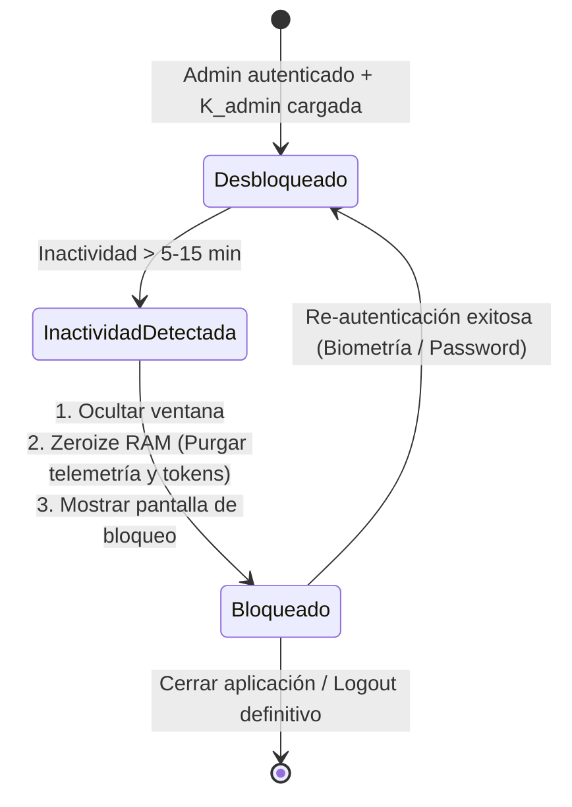

# Tarea 07 (Admin): Bloqueo Automático por Inactividad, Purga de Memoria RAM y Seguridad Operacional

| Atributo | Detalle |
|:---|:---|
| **ID de Tarea** | `TASK-ADMIN-07` |
| **Módulos Afectados** | [`admin-client/src-tauri/src/commands/auth.rs`](../../admin-client/src-tauri/src/commands/auth.rs), [`admin-client/src/App.tsx`](../../admin-client/src/App.tsx) |
| **Dependencias** | [`TASK-ADMIN-01`](task-01-tauri-foundations-and-keystore.md), [`TASK-ADMIN-04`](task-04-parallel-decryption-engine.md) |
| **Prioridad** | Alta / P1 |


> ⚠️ **Brecha conocida (auditoría 2026-09-30):** RF-ADMIN-07-3 está marcado como hecho, pero `admin_unlock_with_biometric` **no invoca ninguna verificación del sistema operativo**: reabre la sesión con el refresh token guardado (`unlock_with_refresh`). Cualquiera frente al equipo bloqueado puede desbloquearlo con ese botón. Pendiente: integrar LocalAuthentication (macOS) / Windows Hello antes de `unlock_with_refresh`, u ocultar el botón hasta tenerlo. Registrado en [`implementation-status.md`](../../.ai-context/implementation-status.md) y en el modelo de amenazas de [`security-model.md`](../../.ai-context/security-model.md).

---

## 1. Contexto y Arquitectura

La consola de administración `telemetry-admin` procesa y descifra información laboral y corporativa altamente sensible en la memoria RAM de la máquina del administrador. Si el administrador deja su estación de trabajo desatendida, existe riesgo de divulgación no autorizada de datos personales.

Esta tarea implementa las medidas de **Endurecimiento de Seguridad Operacional (Security Hardening)**:
1. **Temporizador de Inactividad Configurable (Auto-Lock):** Detección de inactividad del cursor y teclado del administrador (ej. 5 o 15 minutos).
2. **Purga Inmediata de Memoria RAM:** Al activarse el bloqueo, la aplicación oculta la ventana principal, elimina y sobreescribe con ceros todos los registros de telemetría descifrados, las claves intermedias y los tokens de acceso en memoria volátil.
3. **Re-autenticación Obligatoria:** Pantalla de desbloqueo que exige reingresar la contraseña del administrador o utilizar autenticación biométrica del sistema (Touch ID en macOS, Windows Hello en Windows).
4. **Integración con System Tray:** Minimización segura a la bandeja del sistema con contador de alertas.



---

## 2. Requerimientos Funcionales y Reglas de Negocio

- **RF-ADMIN-07-1 (Temporizador de Inactividad):**
  - Configurable por el usuario: 5 minutos (por defecto), 10 minutos, 15 minutos o 30 minutos.
  - El contador de inactividad se resetea con cualquier interacción del mouse o teclado dentro de la ventana de Tauri.
- **RF-ADMIN-07-2 (Purga Atómica de Memoria):**
  - Invocar un comando nativo en Rust (`admin_flush_session_memory()`) que:
    - Sobreescribe con ceros cualquier vector de `DecryptedTelemetryRecord` residual.
    - Limpia la variable en memoria de `access_token`.
    - Solicita al recolector de basura del WebView la liberación inmediata de buffers.
- **RF-ADMIN-07-3 (Desbloqueo Biométrico y por Contraseña):**
  - Si el sistema soporta biometría (Touch ID / Windows Hello), ofrecerla como método primario de desbloqueo rápido.
  - Método secundario: Contraseña de la cuenta de administrador.
  - Al desbloquear exitosamente, el `refresh_token` almacenado en el OS Keystore genera un nuevo `access_token` sin requerir login completo desde cero.

---

## 3. Arquitectura de Código y Pseudocódigo

### A. Comando de Purga de Memoria en Rust ([`admin-client/src-tauri/src/commands/auth.rs`](../../admin-client/src-tauri/src/commands/auth.rs))

```rust
use tauri::command;
use zeroize::Zeroize;

pub static mut CACHED_ACCESS_TOKEN: Option<String> = None;

#[command]
pub fn admin_lock_and_flush_memory() -> Result<(), String> {
    // 1. Limpieza de memoria sensible
    unsafe {
        if let Some(ref mut token) = CACHED_ACCESS_TOKEN {
            token.zeroize();
        }
        CACHED_ACCESS_TOKEN = None;
    }

    tracing::info!("Admin session auto-locked: all decrypted memory and tokens flushed");
    Ok(())
}
```

### B. Hook de Detección de Inactividad en React ([`admin-client/src/hooks/useAutoLock.ts`](../../admin-client/src/hooks/useAutoLock.ts))

```typescript
import { useEffect, useRef, useState } from 'react';
import { invoke } from '@tauri-apps/api/core';

export const useAutoLock = (timeoutMinutes: number = 5) => {
  const [isLocked, setIsLocked] = useState(false);
  const timerRef = useRef<NodeJS.Timeout | null>(null);

  const lockApp = async () => {
    setIsLocked(true);
    try {
      await invoke('admin_lock_and_flush_memory');
    } catch (e) {
      console.error('Failed to flush memory on lock', e);
    }
  };

  const resetTimer = () => {
    if (isLocked) return;
    if (timerRef.current) clearTimeout(timerRef.current);
    timerRef.current = setTimeout(lockApp, timeoutMinutes * 60 * 1000);
  };

  useEffect(() => {
    const events = ['mousemove', 'keydown', 'mousedown', 'scroll'];
    events.forEach(event => window.addEventListener(event, resetTimer));
    resetTimer();

    return () => {
      events.forEach(event => window.removeEventListener(event, resetTimer));
      if (timerRef.current) clearTimeout(timerRef.current);
    };
  }, [timeoutMinutes, isLocked]);

  return { isLocked, setIsLocked, resetTimer };
};
```

---

## 4. Prácticas de Programación y Reglas de Seguridad

- **Destrucción Garantizada:** Asegurar que los componentes de la interfaz de usuario no conserven en closures o estados globales de React las listas de datos descifrados una vez bloqueada la pantalla.
- **Ocultamiento de Ventana:** Minimizar o aplicar un velo visual completo para que miradas casuales o herramientas de captura de pantalla remota no puedan leer los datos expuestos mientras la estación está desatendida.

---

## 5. Validaciones y Restricciones

- Intentos fallidos de desbloqueo: Tras 5 intentos incorrectos consecutivos, forzar el cierre total de la sesión, eliminando el refresh token del Keystore y requiriendo re-login completo con credenciales principales.

---

## 6. Logs y Observabilidad

- `tracing::info!("Inactivity threshold reached. Workspace locked.")`.
- `tracing::info!("Workspace unlocked successfully via biometric prompt")`.

---

## 7. Criterios de Aceptación y Definición de Terminado (DoD)

1. [x] Al permanecer inactivo durante el tiempo configurado, la interfaz muestra la pantalla de bloqueo y oculta los dashboards.
2. [x] El comando de purga de memoria en Rust se ejecuta y elimina el access token de RAM.
3. [x] El desbloqueo con credenciales válidas restaura el acceso al dashboard sin perder el estado de la sesión.
4. [x] Intentos excesivos de desbloqueo erróneo fuerzan un logout de seguridad.

---

## 8. Especificación de Pruebas

- `test_auto_lock_timer_resets_on_activity`: Simular eventos de teclado y comprobar que el temporizador de inactividad se posterga.
- `test_flush_clears_cached_tokens`: Comprobar que tras llamar a `admin_lock_and_flush_memory()`, cualquier llamada posterior sin reautenticación falla con error de autenticación.
