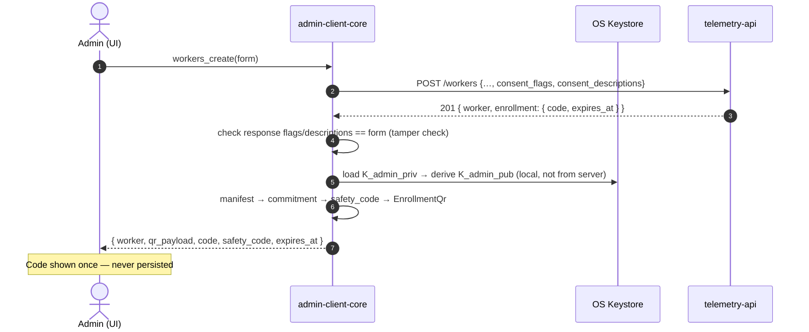

# Tarea 08 (Admin): Registro de Llave Pública, Alta con Consentimiento Descrito, QR de Enrollment y Ciclo de Vida del Worker

| Atributo | Detalle |
|:---|:---|
| **ID de Tarea** | `TASK-ADMIN-08` |
| **Módulos Afectados** | `admin-client/src-tauri/src/commands/{keys,workers}.rs` (nuevos, extraídos de `commands.rs`), `admin-client/src-tauri/src/client.rs`, `admin-client/src/api/tauri-bridge.ts`, `admin-client/src/api/types.ts` (nuevo), `admin-client/src/components/` (`WorkerForm`, `ConsentEditor`, `ConsentPreview`, `EnrollmentModal`, `WorkerDetail`, `ConsentHistory`, `EmployeeCard`, `Dashboard`) |
| **Dependencias** | [`TASK-CRYPTO-02`](../crypto-core/task-02-enrollment-manifest-commitment.md), [`TASK-INT-01`](../integration/task-01-api-contract-alignment.md), [`TASK-ADMIN-02`](task-02-auth-session-and-api-client.md), `telemetry-api` **TASK-12** |
| **Reemplaza** | RF-2/RF-3 de [`TASK-ADMIN-03`](task-03-worker-management-and-enrollment.md) (paquete JSON con `worker_id` + llave) |
| **Especificación funcional** | [`docs/admin-app-spec.md`](../../docs/admin-app-spec.md) (pantallas K1, K2, W1–W4) |
| **Prioridad** | Crítica / P0 |

---

## 1. Contexto y Arquitectura

La app admin hoy genera la llave pero **no la registra en el servidor**, crea workers en un array mock y entrega un JSON con la llave pública para pegar a mano. Con la API TASK-12:

1. La llave pública se registra una vez (`PUT /admins/me/public-key`).
2. El admin define **qué se recolecta y cómo se le explica al empleado** al crear el worker.
3. El servidor devuelve un código de un solo uso; la app construye el **QR con compromiso** y el **código de verificación**.
4. El admin ve y gestiona el ciclo de vida: invitado, esperando consentimiento, activo, pausado, revocado; y la evidencia de consentimiento.



---

## 2. Requerimientos Funcionales y Reglas de Negocio

- **RF-ADMIN-08-1 (Registro de la llave):** después de generar o restaurar la llave, y en cada login, si `GET /admins/me` devuelve `public_key = null`, llamar a `PUT /admins/me/public-key`. Si el servidor tiene una llave **distinta** a la derivada localmente → pantalla K2 y bloquear la creación de workers.
- **RF-ADMIN-08-2 (Formulario de alta):** campos de identidad + editor de consentimiento: seis toggles; toda categoría activa exige una descripción (10–500 caracteres) con una plantilla editable; `location` deshabilitado para `OFFICE`; vista previa en vivo de la pantalla C1 del worker; vigencia del código 1–72 h.
- **RF-ADMIN-08-3 (Construcción del QR):** comando `workers_create` que, después del `201`:
  1. Compara `requested_consent_flags` y `consent_descriptions` de la respuesta con lo enviado (tras normalizar: trim y `None` para las flags en `false`). Si difieren → error `ENROLLMENT_TAMPER_CHECK_FAILED` y no se muestra el QR.
  2. Construye `EnrollmentManifest` con la llave **derivada del keystore**, `consent_version`, flags y descripciones.
  3. Devuelve `EnrollmentQr` (JSON), `code`, `safety_code` y `expires_at`.
- **RF-ADMIN-08-4 (Modal de enrollment):** QR renderizado (librería `qrcode` en Rust → PNG base64, o `qrcode.react` en la UI desde el JSON), código grande en monospace, cuenta regresiva, código de verificación e instrucciones. Botones Copiar código / Guardar PNG. Al cerrarse, el código se descarta.
- **RF-ADMIN-08-5 (Regenerar código):** `POST /workers/:id/enrollment-token`. Para workers vinculados, confirmación explícita: "Esto desvincula el equipo actual (<hostname>)". Construye el QR igual que RF-3, a partir de `GET /workers/:id`.
- **RF-ADMIN-08-6 (Listado real):** `workers_list` contra `GET /workers` con filtros `status`, `role_type`, `search` y paginación. Badge de estado y columna de versión aceptada/vigente (`v1 / v2 ⚠`). Se elimina `mockWorkers` (queda solo en demo mode).
- **RF-ADMIN-08-7 (Detalle y acciones):** W4 con acciones según estado: pausar/reanudar (`PATCH /status`, motivo opcional), revocar (confirmación escribiendo el nombre), eliminar, regenerar código, editar consentimiento (`PUT /consent-config`, mostrando si requiere reaceptación).
- **RF-ADMIN-08-8 (Evidencia):** tabla de `GET /workers/:id/consent-records` y exportación CSV.
- **RF-ADMIN-08-9 (Dashboard):** KPIs por estado y alertas: códigos por vencer (< 2 h), rechazos, workers `ACTIVE` sin datos en 24 h.
  > Estado 2026-09-29: KPIs por estado, llave K2 y códigos por vencer implementados. **Rechazos** y **`ACTIVE` sin datos en 24 h** quedan bloqueados por la API: `WorkerResponse` no expone `last_seen` ni la última decisión de consentimiento, y derivarlos exigiría N llamadas por worker. Requiere ampliar `GET /workers` en `telemetry-api`.

---

## 3. Arquitectura de Código y Pseudocódigo

```rust
// admin-client/src-tauri/src/commands/workers.rs
#[tauri::command]
pub async fn workers_create(form: CreateWorkerForm) -> Result<CreatedWorker, CommandError> {
    form.validate()?;                                           // hours, tz, descriptions, OFFICE+location
    let api = crate::client::get_api_client();
    let created: CreateWorkerResponse = api.post("/workers", &form.to_request()).await?;

    ensure_matches_request(&form, &created.worker)?;            // tamper check (RF-3.1)

    let admin_pub = crate::keystore::derive_admin_public_key()?; // never from the server
    let manifest = EnrollmentManifest::new(
        admin_pub,
        created.worker.consent_version,
        created.worker.requested_consent_flags.clone(),
        created.worker.consent_descriptions.clone(),
    )?;
    let commitment = manifest_commitment(&manifest)?;
    let qr = EnrollmentQr::new(api.base_url(), created.enrollment.code.clone(), commitment.clone());

    tracing::info!(worker_id = %created.worker.id, commitment = &commitment[..8], "enrollment issued");

    Ok(CreatedWorker {
        worker: created.worker,
        enrollment: EnrollmentView {
            qr_payload: qr.to_json()?,
            code: created.enrollment.code,       // shown once, never stored
            safety_code: safety_code(&commitment)?,
            expires_at: created.enrollment.expires_at,
        },
    })
}
```

```ts
// admin-client/src/api/types.ts — mirrors Rust DTOs (snake_case)
export type WorkerStatus = 'PENDING_ENROLLMENT' | 'PENDING_CONSENT' | 'ACTIVE' | 'PAUSED' | 'REVOKED';
export interface ConsentFlags { system_activity: boolean; network_activity: boolean; productivity_basic: boolean;
  productivity_screenshots: boolean; file_activity: boolean; location: boolean; }
export type ConsentDescriptions = { [K in keyof ConsentFlags]: string | null };
export interface EnrollmentView { qr_payload: string; code: string; safety_code: string; expires_at: string; }
```

---

## 4. Prácticas de Programación y Reglas de Seguridad

- El código de enrollment solo vive en la respuesta del comando y en el estado del modal; no va a logs, `localStorage` ni al store global.
- La llave del manifiesto se deriva del keystore (SEC-07); usar la que devuelve el servidor anularía la protección.
- La UI no decide transiciones: habilita botones según `status`, pero la API es la autoridad y sus errores se muestran tal cual (`INVALID_STATUS_TRANSITION`).

---

## 5. Validaciones y Restricciones

- Horario `HH:MM`, inicio < fin; timezone IANA válida (`chrono-tz`).
- Descripción obligatoria por categoría activa (10–500 caracteres, trim).
- `OFFICE` ⇒ `location` deshabilitado y `false`.
- Búsqueda desde 2 caracteres.

---

## 6. Logs y Observabilidad

- `info`: `worker created id=… status=PENDING_ENROLLMENT`, `enrollment issued commitment=<8hex>`, `worker status changed id=… to=PAUSED`.
- `warn`: `enrollment tamper check failed`, `server public key differs from local key`.

---

## 7. Criterios de Aceptación y Definición de Terminado (DoD)

1. [x] Escenarios 1–5 de [`docs/admin-app-spec.md` §4](../../docs/admin-app-spec.md) verificados contra la API con TASK-12.
2. [x] Un QR generado por el admin es aceptado por el agent (AGENT-08) y un QR con la llave alterada es rechazado.
3. [x] No quedan workers mock en builds sin `VITE_DEMO_MODE`.
4. [x] Comandos divididos en `commands/{auth,keys,workers,telemetry,session}.rs` con `CommandError`.
5. [x] `implementation-status.md` actualizado.

---

## 8. Especificación de Pruebas

- `test_workers_create_builds_qr_with_local_key_not_server_key`.
- `test_workers_create_tamper_check_rejects_modified_descriptions` (con `wiremock`).
- `test_workers_create_office_with_location_rejected_client_side`.
- `test_enrollment_view_code_not_logged` (captura de `tracing`).
- `test_register_public_key_on_login_when_missing`.
- `test_server_key_mismatch_blocks_worker_creation`.
- `test_enrollment_qr_cross_app_compatibility`: el QR del admin se verifica con el mismo manifiesto que construye el agent desde la respuesta de enroll (integración en `tests/` del workspace).
- `test_workers_set_status_non_admin_target_rejected`, `test_workers_set_status_sends_normalized_body`, `test_workers_set_status_surfaces_invalid_transition`.
- `test_workers_consent_config_missing_description_rejected`, `test_workers_consent_config_drops_disabled_descriptions`.
- `admin-client/test/workers.test.mjs`: validación de horario/zona, defaults DP-08, descripciones y CSV de evidencia (importa el módulo real).
