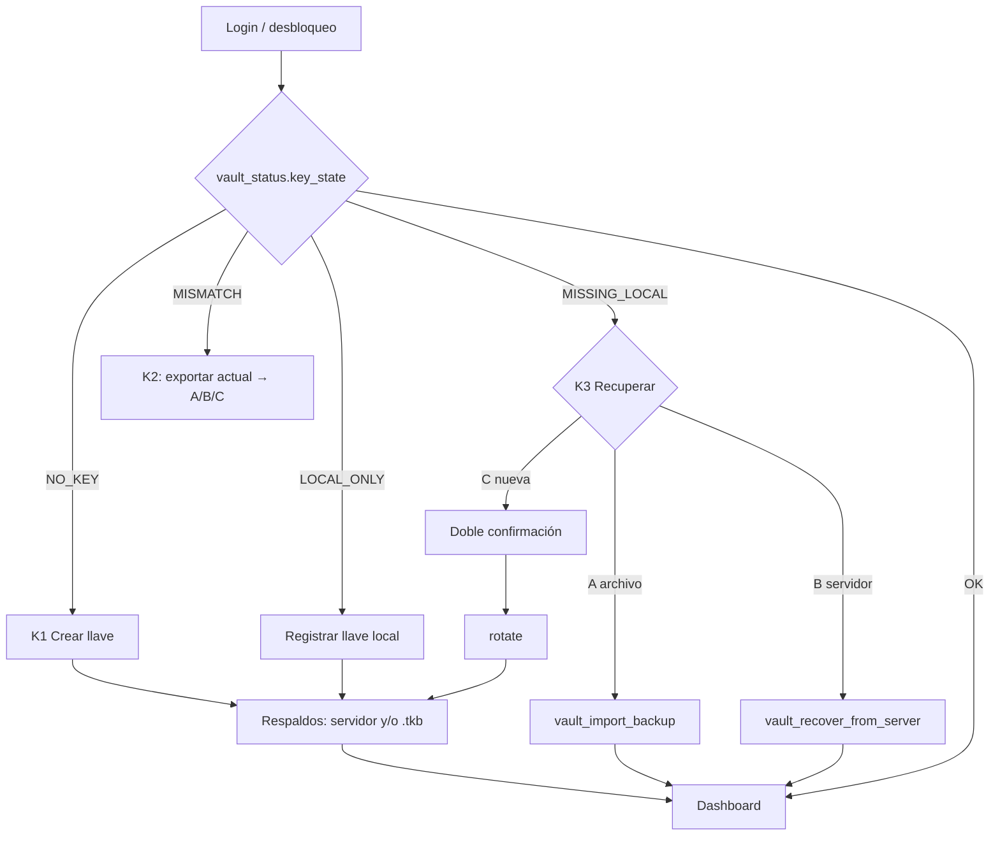

# Tarea 11 (Admin): Bóveda de la Llave — Exportar `.tkb`, Importar, Recuperar desde el Servidor y Generar Nueva Llave

| Atributo | Detalle |
|:---|:---|
| **ID de Tarea** | `TASK-ADMIN-11` |
| **Tareas de origen** | **`TASK-APP-02`** (flujo de importación/exportación de llave privada), `TASK-API-06/07` (vault en el servidor, `telemetry-api` TASK-16) |
| **Módulos Afectados** | `admin-client/src-tauri/src/commands/vault.rs` (nuevo), `admin-client/src-tauri/src/commands/keys.rs` (se retira la exportación v1), `admin-client/src-tauri/src/keystore.rs`, `admin-client/src-tauri/src/client.rs`, `admin-client/src-tauri/src/main.rs`, `admin-client/src/components/{KeyVault,KeyRecoveryWizard,AccountSecurity,ConsentSettings}.tsx`, `admin-client/src/App.tsx`, `admin-client/src/api/{tauri-bridge,types}.ts` |
| **Dependencias** | [`TASK-CRYPTO-03`](../crypto-core/task-03-key-backup-v2-argon2id.md) (formato v2), [`TASK-INT-02`](../integration/task-02-api-v2-contract-alignment.md), [`TASK-ADMIN-10`](task-10-google-sign-in-and-admin-devices.md) (huella de la llave por dispositivo) |
| **Reemplaza** | La exportación `.vault` v1 de [`TASK-ADMIN-01`](task-01-tauri-foundations-and-keystore.md) (el `.vault` se sigue pudiendo **importar**) |
| **Prioridad** | Crítica / P0 — perder `K_admin_priv` sin respaldo hace irrecuperables todos los datos |

---

## 1. Contexto

`K_admin_priv` es la única forma de leer la telemetría. Vive en el keystore del sistema operativo de **un** equipo. Esta tarea implementa los tres caminos de `TASK-APP-02` más la gestión del respaldo en el servidor:

| Situación | Pantalla | Opciones |
|:---|:---|:---|
| Sin llave local, **sin** llave en el servidor (cuenta nueva) | **K1 — Crear llave** | Generar → Master Password → respaldo en servidor (recomendado) → descargar `.tkb` |
| Sin llave local, **con** llave en el servidor (equipo nuevo, reinstalación) | **K3 — Recuperar llave** | **A** "Tengo archivo de respaldo (.tkb)" · **B** "Recuperar con Master Password" (solo si hay respaldo en el servidor) · **C** "Generar nueva llave" (destructivo) |
| Llave local ≠ llave del servidor | **K2 — Llave distinta** | A · B (reemplazan la local tras confirmar y ofrecer exportarla antes) · C |
| Llave local = llave del servidor | **Bóveda** (pestaña "Bóveda & Cumplimiento") | Exportar `.tkb` · Activar/Reemplazar/Eliminar respaldo en servidor · Importar (solo informativo) · Generar nueva llave (rotación) |
| Llave local y servidor sin llave | **K1b — Registrar llave** | Registrar la llave local (`PUT /admins/me/public-key`) |

**Master Password:** contraseña elegida por el admin que protege el respaldo (archivo y servidor). Es distinta de la contraseña de la cuenta, **nunca** sale del equipo y Argon2id se ejecuta solo aquí (restricciones de la sesión de diseño).

---

## 2. Requerimientos Funcionales

- **RF-ADMIN-11-1 (Estado):** `vault_status()` → `VaultStatus { key_state, has_local_key, local_fingerprint, registered_fingerprint, server_backup: { enabled, public_key_fingerprint, updated_at, matches_registered_key } | null, organization }` con `key_state ∈ {NO_KEY, MISSING_LOCAL, MISMATCH, LOCAL_ONLY, OK}` (tabla de §1). La UI enruta con `key_state` tras cada login y al desbloquear.
- **RF-ADMIN-11-2 (Crear llave, K1):** `vault_create_initial_key()` solo si el servidor no tiene llave: generar par X25519 → guardar privada en keystore → `PUT /admins/me/public-key` → si falla, **borrar** la privada recién guardada (no queda una llave local huérfana) → `PATCH` de la huella del dispositivo (RF-ADMIN-10-8). Luego la UI exige elegir: respaldo en servidor (RF-ADMIN-11-4) y/o `.tkb` (RF-ADMIN-11-3); "Omitir" es posible pero la Bóveda muestra una alerta roja persistente mientras `key_backup_enabled = false` y no se haya exportado un `.tkb` en esta instalación.
- **RF-ADMIN-11-3 (Exportar `.tkb`):** `vault_export_tkb(master_password, confirm_password?)`:
  1. Requiere `key_state = OK`.
  2. Verificación de la Master Password: si hay respaldo en el servidor, se descarga (`GET /admins/me/vault/backup`, auditado por la API) y se descifra con la contraseña; la llave obtenida debe ser la local (`BACKUP_KEY_MISMATCH` si no). Si no hay respaldo en el servidor, la contraseña es nueva: `confirm_password` obligatoria e igual, ≥ 12 caracteres.
  3. Cifrar la llave local con **sal y nonce nuevos** (CRYPTO-03), construir el contenedor `.tkb` (`organization`, `created_at`).
  4. Escribir en la carpeta de Descargas (fallback Documentos → home) con el nombre `telemetry_key_{org}_{AAAA-MM-DD}.tkb` (sin sobrescribir: sufijo `-2`, `-3`…; permisos `0600` en Unix).
  5. Devolver `{ path, file_name, public_key_fingerprint }`; la UI muestra la ruta y la advertencia: *"Guarda este archivo en un lugar seguro y separado de este equipo. Quien tenga el archivo y tu Master Password puede leer los datos de tus trabajadores. Si pierdes ambos, los datos históricos son irrecuperables."*
- **RF-ADMIN-11-4 (Respaldo en el servidor):** `vault_setup_server_backup(master_password, confirm_password)` cifra la llave local y llama `POST /admins/me/vault/setup { encrypted_private_key, public_key_fingerprint, argon2_params }` → `{ replaced, updated_at }`. Reemplazar un respaldo existente pide confirmación ("la Master Password anterior deja de servir"). `vault_delete_server_backup()` → `DELETE /admins/me/vault` con confirmación (la opción B deja de existir).
- **RF-ADMIN-11-5 (A — importar archivo):** `vault_import_backup(file_bytes, master_password, replace_local)`: `import_any_backup` acepta `.tkb` v2 y `.vault` v1 → la huella de la llave importada debe ser la **registrada** en el servidor (`BACKUP_KEY_MISMATCH` con ambas huellas cortas) o, si el servidor no tiene llave, se registra → guardar en keystore (si hay otra llave local y `replace_local = false` ⇒ `LOCAL_KEY_PRESENT`) → huella del dispositivo.
- **RF-ADMIN-11-6 (B — recuperar del servidor):** `vault_recover_from_server(master_password, replace_local)`: `GET /admins/me/vault/backup` (`404 VAULT_NOT_CONFIGURED` → mensaje) → validar parámetros **antes** de derivar → descifrar → huella = `public_key_fingerprint` del respaldo = llave registrada → keystore → huella del dispositivo. Contraseña incorrecta → `WRONG_MASTER_PASSWORD` (*"Master Password incorrecta"*; sin distinguir de un blob alterado).
- **RF-ADMIN-11-7 (C — generar nueva llave):** `vault_generate_new_key(acknowledge_data_loss, confirmation_phrase)`:
  - Doble confirmación explícita: (1) casilla *"Entiendo que los datos históricos cifrados con la llave anterior serán ilegibles y que todos mis trabajadores quedarán desvinculados"* (`acknowledge_data_loss = true`) y (2) escribir exactamente **`GENERAR NUEVA LLAVE`**. Ambas se validan **en Rust** (no basta la UI).
  - Si el servidor tiene llave: `POST /admins/me/public-key/rotate { public_key, previous_public_key_fingerprint, confirm_data_loss: true }` (revoca a todos los workers y borra el respaldo del servidor); si no, `PUT /admins/me/public-key`.
  - Orden: generar en memoria → guardar en keystore conservando en RAM (`Zeroizing`) la llave local anterior → llamada al servidor → si falla, **restaurar** la anterior (o borrar si no había). Respuesta `{ public_key_fingerprint, revoked_workers }`; la UI lleva directo a crear los respaldos nuevos (K1 paso 2).
- **RF-ADMIN-11-8 (Reemplazo de una llave local distinta, K2):** antes de A/B con `replace_local = true`, la UI ofrece **Exportar la llave actual** (`.tkb` con una Master Password nueva) porque podría descifrar datos antiguos; solo después habilita "Reemplazar".
- **RF-ADMIN-11-9 (Retiro de v1):** se eliminan `admin_export_backup` y el botón "Exportar Backup (.vault)". `admin_import_backup` se reemplaza por `vault_import_backup`.

---

## 3. Arquitectura de Código y Pseudocódigo

```rust
// commands/vault.rs
#[tauri::command]
pub async fn vault_export_tkb(
    state: State<'_, AppState>,
    master_password: String,
    confirm_password: Option<String>,
) -> Result<ExportedBackup, CommandError> {
    let password = Zeroizing::new(master_password);              // SEC-03 desde la entrada
    let confirm = confirm_password.map(Zeroizing::new);
    let status = compute_status(&state).await?;
    ensure!(status.key_state == KeyState::Ok, "KEY_NOT_READY");
    let local_priv = keystore::load_private_key()?;              // Zeroizing<String>
    match status.server_backup {
        Some(b) if b.enabled => {
            let remote = state.client.get_vault_backup().await?;
            let key = decrypt_private_key(&remote.encrypted_private_key, &password,
                                          &remote.argon2_params, Some(&remote.public_key_fingerprint))
                .map_err(map_backup_err)?;                        // WRONG_MASTER_PASSWORD
            ensure!(key.as_str() == local_priv.as_str(), "BACKUP_KEY_MISMATCH");
        }
        _ => validate_new_password(&password, confirm.as_deref())?,
    }
    let blob = encrypt_private_key(&local_priv, &password, Argon2Params::generate_default())?;
    let file = KeyBackupFile::from_blob(&blob, &status.organization, Utc::now());
    let path = write_backup_file(&downloads_dir()?, &suggested_backup_file_name(&status.organization, Local::now().date_naive()), &file.to_json_bytes()?)?;
    Ok(ExportedBackup { path, file_name, public_key_fingerprint: blob.public_key_fingerprint })
}
```



---

## 4. Reglas de Seguridad

1. El servidor recibe solo `encrypted_private_key`, `argon2_params` y la huella: nunca la Master Password ni la llave en claro. El cuerpo de `vault/setup` se construye con un struct cerrado (sin campos extra; la API además rechaza campos desconocidos).
2. Argon2id y AES-GCM solo en `telemetry-crypto-core` (SEC-02). La Master Password pasa a `Zeroizing<String>` en la primera línea de cada comando; la llave y la KEK se limpian al salir del ámbito (criterio *zeroización* de APP-02).
3. La UI limpia los campos de contraseña (estado de React) tras cada intento, correcto o no. Riesgo residual documentado: las cadenas de JS no se pueden zeroizar.
4. Nunca queda una llave local que no coincide con la registrada por un fallo a mitad de camino (rollback de RF-ADMIN-11-2 y RF-ADMIN-11-7).
5. La frase `GENERAR NUEVA LLAVE` y `acknowledge_data_loss` se comparan en Rust; la API además exige `confirm_data_loss = true`.
6. El `.tkb` se escribe con permisos restrictivos y nunca se sobrescribe un archivo existente.

---

## 5. Validaciones

| Entrada | Regla | Error (`CommandError.code`) |
|:---|:---|:---|
| Master Password nueva | ≥ 12 caracteres, ≤ 1024 bytes, igual a la confirmación | `VALIDATION_ERROR` |
| Master Password existente | Descifra el respaldo | `WRONG_MASTER_PASSWORD` |
| Archivo importado | ≤ 64 KiB; `.tkb` v2 o `.vault` v1 válidos | `INVALID_BACKUP_FILE` |
| Parámetros Argon2 (archivo o servidor) | Rangos de CRYPTO-03 | `INSECURE_BACKUP_PARAMS` |
| Llave importada/recuperada | Huella = registrada | `BACKUP_KEY_MISMATCH` |
| Frase destructiva | Exactamente `GENERAR NUEVA LLAVE` + casilla | `CONFIRMATION_REQUIRED` |
| Crear llave inicial con llave ya registrada | — | `PUBLIC_KEY_ALREADY_REGISTERED` (usar K3) |

---

## 6. Logs y Observabilidad

- `info`: `vault backup exported fingerprint=abcd1234`, `vault server backup configured replaced=…`, `key recovered source=server|file format=v1|v2`, `key rotated revoked_workers=…`.
- `warn`: `vault password verification failed` (sin más datos), `backup fingerprint mismatch`.
- Nunca contraseñas, llaves, blobs, sales ni rutas completas del usuario en `info` (solo el nombre del archivo).

---

## 7. Criterios de Aceptación y DoD (incluye los de `TASK-APP-02`)

1. [x] Exportación genera un archivo `.tkb` válido (`KeyBackupFile::parse` lo acepta y descifra con la Master Password).
2. [x] Importación desde `.tkb` (y `.vault` v1) restaura la llave en el keystore.
3. [x] Recuperación desde el servidor con Master Password funciona; contraseña incorrecta se rechaza.
4. [x] Generar nueva llave exige la doble confirmación explícita y rota la llave en el servidor.
5. [x] KEK y llave privada en `Zeroizing` en todos los caminos (revisión de código + ausencia de copias `String` sin envolver).
6. [x] Round-trip: exportar → borrar llave local → importar → un registro de telemetría cifrado antes se descifra.
7. [x] Ningún camino deja una llave local distinta de la registrada tras un error.
8. [x] `cargo test -p admin-client-core`, `npm run build`, `npm test` en verde.

---

## 8. Especificación de Pruebas

- `test_vault_status_key_states` (las cinco combinaciones con wiremock + keystore de prueba).
- `test_vault_export_tkb_roundtrip_decrypts_telemetry` (criterio 6).
- `test_vault_export_verifies_password_against_server_backup` y `…_wrong_password_rejected`.
- `test_vault_export_new_password_requires_confirmation`.
- `test_vault_setup_server_backup_sends_only_blob_params_and_fingerprint` (el cuerpo no contiene la contraseña ni la llave).
- `test_vault_import_legacy_v1_file`.
- `test_vault_import_rejects_foreign_key`.
- `test_vault_recover_from_server_restores_key`.
- `test_vault_generate_new_key_requires_double_confirmation`.
- `test_vault_generate_new_key_rolls_back_on_server_error`.
- `test_backup_file_written_without_overwrite` (directorio temporal).

---

## 9. Notas de Implementación

- `commands/vault.rs`: `vault_status` (`KeyState` NO_KEY/MISSING_LOCAL/MISMATCH/LOCAL_ONLY/OK), `vault_create_initial_key`, `vault_export_tkb`, `vault_setup_server_backup`, `vault_delete_server_backup`, `vault_import_backup`, `vault_recover_from_server`, `vault_generate_new_key`. Argon2id corre en `spawn_blocking`.
- Exportación: carpeta de Descargas (fallback Documentos → home), `create_new` (sufijos `-2`, `-3`…), permisos `0600` en Unix. Con respaldo en el servidor y llave OK, la Master Password se verifica descifrando ese respaldo; en K2 (llave local distinta) o sin respaldo se pide confirmación, lo que permite exportar la llave local antes de reemplazarla (RF-ADMIN-11-8).
- SEC-13: `vault_create_initial_key` borra la llave si el `PUT` falla; `install_recovered_key` exige la huella registrada y restaura la llave anterior si el registro falla; `vault_generate_new_key` guarda la nueva conservando la anterior en `Zeroizing` y la restaura si la rotación falla (tests `…_rolls_back_…`).
- SEC-15: la casilla y la frase `GENERAR NUEVA LLAVE` se validan en Rust; la API además exige `confirm_data_loss`.
- Se eliminaron `admin_export_backup`, `admin_import_backup` y `admin_generate_keypair` (IPC), la autogeneración de llave en `getAdminPublicKey()` de la UI y la creación de llave dentro de `admin_simulate_and_decrypt` (ahora una autoprueba que requiere llave existente).
- UI: `KeyRecoveryWizard` (K1, K1b, K2, K3 con opciones A/B/C como en TASK-APP-02) antes del tablero; `KeyVault` en "Bóveda & Cumplimiento"; paneles reutilizables en `VaultPanels.tsx`; `MasterPasswordFields` con confirmación y fortaleza; reglas espejo en `src/lib/vault.ts` (NFC, 12 caracteres, 1024 bytes).
- Criterios de TASK-APP-02: export `.tkb` válido (`test_vault_export_tkb_roundtrip_decrypts_telemetry`, `…_verifies_password_against_server_backup`), import `.tkb`/`.vault` (`test_vault_import_legacy_v1_file`), recuperación desde servidor (`test_vault_recover_from_server_restores_key`), doble confirmación (`test_vault_generate_new_key_requires_double_confirmation`), zeroize (contraseñas pasan a `Zeroizing` en la primera línea de cada comando; llave y KEK en crypto-core) y round-trip con descifrado de telemetría.
- Riesgo residual documentado: la Master Password existe como string de JS mientras se escribe; los campos se vacían tras cada intento.
