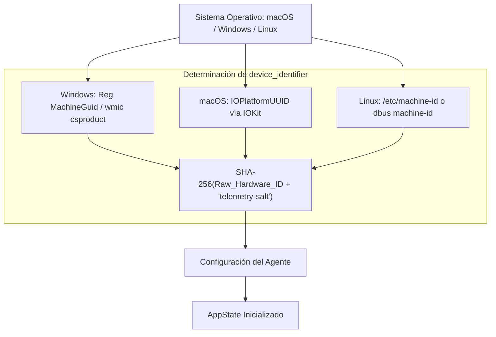

# Tarea 01 (Agent): Infraestructura Base, Configuración e Identificador Único de Dispositivo

| Atributo | Detalle |
|:---|:---|
| **ID de Tarea** | `TASK-AGENT-01` |
| **Módulos Afectados** | [`agent/src/`](file:///Users/demian/Documents/GitHub/telemetry-apps/agent/src/) (`config.rs`, `device.rs`, `main.rs`, `errors.rs`) |
| **Dependencias** | Ninguna (Tarea Base del Agente) |
| **Prioridad** | Crítica / P0 |


> ⚠️ **Parcialmente reemplazada (2026-09-28).** Guardar `admin_public_key`, `worker_id` y tokens en `config.json` (RF-AGENT-01-2) queda **prohibido** (SEC-05): pasan al keystore del SO vía `credentials.rs` en [`TASK-AGENT-08`](task-08-enrollment-consent-and-lifecycle.md). La ruta real de configuración es `<config_dir>/telemetry-worker/config.json` en los tres SO. En Windows, `wmic` está deprecado: usar `HKLM\SOFTWARE\Microsoft\Cryptography\MachineGuid`.

---

## 1. Contexto y Arquitectura

El `telemetry-worker` (o `agent`) es el componente que se ejecuta en las máquinas de los empleados. Requiere una base de inicialización sólida que permita:
1. **Configuración Local Persistente:** Carga de configuración (API URL, credenciales cifradas, tokens JWT, clave pública del administrador) almacenada en el directorio de datos de la aplicación del SO.
2. **Generación Determinista de `device_identifier`:** Cálculo determinista de una huella digital única (SHA-256) basada en el hardware de la máquina, permitiendo identificar de forma confiable la estación de trabajo sin recolectar identificadores invasivos.
3. **Tracing y Diagnóstico No Bloqueante:** Configuración de `tracing-subscriber` para volcar logs rotativos locales sin penalizar el rendimiento del hilo principal.



---

## 2. Requerimientos Funcionales y Reglas de Negocio

- **RF-AGENT-01-1 (Huella Multiplataforma):**
  - **macOS:** Extraer `IOPlatformUUID` usando llamadas a `IOKit` (`IORegistryEntryCreateCFProperty`).
  - **Windows:** Consultar `HKEY_LOCAL_MACHINE\SOFTWARE\Microsoft\Cryptography\MachineGuid` o `wmic csproduct get uuid`.
  - **Linux:** Leer `/etc/machine-id` o `/var/lib/dbus/machine-id`.
  - Normalizar el resultado pasando por `SHA-256` para garantizar un formato canónico de 64 caracteres hexadecimales.
- **RF-AGENT-01-2 (Gestión de Configuración):**
  - Ubicación de configuración:
    - Windows: `%APPDATA%\TelemetryWorker\config.json`
    - macOS: `~/Library/Application Support/TelemetryWorker/config.json`
    - Linux: `~/.config/telemetry-worker/config.json`
  - Guardar el `admin_public_key` obtenido en el enrolamiento, el `worker_id` asignado y el estado de consentimientos.
- **RF-AGENT-01-3 (Tolerancia a Fallos en Inicialización):** Si la huella no puede determinarse por falta de permisos o archivo faltante, generar un UUIDv4 persistente guardado localmente como respaldo garantizando continuidad operativa.

---

## 3. Arquitectura de Código y Pseudocódigo

### A. Módulo de Huella de Hardware ([`agent/src/device.rs`](file:///Users/demian/Documents/GitHub/telemetry-apps/agent/src/device.rs))

```rust
use sha2::{Digest, Sha256};
use std::fs;

pub fn get_device_identifier() -> String {
    let raw_id = get_raw_hardware_id().unwrap_or_else(|| {
        tracing::warn!("Could not read hardware UUID, falling back to persistent fallback");
        get_or_create_fallback_uuid()
    });

    let mut hasher = Sha256::new();
    hasher.update(b"telemetry-worker-device-salt-v1:");
    hasher.update(raw_id.trim().as_bytes());
    format!("{:x}", hasher.finalize())
}

#[cfg(target_os = "windows")]
fn get_raw_hardware_id() -> Option<String> {
    use winreg::enums::*;
    use winreg::RegKey;
    let hklm = RegKey::predef(HKEY_LOCAL_MACHINE);
    let crypto = hklm.open_subkey("SOFTWARE\\Microsoft\\Cryptography").ok()?;
    crypto.get_value("MachineGuid").ok()
}

#[cfg(target_os = "macos")]
fn get_raw_hardware_id() -> Option<String> {
    // Consulta IOPlatformUUID mediante IOKit o comando ioreg
    use std::process::Command;
    let output = Command::new("ioreg")
        .args(&["-rd1", "-c", "IOPlatformExpertDevice"])
        .output().ok()?;
    let text = String::from_utf8_lossy(&output.stdout);
    for line in text.lines() {
        if line.contains("IOPlatformUUID") {
            let parts: Vec<&str> = line.split('"').collect();
            if parts.len() >= 4 {
                return Some(parts[3].to_string());
            }
        }
    }
    None
}

#[cfg(target_os = "linux")]
fn get_raw_hardware_id() -> Option<String> {
    fs::read_to_string("/etc/machine-id")
        .or_else(|_| fs::read_to_string("/var/lib/dbus/machine-id"))
        .ok()
        .map(|s| s.trim().to_string())
}
```

### B. Configuración del Agente ([`agent/src/config.rs`](file:///Users/demian/Documents/GitHub/telemetry-apps/agent/src/config.rs))

```rust
use serde::{Deserialize, Serialize};
use std::path::PathBuf;

#[derive(Clone, Debug, Serialize, Deserialize)]
pub struct WorkerConfig {
    pub api_base_url: String,
    pub worker_id: Option<String>,
    pub admin_public_key: Option<String>,
    pub access_token: Option<String>,
    pub refresh_token: Option<String>,
    pub device_identifier: String,
    pub flush_interval_secs: u64,
}

impl WorkerConfig {
    pub fn config_path() -> PathBuf {
        let mut path = dirs::config_dir().unwrap_or_else(|| PathBuf::from("."));
        path.push("telemetry-worker");
        std::fs::create_dir_all(&path).ok();
        path.push("config.json");
        path
    }

    pub fn load_or_init() -> Self {
        let path = Self::config_path();
        if let Ok(data) = std::fs::read_to_string(&path) {
            if let Ok(cfg) = serde_json::from_str(&data) {
                return cfg;
            }
        }
        let default_cfg = Self {
            api_base_url: "https://telemetry.local/api/v1".to_string(),
            worker_id: None,
            admin_public_key: None,
            access_token: None,
            refresh_token: None,
            device_identifier: crate::device::get_device_identifier(),
            flush_interval_secs: 120,
        };
        default_cfg.save().ok();
        default_cfg
    }

    pub fn save(&self) -> Result<(), std::io::Error> {
        let data = serde_json::to_string_pretty(self)?;
        std::fs::write(Self::config_path(), data)
    }
}
```

---

## 4. Prácticas de Programación y Reglas de Seguridad

- **No Filtrar Huellas Crudas:** No transmitir el `MachineGuid` ni el `IOPlatformUUID` en texto plano por HTTP; solo se comparte el hash SHA-256 resultante.
- **Protección de Tokens:** El archivo `config.json` debe crearse con permisos restringidos de lectura/escritura únicamente para el usuario actual (`0600` en Linux/macOS).
- **Prohibición de Panics:** Todas las lecturas de sistema deben manejar errores con `Option` o `Result` sin provocar caídas en el hilo principal.

---

## 5. Validaciones y Restricciones

- `device_identifier`: Debe tener exactamente 64 caracteres (hexadecimal SHA-256).
- `api_base_url`: Debe comenzar con `https://` (o `http://localhost` para entornos de desarrollo).
- `admin_public_key`: Si está configurada, debe validar que sea un string Base64 decodificable a 32 bytes.

---

## 6. Logs y Observabilidad

- Registrar inicialización con `tracing::info!("Worker agent initialized. Device ID: {}", &device_id[..8])`.
- Nunca registrar el `access_token` o `refresh_token` en texto claro en los logs.

---

## 7. Criterios de Aceptación y Definición de Terminado (DoD)

1. [ ] `get_device_identifier()` genera un identificador consistente e idéntico entre reinicios sucesivos de la aplicación.
2. [ ] `WorkerConfig` se serializa y deserializa correctamente desde el directorio de configuración del SO correspondiente.
3. [ ] El fallback de UUID garantiza que la aplicación arranca aún en entornos de pruebas sin hardware id accesible.
4. [ ] Pruebas unitarias pasan con `cargo test -p agent`.

---

## 8. Especificación de Pruebas

- `test_device_id_format`: Verificar que el resultado de `get_device_identifier()` tiene longitud 64 y sólo contiene caracteres hexadecimales `[0-9a-f]`.
- `test_device_id_deterministic`: Llamar 5 veces consecutivas a `get_device_identifier()` y verificar igualdad estricta.
- `test_config_roundtrip`: Guardar una configuración en un directorio temporal y comprobar que `load_or_init()` recupera todos los campos intactos.
