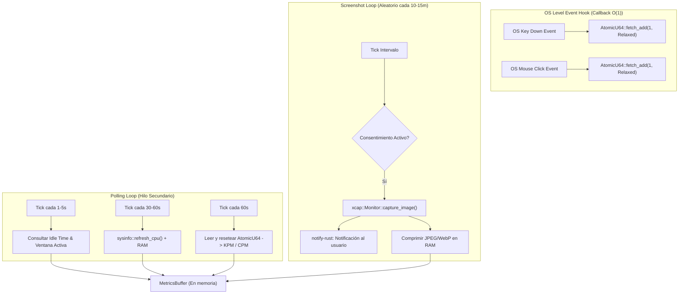

# Tarea 02 (Agent): Colectores de Sistema y Productividad Ultralivianos

| Atributo | Detalle |
|:---|:---|
| **ID de Tarea** | `TASK-AGENT-02` |
| **Módulos Afectados** | [`agent/src/core/collectors/`](file:///Users/demian/Documents/GitHub/telemetry-apps/agent/src/core/collectors/) (`system.rs`, `productivity.rs`, `mod.rs`), [`agent/src/io/system_hooks.rs`](file:///Users/demian/Documents/GitHub/telemetry-apps/agent/src/io/system_hooks.rs) |
| **Dependencias** | [`TASK-AGENT-01`](file:///Users/demian/Documents/GitHub/telemetry-apps/tasks/agent/task-01-agent-foundations-and-device-id.md) |
| **Prioridad** | Crítica / P0 |

---

## 1. Contexto y Arquitectura

El `telemetry-worker` corre ininterrumpidamente en las estaciones de trabajo de los empleados. **El principal cuello de botella no es el cifrado ni la red, sino los hooks del sistema operativo**. Una implementación deficiente de hooks de teclado puede introducir **input lag** perceptible o provocar que el SO descarte el hook por timeout.

Esta tarea implementa dos colectores esenciales:
1. **Colector de Productividad Básica (`productivity_basic`):** Conteo de frecuencia de pulsaciones y clics por minuto mediante un hook O(1) no bloqueante con `AtomicU64`.
2. **Colector de Actividad de Sistema (`system_activity`):** Polling controlado de ventana activa y tiempo de inactividad (cada 1-5 segundos), junto con muestreo de métricas de CPU/RAM (cada 30-60 segundos con `sysinfo`).
3. **Colector de Capturas de Pantalla (`productivity_screenshots`):** Capturas periódicas con `xcap`, comprimidas a JPEG/WebP y acompañadas de una notificación obligatoria al usuario.



---

## 2. Requerimientos Funcionales y Reglas de Negocio

- **RF-AGENT-02-1 (Cero Input Lag en Hooks):** El callback del hook del sistema operativo (`rdev`, `WH_KEYBOARD_LL`, `CGEventTapCreate`) no debe realizar asignaciones en el heap (`String`, `Vec`), llamadas de red, serialización JSON ni bloqueos con Mutex. Solo incrementa contadores `AtomicU64`.
- **RF-AGENT-02-2 (Prohibición Estricta de Keylogging):** Bajo ninguna circunstancia se debe almacenar o registrar la tecla física presionada, secuencias de texto o contraseñas. Solo se computa `keystrokes_per_minute` (KPM) y `clicks_per_minute` (CPM).
- **RF-AGENT-02-3 (Sondeo Eficiente de Ventana e Inactividad):**
  - Consultar `GetForegroundWindow` (Windows) o `NSWorkspace` (macOS) en un intervalo de sondeo de 1 a 5 segundos.
  - Extraer nombre del proceso y título de ventana activa.
  - Calcular segundos de inactividad (`idle_seconds`).
- **RF-AGENT-02-4 (Uso Racional de sysinfo):** `sysinfo::System::refresh_cpu()` y memoria deben ejecutarse cada 30 a 60 segundos, nunca en bucles de 1 segundo para evitar consumo innecesario de CPU (< 0.1% de core).
- **RF-AGENT-02-5 (Capturas de Pantalla Transparentes):**
  - Solo se ejecutan si `productivity_screenshots == true`.
  - Resolución máxima escalada a 1920x1080.
  - Emitir una notificación nativa vía `notify-rust` inmediatamente antes o después de la captura.

---

## 3. Arquitectura de Código y Pseudocódigo

### A. Colector de Productividad con Contadores Atómicos ([`agent/src/core/collectors/productivity.rs`](file:///Users/demian/Documents/GitHub/telemetry-apps/agent/src/core/collectors/productivity.rs))

```rust
use std::sync::atomic::{AtomicU64, Ordering};
use std::sync::Arc;
use serde::Serialize;
use chrono::Utc;

pub static KEYSTROKE_COUNTER: AtomicU64 = AtomicU64::new(0);
pub static CLICK_COUNTER: AtomicU64 = AtomicU64::new(0);

#[derive(Clone, Debug, Serialize)]
pub struct ProductivityMetric {
    pub client_timestamp: chrono::DateTime<Utc>,
    pub keystrokes_per_minute: u64,
    pub clicks_per_minute: u64,
}

pub struct ProductivityCollector;

impl ProductivityCollector {
    /// Inicia el listener de eventos en un hilo dedicado de baja prioridad
    pub fn start_hook() {
        std::thread::Builder::new()
            .name("input-hook".into())
            .spawn(|| {
                if let Err(err) = rdev::listen(|event| {
                    match event.event_type {
                        rdev::EventType::KeyPress(_) => {
                            KEYSTROKE_COUNTER.fetch_add(1, Ordering::Relaxed);
                        }
                        rdev::EventType::ButtonPress(_) => {
                            CLICK_COUNTER.fetch_add(1, Ordering::Relaxed);
                        }
                        _ => {}
                    }
                }) {
                    tracing::error!("Failed to start input listener hook: {:?}", err);
                }
            })
            .expect("Failed to spawn input hook thread");
    }

    /// Llamado cada 60 segundos por el loop de recolección
    pub fn snapshot_and_reset() -> ProductivityMetric {
        let kpm = KEYSTROKE_COUNTER.swap(0, Ordering::Relaxed);
        let cpm = CLICK_COUNTER.swap(0, Ordering::Relaxed);
        ProductivityMetric {
            client_timestamp: Utc::now(),
            keystrokes_per_minute: kpm,
            clicks_per_minute: cpm,
        }
    }
}
```

### B. Colector de Sistema e Inactividad ([`agent/src/core/collectors/system.rs`](file:///Users/demian/Documents/GitHub/telemetry-apps/agent/src/core/collectors/system.rs))

```rust
use sysinfo::{CpuRefreshKind, MemoryRefreshKind, RefreshKind, System};
use serde::Serialize;
use chrono::Utc;

#[derive(Clone, Debug, Serialize)]
pub struct SystemMetric {
    pub client_timestamp: chrono::DateTime<Utc>,
    pub cpu_usage_pct: f32,
    pub memory_used_mb: u64,
    pub memory_total_mb: u64,
    pub active_app_name: String,
    pub active_window_title: String,
    pub idle_seconds: u64,
}

pub struct SystemCollector {
    sys: System,
}

impl SystemCollector {
    pub fn new() -> Self {
        let mut sys = System::new_with_specifics(
            RefreshKind::new()
                .with_cpu(CpuRefreshKind::everything())
                .with_memory(MemoryRefreshKind::everything()),
        );
        sys.refresh_all();
        Self { sys }
    }

    pub fn collect(&mut self) -> SystemMetric {
        self.sys.refresh_cpu_all();
        self.sys.refresh_memory();

        let cpu = self.sys.global_cpu_info().cpu_usage();
        let mem_used = self.sys.used_memory() / 1024 / 1024;
        let mem_total = self.sys.total_memory() / 1024 / 1024;
        let (app, title) = get_active_window_details();
        let idle = get_idle_time_seconds();

        SystemMetric {
            client_timestamp: Utc::now(),
            cpu_usage_pct: cpu,
            memory_used_mb: mem_used,
            memory_total_mb: mem_total,
            active_app_name: app,
            active_window_title: title,
            idle_seconds: idle,
        }
    }
}

// Implementación multiplataforma para ventana e inactividad
#[cfg(target_os = "windows")]
fn get_idle_time_seconds() -> u64 {
    // Win32 GetLastInputInfo
    0
}

#[cfg(target_os = "macos")]
fn get_idle_time_seconds() -> u64 {
    // CGEventSourceSecondsSinceLastInputEvent
    0
}

#[cfg(not(any(target_os = "windows", target_os = "macos")))]
fn get_idle_time_seconds() -> u64 {
    0
}

fn get_active_window_details() -> (String, String) {
    ("UnknownApp".to_string(), "Untitled".to_string())
}
```

---

## 4. Prácticas de Programación y Reglas de Seguridad

- **Restricción O(1) Absoluta:** Jamás agregar locks de Mutex dentro del handler `rdev::listen`.
- **Privacidad y Legalidad:** La captura de pantalla debe ser notificada visiblemente para cumplir con la legislación laboral (evitar catalogación como software espía o malware).
- **Degradación Elegante:** Si la API del sistema operativo no permite obtener el título de ventana por permisos de accesibilidad denegados, retornar `"PermissionDenied"` sin causar pánico ni detener los demás colectores.

---

## 5. Validaciones y Restricciones

- `keystrokes_per_minute`: Valor acumulado en un minuto debe ser $\ge 0$.
- Capturas de pantalla: Descartar si el archivo resultante excede 2 MB antes del cifrado.

---

## 6. Logs y Observabilidad

- `tracing::debug!("Productivity metrics collected: KPM={}, CPM={}", kpm, cpm)`.
- `tracing::info!("Screenshot captured and scheduled for encryption")`.

---

## 7. Criterios de Aceptación y Definición de Terminado (DoD)

1. [x] El hook de teclado y ratón no causa latencia perceptible en la escritura del usuario.
2. [x] El contador atómico `ProductivityCollector::snapshot_and_reset()` retorna valores precisos y se resetea a cero de forma atómica.
3. [x] `SystemCollector::collect()` se ejecuta en menos de 10ms por llamada.
4. [x] `xcap` captura la pantalla y la notificación nativa se dispara exitosamente.
5. [x] Pruebas unitarias pasan con `cargo test -p agent`.


---

## 8. Especificación de Pruebas

- `test_atomic_counters_concurrency`: Ejecutar 10 hilos concurrentes que incrementan 1,000 veces cada uno los contadores atómicos y verificar que la suma sea exactamente 10,000.
- `test_snapshot_resets_counter`: Incrementar 50 pulsaciones, llamar a `snapshot_and_reset()` comprobando 50, y comprobar que una segunda llamada inmediata retorna 0.
- `test_system_collector_returns_valid_metrics`: Verificar que el uso de CPU está en el rango `[0.0, 100.0]` y que la memoria total es mayor a cero.
