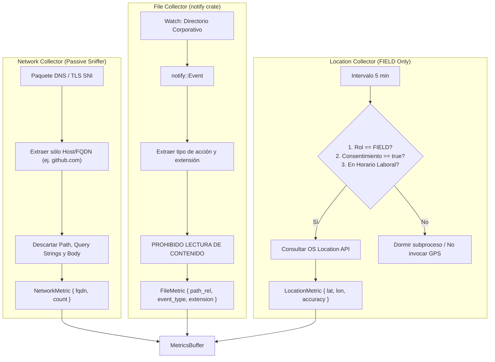

# Tarea 03 (Agent): Colectores de Red (FQDN), Archivos y Geolocalización FIELD

| Atributo | Detalle |
|:---|:---|
| **ID de Tarea** | `TASK-AGENT-03` |
| **Módulos Afectados** | [`agent/src/core/collectors/`](file:///Users/demian/Documents/GitHub/telemetry-apps/agent/src/core/collectors/) (`network.rs`, `files.rs`, `location.rs`) |
| **Dependencias** | [`TASK-AGENT-01`](file:///Users/demian/Documents/GitHub/telemetry-apps/tasks/agent/task-01-agent-foundations-and-device-id.md) |
| **Prioridad** | Alta / P1 |

---

## 1. Contexto y Arquitectura

Para cumplir con GDPR (Art. 5.1.c sobre minimización de datos) y las normativas de privacidad chilenas (Ley 19.628 / 21.719), los colectores de red, archivos y ubicación operan bajo **restricciones de diseño irreversibles**:
1. **Red (FQDN Only):** Prohibido interceptar URLs completas, parámetros GET o payloads HTTP. Solo se extrae el Fully Qualified Domain Name (FQDN) mediante inspección pasiva de DNS o cabeceras SNI.
2. **Archivos (Metadata Only):** Monitoreo reactivo con el crate `notify` sobre carpetas corporativas específicas (ej. `~/Documents/Corporate/`). Solo se transmiten eventos de metadatos (`CREATED`, `MODIFIED`, `DELETED`, `RENAMED`) y extensiones (`.rs`, `.docx`). **Nunca** se abre, indexa o lee el contenido del archivo.
3. **Ubicación FIELD y Geocercas Horarias:** La geolocalización solo se ejecuta si se satisfacen tres condiciones simultáneas: (a) Rol de trabajador `FIELD`, (b) Consentimiento explícito activo, y (c) Hora local actual dentro de la jornada laboral registrada (`work_hours_start` a `work_hours_end`). Fuera de horario, el colector se suspende automáticamente por software.



---

## 2. Requerimientos Funcionales y Reglas de Negocio

- **RF-AGENT-03-1 (Privacidad de Red Estricta):** Almacenar dominios canónicos normalizados en minúsculas (ej. `api.github.com`), contabilizando la frecuencia de accesos en el intervalo de reporte. Prohibido registrar direcciones IP privadas internas o rutas completas.
- **RF-AGENT-03-2 (Monitoreo de Carpetas Corporativas):**
  - La ruta base corporativa debe ser configurable en `WorkerConfig`.
  - Ignorar directorios del sistema, archivos temporales (`.tmp`, `~$*`) y carpetas `.git`.
  - Registrar tipo de evento: `Created`, `Modified`, `Deleted`, `Renamed`.
- **RF-AGENT-03-3 (Reglas Mandatorias de Geolocalización):**
  - Si el rol es `OFFICE`, el módulo de ubicación debe estar permanentemente deshabilitado.
  - La verificación horaria debe calcularse contra la zona horaria del trabajador (ej. `America/Santiago`).
  - Al cruzar la hora de fin de jornada (`work_hours_end`), emitir una notificación al escritorio indicando la suspensión del rastreo.

---

## 3. Arquitectura de Código y Pseudocódigo

### A. Colector de Red FQDN ([`agent/src/core/collectors/network.rs`](file:///Users/demian/Documents/GitHub/telemetry-apps/agent/src/core/collectors/network.rs))

```rust
use std::collections::HashMap;
use std::sync::Mutex;
use chrono::{DateTime, Utc};
use serde::Serialize;

#[derive(Clone, Debug, Serialize)]
pub struct NetworkMetric {
    pub client_timestamp: DateTime<Utc>,
    pub domains: Vec<DomainEntry>,
}

#[derive(Clone, Debug, Serialize)]
pub struct DomainEntry {
    pub fqdn: String,
    pub hits: u32,
}

pub struct NetworkCollector {
    domain_hits: Mutex<HashMap<String, u32>>,
}

impl NetworkCollector {
    pub fn new() -> Self {
        Self {
            domain_hits: Mutex::new(HashMap::new()),
        }
    }

    /// Registra la observación pasiva de una consulta DNS o SNI
    pub fn record_fqdn(&self, raw_domain: &str) {
        // Sanitizar y validar que es solo un dominio válido (sin paths ni queries)
        if let Some(clean_fqdn) = sanitize_fqdn(raw_domain) {
            let mut lock = self.domain_hits.lock().unwrap();
            *lock.entry(clean_fqdn).or_insert(0) += 1;
        }
    }

    pub fn drain(&self) -> NetworkMetric {
        let mut lock = self.domain_hits.lock().unwrap();
        let current_hits = std::mem::take(&mut *lock);
        let domains = current_hits
            .into_iter()
            .map(|(fqdn, hits)| DomainEntry { fqdn, hits })
            .collect();

        NetworkMetric {
            client_timestamp: Utc::now(),
            domains,
        }
    }
}

fn sanitize_fqdn(input: &str) -> Option<String> {
    let host = input.trim().to_lowercase();
    // Eliminar puertos y descartar si contiene diagonales de rutas
    let domain = host.split(':').next()?.split('/').next()?;
    if domain.contains('.') && !domain.contains('@') {
        Some(domain.to_string())
    } else {
        None
    }
}
```

### B. Colector de Geolocalización FIELD con Control Horario ([`agent/src/core/collectors/location.rs`](file:///Users/demian/Documents/GitHub/telemetry-apps/agent/src/core/collectors/location.rs))

```rust
use chrono::{DateTime, Local, NaiveTime, Utc};
use serde::Serialize;

#[derive(Clone, Debug, Serialize)]
pub struct LocationMetric {
    pub client_timestamp: DateTime<Utc>,
    pub latitude: f64,
    pub longitude: f64,
    pub accuracy_meters: f32,
}

pub struct LocationCollector {
    pub worker_role: String, // "OFFICE" o "FIELD"
    pub work_hours_start: NaiveTime,
    pub work_hours_end: NaiveTime,
    pub is_consent_granted: bool,
}

impl LocationCollector {
    pub fn should_collect(&self) -> bool {
        if self.worker_role != "FIELD" || !self.is_consent_granted {
            return false;
        }

        let now_local = Local::now().time();
        now_local >= self.work_hours_start && now_local <= self.work_hours_end
    }

    pub fn collect(&self) -> Option<LocationMetric> {
        if !self.should_collect() {
            return None;
        }

        // Consultar API de geolocalización del SO (CoreLocation / Windows Location / GeoClue2)
        get_os_location()
    }
}

fn get_os_location() -> Option<LocationMetric> {
    // Implementación mock / llamada nativa
    Some(LocationMetric {
        client_timestamp: Utc::now(),
        latitude: -33.4489,
        longitude: -70.6693,
        accuracy_meters: 15.0,
    })
}
```

---

## 4. Prácticas de Programación y Reglas de Seguridad

- **Prohibición Total de Inspección de Cuerpos HTTP:** El sniffer de red jamás debe intentar descifrar TLS ni realizar ataques Man-in-the-Middle locales.
- **Validación Estricta de FQDN:** Cualquier entrada que contenga `?`, `/`, o caracteres fuera de la especificación RFC 1035 para nombres DNS debe ser truncada o descartada inmediatamente.
- **Seguridad en Monitoreo de Archivos:** No usar APIs como `std::fs::read` en los archivos reportados; solo leer `event.paths` para obtener extensiones y nombres relativos.

---

## 5. Validaciones y Restricciones

- FQDN: Longitud máxima de 253 caracteres según estándar DNS.
- Ubicación: Coordenadas deben cumplir $-90.0 \le \text{lat} \le 90.0$ y $-180.0 \le \text{lon} \le 180.0$.
- Horario Laboral: Si `work_hours_start > work_hours_end`, manejar turnos nocturnos adecuadamente.

---

## 6. Logs y Observabilidad

- Registrar cambios en la recolección de ubicación: `tracing::info!("Location collection suspended: outside configured working hours")`.
- En caso de error en el watcher de archivos: `tracing::warn!("File watcher dropped event due to buffer overflow")`.

---

## 7. Criterios de Aceptación y Definición de Terminado (DoD)

1. [ ] El colector de red nunca almacena URLs con rutas (`/path`) o parámetros de consulta (`?query=value`).
2. [ ] El colector de archivos detecta creación y borrado de documentos corporativos sin leer sus contenidos.
3. [ ] Trabajadores con rol `OFFICE` nunca disparan consultas al hardware GPS.
4. [ ] Fuera del horario laboral configurado, `LocationCollector::collect()` retorna `None` de forma inmediata.
5. [ ] Pruebas unitarias pasan con `cargo test -p agent`.

---

## 8. Especificación de Pruebas

- `test_sanitize_fqdn`: Comprobar que `"https://github.com/rust-lang/rust?q=1"` se sanitiza limpiamente a `"github.com"` o se descarta.
- `test_location_check_during_work_hours`: Configurar horario de 09:00 a 18:00 y verificar que retorna `true` a las 14:00 y `false` a las 20:00.
- `test_location_disabled_for_office`: Configurar rol `"OFFICE"` y verificar que `should_collect()` retorna `false` independientemente de la hora.
