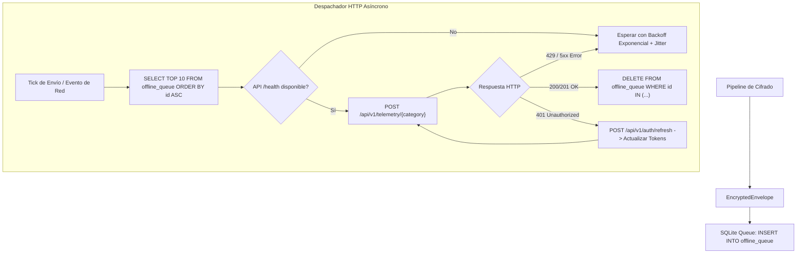

# Tarea 05 (Agent): Cola Local Fuera de Línea (SQLite) y Transporte HTTP con Auto-Renovación de JWT

| Atributo | Detalle |
|:---|:---|
| **ID de Tarea** | `TASK-AGENT-05` |
| **Módulos Afectados** | [`agent/src/io/transport.rs`](../../agent/src/io/transport.rs), [`agent/src/background/worker.rs`](../../agent/src/background/worker.rs) |
| **Dependencias** | [`TASK-AGENT-04`](task-04-metrics-buffer-and-encryption.md) |
| **Prioridad** | Crítica / P0 |


> ℹ️ **Ampliada (2026-09-30) por [`TASK-AGENT-09`](task-09-granular-consent-and-billing-pause.md) e [`INT-02`](../integration/task-02-api-v2-contract-alignment.md).** `402 SUBSCRIPTION_SUSPENDED` / `403 SUBSCRIPTION_CANCELLED` en la ingesta **conservan** el sobre en la cola (no es rechazo por consentimiento) y ponen el motor en `EmployerSuspended`; el refresh tras `401` es single-flight (candado global) y reutiliza el token ya rotado.

---

## 1. Contexto y Arquitectura

Las computadoras portátiles de los empleados sufren desconexiones de red frecuentes (tránsito, fallas de Wi-Fi, modo avión). Para evitar pérdida de datos o bloqueos en la recolección, el agente debe contar con una **cola local fuera de línea resistente a fallos (Offline Queue)** implementada sobre `rusqlite`.

Cuando la red no está disponible, los sobres cifrados (`EncryptedEnvelope`) se encolan en una base de datos SQLite embebida. Tan pronto se restablece la conectividad con la API de Telemetría (`Axum`), un despachador asíncrono con `reqwest` vacía la cola en orden FIFO, manejando reintentos con **backoff exponencial y jitter aleatorio**, e interceptando expiraciones de token (HTTP 401) para renovar el `access_token` automáticamente mediante el `refresh_token`.



---

## 2. Requerimientos Funcionales y Reglas de Negocio

- **RF-AGENT-05-1 (Persistencia SQLite Transaccional):**
  - Almacenar sobres en tabla `offline_queue` con campos: `id`, `category`, `ephemeral_public_key`, `encrypted_payload`, `client_timestamp`, `retry_count`.
  - Capacidad máxima: 100 MB o 7 días de retención. Si se alcanza el límite, purgar los registros más antiguos (FIFO).
- **RF-AGENT-05-2 (Cliente HTTP con TLS 1.3):**
  - Implementado con `reqwest` utilizando `rustls-tls` sin dependencias de OpenSSL del sistema.
  - Timeout de petición estricto: 10 segundos.
- **RF-AGENT-05-3 (Auto-Renovación de JWT Transparente):**
  - Guardar `access_token` en memoria.
  - Al recibir una respuesta `401 Unauthorized`, invocar `POST /api/v1/auth/refresh` enviando el `refresh_token`.
  - Si la renovación es exitosa, guardar el nuevo par de tokens y reintentar la petición inmediatamente.
  - Si la renovación falla con `401` (familia de tokens revocada), detener envíos y notificar a la interfaz de usuario para reinicio de sesión.
- **RF-AGENT-05-4 (Backoff Exponencial con Jitter):**
  - Intervalo base de reintento: 2 segundos.
  - Multiplicador: 2x por falla consecutiva hasta un tope de 300 segundos (5 minutos).
  - Jitter: variación aleatoria de $\pm 20\%$ para evitar sincronización de tormentas de peticiones (*thundering herd*).

---

## 3. Arquitectura de Código y Pseudocódigo

### A. Repositorio de Cola Fuera de Línea ([`agent/src/io/queue.rs`](../../agent/src/io/queue.rs))

```rust
use rusqlite::{params, Connection, Result};
use std::path::Path;

pub struct OfflineQueue {
    conn: Connection,
}

pub struct QueueItem {
    pub id: i64,
    pub category: String,
    pub ephemeral_public_key: String,
    pub encrypted_payload: Vec<u8>,
}

impl OfflineQueue {
    pub fn open<P: AsRef<Path>>(path: P) -> Result<Self> {
        let conn = Connection::open(path)?;
        conn.execute_batch(
            "PRAGMA journal_mode = WAL;
             PRAGMA synchronous = NORMAL;
             CREATE TABLE IF NOT EXISTS offline_queue (
                 id INTEGER PRIMARY KEY AUTOINCREMENT,
                 category TEXT NOT NULL,
                 ephemeral_public_key TEXT NOT NULL,
                 encrypted_payload BLOB NOT NULL,
                 created_at DATETIME DEFAULT CURRENT_TIMESTAMP,
                 retry_count INTEGER DEFAULT 0
             );
             CREATE INDEX IF NOT EXISTS idx_offline_queue_created ON offline_queue(created_at);"
        )?;
        Ok(Self { conn })
    }

    pub fn enqueue(&mut self, category: &str, eph_pub: &str, payload: &[u8]) -> Result<()> {
        self.conn.execute(
            "INSERT INTO offline_queue (category, ephemeral_public_key, encrypted_payload) VALUES (?1, ?2, ?3)",
            params![category, eph_pub, payload],
        )?;
        self.enforce_retention_policy()?;
        Ok(())
    }

    pub fn peek_batch(&self, limit: usize) -> Result<Vec<QueueItem>> {
        let mut stmt = self.conn.prepare(
            "SELECT id, category, ephemeral_public_key, encrypted_payload FROM offline_queue ORDER BY id ASC LIMIT ?1"
        )?;
        let items = stmt.query_map(params![limit as i64], |row| {
            Ok(QueueItem {
                id: row.get(0)?,
                category: row.get(1)?,
                ephemeral_public_key: row.get(2)?,
                encrypted_payload: row.get(3)?,
            })
        })?.collect::<Result<Vec<_>, _>>()?;
        Ok(items)
    }

    pub fn mark_delivered(&mut self, ids: &[i64]) -> Result<()> {
        if ids.is_empty() { return Ok(()); }
        let id_list: Vec<String> = ids.iter().map(|id| id.to_string()).collect();
        let query = format!("DELETE FROM offline_queue WHERE id IN ({})", id_list.join(","));
        self.conn.execute(&query, [])?;
        Ok(())
    }

    fn enforce_retention_policy(&mut self) -> Result<()> {
        // Eliminar registros de más de 7 días o si supera 50,000 entradas
        self.conn.execute(
            "DELETE FROM offline_queue WHERE created_at < datetime('now', '-7 days')",
            [],
        )?;
        Ok(())
    }
}
```

### B. Cliente de Transporte HTTP ([`agent/src/io/transport.rs`](../../agent/src/io/transport.rs))

```rust
use reqwest::{Client, StatusCode};
use serde_json::json;
use crate::config::WorkerConfig;

pub struct TelemetryTransport {
    client: Client,
    config: WorkerConfig,
}

impl TelemetryTransport {
    pub fn new(config: WorkerConfig) -> Self {
        let client = Client::builder()
            .timeout(std::time::Duration::from_secs(10))
            .build()
            .expect("Failed to build HTTP client");
        Self { client, config }
    }

    pub async fn send_telemetry_batch(
        &mut self,
        category: &str,
        eph_public_key: &str,
        encrypted_payload: &[u8],
    ) -> Result<(), TransportError> {
        let url = format!("{}/telemetry/{}", self.config.api_base_url, category);
        let b64_payload = base64::prelude::BASE64_STANDARD.encode(encrypted_payload);

        let req_body = json!({
            "ephemeral_public_key": eph_public_key,
            "encrypted_payload": b64_payload
        });

        let token = self.config.access_token.as_deref().unwrap_or("");
        let response = self.client.post(&url)
            .bearer_auth(token)
            .json(&req_body)
            .send()
            .await
            .map_err(|e| TransportError::NetworkError(e.to_string()))?;

        if response.status() == StatusCode::UNAUTHORIZED {
            // Renovar token e intentar 1 vez más
            self.refresh_access_token().await?;
            let new_token = self.config.access_token.as_deref().unwrap_or("");
            let retry_response = self.client.post(&url)
                .bearer_auth(new_token)
                .json(&req_body)
                .send()
                .await
                .map_err(|e| TransportError::NetworkError(e.to_string()))?;

            if !retry_response.status().is_success() {
                return Err(TransportError::ServerError(retry_response.status().as_u16()));
            }
        } else if !response.status().is_success() {
            return Err(TransportError::ServerError(response.status().as_u16()));
        }

        Ok(())
    }

    async fn refresh_access_token(&mut self) -> Result<(), TransportError> {
        let refresh_token = self.config.refresh_token.as_deref()
            .ok_or(TransportError::MissingRefreshToken)?;
        let url = format!("{}/auth/refresh", self.config.api_base_url);

        let res = self.client.post(&url)
            .json(&json!({ "refresh_token": refresh_token }))
            .send().await
            .map_err(|e| TransportError::NetworkError(e.to_string()))?;

        if res.status().is_success() {
            let body: serde_json::Value = res.json().await
                .map_err(|e| TransportError::Serialization(e.to_string()))?;
            self.config.access_token = body["access_token"].as_str().map(|s| s.to_string());
            if let Some(new_rt) = body["refresh_token"].as_str() {
                self.config.refresh_token = Some(new_rt.to_string());
            }
            self.config.save().ok();
            Ok(())
        } else {
            Err(TransportError::SessionExpired)
        }
    }
}

#[derive(Debug, thiserror::Error)]
pub enum TransportError {
    #[error("Network failure: {0}")]
    NetworkError(String),
    #[error("Server returned status {0}")]
    ServerError(u16),
    #[error("Missing refresh token")]
    MissingRefreshToken,
    #[error("Session has expired, manual login required")]
    SessionExpired,
    #[error("Serialization error: {0}")]
    Serialization(String),
}
```

---

## 4. Prácticas de Programación y Reglas de Seguridad

- **Integridad de Base de Datos:** Usar modo WAL (`PRAGMA journal_mode = WAL`) en SQLite para permitir lecturas y escrituras simultáneas sin bloqueos entre hilos.
- **Seguridad en Tránsito:** Utilizar exclusivamente TLS 1.3 con validación estricta de certificados del servidor. Prohibido deshabilitar la verificación de nombres de host (`danger_accept_invalid_certs`).
- **Manejo de Reuso de Refresh Token:** Si el servidor responde 401 en `/auth/refresh`, asumir revocación por seguridad y borrar los tokens locales.

---

## 5. Validaciones y Restricciones

- Sobres en cola: Tamaño máximo de payload por registro en SQLite: 5 MB.
- Número máximo de reintentos por paquete antes de cuarentena: 10 reintentos.

---

## 6. Logs y Observabilidad

- `tracing::info!("Dispatched batch of {} telemetry records successfully", count)`.
- `tracing::warn!("Server unreachable. Enqueued record into offline SQLite database")`.

---

## 7. Criterios de Aceptación y Definición de Terminado (DoD)

1. [x] Los registros se encolan en SQLite cuando la API está fuera de línea sin causar errores en la UI.
2. [x] Al volver la conectividad, la cola SQLite se vacía secuencialmente en orden FIFO.
3. [x] El interceptor HTTP detecta un `401 Unauthorized`, renueva el par de JWTs y reenvía el lote de forma transparente.
4. [x] Pruebas unitarias pasan con base de datos SQLite en memoria (`Connection::open_in_memory()`).

---

## 8. Especificación de Pruebas

- `test_sqlite_queue_fifo`: Encolar 3 elementos (A, B, C), llamar a `peek_batch(2)` y verificar que devuelve A y B en orden.
- `test_sqlite_delivered_deletion`: Marcar elementos como entregados y comprobar que desaparecen de la cola.
- `test_retention_policy_purges_old_records`: Insertar registros con fecha artificial de hace 8 días y comprobar que son eliminados.
