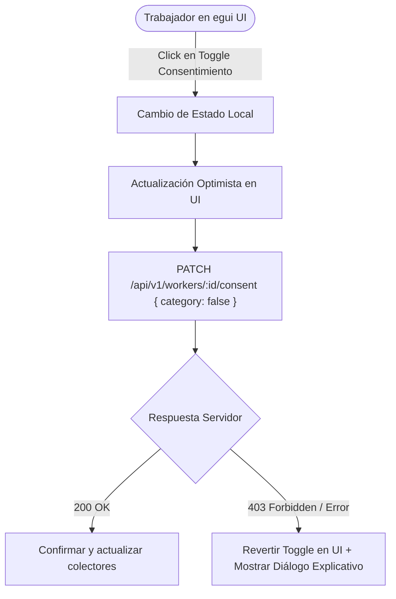

# Tarea 06 (Agent): Interfaz de Usuario Transparente en egui y Gestión de Consentimientos ARCO

| Atributo | Detalle |
|:---|:---|
| **ID de Tarea** | `TASK-AGENT-06` |
| **Módulos Afectados** | [`agent/src/ui/`](file:///Users/demian/Documents/GitHub/telemetry-apps/agent/src/ui/) (`mod.rs`, `settings.rs`, `onboarding.rs`), [`agent/src/app.rs`](file:///Users/demian/Documents/GitHub/telemetry-apps/agent/src/app.rs) |
| **Dependencias** | [`TASK-AGENT-01`](file:///Users/demian/Documents/GitHub/telemetry-apps/tasks/agent/task-01-agent-foundations-and-device-id.md), [`TASK-AGENT-05`](file:///Users/demian/Documents/GitHub/telemetry-apps/tasks/agent/task-05-offline-queue-and-transport.md) |
| **Prioridad** | Alta / P1 |


> ⚠️ **Parcialmente reemplazada (2026-09-28).** Los *toggles granulares por categoría* (RF-AGENT-06-1/2) y el `PATCH /consent` con la matriz de flags quedan **obsoletos**: el trabajador acepta o rechaza el paquete completo definido por el admin y puede retirarlo → ver [`TASK-AGENT-08`](task-08-enrollment-consent-and-lifecycle.md) y [`docs/worker-app-spec.md`](../../docs/worker-app-spec.md). Esta tarea conserva el semáforo, el horario y el portal ARCO (que hoy **no llama a la API**; debe usar `POST /workers/me/data-request` y `/data-deletion`).

---

## 1. Contexto y Arquitectura

A diferencia del software de espionaje corporativo encubierto, el `telemetry-worker` fue diseñado con el principio fundamental de **Transparencia Activa y Soberanía del Trabajador**. La interfaz gráfica, construida con `egui` y `eframe` (450x600 px), otorga visibilidad total y control inmediato en tiempo real sobre lo que se recolecta.

El trabajador dispone de:
1. **Semáforo de Estado Prominente:**
   - 🟢 **Monitoreo Activo:** Conectado a la API y dentro del horario laboral.
   - 🟡 **Pausado / Fuera de Horario:** Geolocalización suspendida automáticamente.
   - 🔴 **Desconectado:** Sin conexión o sesión revocada.
2. **Conmutadores Granulares de Consentimiento:** Toggles independientes para cada una de las 6 categorías. Cualquier cambio invoca inmediatamente `PATCH /api/v1/workers/:id/consent`. Si el servidor rechaza el cambio (ej. un trabajador `OFFICE` intentando activar GPS), la interfaz revierte el interruptor y muestra un diálogo de advertencia.
3. **Portal de Derechos ARCO / GDPR:** Botones para solicitar exportación de datos (`POST /workers/me/data-request`) o supresión definitiva de telemetría (`POST /workers/me/data-deletion`).



---

## 2. Requerimientos Funcionales y Reglas de Negocio

- **RF-AGENT-06-1 (Gestión Granular de los 6 Consentimientos):**
  1. `system_activity` (aplicaciones y hardware)
  2. `network_activity` (dominios de internet FQDN)
  3. `productivity_basic` (frecuencia de pulsaciones y clics)
  4. `productivity_screenshots` (capturas de pantalla periódicas)
  5. `file_activity` (archivos corporativos)
  6. `location` (ubicación GPS - **bloqueado en gris con tooltip si el rol es OFFICE**).
- **RF-AGENT-06-2 (Revocación Instantánea en 1 Clic):** Al desactivar un toggle, el colector correspondiente en segundo plano detiene de inmediato el muestreo sin requerir reiniciar la aplicación.
- **RF-AGENT-06-3 (Visualización de Horario y Zona Horaria):**
  - Mostrar la franja configurada (ej. `09:00 - 18:00`) y la hora local computada en su zona horaria (`America/Santiago`).
  - Indicar claramente si la geolocalización está suspendida por estar fuera de horario.
- **RF-AGENT-06-4 (Portal de Derechos ARCO / GDPR):**
  - Botón "Exportar Mis Datos": Despliega advertencia legal indicando que por el modelo Zero-Knowledge, los registros entregados por la API son paquetes cifrados que requieren la clave privada del administrador para su lectura.
  - Botón "Solicitar Eliminación": Envía solicitud de purga formal al servidor.

---

## 3. Arquitectura de Código y Pseudocódigo

### A. Estructura de Estado de la Aplicación ([`agent/src/app.rs`](file:///Users/demian/Documents/GitHub/telemetry-apps/agent/src/app.rs))

```rust
use eframe::egui;
use serde::{Deserialize, Serialize};

#[derive(Clone, Debug, Serialize, Deserialize)]
pub struct ConsentFlags {
    pub system_activity: bool,
    pub network_activity: bool,
    pub productivity_basic: bool,
    pub productivity_screenshots: bool,
    pub file_activity: bool,
    pub location: bool,
}

pub struct WorkerApp {
    pub worker_role: String, // "OFFICE" o "FIELD"
    pub consents: ConsentFlags,
    pub is_connected: bool,
    pub is_in_work_hours: bool,
    pub offline_queue_count: usize,
    pub status_message: Option<String>,
}

impl eframe::App for WorkerApp {
    fn update(&mut self, ctx: &egui::Context, _frame: &mut eframe::Frame) {
        egui::CentralPanel::default().show(ctx, |ui| {
            self.render_header(ui);
            ui.separator();
            self.render_consent_toggles(ui);
            ui.separator();
            self.render_work_hours(ui);
            ui.separator();
            self.render_arco_portal(ui);
        });
    }
}

impl WorkerApp {
    fn render_header(&self, ui: &mut egui::Ui) {
        ui.horizontal(|ui| {
            let (indicator, status_text) = if !self.is_connected {
                ("🔴", "Desconectado")
            } else if !self.is_in_work_hours {
                ("🟡", "Fuera de Horario (GPS Pausado)")
            } else {
                ("🟢", "Monitoreo Activo y Protegido")
            };
            ui.heading(format!("{} Telemetry Worker", indicator));
            ui.label(status_text);
        });
    }

    fn render_consent_toggles(&mut self, ui: &mut egui::Ui) {
        ui.group(|ui| {
            ui.label(egui::RichText::new("Gestión de Consentimientos").strong());
            
            if ui.checkbox(&mut self.consents.system_activity, "Actividad de Sistema (Apps y Recursos)").changed() {
                self.dispatch_consent_update("system_activity", self.consents.system_activity);
            }
            if ui.checkbox(&mut self.consents.network_activity, "Navegación de Red (Solo Dominios FQDN)").changed() {
                self.dispatch_consent_update("network_activity", self.consents.network_activity);
            }
            if ui.checkbox(&mut self.consents.productivity_basic, "Frecuencia de Teclado y Clics").changed() {
                self.dispatch_consent_update("productivity_basic", self.consents.productivity_basic);
            }
            if ui.checkbox(&mut self.consents.productivity_screenshots, "Capturas de Pantalla Periódicas").changed() {
                self.dispatch_consent_update("productivity_screenshots", self.consents.productivity_screenshots);
            }
            if ui.checkbox(&mut self.consents.file_activity, "Metadatos de Archivos Corporativos").changed() {
                self.dispatch_consent_update("file_activity", self.consents.file_activity);
            }

            // Ubicación: Solo para trabajadores de campo
            let is_field = self.worker_role == "FIELD";
            ui.add_enabled_ui(is_field, |ui| {
                let checkbox = ui.checkbox(&mut self.consents.location, "Ubicación GPS (Solo Campo)");
                if !is_field {
                    checkbox.on_disabled_hover_text("Deshabilitado: Su rol está configurado como OFFICE.");
                } else if checkbox.changed() {
                    self.dispatch_consent_update("location", self.consents.location);
                }
            });
        });
    }

    fn render_work_hours(&self, ui: &mut egui::Ui) {
        ui.horizontal(|ui| {
            ui.label("🕒 Horario Laboral:");
            ui.monospace("09:00 - 18:00 (America/Santiago)");
        });
    }

    fn render_arco_portal(&mut self, ui: &mut egui::Ui) {
        ui.collapsing("Derechos de Privacidad (ARCO / GDPR)", |ui| {
            ui.label("Usted tiene derecho a solicitar una copia cifrada o la supresión de sus registros.");
            ui.horizontal(|ui| {
                if ui.button("📥 Solicitar Mis Datos").clicked() {
                    self.request_data_export();
                }
                if ui.button("🗑️ Solicitar Eliminación").clicked() {
                    self.request_data_deletion();
                }
            });
        });
    }

    fn dispatch_consent_update(&self, category: &str, new_value: bool) {
        tracing::info!("Consent changed: {} = {}", category, new_value);
        // Despachar llamada asíncrona a la API
    }

    fn request_data_export(&mut self) {
        self.status_message = Some("Solicitud de portabilidad enviada con éxito.".into());
    }

    fn request_data_deletion(&mut self) {
        self.status_message = Some("Solicitud de supresión registrada.".into());
    }
}
```

---

## 4. Prácticas de Programación y Reglas de Seguridad

- **Respuesta No Bloqueante en UI:** Las peticiones HTTP disparadas por los toggles de consentimiento deben ejecutarse en tareas asíncronas de Tokio sin bloquear el loop de renderizado de `egui`.
- **Sincronización Bidireccional:** Si el backend responde con un error de validación, revertir el estado visual en la UI en el siguiente frame.

---

## 5. Validaciones y Restricciones

- Bloqueo absoluto de activación de GPS para trabajadores con rol `OFFICE`.
- Tamaño fijo de ventana inicial: 450 píxeles de ancho por 600 píxeles de alto, no redimensionable más allá de límites razonables.

---

## 6. Logs y Observabilidad

- `tracing::info!("Worker updated consent for {}: {}", category, val)`.
- `tracing::warn!("API rejected consent change: reverting UI state")`.

---

## 7. Criterios de Aceptación y Definición de Terminado (DoD)

1. [ ] La interfaz egui compila y renderiza a 60 FPS sin picos de consumo de CPU cuando está en reposo.
2. [ ] El indicador semáforo refleja con precisión los tres estados de conexión y horario laboral.
3. [ ] El toggle de GPS permanece inactivo e inaccesible para trabajadores de tipo `OFFICE`.
4. [ ] Las solicitudes de portabilidad y supresión invocan los endpoints correspondientes de la API.

---

## 8. Especificación de Pruebas

- `test_consent_flags_serialization`: Verificar serialización y deserialización JSON de la estructura `ConsentFlags`.
- `test_office_worker_cannot_enable_gps`: Comprobar que si `worker_role == "OFFICE"`, cualquier intento de mutación a `consents.location = true` es rechazado lógicamente.
