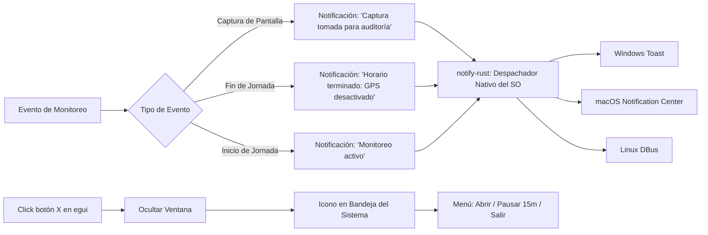

# Tarea 07 (Agent): Notificaciones del Sistema Operativo y Bandeja del Sistema (System Tray)

| Atributo | Detalle |
|:---|:---|
| **ID de Tarea** | `TASK-AGENT-07` |
| **Módulos Afectados** | [`agent/src/notifications.rs`](file:///Users/demian/Documents/GitHub/telemetry-apps/agent/src/notifications.rs), [`agent/src/ui/tray.rs`](file:///Users/demian/Documents/GitHub/telemetry-apps/agent/src/ui/tray.rs) |
| **Dependencias** | [`TASK-AGENT-06`](file:///Users/demian/Documents/GitHub/telemetry-apps/tasks/agent/task-06-egui-transparency-ui-and-consent.md) |
| **Prioridad** | Media / P2 |


> ⚠️ **Ajuste (2026-09-28).** Se elimina la acción de bandeja *Pausar Monitoreo (15 min)* del trabajador: pausar es una acción del admin (`PATCH /workers/:id/status`); el control del trabajador es *Retirar consentimiento* (DP-10). La bandeja hoy no existe (`ui/tray.rs` es solo un struct de estado): implementarla con `tray-icon`. Ver [`docs/worker-app-spec.md` §3–4](../../docs/worker-app-spec.md) para el menú y el catálogo de notificaciones.

---

## 1. Contexto y Arquitectura

Para eliminar cualquier percepción de monitoreo oculto y cumplir con los estándares éticos y legales más estrictos, el `telemetry-worker` utiliza el crate multiplataforma `notify-rust` para alertar explícitamente al empleado sobre eventos de auditoría y cambios en las políticas de privacidad.

Asimismo, la aplicación no debe cerrarse abruptamente cuando el usuario pulsa el botón `X` de la ventana; en su lugar, se oculta en la **Bandeja del Sistema (System Tray)** continuando su ejecución en segundo plano con un menú contextual accesible.



---

## 2. Requerimientos Funcionales y Reglas de Negocio

- **RF-AGENT-07-1 (Notificaciones Obligatorias de Transparencia):**
  - **Captura de Pantalla:** Emitir notificación instantánea cada vez que se ejecute una captura por `productivity_screenshots`.
  - **Fin de Jornada Laboral:** Emitir notificación al cumplirse `work_hours_end` confirmando la desconexión del GPS.
  - **Sesión Expirada:** Alertar si los tokens de autenticación fueron revocados o expiraron.
- **RF-AGENT-07-2 (Comportamiento de la Bandeja del Sistema):**
  - Al hacer clic en el botón cerrar de la ventana principal, cancelar el cierre y minimizar al área de notificación.
  - Menú contextual del icono en la bandeja:
    - *Abrir Panel de Telemetría*
    - *Pausar Monitoreo Temporalmente (15 min)*
    - *Cerrar Sesión*
    - *Salir Definitivamente*
- **RF-AGENT-07-3 (Soporte Multiplataforma):**
  - Windows: WinRT Toast Notifications.
  - macOS: `UNUserNotificationCenter` o script de notificación nativo.
  - Linux: Servidor de notificaciones Freedesktop vía D-Bus.

---

## 3. Arquitectura de Código y Pseudocódigo

### A. Despachador de Notificaciones ([`agent/src/notifications.rs`](file:///Users/demian/Documents/GitHub/telemetry-apps/agent/src/notifications.rs))

```rust
use notify_rust::Notification;

pub struct NotificationDispatcher;

impl NotificationDispatcher {
    pub fn notify_screenshot_taken() {
        std::thread::spawn(|| {
            let _ = Notification::new()
                .appname("Telemetry Worker")
                .summary("Captura de Pantalla Registrada")
                .body("Se ha tomado una captura de pantalla corporativa periódica con fines de auditoría.")
                .icon("dialog-information")
                .timeout(notify_rust::Timeout::Milliseconds(4000))
                .show();
        });
    }

    pub fn notify_work_hours_ended() {
        std::thread::spawn(|| {
            let _ = Notification::new()
                .appname("Telemetry Worker")
                .summary("Jornada Laboral Finalizada")
                .body("El monitoreo de ubicación geográfica ha sido suspendido automáticamente por fin de turno.")
                .icon("dialog-information")
                .show();
        });
    }

    pub fn notify_monitoring_started() {
        std::thread::spawn(|| {
            let _ = Notification::new()
                .appname("Telemetry Worker")
                .summary("Monitoreo de Telemetría Activo")
                .body("La recolección de métricas se encuentra operando según los consentimientos vigentes.")
                .icon("dialog-information")
                .show();
        });
    }
}
```

### B. Gestión de Bandeja del Sistema ([`agent/src/ui/tray.rs`](file:///Users/demian/Documents/GitHub/telemetry-apps/agent/src/ui/tray.rs))

```rust
use tray_icon::{
    menu::{Menu, MenuItem},
    TrayIcon, TrayIconBuilder,
};

pub struct SystemTrayManager {
    _tray_icon: TrayIcon,
}

impl SystemTrayManager {
    pub fn initialize() -> Result<Self, Box<dyn std::error::Error>> {
        let tray_menu = Menu::new();
        let open_item = MenuItem::new("Abrir Panel de Telemetría", true, None);
        let pause_item = MenuItem::new("Pausar Monitoreo (15 min)", true, None);
        let quit_item = MenuItem::new("Salir", true, None);

        tray_menu.append(&open_item)?;
        tray_menu.append(&pause_item)?;
        tray_menu.append(&quit_item)?;

        let tray_icon = TrayIconBuilder::new()
            .with_menu(Box::new(tray_menu))
            .with_tooltip("Telemetry Worker — Protegido")
            .build()?;

        Ok(Self { _tray_icon: tray_icon })
    }
}
```

---

## 4. Prácticas de Programación y Reglas de Seguridad

- **No Bloquear el Hilo Principal:** Despachar todas las llamadas a `notify-rust::Notification::show()` en hilos secundarios o tareas de Tokio para evitar congelamientos en la UI de egui ante demoras en el demonio de notificaciones del SO.
- **Iconos Embebidos:** Embeber el icono de la aplicación en el binario usando `include_bytes!` para garantizar su despliegue sin depender de recursos externos en disco.

---

## 5. Validaciones y Restricciones

- Tiempo de vida de notificaciones de captura: máximo 4 segundos para no entorpecer la visual del usuario.
- Pausa temporal de monitoreo: temporizador máximo estricto de 15 minutos; reanudación automática al agotarse el tiempo.

---

## 6. Logs y Observabilidad

- `tracing::debug!("Dispatched desktop notification: {}", summary)`.
- `tracing::warn!("Failed to display system notification: {:?}", err)`.

---

## 7. Criterios de Aceptación y Definición de Terminado (DoD)

1. [ ] Al activarse la captura de pantalla periódica, aparece una notificación nativa en el escritorio.
2. [ ] Al cerrar la ventana, la aplicación continúa ejecutándose y permanece visible en la bandeja del sistema.
3. [ ] Al seleccionar "Abrir Panel de Telemetría" desde el menú de la bandeja, la ventana egui se restaura en pantalla.
4. [ ] La compilación y ejecución de `notify-rust` se ejecuta sin errores en Linux (DBus), macOS y Windows.

---

## 8. Especificación de Pruebas

- `test_notification_dispatcher_does_not_panic`: Invocar los métodos del despachador de notificaciones y comprobar que no lanzan pánico aún en entornos sin servidor gráfico (headless).
- `test_tray_menu_structure`: Comprobar la instanciación de los items del menú de bandeja del sistema.
