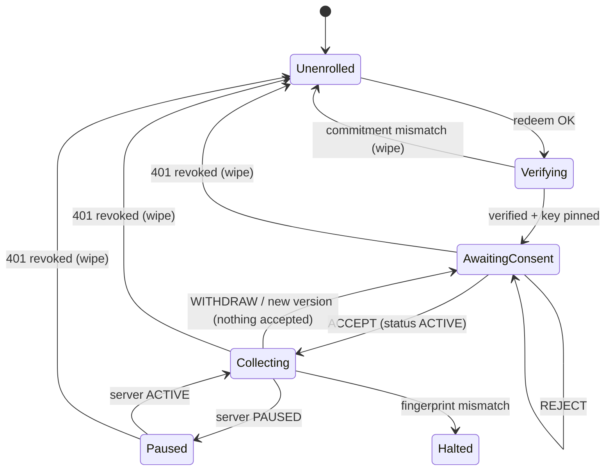

# Tarea 08 (Agent): Enrollment por Código/QR, Pantalla de Consentimiento y Ciclo de Vida del Worker

| Atributo | Detalle |
|:---|:---|
| **ID de Tarea** | `TASK-AGENT-08` |
| **Módulos Afectados** | `agent/src/enrollment.rs` (nuevo, reemplaza `ui/onboarding.rs`), `agent/src/credentials.rs` (nuevo), `agent/src/state.rs` (nuevo), `agent/src/api/` (extiende INT-01), `agent/src/background/`, `agent/src/ui/` (pantallas E1–E3, C1, I, M, W, R, H), `agent/src/config.rs`, `agent/src/ui/settings.rs` (se elimina) |
| **Dependencias** | [`TASK-CRYPTO-02`](../crypto-core/task-02-enrollment-manifest-commitment.md), [`TASK-INT-01`](../integration/task-01-api-contract-alignment.md), `telemetry-api` **TASK-12** |
| **Reemplaza** | Enrollment por JSON de [`TASK-AGENT-01`](task-01-agent-foundations-and-device-id.md) RF-2 y toggles por categoría de [`TASK-AGENT-06`](task-06-egui-transparency-ui-and-consent.md) RF-1/RF-2 |
| **Especificación funcional** | [`docs/worker-app-spec.md`](../../docs/worker-app-spec.md) |
| **Prioridad** | Crítica / P0 |


> ⚠️ **Parcialmente reemplazada (2026-09-30) por [`TASK-AGENT-09`](task-09-granular-consent-and-billing-pause.md).** El consentimiento de **paquete completo** (C1 con ACEPTAR/RECHAZAR todo y `PATCH /workers/:id/consent`, RF-AGENT-08-5) quedó obsoleto: C1 es **granular** (una casilla por categoría, desmarcada por defecto) y usa `PATCH /workers/me/consent`. También cambian los errores de enrollment (v2 por `details.reason`, `ENROLLMENT_LOCKED` con `Retry-After`), el QR (se acepta el `qr_payload` base64) y el refresh (single-flight). El resto (llave fijada, `RunMode`, retiro, revocación) sigue vigente.

---

## 1. Contexto y Arquitectura

Hoy el agent se "enrola" pegando un JSON con la llave del admin, nunca obtiene credenciales, tiene tres categorías activas por defecto y deja que el empleado prenda o apague categorías que nadie envía al servidor. Esta tarea implementa el modelo definitivo:

1. **Enrollment** canjeando un código de un solo uso (`POST /workers/enroll`) → credenciales + llave + manifiesto.
2. **Verificación del compromiso** del QR (o del código de verificación) → **llave fijada**.
3. **Consentimiento todo o nada** (`ACCEPT`/`REJECT`/`WITHDRAW`) con `manifest_hash`.
4. **Ciclo de vida** controlado por el servidor (`GET /workers/me`), reflejado en un `RunMode` que prende y apaga los collectors.



---

## 2. Requerimientos Funcionales y Reglas de Negocio

- **RF-AGENT-08-1 (Entrada del código):** aceptar el QR (JSON `EnrollmentQr` desde imagen/cámara o pegado) o un código manual + URL del servidor. Normalizar el código (mayúsculas, sin espacios, `I/L→1`, `O→0`).
- **RF-AGENT-08-2 (Canje):** `POST /workers/enroll` con `device_identifier` (`device.rs`) y `device_info { hostname, os, app_version }`. Mapear `INVALID_ENROLLMENT_TOKEN`, `DEVICE_ALREADY_ENROLLED` y 429 a los mensajes de la especificación.
- **RF-AGENT-08-3 (Verificación):** construir `EnrollmentManifest` desde la respuesta y calcular `manifest_commitment`.
  - Con QR: `verify_commitment` contra `qr.commitment`. Si no coincide → pantalla E3, **no persistir nada** e intentar `POST /auth/logout` con el refresh token recibido.
  - Manual: mostrar `safety_code` y exigir la confirmación explícita del empleado.
  - Verificar además que `public_key_fingerprint(admin_public_key) == admin_public_key_fingerprint`.
- **RF-AGENT-08-4 (Persistencia segura):** `credentials.rs` con el trait `CredentialStore` (implementaciones con `keyring`, servicio `TelemetryWorker`, y en memoria para tests). Guarda `access_token`, `refresh_token`, `pinned_admin_public_key`, `pinned_fingerprint`, `worker_id` y `accepted_manifest_hash`. **Quitar** tokens y llave de `WorkerConfig`/`config.json` y migrar valores existentes borrándolos del archivo.
- **RF-AGENT-08-5 (Consentimiento):** pantalla C1 según la especificación, con las descripciones del admin **literales**. `ACCEPT`/`REJECT` → `PATCH /workers/:id/consent { decision, consent_version, manifest_hash }`. Ante `409 CONSENT_VERSION_MISMATCH`: refrescar `/workers/me` y volver a mostrar.
- **RF-AGENT-08-6 (Retiro):** botón en la pestaña "Qué se recolecta" y en la bandeja. Confirmación → detener collectors, purgar buffer y cola **antes** del PATCH (DP-09). Si no hay red, el PATCH queda pendiente y se reintenta.
- **RF-AGENT-08-7 (Sincronización de estado):** tarea `lifecycle` que llama a `GET /workers/me` al iniciar, cada 5 min, al despertar de suspensión y después de cualquier 403 de ingesta. Deriva el `RunMode` (ver `architecture.md` §4.1). Si el fingerprint difiere del fijado → `Halted`. Si responde 401 o el refresh falla con 401 → borrar credenciales, llave y cola → `Unenrolled` con la pantalla R.
- **RF-AGENT-08-8 (Gating de collectors):** el scheduler arranca el collector de una categoría solo si `RunMode == Collecting(flags)`, la categoría está en `flags` **y** la categoría estaba en un manifiesto aceptado en este dispositivo (DP-07). Además aplica `role_type` y horario para location y screenshots.
- **RF-AGENT-08-9 (Nueva versión de consentimiento):** si `consent_version > accepted_consent_version`: notificar, mostrar C1 con el banner de cambios y mantener recolectando solo `consent_flags` (efectivas). Una reducción (`NARROWED`) se aplica sin pantalla y con notificación informativa.
- **RF-AGENT-08-10 (Eliminación de lo obsoleto):** borrar `ConsentSettings::default()` con `true`, `ui/settings.rs` (toggles), el parser del JSON antiguo y las variables de entorno `WORKER_ROLE` y `WORKER_ORGANIZATION`. Rol, horario y timezone vienen solo del servidor.

---

## 3. Arquitectura de Código y Pseudocódigo

```rust
// agent/src/state.rs
#[derive(Clone, Debug, PartialEq)]
pub enum RunMode {
    Unenrolled,
    AwaitingConsent { reason: AwaitingReason },
    Collecting(ConsentFlags),
    Paused,
    Halted(HaltReason),
}

pub fn derive_run_mode(me: &WorkerSelf, pinned_fp: &str, accepted_hash: Option<&str>) -> RunMode {
    if me.admin_public_key_fingerprint != pinned_fp {
        return RunMode::Halted(HaltReason::KeyFingerprintMismatch);
    }
    match me.status {
        WorkerStatus::PendingConsent => RunMode::AwaitingConsent { reason: AwaitingReason::NoConsent },
        WorkerStatus::Paused => RunMode::Paused,
        WorkerStatus::Active if me.consent_flags.any() && accepted_hash.is_some() => {
            RunMode::Collecting(me.consent_flags.clone())
        }
        WorkerStatus::Active => RunMode::AwaitingConsent { reason: AwaitingReason::NoConsent },
        WorkerStatus::Revoked | WorkerStatus::PendingEnrollment => RunMode::Unenrolled,
    }
}

// agent/src/enrollment.rs
pub async fn enroll(
    api: &ApiClient,
    input: EnrollmentInput,            // Qr(EnrollmentQr) | Manual { api_url, code }
    device: &DeviceInfo,
) -> Result<PendingEnrollment, EnrollmentError> {
    let resp = api.enroll(&input.code(), device).await?;
    let manifest = EnrollmentManifest::new(
        resp.admin_public_key.clone(), resp.consent_version,
        resp.consent_flags.clone(), resp.consent_descriptions.clone(),
    )?;
    let commitment = manifest_commitment(&manifest)?;
    if public_key_fingerprint(&resp.admin_public_key)? != resp.admin_public_key_fingerprint {
        return Err(EnrollmentError::Tampered);
    }
    let verification = match &input {
        EnrollmentInput::Qr(qr) if verify_commitment(&manifest, &qr.commitment) => Verification::Verified,
        EnrollmentInput::Qr(_) => return Err(EnrollmentError::Tampered),
        EnrollmentInput::Manual { .. } => Verification::NeedsSafetyCode(safety_code(&commitment)?),
    };
    Ok(PendingEnrollment { resp, manifest, commitment, verification })
}
// Nothing is persisted until verification is Verified (or the worker confirmed the safety code).
```

La UI egui nunca hace `await`: envía `UiCommand::{Enroll, ConfirmSafetyCode, Accept, Reject, Withdraw, Unlink}` por `mpsc` y lee el estado desde `watch::Receiver<AgentView>`.

---

## 4. Prácticas de Programación y Reglas de Seguridad

- SEC-07/SEC-08: la llave usada para cifrar sale **siempre** de `CredentialStore::pinned_admin_public_key`, nunca de una respuesta HTTP.
- DP-06..DP-09 tienen tests dedicados (§8).
- Sin secretos en `config.json` ni en logs; el código de enrollment no se loguea.
- `--headless` solo si existe un ícono en la bandeja (spec §5); si no, se niega a iniciar. ⚠️ **No implementado (auditoría 2026-09-30):** `agent/src/main.rs` arranca el motor en `--headless` sin bandeja; ver `implementation-status.md` §5.

---

## 5. Validaciones y Restricciones

- URL del servidor: `https://` en release; `http://` solo en debug.
- El código manual debe tener 12 caracteres Crockford después de normalizar, antes de llamar a la API.
- Timeout del canje: 15 s; sin reintentos automáticos (es de un solo uso).

---

## 6. Logs y Observabilidad

- `info`: `enrolled worker_id=… commitment=<8hex>`, `consent decision=ACCEPT version=2`, `run_mode Collecting(3 categories)`.
- `warn`: `enrollment commitment mismatch` (sin datos), `key fingerprint mismatch → halted`, `revoked → wiped local state`.
- La pestaña de diagnóstico muestra el `RunMode`, la última sincronización y el fingerprint truncado.

---

## 7. Criterios de Aceptación y Definición de Terminado (DoD)

1. [x] Escenarios 1–8 de [`docs/worker-app-spec.md` §7](../../docs/worker-app-spec.md) verificados contra la API con TASK-12.
2. [x] `config.json` ya no contiene tokens ni llaves; se migran las instalaciones existentes.
3. [x] No quedan toggles por categoría ni defaults en `true`.
4. [x] Los collectors se detienen ≤ 1 s después de `WITHDRAW`, `PAUSED` o `REVOKED`.
5. [x] `implementation-status.md` actualizado.

---

## 8. Especificación de Pruebas

- `test_enrollment_qr_commitment_mismatch_persists_nothing`.
- `test_enrollment_manual_requires_safety_code_confirmation`.
- `test_enrollment_fingerprint_mismatch_is_tampered`.
- `test_credentials_never_written_to_config_json`.
- `test_run_mode_derivation_table` (todas las combinaciones de estado, flags y fingerprint).
- `test_scheduler_starts_only_effective_and_locally_accepted_categories` (DP-07).
- `test_scheduler_stops_all_collectors_on_pause_withdraw_revoke` (DP-06).
- `test_withdraw_purges_queue_and_buffer_before_patch` (DP-09).
- `test_consent_version_mismatch_refetches_and_reshows`.
- `test_revoked_401_wipes_credentials_and_queue`.
- `test_default_consent_is_all_false` (DP-08).
