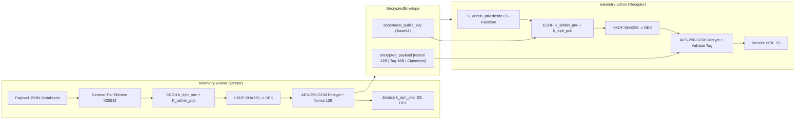

# Tarea 01 (Crypto Core): Primitivas Criptográficas Zero-Knowledge Compartidas

| Atributo | Detalle |
|:---|:---|
| **ID de Tarea** | `TASK-CRYPTO-01` |
| **Módulos Afectados** | [`telemetry-crypto-core/src/`](file:///Users/demian/Documents/GitHub/telemetry-apps/telemetry-crypto-core/src/) (`asymmetric.rs`, `symmetric.rs`, `kdf.rs`, `error.rs`, `lib.rs`) |
| **Dependencias** | Ninguna (Crate Base del Workspace) |
| **Prioridad** | Crítica / P0 |

---

## 1. Contexto y Arquitectura

El ecosistema de Telemetría opera bajo el principio estricto de **Conocimiento Cero (Zero-Knowledge)** y **Cifrado Extremo a Extremo (E2E)** basado en el estándar **HPKE (RFC 9180)**. El servidor Axum/PostgreSQL actúa exclusivamente como un relevador ciego que almacena payloads binarios (`BYTEA`) junto con claves públicas efímeras.

Para garantizar compatibilidad binaria estricta al 100% entre `telemetry-worker` (emisor) y `telemetry-admin` (receptor), toda la lógica de derivación, cifrado y descifrado debe residir en el crate compartido `telemetry-crypto-core`.



---

## 2. Requerimientos Funcionales y Reglas de Negocio

- **RF-CRYPTO-1 (Generación de Claves de Administrador):** Producir pares asimétricos X25519 (`K_admin_priv`, `K_admin_pub`) codificados en Base64 seguro para almacenamiento y transporte.
- **RF-CRYPTO-2 (Cifrado de Telemetría con Clave Efímera):** Por cada lote enviado, generar un par efímero X25519 (`k_eph_priv`, `K_eph_pub`), computar secreto compartido vía Diffie-Hellman, derivar la Data Encryption Key (DEK) usando HKDF-SHA256 con salt `"telemetry-v1"` e info `"aes256gcm"`, y cifrar con AES-256-GCM.
- **RF-CRYPTO-3 (Estructura del Payload Cifrado):** El `encrypted_payload` debe estructurarse binariamente como:
  `[ Nonce (12 bytes) | Auth Tag (16 bytes) | Ciphertext (N bytes) ]`.
- **RF-CRYPTO-4 (Descifrado Seguro):** Recibir `K_admin_priv`, `K_eph_pub` y el `encrypted_payload`, reconstruir el secreto compartido y descifrar el payload verificando autenticidad en tiempo constante.
- **RF-CRYPTO-5 (Limpieza de Memoria - Zeroize):** Garantizar que secretos compartidos, claves privadas intermedias y DEKs se borren de la memoria volátil inmediatamente después de su uso.

---

## 3. Arquitectura de Código y Pseudocódigo

### A. Estructuras de Error y Envelope ([`src/error.rs`](file:///Users/demian/Documents/GitHub/telemetry-apps/telemetry-crypto-core/src/error.rs), [`src/lib.rs`](file:///Users/demian/Documents/GitHub/telemetry-apps/telemetry-crypto-core/src/lib.rs))

```rust
use serde::{Deserialize, Serialize};
use thiserror::Error;

#[derive(Error, Debug)]
pub enum CryptoError {
    #[error("Base64 decoding failed: {0}")]
    Base64Error(#[from] base64::DecodeError),
    #[error("Key length invalid: expected {expected} bytes, got {got}")]
    InvalidKeyLength { expected: usize, got: usize },
    #[error("Payload too short: minimum required is 28 bytes (12B Nonce + 16B Tag)")]
    PayloadTooShort,
    #[error("HKDF key derivation failed")]
    KeyDerivationFailed,
    #[error("Decryption failed: corrupted data or invalid authentication tag")]
    AeadError,
    #[error("Serialization failed: {0}")]
    SerializationError(#[from] serde_json::Error),
}

#[derive(Clone, Debug, Serialize, Deserialize)]
pub struct EncryptedEnvelope {
    pub ephemeral_public_key: String,
    pub encrypted_payload: Vec<u8>,
}
```

### B. Módulo Asimétrico y Derivación ([`src/asymmetric.rs`](file:///Users/demian/Documents/GitHub/telemetry-apps/telemetry-crypto-core/src/asymmetric.rs), [`src/kdf.rs`](file:///Users/demian/Documents/GitHub/telemetry-apps/telemetry-crypto-core/src/kdf.rs))

```rust
use rand::rngs::OsRng;
use x25519_dalek::{EphemeralSecret, PublicKey, StaticSecret};
use base64::prelude::*;
use hkdf::Hkdf;
use sha2::Sha256;
use zeroize::{Zeroize, Zeroizing};
use crate::error::CryptoError;

pub const HKDF_SALT: &[u8] = b"telemetry-v1";
pub const HKDF_INFO: &[u8] = b"aes256gcm";

pub fn generate_admin_keypair() -> (String, String) {
    let secret = StaticSecret::random_from_rng(OsRng);
    let public = PublicKey::from(&secret);
    
    let priv_b64 = BASE64_STANDARD.encode(secret.to_bytes());
    let pub_b64 = BASE64_STANDARD.encode(public.as_bytes());
    (priv_b64, pub_b64)
}

pub fn derive_shared_key(shared_secret: &[u8; 32]) -> Result<Zeroizing<[u8; 32]>, CryptoError> {
    let hk = Hkdf::<Sha256>::new(Some(HKDF_SALT), shared_secret);
    let mut okm = Zeroizing::new([0u8; 32]);
    hk.expand(HKDF_INFO, okm.as_mut())
        .map_err(|_| CryptoError::KeyDerivationFailed)?;
    Ok(okm)
}
```

### C. Cifrado y Descifrado AEAD ([`src/symmetric.rs`](file:///Users/demian/Documents/GitHub/telemetry-apps/telemetry-crypto-core/src/symmetric.rs))

```rust
use aes_gcm::{
    aead::{Aead, KeyInit},
    Aes256Gcm, Nonce,
};
use rand::RngCore;
use zeroize::Zeroizing;
use crate::error::CryptoError;

pub fn encrypt_bytes(dek: &[u8; 32], plaintext: &[u8]) -> Result<Vec<u8>, CryptoError> {
    let cipher = Aes256Gcm::new_from_slice(dek).map_err(|_| CryptoError::AeadError)?;
    let mut nonce_bytes = [0u8; 12];
    rand::rngs::OsRng.fill_bytes(&mut nonce_bytes);
    let nonce = Nonce::from_slice(&nonce_bytes);

    let ciphertext_with_tag = cipher
        .encrypt(nonce, plaintext)
        .map_err(|_| CryptoError::AeadError)?;

    // Formato: [ Nonce (12B) | Tag (16B) | Ciphertext (NB) ]
    let tag = &ciphertext_with_tag[ciphertext_with_tag.len() - 16..];
    let ciphertext = &ciphertext_with_tag[..ciphertext_with_tag.len() - 16];

    let mut output = Vec::with_capacity(12 + 16 + ciphertext.len());
    output.extend_from_slice(&nonce_bytes);
    output.extend_from_slice(tag);
    output.extend_from_slice(ciphertext);
    Ok(output)
}

pub fn decrypt_bytes(dek: &[u8; 32], encrypted_payload: &[u8]) -> Result<Vec<u8>, CryptoError> {
    if encrypted_payload.len() < 28 {
        return Err(CryptoError::PayloadTooShort);
    }

    let nonce = Nonce::from_slice(&encrypted_payload[..12]);
    let tag = &encrypted_payload[12..28];
    let ciphertext = &encrypted_payload[28..];

    let mut ct_and_tag = Vec::with_capacity(ciphertext.len() + 16);
    ct_and_tag.extend_from_slice(ciphertext);
    ct_and_tag.extend_from_slice(tag);

    let cipher = Aes256Gcm::new_from_slice(dek).map_err(|_| CryptoError::AeadError)?;
    cipher.decrypt(nonce, ct_and_tag.as_ref()).map_err(|_| CryptoError::AeadError)
}
```

---

## 4. Prácticas de Programación y Reglas de Seguridad

- **Zeroize Estricto:** Toda variable que almacene material clave (`k_eph_priv`, `StaticSecret`, secreto compartido de ECDH, DEK derivado) debe usar `Zeroizing<T>` o implementar `Drop` con llamada a `.zeroize()`.
- **Aleatoriedad Criptográfica:** El generador de números aleatorios debe ser estrictamente `rand::rngs::OsRng`. Prohibido el uso de generadores deterministas o semillas fijas en producción.
- **Nonce No Repetible:** Generar un IV de 12 bytes fresco por cada cifrado individual.
- **Resistencia a Ataques de Oráculo:** Las fallas de autenticación (`AeadError`) jamás deben distinguir entre errores de integridad de tag y errores de decodificación de payload.

---

## 5. Validaciones y Restricciones

- Longitud de clave pública y privada X25519: exactamente 32 bytes decodificados de Base64.
- Longitud mínima de `encrypted_payload`: 28 bytes (12 bytes de Nonce + 16 bytes de Tag Poly1305/GCM).
- Rechazo inmediato de buffers malformados antes de invocar operaciones pesadas de cómputo.

---

## 6. Logs y Observabilidad

- `tracing::debug!` al derivar claves (registrando solo longitud de bytes y no el contenido sensible).
- Jamás emitir trazas con `K_admin_priv`, `k_eph_priv`, `SS` o `DEK`.
- En caso de error de descifrado, registrar `tracing::warn!("Decryption failure: authentication tag verification failed")`.

---

## 7. Criterios de Aceptación y Definición de Terminado (DoD)

1. [ ] Crate `telemetry-crypto-core` compila limpiamente sin dependencias circulares.
2. [ ] `generate_admin_keypair()` retorna claves Base64 válidas decodificables a 32 bytes.
3. [ ] `encrypt_telemetry_batch` cifra estructuras serializables y retorna `EncryptedEnvelope`.
4. [ ] `decrypt_telemetry_record` recupera el objeto tipado idéntico al original.
5. [ ] Intentos de manipulación de 1 solo bit en el ciphertext provocan `CryptoError::AeadError`.
6. [ ] Tests unitarios y de integración corren con `cargo test -p telemetry-crypto-core`.
7. [ ] Cero warnings con `cargo clippy -p telemetry-crypto-core -- -D warnings`.

---

## 8. Especificación de Pruebas

### Pruebas Unitarias
- `test_roundtrip_encryption_decryption`: Encriptar un struct de telemetría de prueba con la clave pública de admin y verificar que el descifrado produce exactamente el mismo struct.
- `test_tampered_ciphertext_fails`: Modificar un byte de los datos cifrados y asegurar que `decrypt_telemetry_record` retorna `CryptoError::AeadError`.
- `test_tampered_tag_fails`: Modificar un byte del tag de autenticación y asegurar rechazo.
- `test_payload_too_short`: Enviar payloads de 0 a 27 bytes y comprobar que devuelve `CryptoError::PayloadTooShort`.
- `test_zeroize_cleans_memory`: Inspeccionar que `Zeroizing` efectivamente sobreescribe la memoria en el descarte de las estructuras intermedias.
