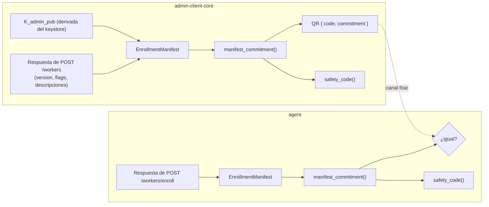

# Tarea 02 (Crypto Core): Manifiesto de Enrollment, Compromiso, Código de Verificación y Fingerprint

| Atributo | Detalle |
|:---|:---|
| **ID de Tarea** | `TASK-CRYPTO-02` |
| **Módulos Afectados** | `telemetry-crypto-core/src/enrollment.rs` (nuevo), `telemetry-crypto-core/src/lib.rs` |
| **Dependencias** | [`TASK-CRYPTO-01`](task-01-crypto-core-foundations.md) |
| **Bloquea a** | [`TASK-ADMIN-08`](../admin-client/task-08-enrollment-and-worker-lifecycle.md), [`TASK-AGENT-08`](../agent/task-08-enrollment-consent-and-lifecycle.md) |
| **Referencias** | [`.ai-context/security-model.md` §3](../../.ai-context/security-model.md), `telemetry-api/ENROLLMENT.md` §2.3 |
| **Prioridad** | Crítica / P0 |

---

## 1. Contexto y Arquitectura

TLS protege el enrollment contra terceros en la red, pero **no contra el propio servidor**. Si el servidor está comprometido, podría entregar su propia llave pública en lugar de `K_admin_pub` y leer toda la telemetría. La defensa es un **compromiso** que la app admin calcula localmente, viaja en el QR (canal físico) y la app worker verifica.

Para que el hash coincida bit a bit, la serialización canónica debe existir **una sola vez**, en este crate. Ninguna app puede reimplementarla (SEC-02).



---

## 2. Requerimientos Funcionales y Reglas de Negocio

- **RF-CRYPTO-02-1 (Tipos canónicos):** `ConsentFlags` (6 `bool`) y `ConsentDescriptions` (6 `Option<String>`) con los campos en este orden fijo: `system_activity`, `network_activity`, `productivity_basic`, `productivity_screenshots`, `file_activity`, `location`. Ambos derivan `Serialize`, `Deserialize`, `Clone`, `PartialEq`, `Eq`, `Debug`, `Default` (todo `false` / `None`).
- **RF-CRYPTO-02-2 (Manifiesto):**
  ```rust
  pub struct EnrollmentManifest {
      pub v: u8,                                  // ENROLLMENT_MANIFEST_VERSION = 1
      pub admin_public_key: String,               // base64 estándar, 32 bytes
      pub consent_version: i32,
      pub consent_flags: ConsentFlags,
      pub consent_descriptions: ConsentDescriptions,
  }
  ```
  `EnrollmentManifest::new(...)` valida la llave (`decode_public_key`) y **normaliza**: la descripción de toda flag en `false` pasa a `None`.
- **RF-CRYPTO-02-3 (Compromiso):** `manifest_commitment(&EnrollmentManifest) -> String` = hex en minúsculas de `SHA-256(b"telemetry-enroll-v1\0" ‖ serde_json::to_vec(manifest))`.
- **RF-CRYPTO-02-4 (Código de verificación):** `safety_code(commitment_hex) -> Result<String, CryptoError>` = `u64::from_be_bytes(commitment[0..8]) % 10^12`, con ceros a la izquierda y formato `"dddd dddd dddd"`.
- **RF-CRYPTO-02-5 (Fingerprint):** `public_key_fingerprint(pub_b64) -> Result<String, CryptoError>` = hex de `SHA-256(32 bytes crudos)`. Debe coincidir con el que calcula el servidor (`admins.public_key_fingerprint`).
- **RF-CRYPTO-02-6 (Comparación):** `verify_commitment(manifest, expected_hex) -> bool` en tiempo constante (`subtle::ConstantTimeEq` o comparación manual sin cortocircuito).
- **RF-CRYPTO-02-7 (QR):** `EnrollmentQr { t: "telemetry-enroll", v: 1, api_url, code, commitment }` con `to_json()` y `parse(json) -> Result<_, CryptoError>` (valida `t`, `v`, formato del código y 64 hex).
- **RF-CRYPTO-02-8 (Payloads compartidos):** mover las estructuras de texto plano de `agent/src/core/metrics.rs` a `telemetry-crypto-core/src/payloads.rs` según [`docs/telemetry-payloads.md`](../../docs/telemetry-payloads.md) (`PlaintextBatch<T>`, `Category` e items), para que agent y admin usen los mismos tipos. *Puede hacerse en INT-01 si se prefiere; no debe duplicarse.*

---

## 3. Arquitectura de Código y Pseudocódigo

```rust
// telemetry-crypto-core/src/enrollment.rs
use serde::{Deserialize, Serialize};
use sha2::{Digest, Sha256};
use crate::{asymmetric::decode_public_key, error::CryptoError};

pub const ENROLLMENT_MANIFEST_VERSION: u8 = 1;
const COMMITMENT_DOMAIN: &[u8] = b"telemetry-enroll-v1\0";

impl EnrollmentManifest {
    /// Builds a normalized manifest. Descriptions of disabled categories are dropped.
    pub fn new(
        admin_public_key: String,
        consent_version: i32,
        consent_flags: ConsentFlags,
        mut consent_descriptions: ConsentDescriptions,
    ) -> Result<Self, CryptoError> {
        decode_public_key(&admin_public_key)?;
        consent_descriptions.retain_enabled(&consent_flags);
        Ok(Self { v: ENROLLMENT_MANIFEST_VERSION, admin_public_key, consent_version, consent_flags, consent_descriptions })
    }
}

/// SHA-256 commitment over the canonical manifest. Enforces SEC-07.
pub fn manifest_commitment(manifest: &EnrollmentManifest) -> Result<String, CryptoError> {
    let json = serde_json::to_vec(manifest).map_err(|e| CryptoError::Serialization(e.to_string()))?;
    let mut h = Sha256::new();
    h.update(COMMITMENT_DOMAIN);
    h.update(&json);
    Ok(hex::encode(h.finalize()))
}

pub fn safety_code(commitment_hex: &str) -> Result<String, CryptoError> {
    let bytes = hex::decode(commitment_hex).map_err(|_| CryptoError::InvalidCommitment)?;
    let head: [u8; 8] = bytes.get(0..8).and_then(|s| s.try_into().ok()).ok_or(CryptoError::InvalidCommitment)?;
    let n = u64::from_be_bytes(head) % 1_000_000_000_000;
    let s = format!("{n:012}");
    Ok(format!("{} {} {}", &s[0..4], &s[4..8], &s[8..12]))
}
```

Agregar `hex` a `[workspace.dependencies]` y variantes `Serialization(String)`, `InvalidCommitment`, `InvalidQr` a `CryptoError`.

---

## 4. Prácticas de Programación y Reglas de Seguridad

- El orden de los campos **es parte del formato**. Un test de vector fijo (§8) protege contra reordenamientos accidentales.
- No usar `serde_json::Value` ni `HashMap` en el manifiesto (el orden de las claves no sería determinista).
- No agregar `#[serde(skip_serializing_if)]`: el manifiesto siempre serializa los 6 campos de cada objeto (`null` incluido).
- Sin I/O ni async. Sin `unwrap` fuera de tests.

---

## 5. Validaciones y Restricciones

- `admin_public_key`: 32 bytes decodificados; se rechaza en `new`.
- `consent_version >= 1`.
- `commitment`: exactamente 64 caracteres hex en minúsculas.
- Código del QR: `^[0-9A-HJKMNP-TV-Z]{4}-[0-9A-HJKMNP-TV-Z]{4}-[0-9A-HJKMNP-TV-Z]{4}$`.

---

## 6. Logs y Observabilidad

El crate no loguea. Los llamadores pueden loguear el compromiso truncado (primeros 8 hex), nunca el código de enrollment.

---

## 7. Criterios de Aceptación y Definición de Terminado (DoD)

1. [ ] `enrollment.rs` expone `EnrollmentManifest`, `ConsentFlags`, `ConsentDescriptions`, `manifest_commitment`, `verify_commitment`, `safety_code`, `public_key_fingerprint`, `EnrollmentQr`.
2. [ ] Test de vector fijo documentado en este archivo y en `security-model.md`.
3. [ ] Los payloads de texto plano viven en el crate (RF-8), o INT-01 los mueve.
4. [ ] `cargo test -p telemetry-crypto-core` y clippy sin advertencias.

---

## 8. Especificación de Pruebas

- `test_enrollment_commitment_fixed_vector`: manifiesto fijo (llave = base64 de `[9u8; 32]`, versión 1, flags system+network, descripciones `"a…"`) → hex esperado hardcodeado. Si cambia, es un **breaking change** del protocolo.
- `test_enrollment_commitment_changes_when_key_changes`.
- `test_enrollment_commitment_changes_when_any_flag_or_description_changes` (iterar las 6 categorías).
- `test_enrollment_disabled_category_description_is_ignored`: flag `false` con y sin descripción → mismo compromiso.
- `test_enrollment_safety_code_format_and_determinism`.
- `test_enrollment_fingerprint_matches_sha256_of_raw_key`.
- `test_enrollment_qr_roundtrip_and_rejects_bad_type_version_code`.
- `test_enrollment_invalid_public_key_rejected`.
