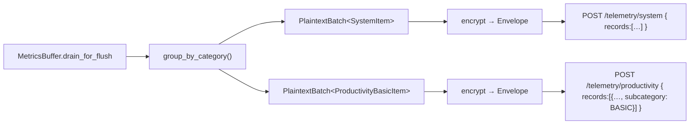

# Tarea 01 (Integración): Alineación con el Contrato Real de la API y Eliminación de Mocks Silenciosos

| Atributo | Detalle |
|:---|:---|
| **ID de Tarea** | `TASK-INT-01` |
| **Módulos Afectados** | `agent/src/io/transport.rs`, `agent/src/background/worker.rs`, `agent/src/io/encryption.rs`, `agent/src/core/metrics.rs`, `agent/src/main.rs`, `agent/src/config.rs`, `agent/src/ui/mod.rs`, `admin-client/src-tauri/src/client.rs`, `admin-client/src-tauri/src/commands.rs`, `admin-client/src/api/tauri-bridge.ts` |
| **Dependencias** | Ninguna (funciona contra la API actual) |
| **Referencias** | [`.ai-context/api-contract.md`](../../.ai-context/api-contract.md), [`.ai-context/implementation-status.md`](../../.ai-context/implementation-status.md), [`docs/telemetry-payloads.md`](../../docs/telemetry-payloads.md) |
| **Prioridad** | Crítica / P0 — sin esto ninguna app funciona contra el servidor real |

---

## 1. Contexto y Arquitectura

La auditoría del 2026-09-28 mostró que ambas apps compilan y pasan sus tests, pero **ninguna funciona contra `telemetry-api`**:

| Defecto | Dónde | Efecto |
|:---|:---|:---|
| Ingesta sin `records[]` ni `client_timestamp` | `transport.rs::send_envelope` | Toda ingesta falla (400/422). |
| Un sobre con categorías mezcladas, enviado a `batch[0].category()` | `background/worker.rs` | Datos de sistema terminan en `/productivity`; falta `subcategory`. |
| Refresh lee `body.access_token` (sin `data`) | `transport.rs`, `client.rs` | La rotación nunca funciona. |
| Login admin sin `role: "ADMIN"` y sin `data` | `client.rs::login` | El login real falla. |
| Fallback a "perfil offline" ante cualquier error | `tauri-bridge.ts::adminLogin` | El usuario cree que inició sesión. |
| `fetch` directo a la API desde el WebView | `tauri-bridge.ts` | Viola SEC-06. |
| `expect()` en rutas de producción | `main.rs`, `worker.rs`, `transport.rs`, `client.rs` | Con `panic = "abort"`, el agent muere en silencio. |
| Test que sobrescribe el `config.json` real | `ui/mod.rs` tests | Rompe el entorno del desarrollador. |

Esta tarea **no** implementa enrollment (AGENT-08 / ADMIN-08). Deja lo existente hablando el contrato correcto para poder probar end-to-end.



---

## 2. Requerimientos Funcionales y Reglas de Negocio

- **RF-INT-01-1 (Tipos de payload compartidos):** usar `PlaintextBatch<T>` y los items de [`docs/telemetry-payloads.md`](../../docs/telemetry-payloads.md) desde `telemetry-crypto-core::payloads` (si CRYPTO-02 no los movió, moverlos aquí). Eliminar el enum etiquetado `MetricPayload` como formato de cable.
- **RF-INT-01-2 (Agrupación):** el flush agrupa por categoría (y subcategoría) y produce **un sobre por grupo**, con `worker_id`, `window_start` y `window_end`.
- **RF-INT-01-3 (Cliente HTTP tipado del agent):** nuevo módulo `agent/src/api/` con DTOs de request/response según `api-contract.md`, desempaquetado de `{ data }` y parseo de `{ error }` a `AgentError::Api { status, code, reason }`. Métodos: `ingest(category, records)`, `refresh()`, `health()`.
- **RF-INT-01-4 (Semántica de errores de ingesta):** 5xx, 429 y errores de red → encolar. 401 → refresh y reintento una vez. **403 → descartar el sobre** (no reintentar datos no consentidos) y marcar "necesita sincronizar estado". 400/413 → descartar y loguear `error`.
- **RF-INT-01-5 (Cliente del admin):** `login` envía `role: "ADMIN"`; deserializa `SingleResponse<AuthResponse>`; guarda el refresh token en el keystore (`admin_refresh_token`); luego llama a `GET /admins/me` para obtener `organization`. `register` usa los tokens devueltos. Interceptor 401 → refresh → reintento; si el refresh falla con 401, se limpia la sesión y se emite el evento `session-expired`.
- **RF-INT-01-6 (Sin mocks silenciosos):** en `tauri-bridge.ts`, todo dato de demo (`mockWorkers`, perfiles offline, llave mock) queda detrás de `import.meta.env.VITE_DEMO_MODE === 'true'`. Sin demo mode, un error se muestra como error. Se elimina el `fetch` directo a la API.
- **RF-INT-01-7 (Sin panics):** reemplazar cada `expect`/`unwrap` de producción listado en `implementation-status.md` por manejo de errores. Si SQLite no abre, la cola funciona en memoria y el problema se muestra en diagnósticos. Si el runtime no inicia, error visible en la UI.
- **RF-INT-01-8 (Aislamiento de tests):** `WorkerConfig` recibe la ruta por parámetro (`load_or_init_at(path)`); los tests usan `tempfile`.
- **RF-INT-01-9 (Header de versión):** ambas apps envían `X-App-Version`.

---

## 3. Arquitectura de Código y Pseudocódigo

```rust
// agent/src/pipeline/flush.rs
pub fn build_envelopes(
    items: Vec<CollectedItem>,
    worker_id: Uuid,
    admin_pub_b64: &str,
) -> Vec<Result<OutgoingRecord, CryptoError>> {
    let mut groups: BTreeMap<Category, Vec<CollectedItem>> = BTreeMap::new();
    for it in items { groups.entry(it.category()).or_default().push(it); }

    groups.into_iter().map(|(category, items)| {
        let (start, end) = time_window(&items);
        let batch = PlaintextBatch::new(category, worker_id, start, end, items);
        let env = encrypt_telemetry_batch(&batch, admin_pub_b64)?;
        Ok(OutgoingRecord {
            category,
            ephemeral_public_key: env.ephemeral_public_key,
            encrypted_payload: env.encrypted_payload,
            client_timestamp: end,
        })
    }).collect()
}

// agent/src/api/mod.rs
#[derive(Serialize)]
struct IngestBody<'a> { records: Vec<IngestRecord<'a>> }

#[derive(Serialize)]
struct IngestRecord<'a> {
    ephemeral_public_key: &'a str,
    encrypted_payload: String,          // base64
    client_timestamp: DateTime<Utc>,
    #[serde(skip_serializing_if = "Option::is_none")]
    subcategory: Option<&'static str>,  // "BASIC" | "SCREENSHOT"
}

#[derive(Deserialize)]
struct Envelope<T> { data: T }
```

La tabla `offline_queue` agrega las columnas `client_timestamp` y `subcategory` (migración en `init_tables` con `ALTER TABLE ... ADD COLUMN` idempotente).

---

## 4. Prácticas de Programación y Reglas de Seguridad

- Hasta AGENT-08, el agent obtiene credenciales solo por configuración de desarrollo (`TELEMETRY_DEV_ACCESS_TOKEN`, **solo en builds debug**) para probar la ingesta. Nunca se usa el login de worker por email (vulnerable y a eliminar en API TASK-12).
- Los tokens del admin nunca cruzan la frontera IPC.
- Sin cambios al formato criptográfico.

---

## 5. Validaciones y Restricciones

- Máximo 100 registros por request y 10 MB por body; partir los lotes si se excede.
- `client_timestamp` en UTC, nunca en el futuro (> +5 min se recorta a `now`).
- Productivity BASIC y SCREENSHOT nunca comparten un request.

---

## 6. Logs y Observabilidad

- `info`: `ingest ok category=system records=1 batch_id=…`.
- `warn`: `ingest dropped: 403 reason=CONSENT_NOT_GRANTED category=…`.
- `warn`: `ingest queued: network error`.
- Nunca payloads, tokens ni títulos de ventana.

---

## 7. Criterios de Aceptación y Definición de Terminado (DoD)

1. [x] Con la API local y un worker con consentimiento (creado vía SQL en dev), el agent ingesta registros de `system` y `productivity` que aparecen en `GET /telemetry/*`.
2. [x] El admin inicia sesión contra la API real; con la API caída muestra error (sin demo mode).
3. [x] El admin descifra en `admin_decrypt_records` un registro real ingestado por el agent.
4. [x] Cero `expect`/`unwrap` fuera de tests en `agent` y `admin-client-core`.
5. [x] Los tests no tocan el directorio de configuración real.
6. [x] `implementation-status.md` actualizado.

---

## 8. Especificación de Pruebas

- `test_flush_groups_mixed_buffer_into_one_envelope_per_category`.
- `test_flush_productivity_basic_and_screenshot_separate_records`.
- `test_api_ingest_body_matches_contract` (serializar y comparar con el JSON de `api-contract.md`).
- `test_api_unwraps_data_envelope_and_parses_error_reason` (con `wiremock`).
- `test_transport_403_drops_envelope_not_queued`.
- `test_transport_401_refreshes_once_then_retries`.
- `test_admin_login_sends_role_admin_and_reads_data_envelope` (con `wiremock`).
- `test_config_load_uses_injected_path` (con `tempfile`).
